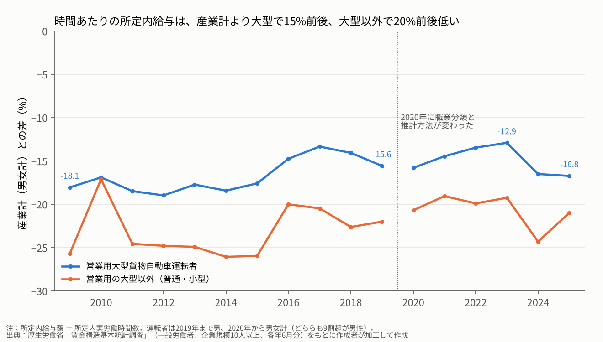
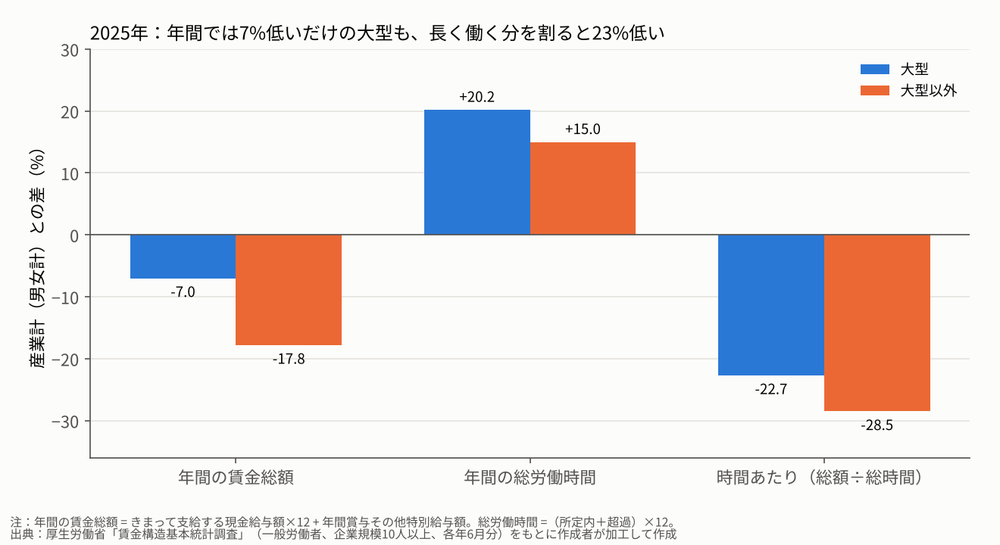
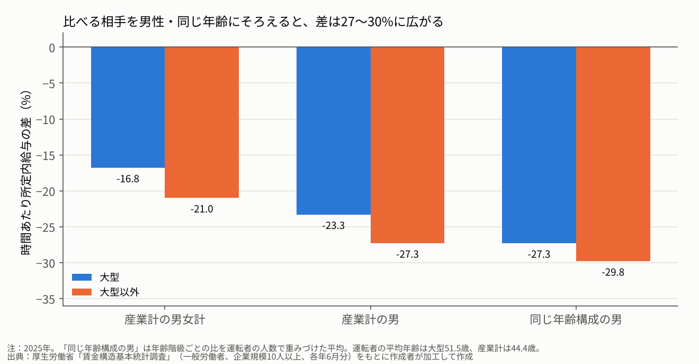
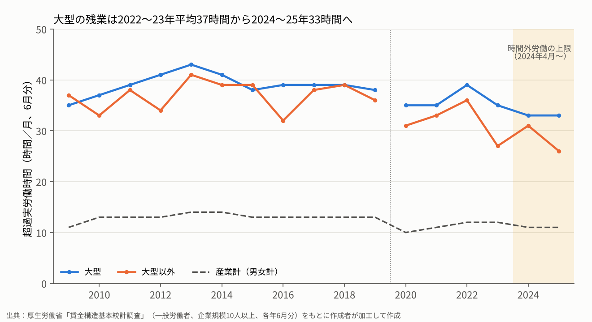

# F449 トラック運転手の賃金は、時間あたりで全産業とどれだけ差があり、縮まっているのか？ 大型で16.8%低く、2019年までに3.4ポイント縮んだが、2024年に広がり直した

## 結論（先に）

- 2025年の時間あたりの所定内給与（基本給などを所定の労働時間で割ったもの）は、産業計（男女計）と比べて、営業用大型貨物自動車運転者で16.8%（1,750円と2,102円）、大型以外で21.0%低い水準でした。
- 年間の賃金総額で比べると、大型の差は7.0%にとどまります。ただ、年間の総労働時間が産業計の1.20倍あるので、総額を総時間で割ると差は22.7%に広がります。
- 差は2009〜2011年の平均（−17.8%）から2017〜2019年の平均（−14.4%）までに3.4ポイント縮みました。2023年には−12.9%まで縮みましたが、2024〜2025年は−16.6%に戻っています。
- 戻った理由は、運転者の伸びが止まったことではありません。2023→2025年に運転者の時間あたり所定内給与は4.8%上がりましたが、産業計は9.6%上がりました。
- 比べる相手を「同じ年齢構成の男性」にそろえると、2025年の差は大型で27.3%、大型以外で29.8%です。男女計と比べた差より10ポイント以上大きくなります。

## 問い

物流の人手不足や「2024年問題」の記事では、トラック運転手は「全産業より賃金が低く、労働時間が長い」とよく書かれます。国土交通省の資料「トラックドライバーの労働条件」も、賃金構造基本統計調査をもとに、年間所得額は全産業平均より大型で約1割、中小型で約2割低く、年間労働時間は大型で約1.22倍、中小型で約1.16倍だと示しています。

長く働いて年間の額が少し低いなら、1時間あたりの差はもっと大きいはずです。この記事は、運送の仕事を数字で説明したい人、2024年問題のあとに何が変わったかを知りたい人に向けて、「時間あたりにすると差はどれだけか」「その差は縮まっているか」を確かめます。運賃や賃金をどうすべきかは扱いません。

## データ（出典）

- 厚生労働省「賃金構造基本統計調査」一般労働者、企業規模10人以上、2009〜2025年の17年分（各年6月分の給与と時間、前年の賞与）
  - 2009〜2019年：職種別第2表（職種・性、年齢階級別）。営業用大型貨物自動車運転者（男）、営業用普通・小型貨物自動車運転者（男）
  - 2020〜2025年：職種第1表（職種小分類×性）と第5表（職種小分類×年齢階級）。営業用大型貨物自動車運転者、営業用貨物自動車運転者（大型車を除く）
  - 比べる相手：各年の第1表（年齢階級別）の産業計、男女計と男
- 取得した Excel 40ファイル（約22MB）を data/raw に同梱しています。旧形式の .xls は gzip で圧縮して置いています。

## 事前の計画

計画は [PLAN.md](PLAN.md) に、集計の前に書きました（2026-11-16 12:50）。仮説と判定は次のとおりです。

| 仮説 | 外れの基準 | 結果 | 判定 |
|---|---|---|---|
| H1 時間あたり（総額÷総時間）の差は、年間の総額の差より大きい（大型、2025年） | 時間あたりの差の方が小さい | 総額 −7.0%、時間あたり −22.7% | 支持 |
| H2 時間あたり所定内の差は、旧分類か新分類の期間のどちらかで2ポイント以上縮んだ | どちらも2ポイント未満、または広がった | 旧分類の期間で3.4ポイント縮み、新分類の期間では1.5ポイント広がった | 支持（ただし最近は逆向き） |
| H3 同じ年齢の男性と比べると、男女計と比べたときより差が5ポイント以上大きい（大型、2025年） | 5ポイント未満 | −16.8% → −27.3%（10.5ポイント大きい） | 支持 |
| H4 2024年以降、運転者の超過実労働時間は2022〜2023年の平均より少ない（大型・大型以外） | どちらかが減っていない | 大型 37.0→33.0時間、大型以外 31.5→28.5時間 | 支持 |

## やったこと

1. 各年の表から、運転者と産業計の「計」と年齢階級別の行を取り出しました（src/02_build.py）。
2. 時間あたり所定内給与 = 所定内給与額 ÷ 所定内実労働時間数、年間の賃金総額 = きまって支給する現金給与額×12 + 年間賞与、年間の総労働時間 =（所定内＋超過）×12 を求め、運転者 ÷ 産業計 − 1 を差としました（src/03_analysis.py）。
3. 年齢をそろえた比較では、年齢階級ごとに「運転者 ÷ 産業計の男」を求め、運転者の人数で重みづけて平均しました。
4. 2020年に職業分類と推計方法が変わったので、伸びは2009〜2019年と2020〜2025年に分けて見ました。

## 分かったこと

### 図1 時間あたりの差は、大型で15%前後、大型以外で20%前後



- 大型の差は2009年の−18.1%から2019年の−15.6%へ、3年平均では3.4ポイント縮みました。2009〜2019年の傾きは1年あたり0.4ポイントです。
- 新しい分類の期間では、2023年の−12.9%がいちばん小さく、2024年は−16.5%、2025年は−16.8%でした。
- 大型以外は年ごとの振れが大きく（2010年の−17.1%など）、はっきり縮んだとは言えません。

### 図2 年間で比べると差は小さく見えるが、長く働く分を割ると広がる



- 2025年の年間の賃金総額の差は、大型で−7.0%、大型以外で−17.8%でした。国土交通省の資料の「約1割」「約2割」と近い水準です。
- 年間の総労働時間は産業計の1.20倍（大型）と1.15倍（大型以外）です。
- 総額を総時間で割ると、差は−22.7%（大型）と−28.5%（大型以外）になります。

### 図3 相手を男性・同じ年齢にそろえると、差はさらに広がる



- 運転者はほとんどが男性で、平均年齢も大型で51.5歳と、産業計の44.4歳より高い集団です。
- 産業計の男と比べると差は−23.3%（大型）、年齢構成もそろえると−27.3%でした。大型以外は−27.3%と−29.8%です。
- 「男女計と比べて15%前後」という見方は、比べる相手の違いで差を小さく見せている面があります。

### 図4 2024年の時間外労働の上限のあとの残業時間



- 大型の超過実労働時間（6月分）は、2022〜2023年の平均37.0時間から2024〜2025年の33.0時間に減りました。大型以外は31.5時間から28.5時間です。
- それでも産業計（2025年は11時間）の3倍前後あります。
- きまって支給する給与のうち所定内以外（主に残業代）の割合は、大型で20.8%、産業計で8.1%でした（2025年）。

## 問い直し（結果を見てから足した）

図1で2024年に差が広がり直したのを見て、「運転者の賃金の伸びが鈍ったのか、産業計が速く伸びたのか」を足して確かめました（src/03b_requestion.py、results/requestion_growth.csv）。

- 2020→2023年：大型の時間あたり所定内給与は6.3%、産業計は2.8%上がり、差は3.4ポイント縮みました。
- 2023→2025年：大型は4.8%、産業計は9.6%上がり、差は4.4ポイント広がりました。大型以外も7.3%と9.6%で、2.1ポイント広がっています。
- 運転者の賃金も上がっていますが、2024〜2025年の全体の賃上げの速さに追いついていない、というのがこのデータでの見え方です。

## 頑健性

縮み（正）・広がり（負）をポイントで示します（results/robustness.csv）。

| 確かめたこと | 大型 | 大型以外 | 結論は変わったか |
|---|---|---|---|
| 基本（所定内の時間あたり、男女計と比較）2009-11→2017-19 | +3.4 | +0.8 | — |
| 基本 2020-21→2024-25 | −1.5 | −2.8 | — |
| 相手を男にする 2009-11→2017-19 / 2020-21→2024-25 | +4.0 / −1.2 | +1.4 / −2.4 | 変わらない |
| 年間の総額÷総時間 2009-11→2017-19 / 2020-21→2024-25 | +2.3 / −0.7 | +2.1 / −2.9 | 変わらない |
| 年齢をそろえた男と比較 2009-11→2017-19 / 2020-21→2024-25 | +2.6 / −0.3 | +0.1 / −2.9 | 大型の縮みは小さくなるが向きは同じ |
| 2020年を除く（2021→2024-25） | −2.2 | −3.6 | 変わらない |
| 傾き 2009-2019 / 2020-2025（1年あたり） | +0.4 / −0.3 | +0.2 / −0.5 | 変わらない |
| 2019→2020年の段差 | −0.2 | +1.3 | 段差は小さい |

「2019年までは縮み、2020年以降は縮んでいない」という結論は、どの定義でも同じでした。年齢をそろえると、旧分類の期間の縮みは大型で2.6ポイントと小さめになります。

## 言えないこと

- 6月分の給与と時間なので、季節による違いや、月ごとに払われる手当の違いは分かりません。
- 2019年と2020年の間は職業分類と推計方法が違います。段差は小さく出ましたが、つなげた17年の伸びとしては読めません。
- 企業規模10人以上の事業所だけで、小さな事業所や個人で運ぶ人は入っていません。
- 差の理由（運賃、取引の慣行、規制、交渉力など）は、このデータからは分かりません。2024年の差の広がりと時間外労働の上限の関係も、因果としては言えません。
- 年齢をそろえた比較は年齢階級（5歳きざみ）で行っており、勤続年数や学歴の違いはそろえていません。

## 仕事で使うなら

- 職種の賃金を比べるときは、月額・年額だけでなく、労働時間で割った数字も並べると、長時間労働で埋めている差が見えます。
- 比べる相手（男女計か男か、年齢構成）を明記すると、差の大きさの議論がかみ合いやすくなります。
- 職種の差は全体の賃上げの速さでも動くので、「差が広がった」は両方の伸びを分けて読むのが安全です。

## 計画からの変更

- 仮説と手法は計画どおりです。
- 問い直し（2023→2025年の伸びの分解）を結果を見てから足しました。
- 「きまって支給のうち所定内以外の割合」を補足として足しました（判定には使っていません）。

## 再現のしかた

```sh
pip install -r requirements.txt
sh src/run_all.sh          # ネットにつながず data/raw から全部作る
# python3 src/01_fetch.py  # 元データを取り直すときだけ（ネットが必要）
```

| ファイル | 役割 |
|---|---|
| src/01_fetch.py | e-Stat から40ファイルを取得し data/raw に保存（run_all.sh からは呼ばない） |
| src/02_build.py | Excel から運転者と産業計の行を取り出し data/wage_long.csv を作る |
| src/03_analysis.py | 差・年齢をそろえた比較・仮説の判定・頑健性 → results/main.json、gap_by_year.csv、robustness.csv |
| src/03b_requestion.py | 問い直し → results/requestion.json、requestion_growth.csv |
| src/04_figures.py | 図4枚 → figures/ |

所要時間は約20秒（CPU 1つ）。乱数は使っていません。再実行の確かめは results/repro_check.txt にあります。

## 関連する記事
- F301「「物流2024年問題」で、トラックの運ぶ量と働く時間はどう変わったか？」：運ぶ量と労働時間を見た記事。本記事は、運転手の時間あたりの賃金の全産業との差を見た点が違います。

## レビューで直したこと

独立レビュー（2026-11-17）で、数字の照合・再実行・図を確かめ、次を直しました。直したあとに /tmp の新しいフォルダで流し直し、results と figures がすべて一致することを確かめています。

| # | 指摘 | 直し方 |
|---|---|---|
| 1 | 既存の看板記事との関係が README に書かれていなかった | 「関連する記事」に番号と違いを1文で書いた |

## 出典

- 厚生労働省「賃金構造基本統計調査」（政府統計の総合窓口 e-Stat）：https://www.e-stat.go.jp/stat-search/files?toukei=00450091&tstat=000001011429
- 国土交通省「トラックドライバーの労働条件」：https://www.mlit.go.jp/common/001186731.pdf

（いずれも厚生労働省「賃金構造基本統計調査」をもとに作成者が加工して作成）
