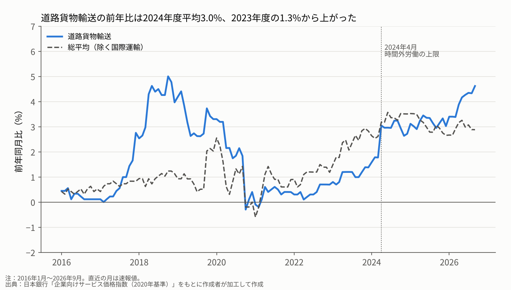
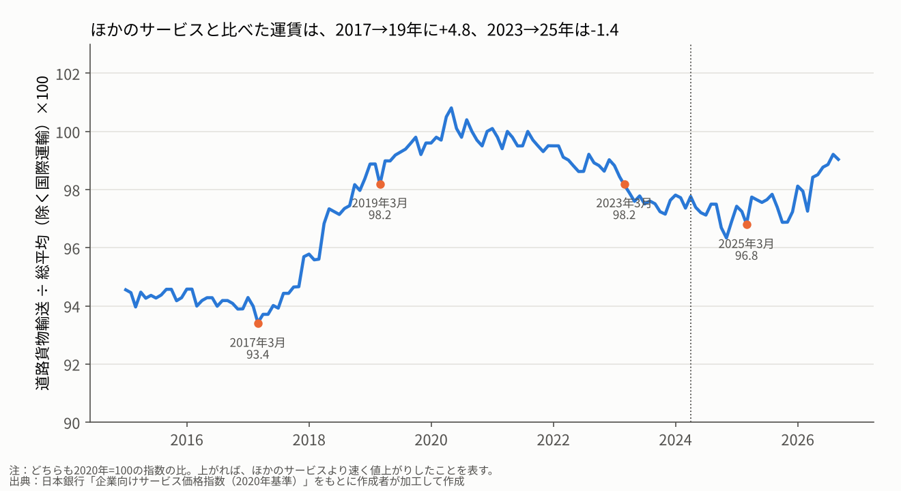
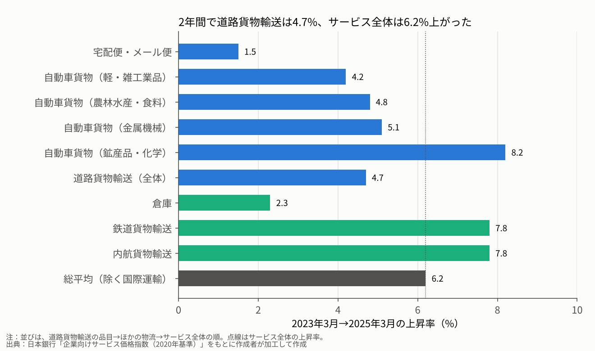
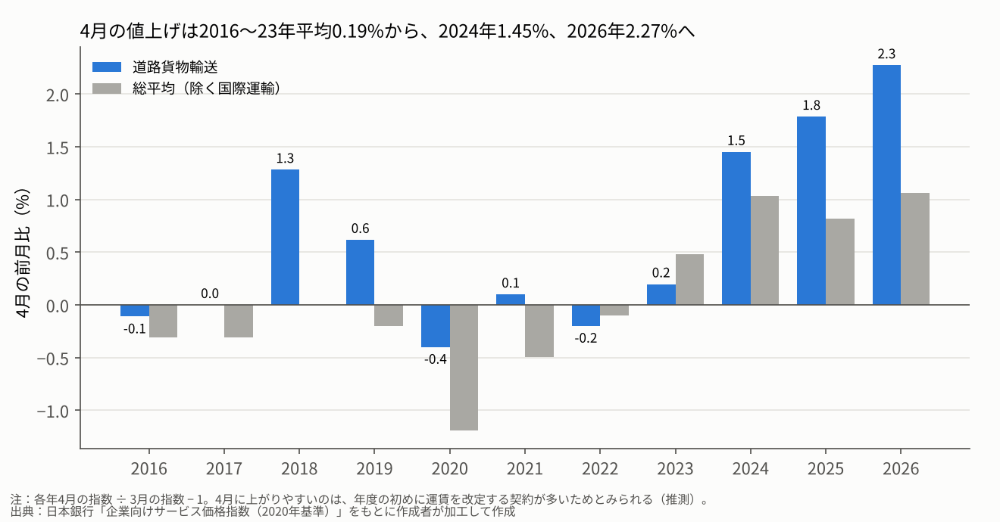

# F450 トラックの運賃は、2024年問題の前後で上がったのか？ 前年比は1.3%から3.0%へ上がったが、2年間の上昇4.7%はサービス全体の6.2%より小さかった

## 結論（先に）

- 企業どうしの取引の値段を測る日本銀行の企業向けサービス価格指数で、道路貨物輸送の前年比は、2023年度平均の1.3%から2024年度平均の3.0%、2025年度平均の3.3%へと上がりました。
- 4月の値上げがはっきり大きくなりました。4月の前月比は2016〜2023年の平均0.19%に対し、2024年は1.45%、2025年は1.79%、2026年は2.27%でした。
- ただし、2023年3月→2025年3月の2年間の上昇率は、道路貨物輸送が4.7%で、サービス全体（総平均、除く国際運輸）の6.2%より小さい値でした。ほかのサービスより速く上がったとは言えません。
- 前の人手不足の時期（2017年3月→2019年3月）は、道路貨物輸送が6.9%、サービス全体が1.7%で、ほかより大きく上がっていました。今回は様子が違います。
- 2025年度の後半から道路貨物輸送の前年比がサービス全体を上回り始め、2026年9月は4.6%（全体は2.9%）でした（速報値）。

## 問い

「2024年問題」は、2024年4月からトラック運転者の時間外労働に上限がついたことで、運べる量が減り、運賃が上がると言われてきた問題です。荷主として運賃の動きを知りたい人、物価の記事で「運賃の値上げ」を見たときに大きさを確かめたい人に向けて、運賃の値段が2024年4月の前後でどう動いたかを、ほかのサービスの値段や燃料の値段と並べて確かめます。運賃をどう決めるべきかは扱いません。

## データ（出典）

- 日本銀行「企業向けサービス価格指数（2020年基準）」月次（消費税を除く）：総平均、総平均（除く国際運輸）、道路貨物輸送、その中の宅配便・メール便と自動車貨物輸送4品目、鉄道貨物輸送、内航貨物輸送、倉庫
- 日本銀行「企業物価指数（2020年基準）」国内企業物価指数の軽油
- 道路貨物輸送は1985年1月から、自動車貨物輸送の品目は2015年1月から。分析は主に2015年1月〜2026年9月。直近の月は速報値です
- 日本銀行の時系列統計データ検索サイトの API から取った CSV 12本（約0.6MB）を data/raw に同梱しています

## 事前の計画

計画は [PLAN.md](PLAN.md) に、集計の前に書きました（2026-11-16 13:20）。

| 仮説 | 外れの基準 | 結果 | 判定 |
|---|---|---|---|
| H1 道路貨物輸送の前年比は、2024年度平均が2023年度平均より高い | 同じか低い | 1.32% → 2.97% | 支持 |
| H2 2023年3月→2025年3月の上昇率は、道路貨物輸送の方が総平均（除く国際運輸）より大きい | 同じか小さい | 4.7% と 6.2% | 外れ |
| H3 2024年4月の前月比は、2016〜2023年の4月の平均の2倍以上 | 2倍未満 | 1.45% と 0.19% | 支持 |
| H4 2024年度の前年比は、軽油との関係から予測される95%予測区間の上限を超える | 区間の中 | 実際2.97%、予測1.47%、上限4.35% | 外れ |

## やったこと

1. API の CSV を月次の表にしました（src/02_build.py）。
2. 前年同月比を年度（4月〜翌3月）で平均し、4月の前月比を年ごとに並べました（src/03_analysis.py）。
3. 2023年3月から2025年3月までの2年間の上昇率を、品目とほかの物流サービスで比べました。
4. 道路貨物輸送の前年比を、軽油の前年比（同じ月と6か月前）で説明する回帰を2016〜2023年の月次（96か月）で推計し、2024年度の実際と比べました。

## 分かったこと

### 図1 前年比は2024年4月にはっきり上がった



- 道路貨物輸送の前年比は、2024年3月の1.8%から4月の3.0%へ上がりました。年度平均では2023年度1.32%、2024年度2.97%、2025年度3.26%です。
- 同じ時期、サービス全体（総平均、除く国際運輸）も2023年度2.56%、2024年度3.41%と上がっていました。
- 2018年度（4.37%）の上がり方の方が大きく、今回の上昇はこの10年で最大ではありません。

### 図2 ほかのサービスと比べた運賃は、今回は上がっていない



- 道路貨物輸送をサービス全体で割った比（相対価格）は、2017年3月の93.4から2019年3月の98.2へ4.8上がりました。
- 2023年3月の98.2から2025年3月の96.8へは1.4下がりました。2024年問題の前後の2年で、運賃はサービス全体より遅く上がったことになります。
- その後は上がり、2026年9月は99.0でした。

### 図3 品目で見ても、全体を上回ったのは化学品などの輸送だけ



- 2023年3月→2025年3月の上昇率は、自動車貨物輸送（鉱産品・化学工業品）が8.2%、金属機械工業品が5.1%、農林水産・食料工業品が4.8%、軽・雑工業品が4.2%、宅配便・メール便が1.5%でした。
- 宅配便を除く4品目の単純平均は5.6%で、これもサービス全体の6.2%を下回りました。
- 鉄道貨物輸送と内航貨物輸送は7.8%で、トラックより大きく上がりました。

### 図4 4月の値上げは大きくなった



- 4月の前月比は、2016〜2023年の平均0.19%に対し、2024年1.45%、2025年1.79%、2026年2.27%でした。2018年（1.28%）を3年続けて上回っています。
- サービス全体の4月の前月比も、2016〜2023年の平均−0.27%から2024年は1.04%に上がっています。
- 4月に上がりやすいのは、年度の初めに運賃を改定する契約が多いためとみられます（推測）。

## 問い直し（結果を見てから足した）

H2 が外れたのを見て、「前の人手不足の時期と比べると、今回の上がり方はどうか」を足しました（src/03b_requestion.py）。

- 2017年3月→2019年3月：道路貨物輸送 +6.9%、サービス全体 +1.7%。相対価格は +4.8。
- 2023年3月→2025年3月：道路貨物輸送 +4.7%、サービス全体 +6.2%。相対価格は −1.4。
- 前回は「運賃だけが上がった」、今回は「ほかの値段と一緒に上がった」という違いが見えます。2026年に入ってからは運賃の方が速く上がっています（2026年9月の前年比 4.6% と 2.9%）。

## 頑健性

| 確かめたこと | 値 | 結論は変わったか |
|---|---|---|
| 基本：2023年3月→2025年3月、道路貨物輸送 − 総平均（除く国際運輸） | −1.5ポイント | — |
| 相手を総平均（含む国際運輸）にする | −1.4ポイント | 変わらない |
| 期間を2023年3月→2026年3月（3年）にする | −1.0ポイント | 変わらない（差は小さくなる） |
| 宅配便を除く自動車貨物輸送4品目の単純平均 | −0.6ポイント | 変わらない（差は小さくなる） |
| 2024年問題の前の2年（2021年3月→2023年3月） | −1.3ポイント | 前から全体より遅かった |
| 軽油との回帰を2016〜2019年で推計 | 実際 − 予測の上限 = −1.58ポイント | 変わらない（区間の中） |
| 軽油との回帰を2016〜2023年で推計 | −1.38ポイント | — |

軽油との回帰は説明力が低く（決定係数0.08、2016〜2019年で推計すると0.51）、予測区間が広いため、H4 の「外れ」は「燃料では説明できない上昇があったとまでは言えない」という意味です。

## 言えないこと

- 指数は「同じ内容の運送の値段」の動きで、運送会社の売上や運転者の賃金そのものではありません。
- 2024年4月の上昇が時間外労働の上限によるものかは、因果としては言えません。同じ時期に人件費や物価全体も上がっています。
- 直近の月は速報値で、改訂されることがあります。
- 運送の契約は品目・距離・荷主によって違い、指数はその平均の動きしか表しません。
- 4月に上がりやすい理由（年度の初めの改定）は推測で、データでは確かめていません。

## 仕事で使うなら

- 運賃の値上げの大きさを話すときは、前年比だけでなく、サービス全体の値段と並べた相対価格も一緒に見ると、「運賃だけが上がったのか」が分かります。
- 4月に段差が出やすいので、年度の途中の比較では4月をまたぐかどうかに気をつけると読み違いが減ります。

## 計画からの変更

- 仮説と手法は計画どおりです。
- 問い直し（前の人手不足の時期との比較、相対価格）を結果を見てから足しました。
- 2026年9月の前年比を補足として足しました（判定には使っていません）。

## 再現のしかた

```sh
pip install -r requirements.txt
sh src/run_all.sh          # ネットにつながず data/raw から全部作る
# python3 src/01_fetch.py  # 元データを取り直すときだけ（ネットが必要）
```

| ファイル | 役割 |
|---|---|
| src/01_fetch.py | 日銀の API から12系列を取得し data/raw に保存（run_all.sh からは呼ばない） |
| src/02_build.py | 月次の表 data/monthly.csv を作る |
| src/03_analysis.py | 年度の前年比、4月の前月比、品目別の上昇、軽油との回帰、仮説の判定、頑健性 |
| src/03b_requestion.py | 問い直し（相対価格、前回の時期との比較） |
| src/04_figures.py | 図4枚 |

所要時間は約4秒（CPU 1つ）。乱数は使っていません。再実行の確かめは results/repro_check.txt にあります。

## 関連する記事
- F301「「物流2024年問題」で、トラックの運ぶ量と働く時間はどう変わったか？」：運ぶ量と労働時間を見た記事。本記事は、企業向けサービス価格指数で運賃の動きを見た点が違います。

## レビューで直したこと

独立レビュー（2026-11-17）で、数字の照合・再実行・図を確かめ、次を直しました。直したあとに /tmp の新しいフォルダで流し直し、results と figures がすべて一致することを確かめています。

| # | 指摘 | 直し方 |
|---|---|---|
| 1 | 既存の看板記事との関係が README に書かれていなかった | 「関連する記事」に番号と違いを1文で書いた |

## 出典

- 日本銀行「企業向けサービス価格指数」「企業物価指数」（時系列統計データ検索サイト）：https://www.stat-search.boj.or.jp/
- 日本銀行「企業向けサービス価格指数」の公表ページ：https://www.boj.or.jp/statistics/pi/cspi_release/index.htm

（いずれも日本銀行「企業向けサービス価格指数」「企業物価指数」をもとに作成者が加工して作成）
