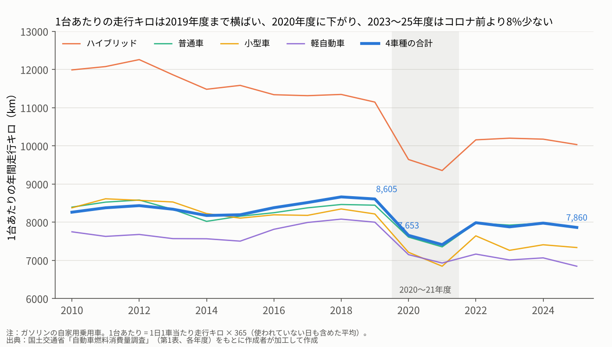
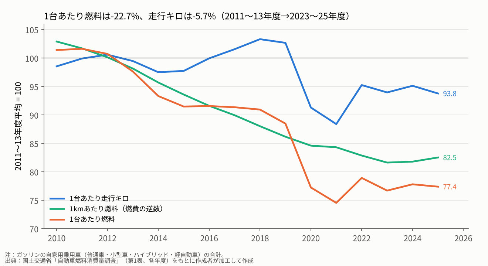
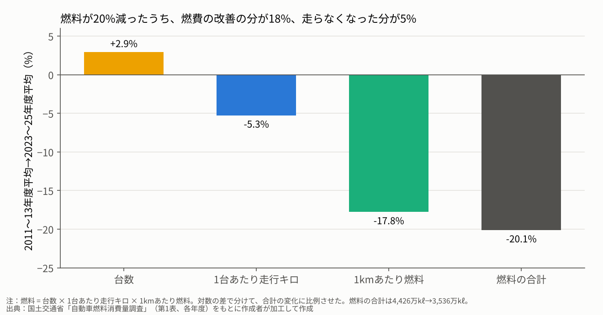
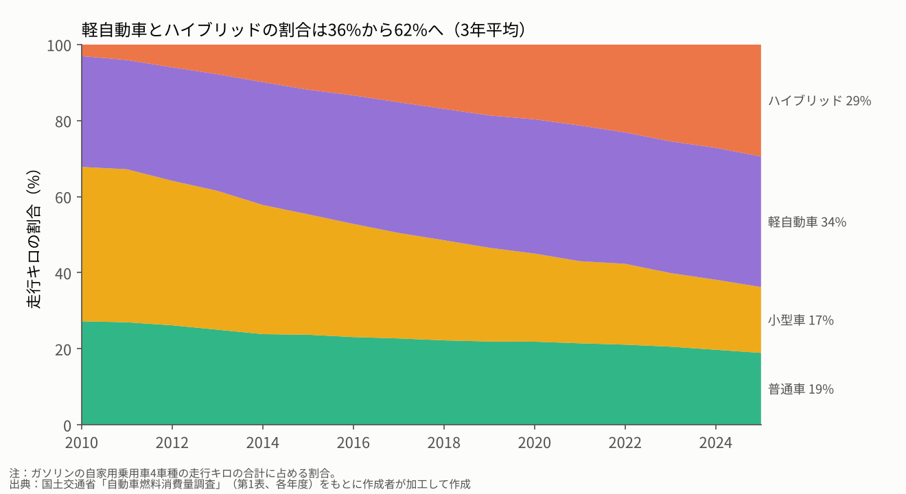

# F451 自家用車の1台あたりの走行距離と燃料は、どれだけ減ったのか？ 走行距離は5.7%減、燃料は22.7%減。燃料の減りの多くは燃費の改善（11.0→13.4km/ℓ）だった

## 結論（先に）

- ガソリンの自家用乗用車（普通車・小型車・ハイブリッド・軽自動車）の1台あたりの年間走行キロは、2011〜13年度平均の8,381kmから2023〜25年度平均の7,902kmへ、5.7%減りました。
- 1台あたりの年間の燃料は765ℓから592ℓへ、22.7%減りました。1kmあたりの燃料が18.0%減った（燃費が11.0km/ℓから13.4km/ℓに良くなった）ためです。
- 燃料の合計（4,426万kℓ→3,536万kℓ、−20.1%）を分けると、1kmあたり燃料の分が−17.8%、1台あたり走行キロの分が−5.3%、台数の分が+2.9%でした。
- 1台あたり走行キロは2019年度まではむしろ増えていて、2020年度に大きく下がり、そのあと戻りきっていません。2023〜25年度はコロナ前（2017〜19年度）より8.0%少ない水準です。
- 走行キロに占める軽自動車とハイブリッドの割合は、35.7%から61.9%へ増えました。燃費の改善のうち約44%は、この車種の入れ替わりで説明できます。

## 問い

ガソリンの販売量が減っていることはよく知られています。では、それは「1台あたり走らなくなった」からなのか、「燃費が良くなった」からなのか、「軽自動車やハイブリッドに乗り換えた」からなのか。燃料を売る仕事や車の関連の仕事をしている人、ガソリンの需要の記事を読む人に向けて、国の調査で分けて確かめます。

## データ（出典）

- 国土交通省「自動車燃料消費量調査」年度の第1表（燃料別・車種別 総括表）、2010〜2025年度の16年分
  - 燃料消費量、走行キロ、走行1kmあたり燃料消費量、1日1車当たり走行キロ（= 走行キロ ÷ 実在延日車。使われていない日も含めた1台1日の平均）
  - 中心は「ガソリン・自家用・旅客」の普通車・小型車・乗用車（ハイブリッド）・軽自動車
- 1台あたりの年間走行キロ = 1日1車当たり走行キロ × 365。台数（延べの平均）= 走行キロ ÷（1日1車当たり走行キロ × 365）
- 2010年度は東日本大震災の影響で2011年3月の北海道・東北の数字が入っていないため、表の括弧内の参考値（含む値）を使い、比べる基準は2011〜13年度平均にしました
- 取得した Excel 16ファイル（約0.5MB）を data/raw に同梱しています

## 事前の計画

計画は [PLAN.md](PLAN.md) に、集計の前に書きました（2026-11-16 13:55）。

| 仮説 | 外れの基準 | 結果 | 判定 |
|---|---|---|---|
| H1 1台あたり年間走行キロは5%以上減った | 減りが5%未満 | −5.7% | 支持（ただしコロナ前までは増えていた） |
| H2 1台あたり燃料の減り方は、走行キロの減り方より大きい | 同じか小さい | −22.7% と −5.7% | 支持 |
| H3 燃料の合計の変化でいちばん大きいのは1kmあたり燃料 | ほかの要素の方が大きい | −17.8%（走行キロ −5.3%、台数 +2.9%） | 支持 |
| H4 軽自動車＋ハイブリッドの走行キロの割合が10ポイント以上増えた | 10ポイント未満 | 35.7% → 61.9% | 支持 |

## やったこと

1. 各年度の第1表から、燃料・業態・車種ごとの行を取り出しました（src/02_build.py）。
2. ガソリンの自家用乗用車4車種を合計し、1台あたり走行キロ・1台あたり燃料・1kmあたり燃料を求めました（src/03_analysis.py）。
3. 燃料の合計の変化を、対数の差で台数・1台あたり走行キロ・1kmあたり燃料の3つに分けました。
4. 1kmあたり燃料の変化を、車種の構成の変化と、車種の中の改善に分けました（シフトシェア）。

## 分かったこと

### 図1 走行キロはコロナの年に下がって、戻っていない



- 4車種の合計の1台あたり年間走行キロは、2019年度に8,605km、2020年度に7,653km、2025年度に7,860kmでした。
- 2011〜2019年度はほぼ横ばいか少し増えていて、減ったのは2020年度からです。
- ハイブリッドは1台あたりの走行キロが長い車種（2023〜25年度平均10,134km）ですが、ほかの車種と同じように2020年度に下がりました。

### 図2 1台あたりの燃料は、走行キロよりずっと大きく減った



- 2011〜13年度平均を100とすると、2025年度は1台あたり走行キロが93.8、1kmあたり燃料が82.5、1台あたり燃料が77.4でした。
- 燃費に直すと、11.0km/ℓから13.4km/ℓへ良くなりました。
- 1kmあたり燃料は、2011〜2025年度の傾きで1年あたり1.67%ずつ減っています。

### 図3 燃料が減ったうち、燃費の改善の分が大きい



- 燃料の合計は20.1%減りました。分けると、1kmあたり燃料が−17.8%、1台あたり走行キロが−5.3%、台数が+2.9%です。
- 台数（延べの平均）は5,784万台から5,976万台へ増えていて、燃料を増やす向きに働いています。

### 図4 走る車の中身が、軽自動車とハイブリッドに入れ替わった



- 走行キロの割合は、ハイブリッドが6.0%から27.4%、軽自動車が29.7%から34.5%へ増え、小型車が38.2%から18.4%へ減りました（3年平均どうし）。
- 1kmあたり燃料の減り（0.0913→0.0749ℓ/km）のうち、約44%が車種の構成の変化、約56%が同じ車種の中の改善でした。
- 車種の中では、軽自動車（0.0768→0.0659ℓ/km）や普通車（0.1191→0.1036ℓ/km）の改善が大きく、ハイブリッドの中の改善は小さめでした（0.0625→0.0611ℓ/km）。

## 問い直し（結果を見てから足した）

図1で2020年度の段差が目立ったので、「1台あたり走行キロはコロナ前に戻ったのか」を車種ごとに足しました（src/03b_requestion.py）。

| 車種 | 2017〜19年度平均 | 2020〜21年度平均 | 2023〜25年度平均 | コロナ前との差 |
|---|---|---|---|---|
| 4車種の合計 | 8,592km | 7,531km | 7,902km | −8.0% |
| 普通車 | 8,425km | 7,479km | 7,913km | −6.1% |
| 小型車 | 8,244km | 7,026km | 7,333km | −11.1% |
| ハイブリッド | 11,266km | 9,496km | 10,134km | −10.1% |
| 軽自動車 | 8,022km | 7,037km | 6,972km | −13.1% |

- どの車種も戻りきっていません。軽自動車は2020〜21年度よりさらに少なくなっています。
- 合計の減り（−8.0%）が車種ごとの減り（−6〜−13%）より小さいのは、よく走るハイブリッドの割合が増えたためです。

## 頑健性

| 確かめたこと | 1台あたり走行キロ | 1台あたり燃料 | 1kmあたり燃料 | 台数 |
|---|---|---|---|---|
| 基本：2011〜13年度平均→2023〜25年度平均 | −5.7% | −22.7% | −18.0% | +3.3% |
| 基準を2011年度の1年に（→2025年度） | −6.2% | −23.8% | −18.9% | +5.2% |
| 基準を2010年度（参考値）に（→2025年度） | −4.8% | −23.7% | −19.8% | +4.9% |
| 終わりをコロナ前の2017〜19年度平均に | +2.5% | −9.7% | −11.9% | +4.3% |
| 軽油の自家用乗用車（普通・小型）を含める | −5.4% | −22.6% | −18.2% | +5.0% |
| 年ごとの傾き（2011〜2025年度、%/年） | −0.58 | −2.26 | −1.67 | — |

「燃料の減りは燃費の改善が中心」はどの確かめでも同じでした。一方、走行キロの減りは2020年度からのもので、コロナ前までで区切ると走行キロは2.5%増えています。基準を2010年度にすると減りは4.8%で、H1 の5%の基準を下回ります。

## 言えないこと

- 標本調査で、車種ごとの値は年ごとに振れます。
- 1台あたりは「実在延日車」で割った平均で、ほとんど使われない車も分母に入ります。
- 走らなくなった理由（在宅勤務、高齢化、ガソリンの値段など）は、このデータからは分かりません。
- 電気自動車は燃料の統計に入りません。ガソリンの減りの一部が電気自動車への乗り換えによるものかは、この表では分かりません。
- ハイブリッドは2010年度から別の行になっていますが、それ以前の比較はできません。

## 仕事で使うなら

- 燃料の需要の変化を見るときは、「台数」「1台あたり走行キロ」「1kmあたり燃料」に分けると、どこが動いたかが分かります。
- 車種の構成が変わる時期は、合計の1台あたりの値と、車種ごとの値が違う動きをするので、両方を並べると読み違いが減ります。

## 計画からの変更

- 仮説と手法は計画どおりです。
- 問い直し（コロナ前との比較を車種ごとに）を結果を見てから足しました。

## 再現のしかた

```sh
pip install -r requirements.txt
sh src/run_all.sh          # ネットにつながず data/raw から全部作る
# python3 src/01_fetch.py  # 元データを取り直すときだけ（ネットが必要）
```

| ファイル | 役割 |
|---|---|
| src/01_fetch.py | e-Stat から第1表16ファイルを取得（run_all.sh からは呼ばない） |
| src/02_build.py | 第1表を縦長の表 data/table1_long.csv にする |
| src/03_analysis.py | 1台あたりの値、分解、シフトシェア、仮説の判定、頑健性 |
| src/03b_requestion.py | 問い直し（コロナ前との比較） |
| src/04_figures.py | 図4枚 |

所要時間は約3秒（CPU 1つ）。乱数は使っていません。再実行の確かめは results/repro_check.txt にあります。

## レビューで直したこと

独立レビュー（2026-11-17）で数字の照合・再実行・図を確かめ、直すところはなかった。

## 出典

- 国土交通省「自動車燃料消費量調査」（政府統計の総合窓口 e-Stat）：https://www.e-stat.go.jp/stat-search/files?toukei=00600370&tstat=000001051698

（いずれも国土交通省「自動車燃料消費量調査」をもとに作成者が加工して作成）
