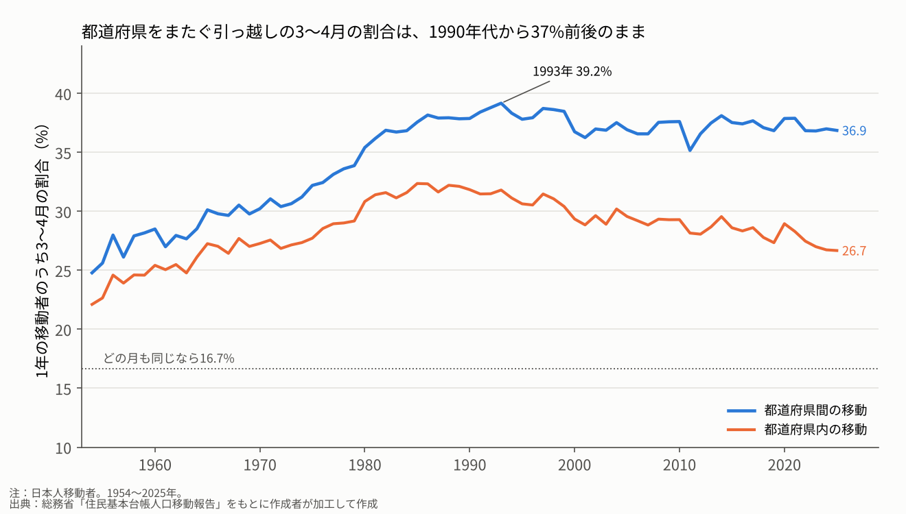
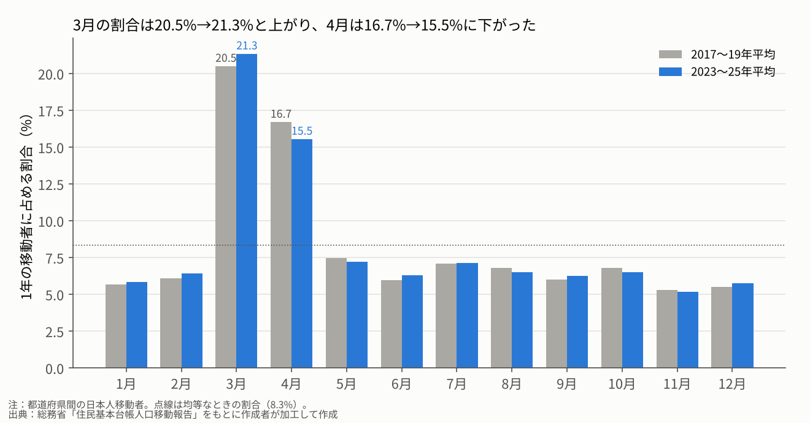
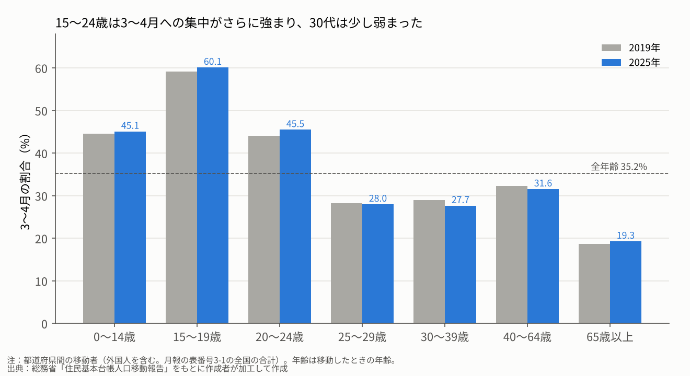
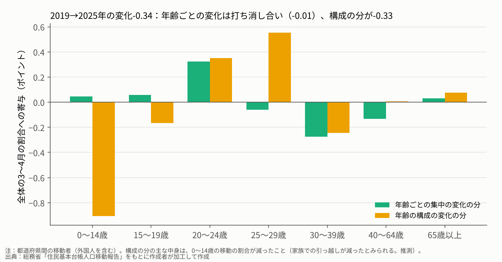

# F452 引っ越しの3〜4月への集中は、弱まっているのか？ 都道府県をまたぐ移動の3〜4月の割合は37.2%→36.9%でほぼ動かず、3月のピークは2.84倍→2.99倍に強まった

## 結論（先に）

- 都道府県をまたぐ引っ越し（日本人）のうち3〜4月の割合は、2017〜19年平均の37.2%に対し、2023〜25年平均は36.9%でした。下がりは0.3ポイントで、集中は弱まったとは言えません。
- 3月だけで見ると、割合は20.5%から21.3%へ上がり、3月の移動者はほかの11か月の平均の2.84倍から2.99倍になりました。4月は16.7%から15.5%に下がっています。
- 長い目で見ると、3〜4月の割合は1960年代の29.0%から1980年代の37.2%へ上がり、1993年の39.2%を最高に、そのあとは37%前後で動いていません。
- 年齢で見ると、15〜24歳の3〜4月の割合は2019年の47.3%から2025年の48.4%へ上がり、30〜39歳は29.0%から27.7%へ下がりました。全体ではこの2つが打ち消し合っています。
- 同じ県の中の引っ越しでは、3〜4月の割合が27.9%から26.8%へ1.1ポイント下がり、少し弱まっています。

## 問い

引っ越しは3〜4月に集中し、この時期は業者が混み、料金も高くなりがちです。国土交通省は2021年1月の発表などで、3〜4月に引っ越しが集中し、特に3月は通常の月の約2倍になるとして、時期を分散させるよう協力を呼びかけてきました。引っ越しの混み方を気にする人や、引っ越し・物流の仕事で人手の配分を考える人に向けて、住民票の移動の統計で「集中は弱まっているのか」「どの年齢で集中しているのか」を確かめます。

## データ（出典）

- 総務省「住民基本台帳人口移動報告」
  - 長期時系列表 第1表：月別の都道府県間・都道府県内の移動者数（日本人、1954〜2025年）
  - 月報 表番号3-1：年齢（5歳階級）別の他都道府県からの転入者数。全国の合計は都道府県間の移動者数と同じ。2019・2023・2024・2025年の各月（外国人を含む移動者、48ファイル）
- 2020〜2022年はコロナの影響があるので、比べる中心は2017〜19年と2023〜25年にしました
- 取得した Excel 49ファイル（約3MB）を data/raw に同梱しています

## 事前の計画

計画は [PLAN.md](PLAN.md) に、集計の前に書きました（2026-11-16 14:40）。

| 仮説 | 外れの基準 | 結果 | 判定 |
|---|---|---|---|
| H1 都道府県間の3〜4月の割合は、2023〜25年平均が2017〜19年平均より1ポイント以上低い | 下がりが1ポイント未満 | 37.21% → 36.89%（−0.32） | 外れ |
| H2 長い目では集中は強まった（2015〜19年平均 > 1980〜89年平均） | 同じか低い | 37.31% と 37.15% | 支持（ただし差は0.16ポイントで、1980年代からはほぼ横ばい） |
| H3 20〜24歳の3〜4月の割合は、全年齢より10ポイント以上高い（2025年） | 10ポイント未満 | 45.50% と 35.24%（+10.26） | 支持 |
| H4 2019→2025年の下がり方は、15〜24歳より25〜64歳の方が大きい | 15〜24歳の方が同じか大きく下がった | 15〜24歳 +1.13、25〜64歳 −0.83 | 支持 |

## やったこと

1. 長期時系列表と月報から、月ごとの移動者数を縦長の表にしました（src/02_build.py）。
2. 年ごとに、3〜4月の割合、3月のピークの倍率（3月 ÷ ほかの11か月の平均）、12か月の割合のばらつき（ハーフィンダール指数）を求めました（src/03_analysis.py）。
3. 年齢階級ごとに、3〜4月の割合を2019・2023・2024・2025年で比べました。

## 分かったこと

### 図1 3〜4月の割合は、1990年代から37%前後のまま



- 都道府県間の3〜4月の割合は、1960年代の平均29.0%から1980年代の平均37.2%に上がり、1993年に39.2%で最も高くなりました。
- そのあとは36〜38%の間で動いていて、2025年は36.9%でした。2020年と2021年は37.9%と、むしろ少し高くなっています。
- 県の中の引っ越しは1980年代の32%前後から下がり、2025年は26.7%です。

### 図2 3月への集中は強まり、4月は弱まった



- 都道府県間の3月の割合は、2017〜19年平均の20.5%から2023〜25年平均の21.3%に上がりました。4月は16.7%から15.5%に下がっています。
- 3月の移動者は、ほかの11か月の平均の2.84倍から2.99倍になりました。国の資料の「約2倍」は、県の中の引っ越し（1.94倍）に近い値です。

### 図3 15〜24歳の集中は強まり、30代は弱まった



- 2025年の3〜4月の割合は、15〜19歳で60.1%、20〜24歳で45.5%、0〜14歳で45.1%と高く、65歳以上は19.3%でした。全年齢は35.2%です。
- 2019年から2025年で、15〜24歳は47.3%から48.4%に上がり、30〜39歳は29.0%から27.7%に、40〜64歳は32.3%から31.6%に下がりました。
- 2025年の3〜4月の移動者のうち、20〜24歳が30.0%を占めています。

## 問い直し（結果を見てから足した）

全体の割合がほとんど動かなかったのを見て、「年齢ごとの集中が変わらないからか、変化が打ち消し合っているからか」を足しました（src/03b_requestion.py）。都道府県間の移動者（外国人を含む）の3〜4月の割合の2019→2025年の変化（−0.34ポイント）を、年齢ごとの集中の変化と、年齢の構成の変化に分けました。



- 年齢ごとの集中の変化の分は合計で−0.01ポイントでした。15〜24歳の+0.38と、25〜64歳の−0.47が打ち消し合っています。
- 年齢の構成の変化の分は−0.33ポイントでした。主な中身は、集中の強い0〜14歳の移動の割合が9.0%から7.0%に減ったことです（家族での引っ越しが減ったとみられますが、推測です）。
- つまり、働く年代では少し分散が進んだ一方、進学・就職の年代では集中が強まっています。

## 頑健性

| 確かめたこと | 前 | 後 | 差 |
|---|---|---|---|
| 基本：都道府県間（日本人）3〜4月の割合 2017〜19→2023〜25 | 37.21% | 36.89% | −0.32 |
| 都道府県内の移動 | 27.92% | 26.80% | −1.12 |
| 3月のピークの倍率（都道府県間） | 2.84倍 | 2.99倍 | +0.15 |
| 3月のピークの倍率（都道府県内） | 2.01倍 | 1.94倍 | −0.07 |
| 1年ずつ：2019年→2025年（都道府県間） | 36.84% | 36.86% | +0.02 |
| ハーフィンダール指数（都道府県間、均等なら833） | 1,098.9 | 1,099.9 | +1.0 |
| 外国人を含む移動者（月報、全年齢）2019→2025年 | 35.59% | 35.24% | −0.35 |

都道府県間の移動では、どの測り方でも「集中は弱まっていない」でした。県の中の引っ越しだけは、少し弱まっています。

## 言えないこと

- 住民票の届け出の月を数えていて、実際に荷物を運んだ月とはずれることがあります。
- 引っ越し業者の件数や料金は、このデータからは分かりません。
- 集中が変わらない理由、30代で弱まった理由（呼びかけ、在宅勤務、会社の異動の時期など）は分かりません。
- 年齢別は2019年以降の4年分だけで、長い流れは全年齢でしか見られません。年齢別の表は外国人を含み、長期時系列表は日本人だけです。
- 呼びかけの効果は、呼びかけがなかった場合と比べられないので、言えません。

## 仕事で使うなら

- 都道府県をまたぐ移動では、3〜4月の山の大きさはこの数年ほとんど変わっていません。年ごとの山の大きさを比べるときの目安になります。
- 山の中身は3月に寄っていて、進学・就職の年代が多くを占めます。4月の割合は下がっています。

## 計画からの変更

- 仮説と手法は計画どおりです。
- 月報は当初2015・2017年も取る予定でしたが、2019年より前は日本人だけの表で、2019年以降（外国人を含む）とそろわないため、年齢別は2019年以降に絞りました。
- 問い直し（シフトシェア）を結果を見てから足しました。

## 再現のしかた

```sh
pip install -r requirements.txt
sh src/run_all.sh          # ネットにつながず data/raw から全部作る
# python3 src/01_fetch.py  # 元データを取り直すときだけ（ネットが必要）
```

| ファイル | 役割 |
|---|---|
| src/01_fetch.py | e-Stat から長期時系列表と月報48ファイルを取得（run_all.sh からは呼ばない） |
| src/02_build.py | 月ごとの表 data/long_monthly.csv、data/age_monthly.csv を作る |
| src/03_analysis.py | 3〜4月の割合、ピークの倍率、年齢別、仮説の判定、頑健性 |
| src/03b_requestion.py | 問い直し（シフトシェア） |
| src/04_figures.py | 図4枚 |

所要時間は約10秒（CPU 1つ）。乱数は使っていません。再実行の確かめは results/repro_check.txt にあります。

## レビューで直したこと

独立レビュー（2026-11-17）で、数字の照合・再実行・図を確かめ、次を直しました。直したあとに /tmp の新しいフォルダで流し直し、results と figures がすべて一致することを確かめています。

| # | 指摘 | 直し方 |
|---|---|---|
| 1 | 3月・4月の割合の2023〜25年平均（21.345%・15.547%）を小数2桁に丸めたあとでもう一度丸め、本文と図2の題で21.4%・15.6%と書いていた（図2の棒の数字は21.3・15.5で食い違い） | 03_analysis.py の丸めを小数3桁にし、本文・note・図2の題を21.3%・15.5%に直した |
| 2 | data/raw/SOURCES.md に、使わず同梱もしていない2015・2017年の月報24ファイルが取得済みのように並んでいた | SOURCES.md の末尾に、その24ファイルは分析に使わず同梱していないこと（理由は README の「計画からの変更」）を書き足した |

## 出典

- 総務省「住民基本台帳人口移動報告」（政府統計の総合窓口 e-Stat）：https://www.e-stat.go.jp/stat-search/files?toukei=00200523&tstat=000000070001
- 国土交通省 報道発表（2021年1月13日、引越時期の分散への協力の呼びかけ）：https://www.mlit.go.jp/report/press/jidosha04_hh_000226.html

（いずれも総務省「住民基本台帳人口移動報告」をもとに作成者が加工して作成）
