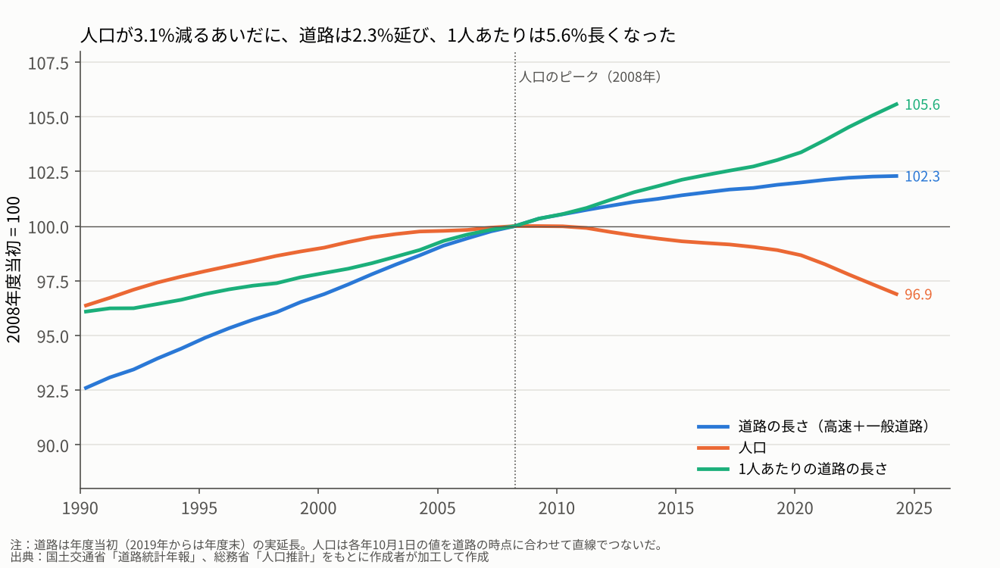
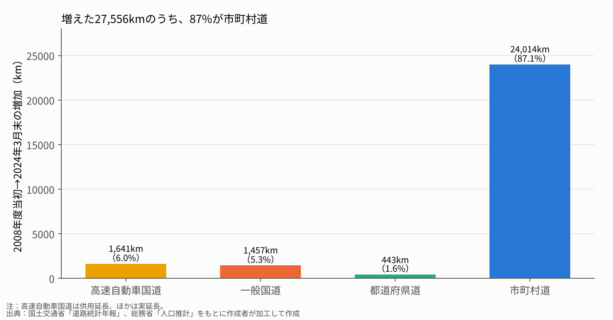
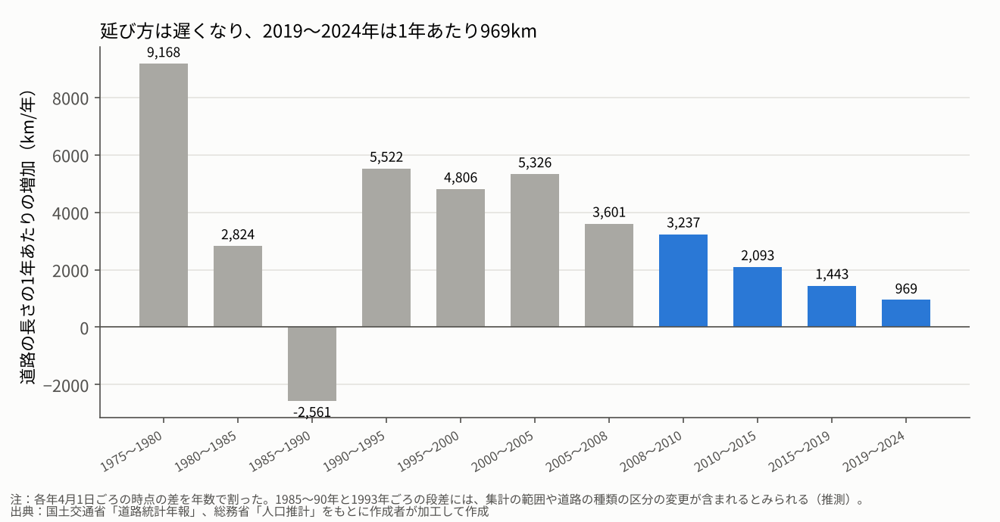
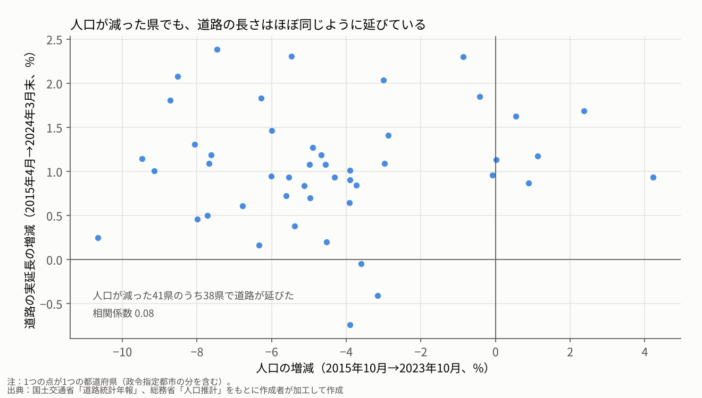

# F453 人口が減っても、道路は延び続けているのか？ 人口のピークの2008年から道路は2.3%（約2.8万km）延び、1人あたりは5.6%長くなった。延び方は1年あたり約1,000kmまで遅くなった

## 結論（先に）

- 道路の長さ（一般道路の実延長と高速自動車国道の供用延長の合計）は、2008年度当初の120万3,777kmから2024年3月末の123万1,333kmへ、2万7,556km（2.3%）延びました。同じ期間に人口は3.1%減りました。
- 人口1人あたりの道路の長さは、9.4mから9.9mへ5.6%長くなりました。
- 増えた分の87.1%は市町村道でした。高速自動車国道は6.0%、一般国道は5.3%、都道府県道は1.6%です。
- 延び方は遅くなっています。1年あたりの増加は、1990〜2008年の平均4,949kmから、2008〜2024年は1,722km、2019〜2024年は969kmでした。
- 2015〜2023年に人口が減った41都道府県のうち38で、道路は延びていました。人口の増減と道路の増減の相関はほぼありません（相関係数0.08）。

## 問い

日本の人口は2008年ごろを境に減り始めました。道路や橋の維持の費用の話題では、「人口が減っても道路は増え続けている」と言われることがあります。インフラの数字を説明する仕事の人や、こうした記事を読む人に向けて、国の道路統計で「道路は人口が減ったあとも延びているのか」「延びているならどの種類の道路か」「人口が減った県でも延びているのか」を確かめます。道路を増やすべきか減らすべきかは扱いません。

## データ（出典）

- 国土交通省「道路統計年報」（道路統計調査）
  - 2025年度版 表1-1「道路現況の推移」：高速自動車国道の供用延長、一般国道・都道府県道・市町村道・一般道路の実延長（1952年度〜2024年3月末）。年度当初（4月1日）と年度末（3月31日）の時点が混ざり、単位も km と m が混ざっているので、時点と単位をそろえました
  - 表4「都道府県別道路現況（合計）」の2016年度版（2015年4月1日現在。表の下の前年の合計の行の日付から判断）と2025年度版（2024年3月31日現在）。政令指定都市の行は、その都道府県に足しました（足した合計が表の合計と一致することを確かめています）
- 総務省「人口推計」各年10月1日現在の都道府県別の総人口（1920〜2024年）
- 取得した Excel 6ファイル（約0.4MB）を data/raw に同梱しています

## 事前の計画

計画は [PLAN.md](PLAN.md) に、集計の前に書きました（2026-11-16 15:25）。

| 仮説 | 外れの基準 | 結果 | 判定 |
|---|---|---|---|
| H1 道路は人口のピーク（2008年）のあとも延びた | 同じか減った | +27,556km（+2.3%） | 支持 |
| H2 増加のうち、いちばん大きいのは市町村道 | ほかの種類の方が大きい | 市町村道 24,014km（87.1%） | 支持 |
| H3 1人あたりの道路の長さは3%以上長くなった | 3%未満 | +5.6% | 支持 |
| H4 人口が減った都道府県の75%以上で道路が延びた | 75%未満 | 41県のうち38県（92.7%） | 支持 |

## やったこと

1. 表1-1の各行を時点（年度当初は4月1日、年度末は翌年3月31日）に直し、列ごとに km と m の単位をそろえました（src/02_build.py）。
2. 人口（各年10月1日）を道路の時点に合わせて直線でつなぎ、1人あたりの道路の長さを求めました（src/03_analysis.py）。
3. 2008年度当初から2024年3月末までの増加を、道路の種類に分けました。
4. 都道府県ごとに、道路の増減（2015年4月→2024年3月末）と人口の増減（2015年10月→2023年10月）を並べました。並べ方は順位にしていません。

## 分かったこと

### 図1 人口が減っても、道路は延びた



- 2008年度当初を100とすると、2024年3月末の道路は102.3、人口は96.9、1人あたりの道路は105.6でした。
- 1人あたりの道路の長さは、人口が増えていた2008年までも少しずつ長くなっていましたが、人口が減り始めてから伸びが速くなりました。

### 図2 増えた道路のほとんどは市町村道



- 増えた2万7,556kmのうち、市町村道が2万4,014km（87.1%）でした。
- 高速自動車国道は7,560kmから9,201kmへ1,641km（6.0%）、一般国道は1,457km（5.3%）、都道府県道は443km（1.6%）増えました。
- 市町村道の増え方も遅くなっていて、1年あたりの増加は1990〜2008年の4,321kmから、2008〜2024年は1,501kmでした。市町村道は2024年3月末の道路全体の約84%を占めます。

### 図3 延び方は遅くなった



- 1年あたりの増加は、2008〜2010年の3,237kmから、2010〜2015年は2,093km、2015〜2019年は1,443km、2019〜2024年は969kmでした。
- 1985〜1990年の減少や、1993年ごろの種類の間の移り（一般国道が増え、都道府県道が減った）には、集計の範囲や区分の変更が含まれるとみられます（推測）。

### 図4 人口が減った県でも、道路はほぼ同じように延びた



- 2015〜2023年に人口が減ったのは41都道府県、そのうち38で道路が延びていました。道路が短くなったのは3県でした。
- 道路の増加率の中央値は、人口が減った県で1.01%、人口が増えた6都県で1.15%と、ほぼ同じでした。
- 人口の増減と道路の増減の相関係数は0.08で、関係はほとんど見えません。

## 問い直し（結果を見てから足した）

県ごとの点の散らばりを見て、「1人あたりの道路は、どの地方で長くなったのか」を地方別（北から南）に足しました（src/03b_requestion.py）。2015年→2023年の1人あたりの道路の長さです。

| 地方 | 2015年（m/人） | 2023年（m/人） | 変化 | 人口の増減 |
|---|---|---|---|---|
| 北海道 | 16.80 | 17.82 | +6.1% | −5.4% |
| 東北 | 17.61 | 19.24 | +9.3% | −7.4% |
| 関東 | 5.90 | 5.86 | −0.8% | +1.2% |
| 中部 | 11.78 | 12.27 | +4.2% | −3.3% |
| 近畿 | 6.02 | 6.27 | +4.1% | −2.4% |
| 中国 | 14.14 | 15.01 | +6.1% | −5.0% |
| 四国 | 15.07 | 16.39 | +8.7% | −6.9% |
| 九州・沖縄 | 11.53 | 12.00 | +4.0% | −2.9% |

- 1人あたりの道路が長くなったのは、主に人口が減ったためです。道路の増加率は8地方とも0.4〜1.5%で、差は小さめでした。
- 人口が大きく減った東北と四国で、1人あたりの伸びが大きくなっています。関東だけは人口が増え、1人あたりは少し短くなりました。

## 頑健性

| 確かめたこと | 値 | 結論は変わったか |
|---|---|---|
| 始まりを2010年度当初にする：道路の増加率 | +1.74% | 変わらない |
| 始まりを2010年度当初にする：1人あたりの増加率 | +5.0% | 変わらない |
| 高速道路を除く一般道路だけ（2008→2024年） | +2.17% | 変わらない |
| 県の行だけ（政令市を足さない）：人口が減った県で道路が延びた割合 | 92.7% | 変わらない |
| 人口の時点を2014→2024年にする：同じ割合 | 92.9%（42県のうち） | 変わらない |
| 県の道路の増減と人口の増減の相関 | 0.08 | — |

## 言えないこと

- 道路の長さだけで、車線の数や幅、交通量は分かりません。
- 道路が延びた理由（新しく作った道路、市町村による道路の認定、測り方の見直し）は、表からは分けられません。
- 維持の費用や老朽化は扱っていません。
- 県の比較は2時点だけで、相関が小さいことは「人口と関係なく道路が決まる」という因果を示すものではありません。
- 福島県の市町村道の一部は、震災の影響で最新の値になっていないと表の注にあります。

## 仕事で使うなら

- インフラの量を人口と並べるときは、合計と1人あたりの両方を示すと、「延びている」と「人口あたりで長くなっている」を分けて説明できます。
- 道路の長さの増減は、新しく作った分と区分の変更が混ざるので、長い期間で比べるときは区分の変更の時期に注意が要ります。

## 計画からの変更

- 仮説と手法は計画どおりです。人口は総人口を使い、日本人人口での確かめは時点をずらす確かめに替えました。
- 問い直し（地方別の1人あたり）と、延び方の速さ（期間別の1年あたりの増加）を結果を見てから足しました。

## 再現のしかた

```sh
pip install -r requirements.txt
sh src/run_all.sh          # ネットにつながず data/raw から全部作る
# python3 src/01_fetch.py  # 元データを取り直すときだけ（ネットが必要）
```

| ファイル | 役割 |
|---|---|
| src/01_fetch.py | e-Stat から道路統計年報と人口推計の6ファイルを取得（run_all.sh からは呼ばない） |
| src/02_build.py | 時点と単位をそろえた全国の表、都道府県の表、人口の表を作る |
| src/03_analysis.py | 増加・1人あたり・種類別・県ごと、仮説の判定、頑健性 |
| src/03b_requestion.py | 問い直し（延び方の速さ、地方別の1人あたり） |
| src/04_figures.py | 図4枚 |

所要時間は約5秒（CPU 1つ）。乱数は使っていません。再実行の確かめは results/repro_check.txt にあります。

## レビューで直したこと

独立レビュー（2026-11-17）で数字の照合・再実行・図を確かめ、直すところはなかった。

## 出典

- 国土交通省「道路統計年報」（政府統計の総合窓口 e-Stat）：https://www.e-stat.go.jp/stat-search/files?toukei=00600610&tstat=000001017725
- 総務省「人口推計」（政府統計の総合窓口 e-Stat）：https://www.e-stat.go.jp/stat-search/files?toukei=00200524&tstat=000000090001

（いずれも国土交通省「道路統計年報」、総務省「人口推計」をもとに作成者が加工して作成）
