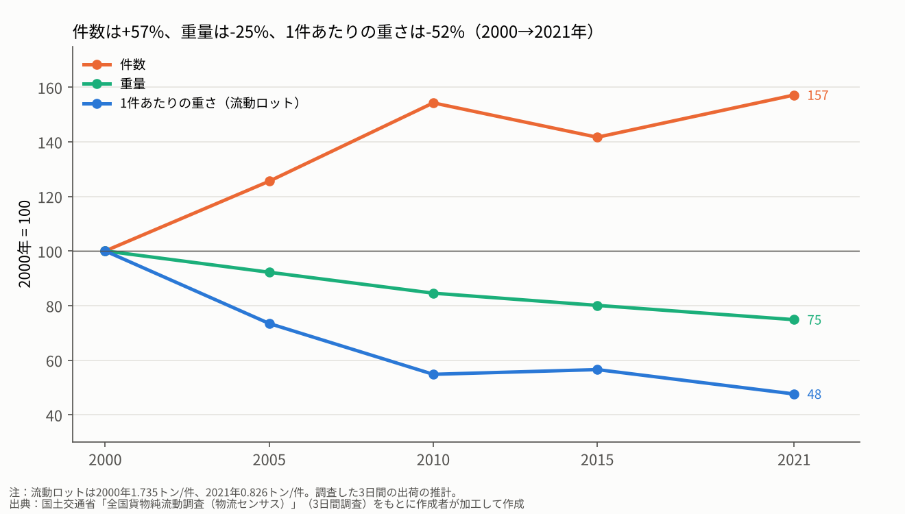
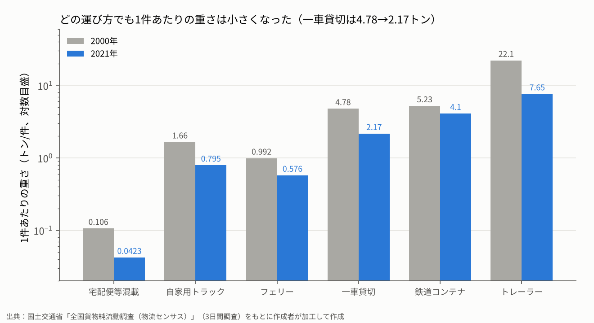
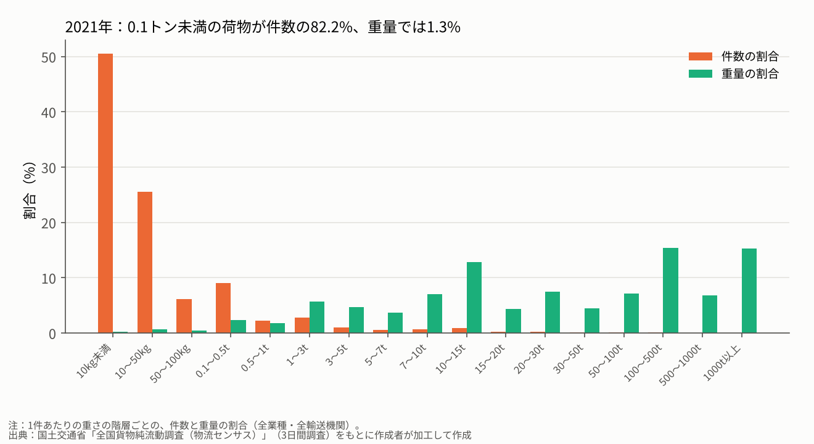
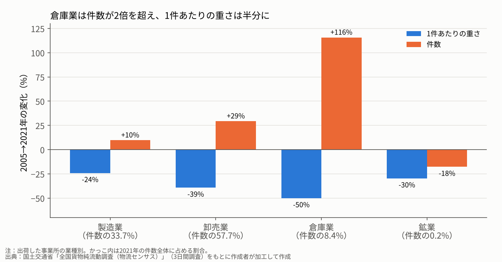

# F454 「荷物の小口化」は、物流センサスでどこまで進んだのか？ 1件あたりの重さは2000年の1.73トンから2021年の0.83トンへ52%小さくなり、件数は57%増えた

## 結論（先に）

- 国土交通省の物流センサスで、出荷1件あたりの重さ（流動ロット）は、2000年の1.735トンから2021年の0.826トンへ52.4%小さくなりました。
- 調査した3日間の出荷の件数は1,596万件から2,508万件へ57.1%増え、重量は2,769万トンから2,072万トンへ25.2%減りました。
- 小口化は、宅配便などの運び方に件数が移ったからではなく、同じ運び方の中で1件が軽くなったことで説明できます。2005→2021年の変化（−0.448トン）を分けると、運び方の中の分が−0.967トン、運び方の構成の分が+0.519トンでした。
- トラックを1台借り切る「一車貸切」は、件数が243.5万件から480.8万件へほぼ倍になり、1件あたりの重さは4.61トンから2.17トンになりました。
- 2021年は、0.1トン未満の荷物が件数の82.2%を占める一方、重量では1.3%でした。

## 問い

物流の効率や人手不足の記事では、「荷物が小口化・多頻度化している」とよく書かれます。国の物流の検討の場でも、1回に運ぶ荷物が小さくなり回数が増えたことが、トラックの積載率の低さの背景の1つとして挙げられてきました。運送や倉庫の仕事で出荷の形の変化を数字で知りたい人に向けて、物流センサスで「1件あたりの重さはどれだけ小さくなったか」「どの運び方・どの業種で小さくなったか」を確かめます。

## データ（出典）

- 国土交通省「全国貨物純流動調査（物流センサス）」（5年ごと。調査した3日間の出荷の拡大推計）
  - 表1-5-15 代表輸送機関別の流動量（重量・件数）と流動ロット：2015年調査の表（2000〜2015年）と2021年調査の表（2005〜2021年）。重なる3つの年の重量・件数は、2つの表で一致しました
  - 表1-5-12 発産業業種別の流動量（2005〜2021年）
  - 表2-7-1・2-7-2 流動ロット階層別の流動量（重量・件数）、2015年調査と2021年調査
- 流動ロット = 重量 ÷ 件数（トン／件）。調査の対象は鉱業・製造業・卸売業・倉庫業の事業所の出荷です
- 取得した Excel 7ファイル（約1.4MB）を data/raw に同梱しています

## 事前の計画

計画は [PLAN.md](PLAN.md) に、集計の前に書きました（2026-11-16 16:05）。

| 仮説 | 外れの基準 | 結果 | 判定 |
|---|---|---|---|
| H1 合計の流動ロットは2000→2021年で40%以上小さくなった | 40%未満 | −52.4% | 支持 |
| H2 件数は増え、重量は減った | どちらかが満たされない | 件数 +57.1%、重量 −25.2% | 支持 |
| H3 ロットの縮みは、運び方の構成の変化より、運び方の中の縮みで多く説明できる（2005→2021年） | 構成の分の方が大きい | 中の分 −0.967、構成の分 +0.519 | 支持 |
| H4 2021年に0.1トン未満が件数の80%以上、重量の2%未満 | どちらかが満たされない | 件数82.2%、重量1.3% | 支持 |

## やったこと

1. 2つの公表年の表から、代表輸送機関（その荷物を主に運んだ機関）ごとの重量・件数を2000〜2021年でつなぎました（src/02_build.py）。
2. 合計のロットの変化を、件数の構成の変化と、運び方ごとのロットの変化に分けました（シフトシェア、src/03_analysis.py）。
3. ロット階層別に、件数と重量の割合を比べました。

## 分かったこと

### 図1 件数は増え、重量は減り、1件は半分の重さに



- 流動ロットは2000年1.735、2005年1.274、2010年0.951、2015年0.981、2021年0.826トン／件でした。2010〜2015年はほぼ横ばいで、2015→2021年に15.7%小さくなりました。
- 件数は2010年に2,462万件まで増え、2015年に2,261万件に減ったあと、2021年は2,508万件で5回の調査で最も多くなりました。

### 図2 どの運び方でも1件は軽くなった



- 2000→2021年に、宅配便等混載は0.106→0.042トン、自家用トラックは1.66→0.80トン、一車貸切は4.78→2.17トン、トレーラーは22.1→7.6トンになりました。
- 宅配便等混載の件数の割合は、2000年の48.9%から2021年の57.0%で、2010年（63.2%）よりは低い水準でした。

### 図3 件数のほとんどは0.1トン未満



- 2021年は、0.1トン未満の荷物が件数の82.2%、重量の1.3%でした。2015年は件数の79.2%、重量の1.3%です。
- 10トン以上の荷物は件数の1.6%ですが、重量の73.5%を占めます。

## 問い直し（結果を見てから足した）

シフトシェアで「構成の分」がプラスになったのを見て、中身を確かめました（results/shift_share_2005_2021.csv）。プラスの主な理由は、1件の重さが大きい一車貸切と「その他」の件数が増えたことでした。一車貸切は件数がほぼ倍になる一方で、1件の重さは半分以下になっています。つまり、トラックを借り切る運び方そのものが「小さい荷物を何度も運ぶ」形に変わってきた、という見え方です。

あわせて、出荷する業種ごとに2005→2021年の変化を足しました（src/03b_requestion.py）。



| 業種 | ロット 2005年 | ロット 2021年 | ロットの変化 | 件数の変化 | 2021年の件数の割合 |
|---|---|---|---|---|---|
| 製造業 | 2.08 | 1.58 | −24% | +10% | 33.7% |
| 卸売業 | 0.36 | 0.22 | −39% | +29% | 57.7% |
| 倉庫業 | 2.19 | 1.09 | −50% | +116% | 8.4% |
| 鉱業 | 53.75 | 37.81 | −30% | −18% | 0.2% |

- 倉庫業からの出荷は件数が2倍を超え、1件の重さは半分になりました。卸売業は件数の6割近くを占め、1件の重さは0.22トンです。

## 頑健性

| 確かめたこと | 値 | 結論は変わったか |
|---|---|---|
| 合計のロットの変化 2005→2021年 | −35.2% | 変わらない |
| 合計のロットの変化 2015→2021年 | −15.7% | 変わらない |
| 合計のロットの変化 2000→2015年 | −43.5% | 変わらない |
| 宅配便等混載を除く合計のロット 2000→2021年 | −43.3% | 変わらない |
| 「その他」の輸送機関を除く 2000→2021年（2021年に件数が約99万件に急に増えた区分） | −51.7% | 変わらない |
| 「その他」を除いた分解：運び方の中の分の割合（2005→2021年） | 142.7% | 変わらない |
| 分解の期間を2000→2021年にしたとき：中の分の割合 | 120.9% | 変わらない |
| 2つの公表年の表の重なる年の重量・件数の差 | 0 | 一致 |
| 0.05トン未満の件数の割合／0.5トン未満の件数の割合（2021年） | 76.0%／91.1% | 区切りを変えても形は同じ |

「中の分の割合」が100%を超えるのは、構成の分がプラス（重い運び方の件数が増えた）で、中の分がそれを上回って縮んだためです。

## 言えないこと

- 3日間の調査の拡大推計で、調査した時期の違いや年ごとの振れがあります。
- 2021年はコロナの影響を受けた時期の調査です。
- 小口化の理由（通販、在庫の持ち方、取引の慣行など）は、このデータからは分かりません。
- 調査の対象は鉱業・製造業・卸売業・倉庫業の事業所の出荷で、消費者向けの宅配のすべてが入るわけではありません。
- 業種別の表と輸送機関別の表では、合計のロットが少し違います（2005年 1.28 と 1.27）。

## 仕事で使うなら

- 「小口化」を説明するときは、合計のロットだけでなく、運び方ごとのロットと件数を並べると、宅配便が増えたせいなのか、同じ運び方の中で小さくなったのかが分けられます。
- 件数と重量の分布は大きく違う（件数の8割が0.1トン未満、重量の7割が10トン以上）ので、どちらで見ているかを書き添えると誤解が減ります。

## 計画からの変更

- 仮説と手法は計画どおりです。ロット階層の区切りを0.5トンに変える確かめは件数の割合で行いました。
- 問い直し（構成の分の中身、業種別）を結果を見てから足しました。

## 再現のしかた

```sh
pip install -r requirements.txt
sh src/run_all.sh          # ネットにつながず data/raw から全部作る
# python3 src/01_fetch.py  # 元データを取り直すときだけ（ネットが必要）
```

| ファイル | 役割 |
|---|---|
| src/01_fetch.py | e-Stat から7ファイルを取得（run_all.sh からは呼ばない） |
| src/02_build.py | 輸送機関別・業種別・ロット階層別の表を作り、重なる年の一致を確かめる |
| src/03_analysis.py | ロットの推移、シフトシェア、ロット階層、仮説の判定、頑健性 |
| src/03b_requestion.py | 問い直し（業種別、一車貸切） |
| src/04_figures.py | 図4枚 |

所要時間は約5秒（CPU 1つ）。乱数は使っていません。再実行の確かめは results/repro_check.txt にあります。

## レビューで直したこと

独立レビュー（2026-11-17）で、数字の照合・再実行・図を確かめ、次を直しました。直したあとに /tmp の新しいフォルダで流し直し、results と figures がすべて一致することを確かめています。

| # | 指摘 | 直し方 |
|---|---|---|
| 1 | 図1の注の流動ロット「2000年1.74トン/件」が、小数3桁に丸めた1.735をもう一度丸めた値で、題名の1.73トン（元の値1.7345）と食い違っていた | 図1の注を本文と同じ小数3桁（1.735・0.826トン/件）で書くようにした |

## 出典

- 国土交通省「全国貨物純流動調査（物流センサス）」（政府統計の総合窓口 e-Stat）：https://www.e-stat.go.jp/stat-search/files?toukei=00600620&tstat=000001103136

（いずれも国土交通省「全国貨物純流動調査」をもとに作成者が加工して作成）
