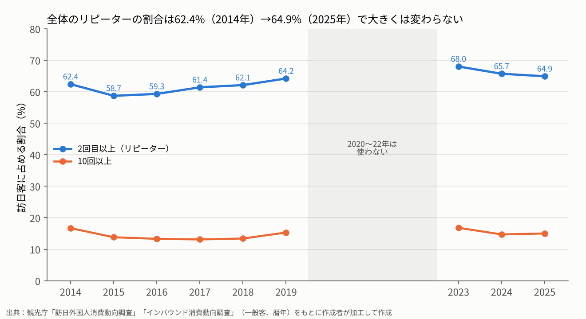
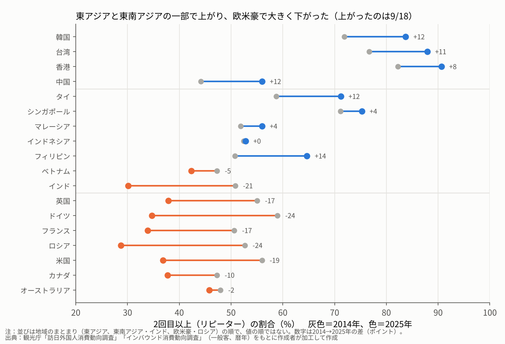
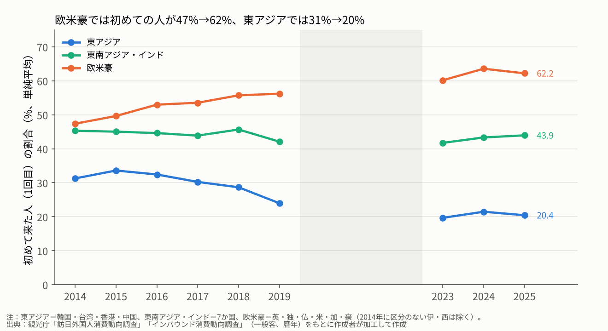
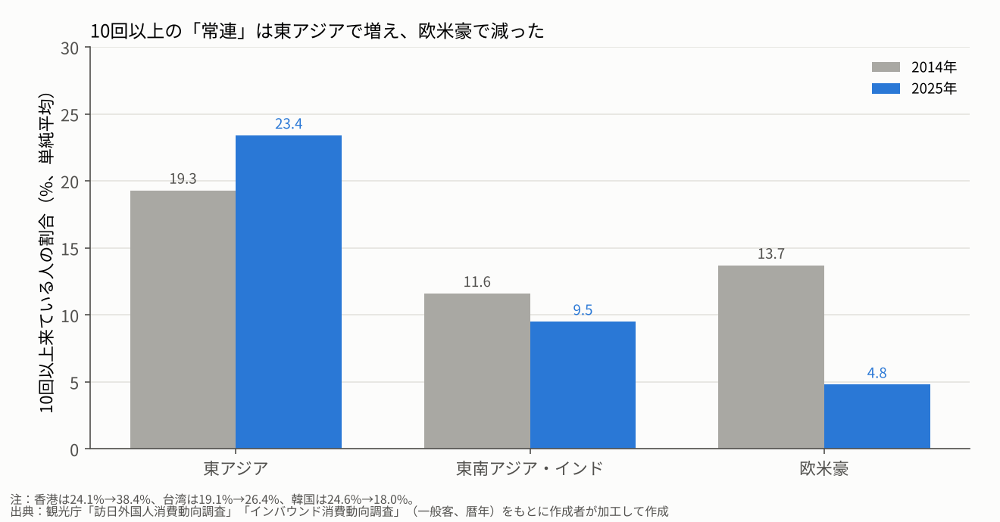

# F455 訪日客のうち、何度も来ている人の割合は増えたのか？ 全体は62.4%→64.9%でほぼ横ばい。東アジアは上がり、欧米豪は52.6%→34.4%（平均）と初めての人が増えた

## 結論（先に）

- 訪日客（一般客）のうち2回目以上の人（リピーター）の割合は、2014年の62.4%に対し、2025年は64.9%でした。2023年の68.0%から2年続けて下がっています。
- 国・地域で見ると、2014年と2025年の両方で比べられる18のうち、上がったのは9、下がったのも9でした。
- 東アジア（韓国・台湾・香港・中国）は上がり、2023〜25年平均で79.5%でした。欧米豪は2014年の平均52.6%から2023〜25年平均34.4%へ下がり、初めて来る人が多くなっています。
- 中国のリピーターの割合は44.2%から56.0%へ11.8ポイント上がりました（2023年は65.0%）。
- 10回以上来ている「常連」の割合は、東アジアで19.3%→23.4%と増え、欧米豪で13.7%→4.8%と減りました。

## 問い

訪日客の数はコロナ前を超えました。その中身が「初めて来る人が増えた」のか「何度も来る人が増えた」のかで、観光の現場に求められること（行き先、案内の仕方）が変わると言われます。観光の仕事をしている人やインバウンドの記事を読む人に向けて、観光庁の消費動向調査で、来訪回数の構成の変化を国・地域別に確かめます。

## データ（出典）

- 観光庁「訪日外国人消費動向調査」（2024年から「インバウンド消費動向調査」）暦年の集計表、国籍・地域別「回答者属性および旅行内容」の「日本への来訪回数」（ウェイトをかけた構成比）
  - 2014〜2019年は e-Stat の年確定値、2023〜2025年は観光庁のサイトの集計表。2020〜2022年は調査が止まったり試算値だったりするため使っていません
  - 一般客（クルーズ客などを除く）、全目的
- 取得した Excel 9ファイル（gzip で圧縮して約14MB）を data/raw に同梱しています

## 事前の計画

計画は [PLAN.md](PLAN.md) に、国籍別の集計の前に書きました（2026-11-16 17:10）。表の形を確かめるときに、全体の1回目の割合（2014年37.6%、2025年35.1%）を見ています。

| 仮説 | 外れの基準 | 結果 | 判定 |
|---|---|---|---|
| H1 比べられる国・地域の過半（12以上）でリピーターの割合が上がった | 11以下 | 18のうち9 | 外れ |
| H2 中国のリピーターの割合は15ポイント以上上がった（2014→2025年） | 15ポイント未満 | +11.8 | 外れ（2015〜16年平均→2023〜25年平均では+20.7） |
| H3 全体の10回以上の割合は3ポイント以上上がった | 3ポイント未満 | 16.7%→15.0%（−1.7） | 外れ |
| H4 2023〜25年平均で、東アジアは欧米豪より20ポイント以上高い | 20ポイント未満 | 79.5% と 34.4%（差45.1） | 支持 |

## やったこと

1. 各年の集計表から、国籍・地域ごとの来訪回数（1回目〜20回以上の8区分）の構成比を取り出しました（src/02_build.py）。
2. リピーターの割合 = 100 − 1回目の割合、10回以上 = 10〜19回 ＋ 20回以上 として、国・地域ごと、地域のまとまりごとに比べました（src/03_analysis.py）。地域のまとまりは単純平均です。

## 分かったこと

### 図1 全体の割合は大きくは変わらない



- リピーターの割合は2015年に58.7%まで下がり、2019年に64.2%、2023年に68.0%、2025年に64.9%でした。
- 10回以上の割合は、2014年16.7%、2019年15.3%、2025年15.0%でした。

### 図2 東アジアで上がり、欧米豪で大きく下がった



- 2014→2025年に、韓国は71.9%→83.7%、台湾は76.7%→87.9%、香港は82.2%→90.6%、中国は44.2%→56.0%と上がりました。
- 米国は56.0%→36.8%、英国は55.1%→37.9%、ドイツは59.0%→34.7%、フランスは50.6%→33.9%と下がりました。
- 東南アジアは、タイ（+12.5）・フィリピン（+14.0）で上がり、ベトナム（−5.0）・インド（−20.7）で下がりました。

### 図3 欧米豪では、初めての人が6割を超えた



- 1回目の人の割合の単純平均は、欧米豪で2014年の47.4%から2025年の62.2%に、東アジアで31.3%から20.4%になりました。
- 欧米豪の下がりは2014→2019年にもあり、コロナ後にさらに進みました。

## 問い直し（結果を見てから足した）

東アジアでリピーターが増えたのを見て、「10回以上来ている常連も増えたのか」を地域のまとまりごとに足しました（src/03b_requestion.py）。



- 10回以上の割合の単純平均は、東アジアで19.3%→23.4%、東南アジア・インドで11.6%→9.5%、欧米豪で13.7%→4.8%でした。
- 東アジアの中でも、香港は24.1%→38.4%、台湾は19.1%→26.4%と増え、韓国は24.6%→18.0%と減りました。韓国はリピーターの割合は上がっていて、「2〜9回目」の層が厚くなった形です。

## 頑健性

| 確かめたこと | 値 | 結論は変わったか |
|---|---|---|
| 比べる年を2015〜16年平均→2023〜25年平均にする：上がった国・地域の数 | 10/18 | 半々の形は同じ |
| 同：中国の上がり幅 | +20.7ポイント | H2 は基準年しだいで支持にもなる |
| リピーターを「3回目以上」にする：上がった国・地域の数 | 9/18 | 変わらない |
| 同：全体の3回目以上の割合（2014→2025年） | +4.7ポイント | 全体では少し上がる |
| 回答数が毎年300以上の16の国・地域だけ：上がった数 | 9/16 | 変わらない |
| 回答数で重みをつけた平均：東アジア − 欧米豪（2023〜25年） | 40.0ポイント | 変わらない |
| 全体の10回以上の割合（2014→2019年） | −1.4ポイント | 変わらない |

## 言えないこと

- 来訪回数は、出国する空港・港での聞き取りによる自己申告です。
- 国籍・地域ごとの訪日客の数（構成）が変わった影響を、この表だけで全体の割合から分けて示すことはできません。
- 欧米豪で初めての人が増えた理由（円安、航空便、情報の広がりなど）は、このデータからは分かりません。
- 2014年はイタリア・スペインの区分がなく、比べられるのは18の国・地域です。
- 2023年以降は調査の名前や集計の区分が少し変わっています。

## 仕事で使うなら

- 全体の割合だけでは、「東アジアの常連が増え、欧米豪の初めての人が増えた」という反対向きの動きが打ち消し合って見えなくなります。国・地域別に分けて読むと実態に近づきます。
- 初めての人が6割を超える国・地域と、9割がリピーターの国・地域では、旅の組み立てが違う可能性があります（推測）。

## 計画からの変更

- 計画では比べられる国・地域を19としていましたが、2014年にイタリア・スペインの区分がないため18になりました（H1 の基準12はそのまま）。
- 欧米豪のまとまりは、2023〜25年の値にはイタリア・スペインを含み、2014年の値と問い直しの値では含んでいません。
- 問い直し（10回以上の常連）を結果を見てから足しました。

## 再現のしかた

```sh
pip install -r requirements.txt
sh src/run_all.sh          # ネットにつながず data/raw から全部作る
# python3 src/01_fetch.py  # 元データを取り直すときだけ（ネットが必要）
```

| ファイル | 役割 |
|---|---|
| src/01_fetch.py | e-Stat と観光庁のサイトから9ファイルを取得（run_all.sh からは呼ばない） |
| src/02_build.py | 来訪回数の構成比を縦長の表 data/visits_long.csv にする |
| src/03_analysis.py | 国・地域別の割合、地域のまとまり、仮説の判定、頑健性 |
| src/03b_requestion.py | 問い直し（10回以上の常連） |
| src/04_figures.py | 図4枚 |

所要時間は約5秒（CPU 1つ）。乱数は使っていません。再実行の確かめは results/repro_check.txt にあります。

## レビューで直したこと

独立レビュー（2026-11-17）で数字の照合・再実行・図を確かめ、直すところはなかった。

## 出典

- 観光庁「訪日外国人消費動向調査」（政府統計の総合窓口 e-Stat）：https://www.e-stat.go.jp/stat-search/files?toukei=00601030&tstat=000001079655
- 観光庁「インバウンド消費動向調査」：https://www.mlit.go.jp/kankocho/tokei_hakusyo/gaikokujinshohidoko.html

（いずれも観光庁「訪日外国人消費動向調査」「インバウンド消費動向調査」をもとに作成者が加工して作成）
