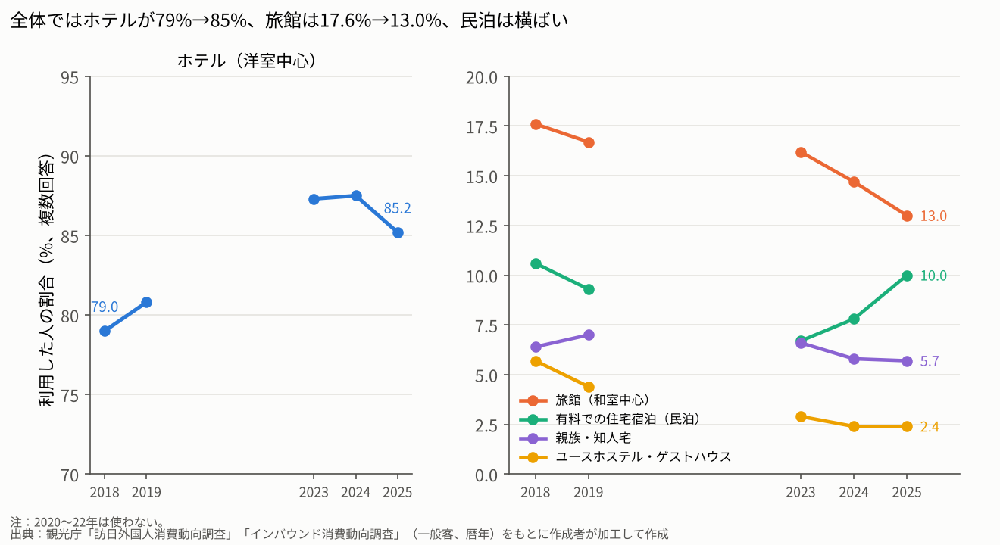
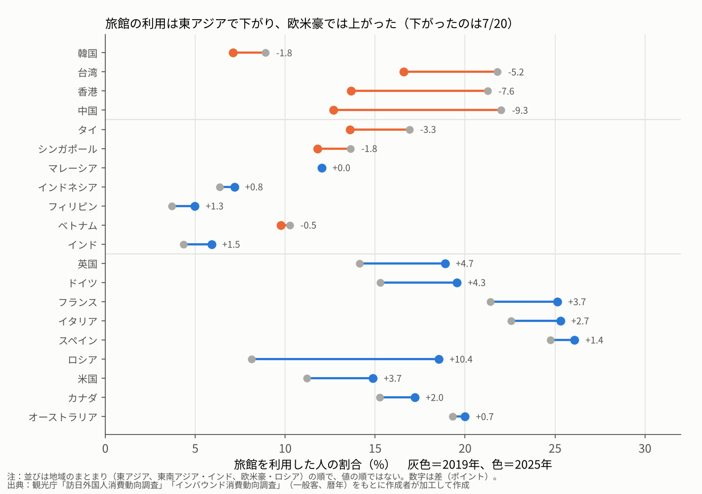
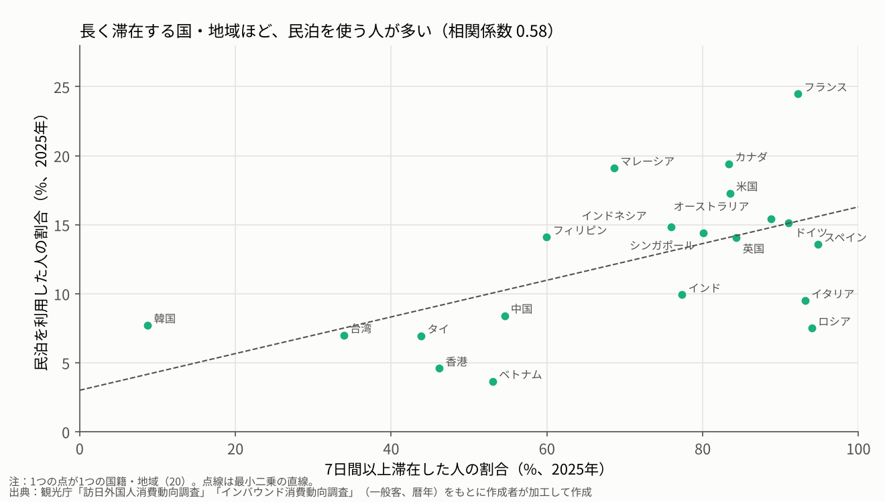
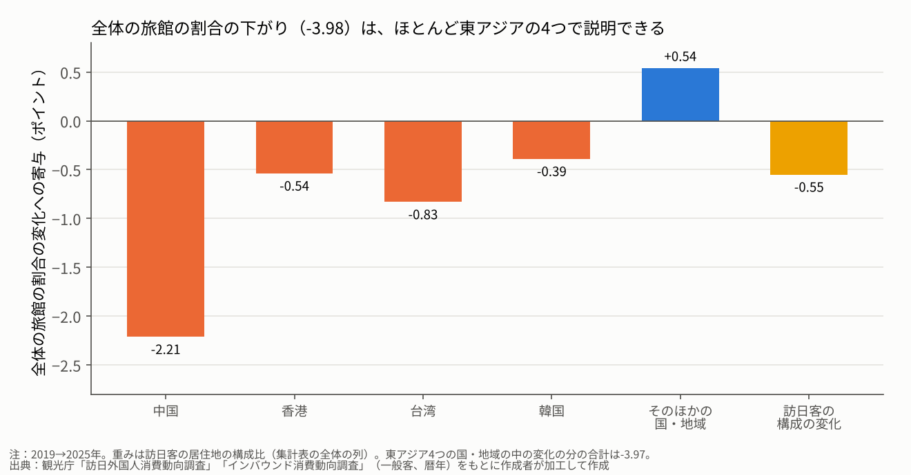

# F456 訪日客が泊まる場所は、ホテルから旅館や民泊などへ広がったのか？ 広がってはいない。ホテルの利用は79.0%→85.2%、旅館は17.6%→13.0%、民泊は10.6%→10.0%

## 結論（先に）

- 日本滞在中にホテル（洋室中心）を利用した訪日客の割合は、2018年の79.0%から2025年の85.2%へ上がりました（複数回答）。比べられる20の国籍・地域のうち19で上がっています。
- 旅館（和室中心）は17.6%から13.0%へ、ユースホステル・ゲストハウスは5.7%から2.4%へ下がりました。民泊（有料での住宅宿泊）は10.6%から10.0%で、2023年の6.7%からは戻っています。
- ただし旅館は国・地域で逆向きです。2019→2025年に旅館が下がったのは20のうち7で、中国（22.0%→12.7%）・香港・台湾など東アジアで下がり、欧米豪では上がりました。
- 全体の旅館の割合の下がり（訪日客の構成で重みづけて−3.98ポイント）のうち、東アジア4つの国・地域の中の変化で−3.97ポイントが説明できます。
- 7日間以上滞在する人が多い国・地域ほど、民泊の利用が多い傾向があります（2025年、相関係数0.58）。

## 問い

訪日客が増えるなかで、「ホテル以外の宿（旅館、民泊、ゲストハウス）にも泊まるようになった」と言われることがあります。宿泊の仕事をしている人や、民泊・旅館の記事を読む人に向けて、観光庁の消費動向調査の「日本滞在中に利用した宿泊施設」（複数回答）で、種類ごとの利用の割合がコロナの前と後でどう変わったか、国・地域でどう違うかを確かめます。

## データ（出典）

- 観光庁「訪日外国人消費動向調査」（2024年から「インバウンド消費動向調査」）暦年の集計表 表1-1「国籍・地域別 回答者属性および旅行内容」の「日本滞在中に利用した宿泊施設（複数回答）」「滞在日数」「居住地」
- 2018・2019・2023・2024・2025年。選択肢がそろうのは2018年からです（2014年は選択肢が6つで民泊がなく、2015〜2017年の表にはこの項目がありません）。2020〜2022年は使っていません
- 取得した Excel 5ファイル（gzip で圧縮して約8MB）を data/raw に同梱しています（F455 と同じファイル）

## 事前の計画

計画は [PLAN.md](PLAN.md) に、国籍別の集計の前に書きました（2026-11-16 17:45）。選択肢がそろう年を確かめるときに、全体の列の値（ホテル・旅館・民泊）を見ています。

| 仮説 | 外れの基準 | 結果 | 判定 |
|---|---|---|---|
| H1 2019→2025年に旅館の割合は20のうち11以上で下がった | 10以下 | 7 | 外れ |
| H2 2025年の民泊は、欧米豪が東アジアより5ポイント以上高い | 5ポイント未満 | 16.1% と 6.9%（差9.2） | 支持 |
| H3 7日間以上の割合と民泊の割合の相関は0.5以上（2025年） | 0.5未満 | 0.58 | 支持（順位相関は0.48） |
| H4 2018→2025年にホテルの割合は20のうち14以上で上がった | 13以下 | 19 | 支持 |

## やったこと

1. 各年の表1-1から、国籍・地域ごとに宿泊施設の種類別の利用の割合と、滞在日数の構成比を取り出しました（src/02_build.py）。
2. 年ごと・国籍ごとに割合を比べ、7日間以上の割合と民泊の割合の相関を見ました（src/03_analysis.py）。地域のまとまりは単純平均です。

## 分かったこと

### 図1 全体では、ホテルの割合が上がった



- ホテルは79.0%（2018年）→80.8%（2019年）→87.3%（2023年）→85.2%（2025年）でした。
- 旅館は17.6%→13.0%、ゲストハウスは5.7%→2.4%、親族・知人宅は6.4%→5.7%と下がりました。
- 民泊は2023年に6.7%まで下がり、2025年に10.0%へ戻りました。

### 図2 旅館は、東アジアで下がり、欧米豪で上がった



- 2019→2025年に、中国は22.0%→12.7%、香港は21.3%→13.7%、台湾は21.8%→16.6%と下がりました。
- フランスは21.4%→25.1%、英国は14.1%→18.9%、米国は11.2%→14.9%、ドイツは15.3%→19.6%と上がりました。
- 東アジアの単純平均は18.5%→12.5%、欧米豪は18.0%→20.9%でした。

### 図3 長く滞在する国・地域ほど、民泊を使う



- 2025年の民泊の利用は、欧米豪の平均16.1%、東南アジア・インド11.9%、東アジア6.9%でした。
- 7日間以上滞在した人の割合と民泊の割合の相関係数は0.58（2019年は0.30）でした。

## 問い直し（結果を見てから足した）

全体の旅館の割合は下がったのに、下がった国・地域は20のうち7だけでした。そこで、訪日客の居住地の構成比（集計表の全体の列）を重みにして、2019→2025年の変化を「国・地域ごとの旅館の割合の変化」と「訪日客の構成の変化」に分けました（src/03b_requestion.py）。



- 重みづけた旅館の割合は16.76%→12.78%（−3.98ポイント）で、表の全体の値とほぼ同じでした。
- 国・地域の中の変化の分が−3.43、構成の変化の分が−0.55でした。中の変化のうち、東アジア4つの合計が−3.97（中国だけで−2.21）で、ほかの国・地域はわずかにプラスです。
- 東アジアは2025年でも訪日客の66.8%を占めるため、東アジアで旅館の利用が下がると、全体の割合も下がって見えます。

## 頑健性

| 確かめたこと | 値 | 結論は変わったか |
|---|---|---|
| 旅館：2018〜19年平均→2023〜25年平均で下がった数 | 7/20 | 変わらない |
| ホテル：2018〜19年平均→2023〜25年平均で上がった数 | 20/20 | 変わらない |
| 全体の「旅館・ゲストハウス・カプセル・民泊」の合計（上限の目安）2018→2025年 | −8.6ポイント | ホテル以外への広がりは見えない |
| 回答数が毎年300以上の19国・地域だけ：旅館が下がった数 | 7/19 | 変わらない |
| 7日間以上と民泊の順位相関（2025年） | 0.48 | 少し弱くなる |
| 同じ相関を2019年で | 0.30 | 2025年の方が強い |

## 言えないこと

- 複数回答で、何泊をどの施設で泊まったかは分かりません。
- 民泊の割合は、回答者がホテルや民泊をどう区別したかに左右されます。
- 宿泊施設の数や値段の変化（供給の側）は扱っていません。
- 国・地域の比べ方は単純平均です。問い直しの重みは居住地の構成比で、国籍とは厳密には同じではありません。
- 滞在日数と民泊の関係は国・地域の間の相関で、長く泊まるから民泊を選ぶという因果は言えません。

## 仕事で使うなら

- 全体の割合だけを見ると「旅館離れ」に見えますが、国・地域別では逆向きの動きがあります。訪日客の構成が東アジアに偏っているときは、国・地域別に分けて読むと誤解が減ります。
- 民泊の利用は滞在の長さと一緒に動く傾向があるので、滞在日数の構成と並べて見ると説明しやすくなります。

## 計画からの変更

- 仮説と手法は計画どおりです。
- 問い直し（居住地の構成比を重みにしたシフトシェア）を結果を見てから足しました。

## 再現のしかた

```sh
pip install -r requirements.txt
sh src/run_all.sh          # ネットにつながず data/raw から全部作る
# python3 src/01_fetch.py  # 元データを取り直すときだけ（ネットが必要）
```

| ファイル | 役割 |
|---|---|
| src/01_fetch.py | e-Stat と観光庁のサイトから5ファイルを取得（run_all.sh からは呼ばない） |
| src/02_build.py | 宿泊施設と滞在日数の構成比を縦長の表にする |
| src/03_analysis.py | 国籍別の割合、相関、仮説の判定、頑健性 |
| src/03b_requestion.py | 問い直し（旅館の割合の変化の分解） |
| src/04_figures.py | 図4枚 |

所要時間は約5秒（CPU 1つ）。乱数は使っていません。再実行の確かめは results/repro_check.txt にあります。

## レビューで直したこと

独立レビュー（2026-11-17）で数字の照合・再実行・図を確かめ、直すところはなかった。

## 出典

- 観光庁「訪日外国人消費動向調査」（政府統計の総合窓口 e-Stat）：https://www.e-stat.go.jp/stat-search/files?toukei=00601030&tstat=000001079655
- 観光庁「インバウンド消費動向調査」：https://www.mlit.go.jp/kankocho/tokei_hakusyo/gaikokujinshohidoko.html

（いずれも観光庁「訪日外国人消費動向調査」「インバウンド消費動向調査」をもとに作成者が加工して作成）
