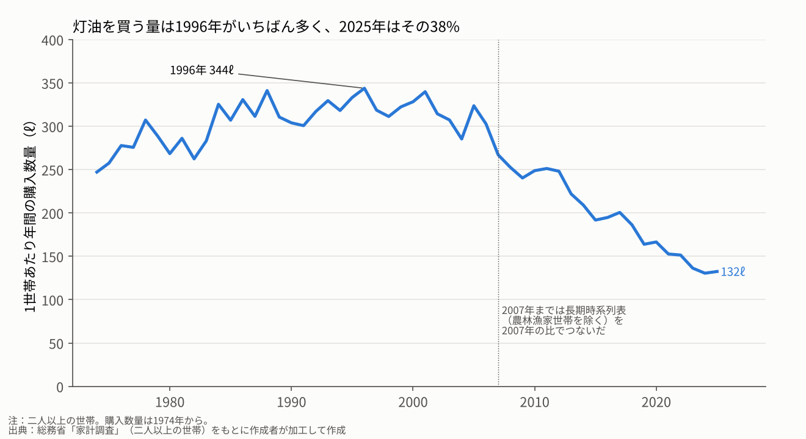
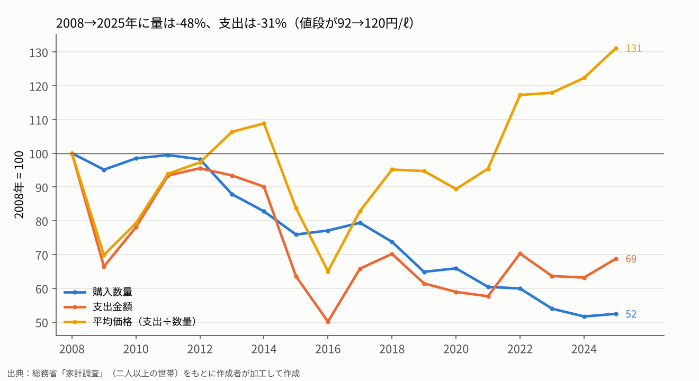
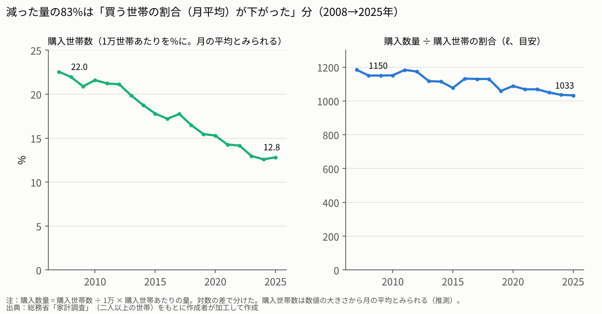
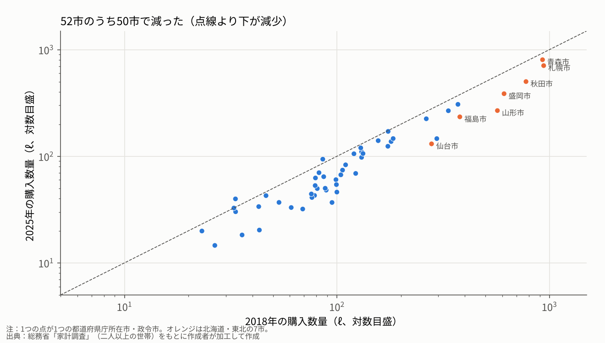

# F457 家庭の灯油の購入量は、どれだけ減ったのか？ 1996年の344ℓから2025年の132ℓへ62%減。減った分の8割は「買う世帯の割合（月平均）」が下がった分だった

## 結論（先に）

- 二人以上の世帯の1世帯あたり年間の灯油の購入数量は、いちばん多かった1996年の343.8ℓから、2025年の132.4ℓへ61.5%減りました。
- 2008→2025年では、購入数量が47.6%減ったのに対し、支出金額は31.2%の減りでした。1ℓあたりの値段が91.66円から120.23円へ上がったためです。
- 2008→2025年の購入数量の減りを分けると、83.4%が「灯油を買う世帯の割合が減った」分（22.0%→12.8%）、16.6%が「買う世帯あたりの量が減った」分でした。
- 2018→2025年に、52の都道府県庁所在市・政令市のうち50市で購入数量が減りました。北海道・東北の7市の合計は32.3%、それ以外の45市の合計は26.8%減っています。
- 値段が大きく動いた年（2009年に−30.2%、2016年に−22.3%、2022年に+22.9%）でも、量の動きは−4.9%、+1.6%、−0.8%と小さく、量は値段にあまり関係なく年に約4%ずつ減っていました。

## 問い

灯油は寒い地方の暖房の燃料で、エアコンやガス・電気の暖房への置き換えで使われなくなってきたと言われます。灯油や燃料を扱う仕事の人、冬の暖房の変化に関心がある人に向けて、家計調査で「1世帯あたりの購入量はいつから、どれだけ減ったのか」「減ったのは買う家が減ったからか、買う家の量が減ったからか」を確かめます。灯油の値段をどうすべきかは扱いません。

## データ（出典）

- 総務省「家計調査」二人以上の世帯
  - 長期時系列 表番号20-3-a（1963〜2007年、農林漁家世帯を除く）：灯油の支出金額・購入数量（購入数量は1974年から）
  - 各年の詳細結果表 表番号4-1（2007〜2025年）：全国の支出金額・購入数量・平均価格・購入世帯数（1万世帯あたり）。2018年からは52市別も
- 2007年は両方の表にあり、表4-1 ÷ 長期時系列表 = 1.019 の比で2006年以前をつなぎました
- 取得した Excel 20ファイル（約11MB、.xls は gzip）を data/raw に同梱しています

## 事前の計画

計画は [PLAN.md](PLAN.md) に、年ごとの集計の前に書きました（2026-11-16 18:30）。表の形を確かめるときに、2008年・2018年・2025年の全国の行を見ています。

| 仮説 | 外れの基準 | 結果 | 判定 |
|---|---|---|---|
| H1 購入数量がいちばん多かった年は2000年より前 | 2000年以降 | 1996年 | 支持 |
| H2 2008→2025年の支出の減りは、量の減りより小さい | 支出の方が大きく減った | 支出 −31.2%、量 −47.6% | 支持 |
| H3 2018→2025年に52市のうち40市以上で量が減った | 39市以下 | 50市 | 支持 |
| H4 量の減りのうち、買う世帯の割合の減りの分が半分以上 | 半分未満 | 83.4% | 支持 |

## やったこと

1. 長期時系列表と各年の表4-1から、灯油の行を取り出しました（src/02_build.py）。表の形が2020年から変わるので、2つの形に合わせて読みました。
2. 2007年の比で長い系列をつなぎ、平均価格（支出 ÷ 数量）を求めました（src/03_analysis.py）。
3. 購入数量 = 購入世帯数 ÷ 1万 × 購入世帯あたりの量 として、2008→2025年の変化を対数の差で分けました。
4. 52市の2018年と2025年を比べました。

## 分かったこと

### 図1 いちばん多かったのは1996年



- 購入数量は1974年の247.1ℓから増え、1996年に343.8ℓでいちばん多くなりました。2000年は328.2ℓで、2000年代の半ばから減り方がはっきりしています。
- 2025年は132.4ℓで、1996年の4割弱です。

### 図2 量は半分近くに、支出は3割減



- 2008年を100とすると、2025年の購入数量は52、支出金額は69、平均価格は131でした。
- 値段は2016年に59.60円/ℓまで下がり、2025年は120.23円/ℓでした。

### 図3 減った分の8割は「買う世帯の割合（月平均）」が下がった分



- 購入世帯数（1万世帯あたり）を割合に直すと、2008年の22.0%から2025年の12.8%に下がりました。
- 購入数量をこの割合で割った目安は1,150ℓから1,033ℓで、10%ほどの減りでした。
- 表の購入世帯数は、数値の大きさから月の平均とみられます（推測）。そのため、2つ目の値は「買う家1軒の年間の量」そのものではなく目安ですが、分解の式（掛け算）はそのまま成り立ちます。
- 月平均の割合なので、この低下には「灯油をまったく買わなくなった世帯が増えた」ことと「買う月が少なくなった」ことの両方が入りえます。このデータでは2つを分けられません（レビューで追記）。

### 図4 52市のうち50市で減った



- 2018→2025年に、北海道・東北の7市（札幌・青森・盛岡・仙台・秋田・山形・福島）はすべて減り、7市の合計で32.3%減りました。
- それ以外の45市では43市で減り、合計で26.8%減りました。

## 問い直し（結果を見てから足した）

値段が大きく動いた年があったのを見て、「値段が動くと、買う量も動くのか」を足しました（src/03b_requestion.py、2008〜2025年の前年比18組）。

| 年 | 値段の前年比 | 量の前年比 |
|---|---|---|
| 2009年 | −30.2% | −4.9% |
| 2016年 | −22.3% | +1.6% |
| 2022年 | +22.9% | −0.8% |

- 前年比どうしの回帰の傾きは0.058（相関係数0.18）で、値段と量の関係はほとんど見えませんでした。量の前年比の平均は−3.9%です。
- このデータでは、灯油の量は値段よりも、年ごとに少しずつ減る流れで動いているように見えます。冬の寒さの違いは取り除いていません。

## 頑健性

| 確かめたこと | 値 | 結論は変わったか |
|---|---|---|
| 2008〜10年平均→2023〜25年平均：購入数量 | −46.2% | 変わらない |
| 同：支出金額 | −20.0% | 支出の減りの方が小さいのは同じ |
| 同：買う世帯の割合の減りの分の割合 | 83.6% | 変わらない |
| 2019→2024年に量が減った市 | 44/52 | 変わらない（基準の40以上） |
| 北海道・東北7市の合計 2018→2025年 | −32.3% | — |
| それ以外45市の合計 2018→2025年 | −26.8% | — |
| つなぎ目を補正しないときのいちばん多い年 | 1996年 | 変わらない |

## 言えないこと

- 冬の寒さの違いの影響は、平均をとる以外には取り除いていません。
- 家計調査は標本調査で、市別は世帯数が少なく年ごとの振れが大きくなります。
- 暖房の置き換え先（エアコン、ガス、電気）は、この品目の表だけでは分かりません。
- 購入世帯数の定義（月の平均か年間か）は表の数値から推測したもので、確かめていません。
- 二人以上の世帯だけで、単身世帯は入っていません。

## 仕事で使うなら

- 灯油の需要の変化は、「使う家の数」と「1軒の量」に分けると、どちらが動いているかが見えます。このデータでは、その月に買う世帯の割合（月平均）の低下が中心でした。
- 年ごとの値段の上下で量が大きく動くとは限らないので、長い流れと年ごとの振れを分けて読むと説明しやすくなります。

## 計画からの変更

- 計画の「つなぎ目を補正しない場合」は、いちばん多い年の確かめとして行いました。
- 問い直し（値段と量の前年比）を結果を見てから足しました。
- 購入世帯数の定義を確かめられなかったため、図3と本文に推測と書きました。

## 再現のしかた

```sh
pip install -r requirements.txt
sh src/run_all.sh          # ネットにつながず data/raw から全部作る
# python3 src/01_fetch.py  # 元データを取り直すときだけ（ネットが必要）
```

| ファイル | 役割 |
|---|---|
| src/01_fetch.py | e-Stat から長期時系列表と表4-1を取得（run_all.sh からは呼ばない） |
| src/02_build.py | 灯油の行を取り出して data/ に CSV を作る |
| src/03_analysis.py | 長期のつなぎ、分解、都市別、仮説の判定、頑健性 |
| src/03b_requestion.py | 問い直し（値段と量の前年比） |
| src/04_figures.py | 図4枚 |

所要時間は約12秒（CPU 1つ）。乱数は使っていません。再実行の確かめは results/repro_check.txt にあります。

## レビューで直したこと

独立レビュー（2026-11-17）で、数字の照合・再実行・図を確かめ、次を直しました。直したあとに /tmp の新しいフォルダで流し直し、results と figures がすべて一致することを確かめています。

| # | 指摘 | 直し方 |
|---|---|---|
| 1 | 題名・図3の「減った分の8割は買う家が減った」は、購入世帯数が月平均とみられる（README でも推測）ため、「買わなくなった世帯」と「買う月が減った世帯」を分けられず言い過ぎ。図2の横軸が2007.5などの小数で出ていた | 題名・見出し・図3の題を「買う世帯の割合（月平均）が下がった分」に直し、README・note に2つを分けられないことを書き足した。図2の横軸の目盛りを整数の年にした |

## 出典

- 総務省「家計調査」（政府統計の総合窓口 e-Stat）：https://www.e-stat.go.jp/stat-search/files?toukei=00200561&tstat=000000330001

（いずれも総務省「家計調査」をもとに作成者が加工して作成）
