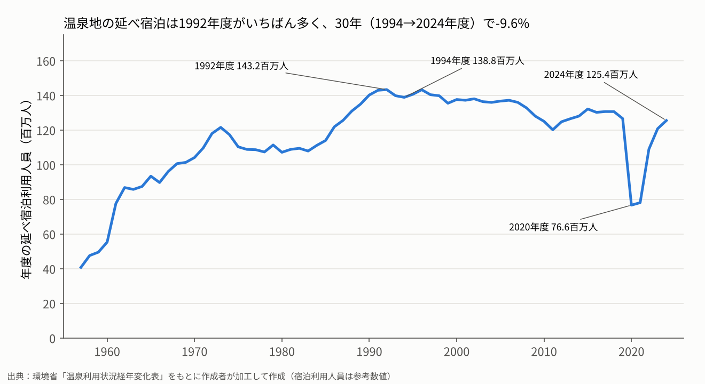
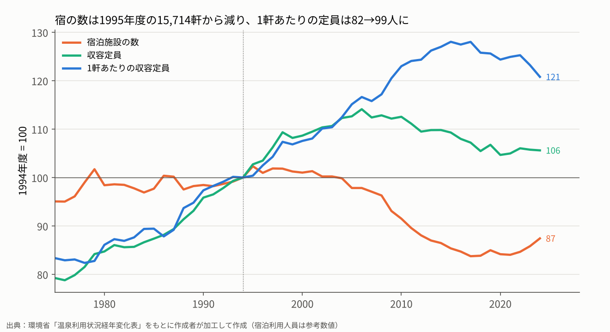
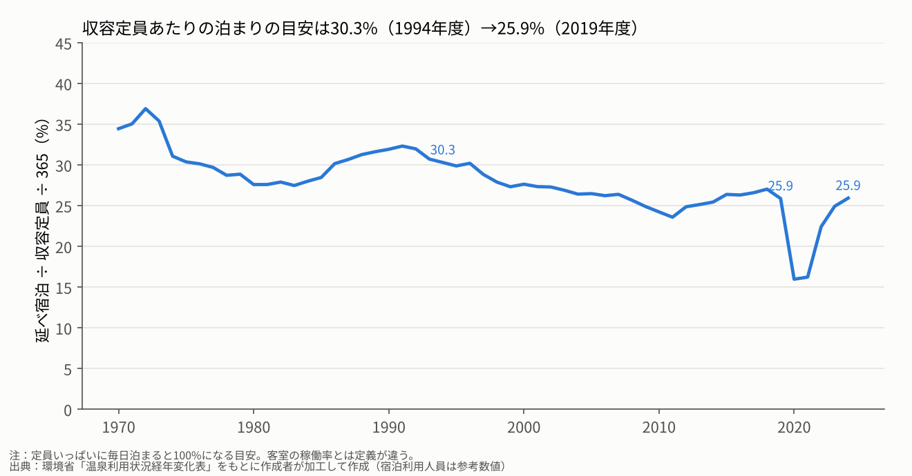
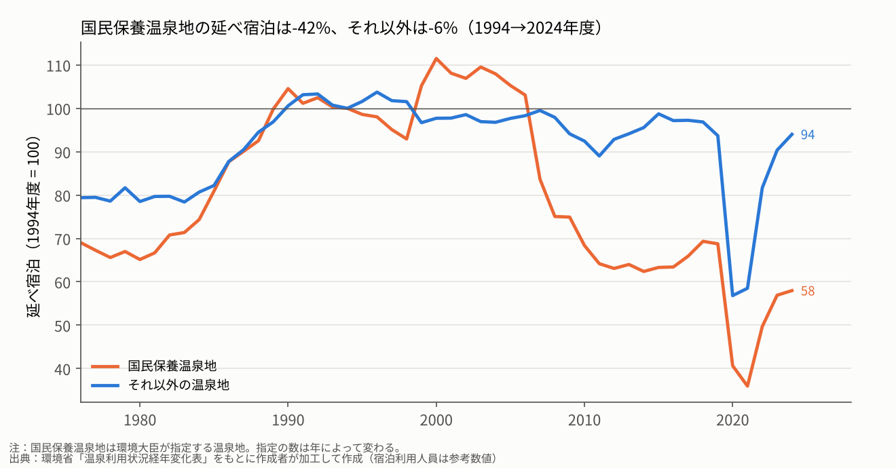

# F458 温泉地に泊まる人は、30年でどれだけ減ったのか？ 延べ宿泊は1994年度の1億3,878万人から2024年度の1億2,541万人へ9.6%減。宿は1995年度の山から15%減り、1軒は2割大きくなった

## 結論（先に）

- 温泉地の年度の延べ宿泊利用人員は、1994年度の1億3,878万人から2024年度の1億2,541万人へ、30年で9.6%減りました。いちばん多かった1992年度（1億4,325万人）からは12.4%減です。
- 宿泊施設の数は、いちばん多かった1995年度の15,714軒から2024年度の13,425軒へ14.6%減りました（2017年度の12,860軒からは少し増えています）。
- 1軒あたりの収容定員は81.7人（1994年度）から98.7人（2024年度）へ20.8%増え、宿は大きくなりました。
- 収容定員1人分あたりの泊まりの目安（延べ宿泊 ÷ 収容定員 ÷ 365）は、1994年度の30.3%から2019年度の25.9%に下がりました。
- 環境大臣が指定する国民保養温泉地の延べ宿泊は、1994年度から2024年度で42.0%減り、それ以外の温泉地（−6.0%）より大きく減っています。

## 問い

「温泉地の宿泊客は減っている」と言われる一方で、訪日客は増えています。温泉地の観光や宿の仕事をしている人、地方の観光の記事を読む人に向けて、環境省が毎年まとめている温泉利用状況の長い表で、温泉地の宿泊施設の数・収容定員・延べ宿泊が30年でどう変わったかを確かめます。

## データ（出典）

- 環境省「温泉利用状況経年変化表」（昭和32年度〜令和6年度、令和7年3月末現在）。温泉地数、宿泊施設数、収容定員、年度延宿泊利用人員、温泉利用の公衆浴場数、国民保養温泉地の年度延宿泊利用人員
- 表は PDF だけで公開されています。PDF（約60KB）を data/raw に同梱し、src/01b_extract.py で一度だけ文字を取り出して data/onsen_trend.csv を作りました。取り出しでは、源泉総数と内訳（利用源泉・未利用源泉の自噴・動力）の和を年ごとに比べ、差が0.1%未満（最大5件。元の表の差とみられる）であることを確かめ、列がずれていないことを確かめています
- 表の注にあるとおり、宿泊利用人員は参考数値です

## 事前の計画

計画は [PLAN.md](PLAN.md) に、年ごとの集計の前に書きました（2026-11-16 19:20）。PDF の形を確かめるときに、最初と最後の数行の値を見ています。

| 仮説 | 外れの基準 | 結果 | 判定 |
|---|---|---|---|
| H1 延べ宿泊は1994→2024年度で10%以上減った | 減りが10%未満 | −9.6% | 外れ（ぎりぎり。ほかの比べ方では−12〜−16%） |
| H2 宿泊施設の数は、いちばん多い年度から10%以上減った | 10%未満 | −14.6% | 支持 |
| H3 1軒あたりの収容定員は10%以上増えた | 10%未満 | +20.8% | 支持 |
| H4 定員あたりの泊まりの目安は2019年度の方が1994年度より低い | 同じか高い | 30.3% → 25.9% | 支持 |

## やったこと

1. PDF の表から年度ごとの数字を取り出しました（src/01b_extract.py、一度だけ）。
2. 1軒あたりの収容定員と、延べ宿泊 ÷ 収容定員 ÷ 365（定員いっぱいに毎日泊まると100%になる目安）を求めました（src/03_analysis.py）。

## 分かったこと

### 図1 延べ宿泊は1992年度がいちばん多かった



- 延べ宿泊は1957年度の4,070万人から増え、1992年度に1億4,325万人でいちばん多くなりました。
- 2000年代の後半から減り、2020年度はコロナの影響で7,659万人まで下がりました。2024年度は1億2,541万人で、2019年度（1億2,653万人）とほぼ同じ水準に戻っています。

### 図2 宿は減り、1軒は大きくなった



- 宿泊施設は1995年度の15,714軒をいちばん多くとして減り、2017年度に12,860軒、2024年度は13,425軒でした。
- 収容定員は1994年度の125.4万人から2024年度の132.5万人と、少し増えています。
- 1軒あたりの収容定員は81.7人から98.7人になりました。

### 図3 定員あたりの泊まりは少なくなった



- 延べ宿泊 ÷ 収容定員 ÷ 365 は、1994年度の30.3%から2019年度・2024年度の25.9%へ下がりました。客室の稼働率とは定義が違う目安です。

## 問い直し（結果を見てから足した）

国民保養温泉地の延べ宿泊が大きく減っていたので、それ以外の温泉地と分けて足しました（src/03b_requestion.py）。



- 国民保養温泉地の延べ宿泊は2000年度の1,559万人がいちばん多く、2024年度は811万人でした。1994年度からは42.0%減です。
- それ以外の温泉地は1994→2024年度で6.0%の減りでした。2019→2024年度は、国民保養温泉地が15.7%減、それ以外が0.3%増です。
- 全体に占める国民保養温泉地の割合は、10.1%から6.5%に下がりました。国民保養温泉地の指定の数は年によって変わるため、この差には指定の増減も含まれます。

## 頑健性

| 確かめたこと | 値 | 結論は変わったか |
|---|---|---|
| 1992〜96年度平均→2022〜24年度平均：延べ宿泊 | −16.1% | 減りは大きく見える |
| 1994→2019年度（コロナ前）：延べ宿泊 | −8.8% | 1割弱の減りは同じ |
| いちばん多かった1992年度→2024年度：延べ宿泊 | −12.4% | — |
| 国民保養温泉地の延べ宿泊 1994→2024年度 | −42.0% | — |
| 1992〜96年度平均→2022〜24年度平均：1軒あたりの収容定員 | +22.6% | 変わらない |
| 稼働の目安 1992〜96年度平均→2017〜19年度平均 | −4.1ポイント | 変わらない |

H1 は基準の10%をわずかに下回って「外れ」ですが、比べる年の選び方で−9%〜−16%の幅があります。「30年で1〜2割の減り」と幅で読むのが安全です。

## 言えないこと

- 宿泊利用人員は参考数値で、集め方は都道府県によって違う可能性があります。
- 日本人と訪日客の内訳は分かりません。
- 温泉地の宿の売上や、日帰りの利用は分かりません。
- 宿の数が減った理由（廃業、統合、建て替え）は分かりません。
- 温泉地の数は2010年度の3,185をいちばん多くとして2024年度は2,839で、何を1つの温泉地と数えるかの変化の影響は分けられません。温泉利用の公衆浴場は1994年度の4,164から2024年度の7,721へ増えていますが、利用者の数は表にありません。

## 仕事で使うなら

- 温泉地の宿泊の減りを語るときは、比べる年（ピークか、30年前か、コロナ前か）で−9%から−16%まで変わるので、比べる年を書き添えると誤解が減ります。
- 宿の数と1軒の大きさが逆向きに動いているので、軒数だけでなく収容定員も並べると実態に近づきます。

## 計画からの変更

- 仮説と手法は計画どおりです。
- 問い直し（国民保養温泉地とそれ以外）を結果を見てから足しました。

## 再現のしかた

```sh
pip install -r requirements.txt
sh src/run_all.sh                 # ネットにつながず data/onsen_trend.csv から全部作る
# python3 src/01_fetch.py         # PDF を取り直すときだけ（ネットが必要）
# python3 src/01b_extract.py      # PDF から data/onsen_trend.csv を作り直すときだけ（pdftotext が必要）
```

| ファイル | 役割 |
|---|---|
| src/01_fetch.py | 環境省のサイトから PDF を取得（run_all.sh からは呼ばない） |
| src/01b_extract.py | PDF から数字を取り出し、源泉数の和で確かめて data/onsen_trend.csv を作る（一度だけ） |
| src/03_analysis.py | 30年の比較、1軒あたり、稼働の目安、仮説の判定、頑健性 |
| src/03b_requestion.py | 問い直し（国民保養温泉地） |
| src/04_figures.py | 図4枚 |

所要時間は約2秒（CPU 1つ）。乱数は使っていません。再実行の確かめは results/repro_check.txt にあります。

## レビューで直したこと

独立レビュー（2026-11-17）で、数字の照合・再実行・図を確かめ、次を直しました。直したあとに /tmp の新しいフォルダで流し直し、results と figures がすべて一致することを確かめています。

| # | 指摘 | 直し方 |
|---|---|---|
| 1 | 題名の「宿は15%減り」は1995年度の山からの減り（−14.6%）で、題名のほかの数字（1994→2024年度）と起点が違うのに書かれていなかった（1994年度からは−12.6%） | 題名を「宿は1995年度の山から15%減り」に直した（README・note・status） |

## 出典

- 環境省「温泉利用状況等について」：https://www.env.go.jp/nature/onsen/data/index.html
- 環境省「温泉利用状況経年変化表」（PDF）：https://www.env.go.jp/nature/onsen/pdf/6-7_p_3.pdf

（いずれも環境省「温泉利用状況経年変化表」をもとに作成者が加工して作成）
