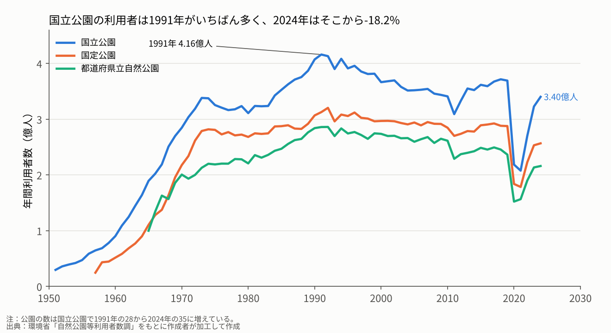
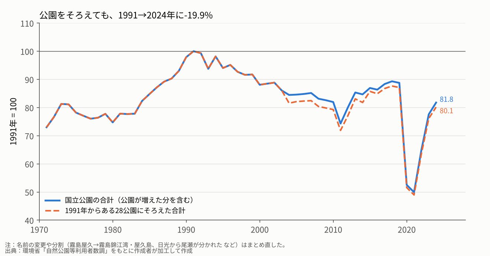
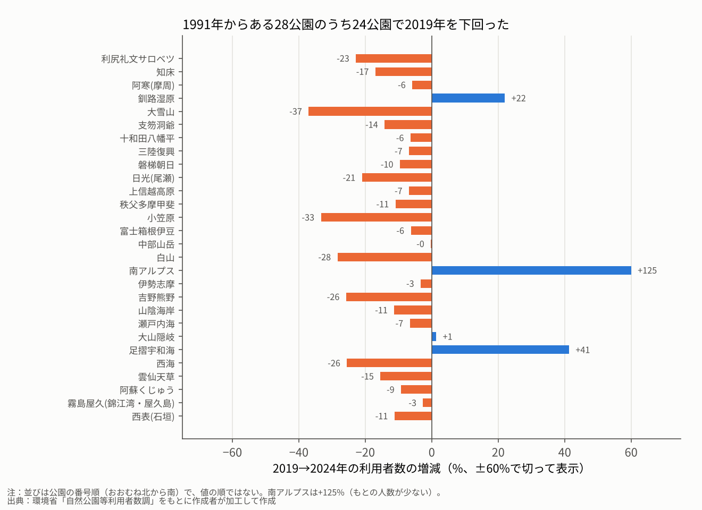
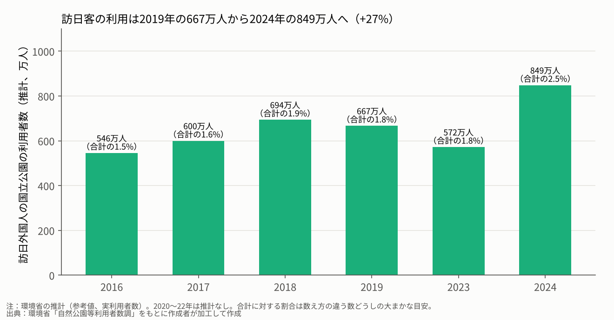

# F459 国立公園を訪れる人は、減っているのか？ 1991年の4.16億人から2024年の3.40億人へ18.2%減。公園をそろえると19.9%減で、28公園のうち24公園が2019年を下回った

## 結論（先に）

- 国立公園の年間利用者数は1991年の4億1,596万人がいちばん多く、2024年は3億4,007万人で、18.2%少ない水準でした。
- 国立公園の数は1991年の28から2024年の35に増えています。1991年からある28公園（名前の変更や分割はまとめ直した）にそろえると、1991→2024年は19.9%の減りでした。
- 2024年は2019年（3億6,915万人）より7.9%少なく、コロナ前に戻っていません。そろえた28公園のうち24公園で2019年を下回りました。
- 国定公園（いちばん多い1992年から−19.9%）、都道府県立自然公園（1992年から−24.5%）も同じように減っています。
- 一方、訪日外国人の国立公園の利用（環境省の推計、参考値）は2019年の667万人から2024年の849万人へ27.2%増えました。合計に対しては2.5%ほどの大きさです。

## 問い

国は国立公園の利用を増やす取り組み、とくに訪日客の利用を進めてきました。国立公園や自然観光の仕事をしている人、地方の観光の記事を読む人に向けて、環境省の自然公園等利用者数調で、国立公園の利用者数が長い目でどう動いたか、公園が増えた影響を除くとどうか、コロナの後に戻ったかを確かめます。

## データ（出典）

- 環境省「自然公園等利用者数調」
  - 自然公園の公園数・年間利用者数の推移（1951〜2024年、国立・国定・都道府県立）。早い年は人、のちの年は千人で書かれているので、人にそろえました
  - 国立公園利用者数（公園、年次別、1971〜2024年、万人）。5つの年のまとまりごとに公園の並びが違うので、まとまりごとに読みました。公園別の合計が表の合計と一致することを確かめています
  - 国立公園別訪日外国人利用者数推計値（参考、2016〜2019年・2023〜2024年）
- 取得した Excel 3ファイル（約0.2MB）を data/raw に同梱しています

## 事前の計画

計画は [PLAN.md](PLAN.md) に、公園別の集計の前に書きました（2026-11-16 20:10）。表の形を確かめるときに、合計の列の一部の値を見ています。計画では1991年の公園数を29と書きましたが、表では28でした。

| 仮説 | 外れの基準 | 結果 | 判定 |
|---|---|---|---|
| H1 いちばん多い年より2024年が10%以上少ない | 10%未満 | −18.2%（1991年がいちばん多い） | 支持 |
| H2 1991年からある公園にそろえると、減りは全体より大きい | 同じか小さい | −19.9% と −18.2% | 支持 |
| H3 2024年は2019年より5%以上少ない | 5%未満 | −7.9% | 支持 |
| H4 そろえた公園のうち、2024年が2019年を下回る公園が過半 | 半分以下 | 28のうち24 | 支持 |

## やったこと

1. 合計の表と公園別の表を読み、単位を人（公園別は万人）にそろえました（src/02_build.py）。
2. 1991年からある公園に、名前の変更・分割（三陸復興、阿寒摩周、西表石垣、霧島錦江湾と屋久島、日光と尾瀬）をまとめ直して「そろえた合計」を作りました（src/03_analysis.py）。
3. 公園ごとに2019→2024年の増減を求めました。並べ方は公園の番号順（おおむね北から南）です。

## 分かったこと

### 図1 国立公園の利用者は1991年がいちばん多い



- 国立公園の利用者数は1950〜80年代に増え、1991年に4億1,596万人でいちばん多くなりました。
- 2020年はコロナの影響で2億1,849万人まで下がり、2024年は3億4,007万人でした。
- 国定公園と都道府県立自然公園も、1992年をいちばん多くして同じように減っています。

### 図2 公園をそろえても減っている



- 1991年からある28公園の合計は、1991年の4億1,596万人から2024年の3億3,339万人へ19.9%減りました。
- 1991年より後に指定された公園（慶良間諸島、妙高戸隠連山、やんばる、奄美群島、日高山脈襟裳十勝。尾瀬は日光にまとめ直した）が2024年に加えた分は668万人で、全体の減りを少し小さく見せています。

### 図3 28公園のうち24公園で2019年を下回った



- 2019→2024年に、大雪山（−37%）、小笠原（−33%）、白山（−28%）などが大きく減りました。
- 増えたのは釧路湿原（+22%）、南アルプス（+125%、もとの人数が少ない）、大山隠岐（+1%）、足摺宇和海（+41%）の4公園でした。

## 問い直し（結果を見てから足した）

利用者が2019年より減っていたので、国が力を入れてきた訪日客の利用（環境省の推計、参考値）を足して見ました（src/03b_requestion.py）。



- 訪日外国人の国立公園の利用者数（実利用者数）は、2016年の546万人、2019年の667万人、2024年の849万人と増えました（2019→2024年で+27.2%）。
- 訪日客のうち国立公園を訪れた人の割合（訪問率）は、2019年の20.9%から2024年の23.8%に上がりました。
- 合計の利用者数に対する大きさは、2019年1.8%、2024年2.5%の目安です（数え方の違う数どうしの大まかな比較）。訪日客の増え方は、国立公園全体の減りを打ち消すほどの大きさではありません。

## 頑健性

| 確かめたこと | 値 | 結論は変わったか |
|---|---|---|
| 国立公園：1990〜94年平均→2022〜24年平均 | −23.6% | 減りは大きく見える |
| 国立公園：1990〜94年平均→2023〜24年平均 | −18.6% | 変わらない |
| 国定公園：いちばん多い年（1992年）→2024年 | −19.9% | 同じ形 |
| 都道府県立自然公園：いちばん多い年（1992年）→2024年 | −24.5% | 同じ形 |
| そろえた公園から区域が広がった西表(石垣)を除く 1991→2024年 | −20.3% | 変わらない |
| 2024年の代わりに2023年：国立公園 2019→2023年 | −12.6% | 変わらない |
| そろえた公園で2023年が2019年を下回った数 | 22/28 | 変わらない |

## 言えないこと

- 利用者数は各公園の推計で、数え方は公園や年によって違う可能性があります。
- 区域の拡張・縮小の影響は、名前の変更や分割をまとめ直す以外には取り除いていません。
- 訪日客の推計は参考値で、合計の利用者数とは数え方が違います。
- 減った理由（人口、旅行の好み、交通など）は、このデータからは分かりません。
- 公園ごとの増減は、もとの人数が少ない公園では大きく振れます。

## 仕事で使うなら

- 国立公園の利用を長い目で比べるときは、公園の数が増えていることに気をつけ、そろえた公園の合計も並べると誤解が減ります。
- 訪日客の利用が増えていても、全体の中では小さな割合なので、全体の動きは日本人の利用でほぼ決まっている、という読み方がこのデータに沿っています。

## 計画からの変更

- 1991年の国立公園の数は、計画では29としていましたが、表の値（28）を使いました。
- 問い直し（訪日客の推計）を結果を見てから足しました。

## 再現のしかた

```sh
pip install -r requirements.txt
sh src/run_all.sh          # ネットにつながず data/raw から全部作る
# python3 src/01_fetch.py  # 元データを取り直すときだけ（ネットが必要）
```

| ファイル | 役割 |
|---|---|
| src/01_fetch.py | 環境省のサイトから Excel 3ファイルを取得（run_all.sh からは呼ばない） |
| src/02_build.py | 合計の表と公園別の表を読む |
| src/03_analysis.py | 推移、そろえた公園、2019→2024年、仮説の判定、頑健性 |
| src/03b_requestion.py | 問い直し（訪日客の推計） |
| src/04_figures.py | 図4枚 |

所要時間は約3秒（CPU 1つ）。乱数は使っていません。再実行の確かめは results/repro_check.txt にあります。

## レビューで直したこと

独立レビュー（2026-11-17）で数字の照合・再実行・図を確かめ、直すところはなかった。

## 出典

- 環境省「自然公園の統計」（自然公園等利用者数調）：https://www.env.go.jp/park/doc/data.html

（いずれも環境省「自然公園等利用者数調」をもとに作成者が加工して作成）
