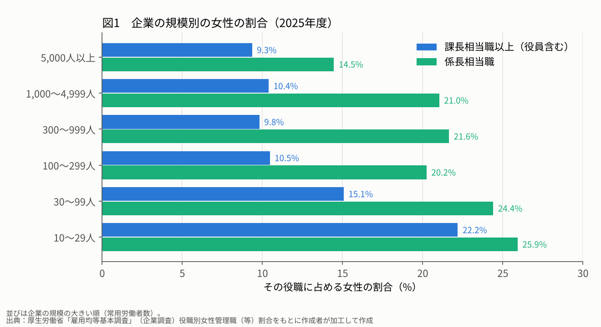
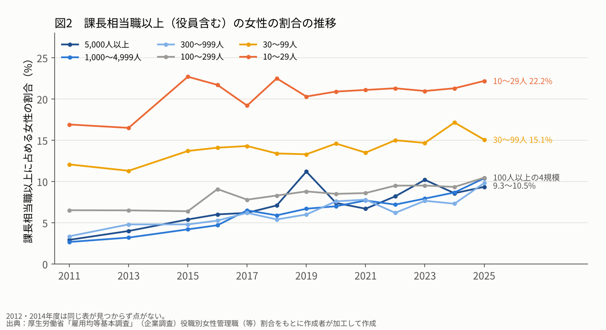
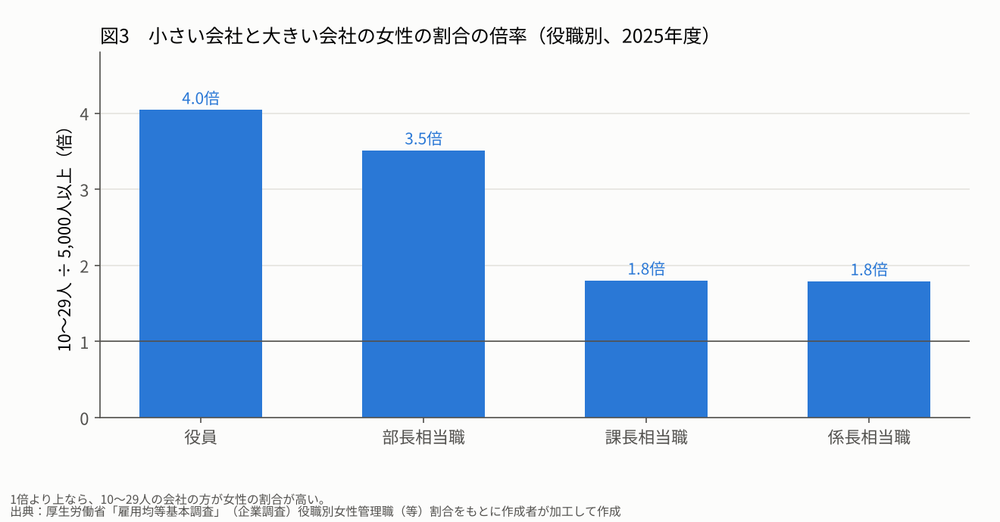
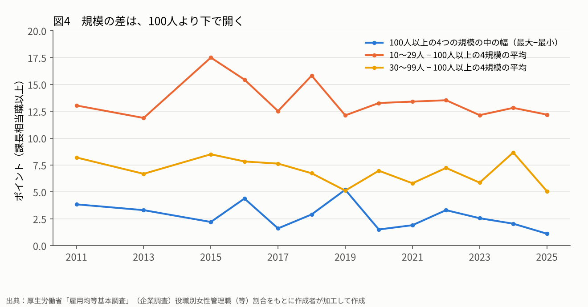

# F460 企業の女性の管理職の割合は、規模でどう違うのか？ 課長以上は10〜29人の会社で22.2%、5,000人以上で9.3%。100人以上の会社どうしの差は3.8→1.1ポイントに縮んだ

## 結論（先に）

- 2025年度、課長相当職以上（役員含む）に占める女性の割合は、10〜29人の会社で22.2%、5,000人以上の会社で9.3%でした。小さい会社の方が2.37倍高い水準です。
- ただし差がはっきり出るのは100人より下です。100人以上の4つの規模（5,000人以上、1,000〜4,999人、300〜999人、100〜299人）は9.3〜10.5%に並び、幅は2011年度の3.8ポイントから1.1ポイントに縮みました。
- 10〜29人と5,000人以上の倍率は、2011年度の5.8倍から2025年度の2.4倍へ下がりました。ポイントの差は14.0→12.8ポイントで、こちらはあまり縮んでいません。大きい会社が速く上がった（年0.46ポイント）一方、小さい会社も上がっています（年0.28ポイント）。
- 規模の差は上の役職ほど大きく、10〜29人÷5,000人以上は役員4.0倍、部長相当職3.5倍、課長相当職1.8倍、係長相当職1.8倍でした。

## 問い

企業の女性の管理職の割合は、規模でどう違うのか？ 「大企業の方が進んでいる」とも「中小の方が多い」とも言われます。厚生労働省「雇用均等基本調査（企業調査）」の役職別女性管理職割合は、企業の規模ごとに出ています。規模ごとの違いと、その違いが年とともにどう動いたかを確かめました。人事・採用の仕事をしている人や、女性の登用の記事を読む人を想定しています。

## データ（出典）

- 厚生労働省「雇用均等基本調査」企業調査「役職別女性管理職（等）割合」（政府統計の総合窓口 e-Stat）
- 年度：2003、2009、2011、2013、2015〜2025年度。2010・2012・2014年度は同じ名前の表が見つからず使っていません。
- 規模（常用労働者数）：5,000人以上、1,000〜4,999人、300〜999人、100〜299人、30〜99人、10〜29人。2003年度は30〜99人までです。
- 役職：課長相当職以上（役員含む）、係長相当職以上（役員含む）、役員、部長相当職、課長相当職、係長相当職。課長相当職以上は2011年度からあります。
- 値は「その役職の人のうち女性の割合（%）」です。2017年度のファイルは1枚目が別の表で、2枚目のシートを読みました（data/raw/SOURCES.md に記録）。

## 事前の計画

PLAN.md に、規模別の集計の前に仮説と外れの基準を書きました。

| 仮説 | 外れの基準 | 結果 | 判定 |
|---|---|---|---|
| H1：2025年度の課長相当職以上は、10〜29人が5,000人以上の2倍以上 | 2倍未満 | 22.2% ÷ 9.3% ＝ 2.37倍 | 支持 |
| H2：10〜29人と5,000人以上の差（ポイント）は2011年度より2025年度が小さい | 同じか大きい | 14.0 → 12.8ポイント | 支持（ただし小さい縮み。下の頑健性を参照） |
| H3：規模の倍率は部長相当職の方が係長相当職より大きい | 同じか小さい | 部長3.5倍、係長1.8倍 | 支持 |
| H4：2009→2025年度の係長相当職の上がり幅は5,000人以上の方が大きい | 同じか小さい | 5,000人以上 +6.0、10〜29人 +4.5ポイント | 単年では支持、3年平均では外れ |

## やったこと

- e-Stat の Excel 15ファイルから、規模別の行と役職別の列を取り出しました（表の形は年で少し違うので、見出しの文字で列を決めています）。
- 規模ごとの女性の割合、小さい会社と大きい会社の差と倍率、役職ごとの倍率を計算しました。
- 規模の並びは大きい順にしています（割合の高い順・低い順には並べていません）。

## 分かったこと

### 図1 2025年度は、小さい会社ほど女性の割合が高い



課長相当職以上の女性の割合は、5,000人以上9.3%、1,000〜4,999人10.4%、300〜999人9.8%、100〜299人10.5%、30〜99人15.1%、10〜29人22.2%でした。係長相当職でも14.5%から25.9%まで、同じ向きです。10人以上の会社全体では13.8%でした。

### 図2 大きい会社が追いつき、100人以上はほぼ同じ水準になった



2011年度の課長相当職以上は、5,000人以上2.9%、1,000〜4,999人2.7%でした。2025年度にはそれぞれ9.3%、10.4%です。2011〜2025年度の傾き（最小二乗）は、5,000人以上が年0.46ポイント、1,000〜4,999人が年0.50ポイントで、30〜99人（年0.27）と10〜29人（年0.28）より速く上がりました。10〜29人は年ごとの振れが大きく、2015年度と2018年度に22%台になっています。

### 図3 差が大きいのは上の役職



10〜29人÷5,000人以上の倍率は、役員4.0倍、部長相当職3.5倍、課長相当職1.8倍、係長相当職1.8倍でした。5,000人以上の部長相当職は4.8%で、10〜29人（16.7%）との差が大きいままです。

## 問い直し（結果を見てから足した）

最初の比較は両端の規模だけでした。結果を見て「差は大企業どうしでもあるのか、それとも100人より下だけなのか」を足しました（03b_requestion.py）。



- 100人以上の4規模の中の幅（最大−最小）は2011年度3.8ポイント、2025年度1.1ポイントで、2011〜2025年度の平均は2.8ポイントでした。
- 10〜29人と100人以上の4規模の平均との差は、2011年度13.0ポイント、2025年度12.2ポイントで、平均13.5ポイントでした。
- 30〜99人との差は8.2→5.1ポイントで、こちらは縮んでいます。
- つまり「規模が大きいほど低い」というより、「100人以上はほぼ同じ水準で、100人より下、とくに30人より下が高い」という形です。
- 役員と部長相当職の差は、10〜29人で10.2ポイント、30〜99人で8.5ポイントと、小さい会社ほど役員の方が高く出ます。小さい会社では、経営者の家族が役員になっている例が多いのかもしれません（推測。この表では確かめられません）。

## 頑健性

| 確かめたこと | 結果 | 結論への影響 |
|---|---|---|
| 役員を含まない部長・課長・係長で見る | 2025年度の倍率は部長3.5、課長1.8、係長1.8倍。2011年度は4.4、3.4、2.0倍 | 小さい会社の方が高い向きは同じ。倍率はどの役職でも下がった |
| 同じく、ポイントの差 | 部長6.7→12.0、課長7.9→8.4、係長9.7→11.5ポイント | 役員を除くと、ポイントの差は縮んでいない。H2 の「差が縮んだ」は課長相当職以上（役員含む）に限った話 |
| 3年平均で比べる（2011・13・15年度と2023〜25年度） | 差14.6→12.1ポイント、倍率4.6→2.3倍 | H2 と同じ向き |
| 係長相当職の上がり幅を3年平均で（2009・11・13年度と2023〜25年度） | 5,000人以上 +6.0、10〜29人 +6.3ポイント | H4 は単年の結果で、3年平均では逆。H4 は頑健でない |
| 規模の小ささと割合の順位相関（6規模） | 2011〜2025年度の13年で0.60〜1.00、2025年度0.94 | どの年も「小さいほど高い」寄り |
| 10〜29人を除いた5規模の順位相関 | 0.30〜1.00。2019・2023年度は0.30 | 30人以上だけだと向きは弱い年がある。図4の形と合う |
| どの年も10〜29人 ＞ 5,000人以上か | 課長相当職以上13/13年、係長相当職14/14年 | 向きは毎年同じ |
| 2003年度（係長以上、30〜99人まで） | 5,000人以上3.3%、30〜99人10.7%（2025年度は11.5%、17.5%） | 20年前も同じ向きで、大きい会社の上がり方が大きい |

## 言えないこと

- 規模別の表と産業別の表は別で、規模×産業の表はありません。小さい会社の割合が高いのが、女性の多い産業が小さい会社に多いからなのかは、このデータでは分けられません。
- 管理職の「相当職」は会社ごとの決め方によります。小さい会社の課長と大きい会社の課長が、同じ数の部下や同じ権限を持つとは限りません。
- 標本調査なので年ごとの振れがあります。とくに5,000人以上の役員、10〜29人の各役職は振れが大きく、2019年度の5,000人以上（11.2%）は前後の年より高く出ています。
- 値は「役職の人のうち女性の割合」で、女性の管理職がいる会社の割合ではありません（別の表です）。
- 2010・2012・2014年度は抜けているので、その間の動きは分かりません。

## 仕事で使うなら

- 「女性の管理職の割合」を規模で比べるときは、両端だけでなく100人の前後で分けて見ると、形がつかみやすくなります。100人以上どうしでは、2025年度の差は1ポイントほどでした。
- 大きい会社の数字を語るときは、部長相当職（5,000人以上で4.8%）と係長相当職（14.5%）の差もあわせて示すと、どの段で少ないかが伝わります。
- 単年の値は振れるので、規模の小さい区分や役員は3年平均で見る方が安全です。

## 計画からの変更

- 問い直し（100人以上の4規模の幅、規模ごとの傾き、役員と部長の差）は、結果を見てから足しました。
- 2017年度のファイルで、読むシートを表題で選ぶようにしました。

## 再現のしかた

```sh
pip install -r requirements.txt
sh src/run_all.sh          # ネットにつながず data/raw から全部作る
# python3 src/01_fetch.py  # 元データを取り直すときだけ（ネットが必要）
```

| ファイル | 役割 |
|---|---|
| src/01_fetch.py | e-Stat から Excel 15ファイルを取得（run_all.sh からは呼ばない） |
| src/02_build.py | 規模別の行と役職別の列を取り出して data/managers_by_size.csv を作る |
| src/03_analysis.py | 仮説の判定、頑健性 |
| src/03b_requestion.py | 問い直し（100人以上の幅、傾き） |
| src/04_figures.py | 図4枚 |

所要時間は数秒（CPU 1つ）。乱数は使っていません。再実行の確かめは results/repro_check.txt にあります。

## レビューで直したこと

独立レビュー（2026-11-17）で、数字の照合・再実行・図を確かめ、次を直しました。直したあとに /tmp の新しいフォルダで流し直し、results と figures がすべて一致することを確かめています。

| # | 指摘 | 直し方 |
|---|---|---|
| 1 | 「言えないこと」で女性の多い産業の例に、扱わない話題に近い産業名を挙げていた | 例の産業名を外し「女性の多い産業」とだけ書いた（README・note。PLAN.md は計画の記録なのでそのまま） |

## 出典

- 厚生労働省「雇用均等基本調査」（政府統計の総合窓口 e-Stat）：https://www.e-stat.go.jp/stat-search/files?toukei=00450281&tstat=000001051898

（いずれも厚生労働省「雇用均等基本調査」をもとに作成者が加工して作成）
