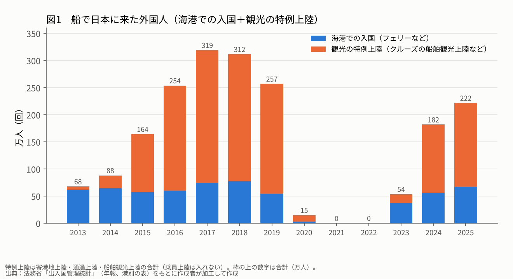
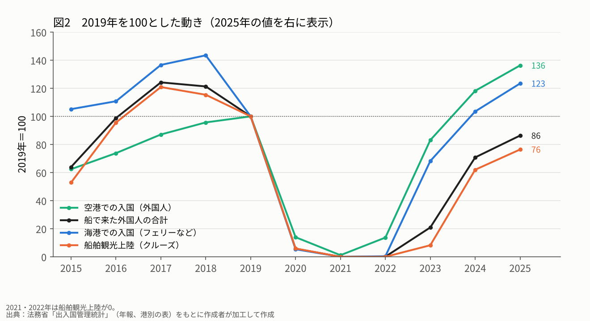
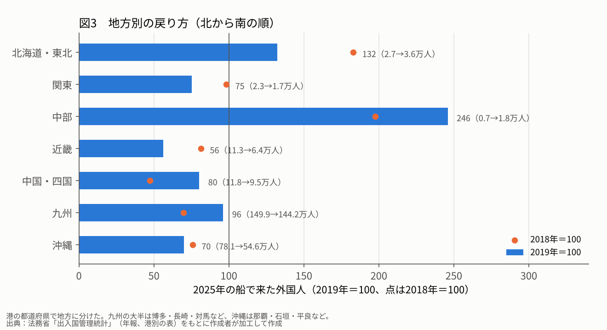
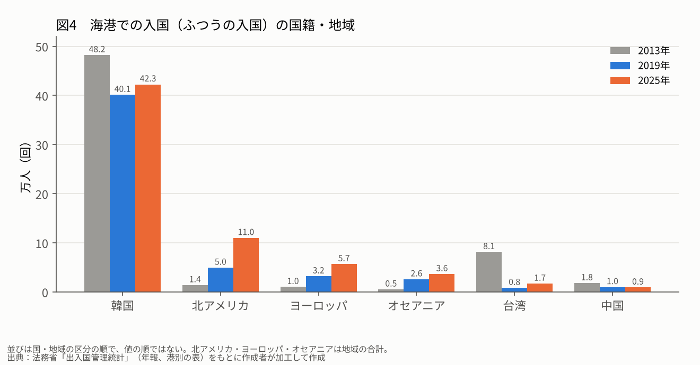

# F461 船で日本に来る外国人は、コロナ前に戻ったのか？ 2025年は222万人で2019年の86%。フェリーなどの入国は23%増えたが、クルーズの上陸は24%少ない

## 結論（先に）

- 船で日本に来た外国人（海港での入国＋クルーズなどの観光の特例上陸）は、2025年に221.8万人（回）で、2019年（256.9万人）の86.3%でした。空港での外国人の入国が2019年の1.36倍になったのとは違い、コロナ前に戻っていません。いちばん多かった2017年（319.1万人）の7割ほどです。
- 中身は逆向きに動きました。海港でのふつうの入国（フェリーなど）は54.3万→67.0万人で1.23倍に増え、クルーズの客が使う船舶観光上陸は202.6万→154.8万人で0.76倍でした。
- 船舶観光上陸の減り（−47.8万人）は、中国の国籍の客の減り（159.6万→108.8万人、−50.8万人）でほぼ説明できます。中国の割合は78.8%から70.3%に下がりました。
- 地方別では、2019年と比べると沖縄（70）が九州（96）より戻りが遅く見えます。ただし2018年と比べると九州70、沖縄76で順番が入れ替わり、どちらが遅いかはくらべる年で変わります。

## 問い

船で日本に来る外国人は、コロナ前に戻ったのか？ 訪日客全体は2019年を大きく上回りました。一方で、韓国とのフェリーや、九州・沖縄に寄るクルーズ船の客はどうか。港・観光・地域の仕事をしている人に向けて、法務省「出入国管理統計」の港別の表で確かめました。

## データ（出典）

- 法務省「出入国管理統計」年報（e-Stat）、2013〜2025年
  - 港別 出入国者（港ごとの入国外国人）
  - 港別 特例上陸許可人員（寄港地上陸、通過上陸、船舶観光上陸、乗員上陸）
  - 船舶観光上陸許可人員の国籍・地域（2016〜2025年）
  - 港別 入国外国人の国籍・地域（2013・2019・2025年）
- この記事の「船で来た外国人」＝海港（名前に「空港」がつかない港）での入国外国人 ＋ 海港での寄港地上陸・通過上陸・船舶観光上陸。乗員上陸（船員）は入れていません。
- クルーズの客の多くは、2015年に始まった「船舶観光上陸許可」で上陸していて、入国外国人の数には入りません。そのため両方を足しています。2014年まではクルーズの客の一部が寄港地上陸に入っていました。
- 港の都道府県は、2022年以降の表にある都道府県の列から取りました。2023年から「大阪」「神戸」は「大阪(阪神)」「神戸(阪神)」の名前になったので、同じ港としてそろえました。

## 事前の計画

PLAN.md に仮説と外れの基準を書きました。表の取り出しを点検するときに全国の合計と上位の港の値を見ていたので、H1・H2 はその確かめで、H3・H4 は見ていない集計についての仮説です（PLAN.md に明記）。

| 仮説 | 外れの基準 | 結果 | 判定 |
|---|---|---|---|
| H1：2025年の船で来た外国人は2019年より10%以上少ない | 10%未満の減りか増加 | −13.7% | 支持（下見で見えた値の確かめ） |
| H2：船の2019年比は空港の2019年比より0.3以上低い | 差が0.3未満 | 空港1.363、船0.863、差0.50 | 支持（同上） |
| H3：2019年比は沖縄の方が九州より低い | 同じか高い | 沖縄0.699、九州0.962 | 支持。ただし2018年比では逆（頑健でない） |
| H4：船舶観光上陸のうち九州・沖縄の港の割合は2019年より2025年が低い | 同じか高い | 93.3% → 97.0% | 外れ（集中はむしろ強まった） |

## やったこと

- 港別の表を年ごとに読み、名前に「空港」がつく港とつかない港に分けました。全国の合計と港の合計が一致することを年ごとに確かめています。
- 特例上陸は、見出しの文字で寄港地上陸・通過上陸・船舶観光上陸・乗員上陸の列を決めました。
- 港の都道府県から、北から南の7つの地方に分けました（悪い順には並べていません）。

## 分かったこと

### 図1 2017年がいちばん多く、2025年はその7割



船で来た外国人は、船舶観光上陸が始まった2015年から急に増え、2017年に319.1万人でいちばん多くなりました。2018年311.7万人、2019年256.9万人と減り始めたところでコロナになり、2021・2022年はほぼ0でした。2023年53.7万人、2024年181.9万人、2025年221.8万人と戻っています。

### 図2 フェリーなどの入国は戻り、クルーズは戻っていない



2019年を100とすると、2025年は空港での入国136、海港での入国123、船で来た外国人の合計86、船舶観光上陸76でした。船舶観光上陸の国籍を見ると、中国が159.6万→108.8万人に減り、台湾は28.2万→27.9万人でほぼ同じ、韓国は1.6万→4.0万人に増えました。合計の減り（−47.8万人）は中国の減り（−50.8万人）とほぼ同じ大きさです。

### 図3 地方別：九州と沖縄が大半、戻り方はくらべる年で変わる



2025年の船で来た外国人は、九州144.2万人、沖縄54.6万人で、2つで全体の9割です。2019年と比べると九州96、沖縄70、近畿56、中国・四国80、関東75、北海道・東北132、中部246でした（北海道・東北と中部はもとの人数が少ない地方です）。2018年と比べると九州70、沖縄76です。九州は2019年に対馬のフェリー（韓国の客）が大きく減っていたので、2019年とくらべると戻りがよく見えます。

## 問い直し（結果を見てから足した）

海港でのふつうの入国が2019年より12.7万人増えたのを見て、「増えたのは誰で、どの港か」を足しました（03b_requestion.py）。



- 北アメリカ・ヨーロッパ・オセアニアの合計は10.7万→20.3万人で、増えた分の75%を占めました。
- 米国・ヨーロッパ・オセアニアの客が増えた港は、長崎（1.3万→4.1万人）、鹿児島（0.7万→1.9万人）、佐世保（0.1万→1.2万人）、金沢（0.04万→1.2万人）、函館（0.3万→1.3万人）などでした。クルーズ船の客が、船舶観光上陸ではなくふつうの入国の手続きで上陸している例が多いのかもしれません（推測。この表では船の種類は分かりません）。
- 韓国は40.1万→42.3万人で、2013年（48.2万人）には届いていません。比田勝（対馬）は20.1万→22.6万人に増え、厳原（対馬）は6.2万→4.0万人、博多は7.9万→6.5万人に減りました。

## 頑健性

| 確かめたこと | 結果 | 結論への影響 |
|---|---|---|
| くらべる年を2018年にする | 船0.712、空港1.424 | 「船は戻っていない」はより強くなる |
| 同じく、地方別 | 九州0.697、沖縄0.758 | H3 は逆になる。沖縄の方が遅いとは言えない |
| 終わりの年を2024年にする | 船0.708、空港1.182。沖縄0.621、九州0.758 | 向きは同じ |
| 乗員上陸（船員）も入れる | 0.851（船員だけでは0.834） | ほぼ同じ |
| 船舶観光上陸だけで見る | 0.764。九州0.878、沖縄0.674 | クルーズだけでも戻っていない |
| 海港でのふつうの入国だけ | 2019年比1.234、2018年比0.860 | 2019年比では増えたが、2018年には届かない |
| 九州から対馬の2港を除く | 2019年比0.951、2018年比0.708 | 対馬を除いても九州の形は同じ |

## 言えないこと

- 入国外国人と上陸許可の数は「回数」で、同じ人が何度も来れば何度も数えます。
- 1回の航海で2つの港に寄るクルーズの客が、船舶観光上陸で何回数えられるかは確かめていません。人数そのものとは違う可能性があります。
- 空港で入国してから日本の港で船に乗るクルーズ（フライ＆クルーズ）の客は、空港での入国に入っています。
- 海港での入国の増えた分のうち、どれだけがクルーズの客かは、この表では分かりません（上の推測）。
- 港ごとの人数は、船会社の航路や寄港地の決め方で大きく動きます。減った・増えた理由は、この表では分かりません。

## 仕事で使うなら

- 「船で来る外国人」を数えるときは、入国外国人だけでなく船舶観光上陸も足さないと、クルーズの客の多くが抜けます。
- 2019年は対馬のフェリーが減った年なので、フェリーの戻りを語るときは2018年も並べると誤解が減ります。
- クルーズの客は中国の国籍の割合が高く、合計の動きは中国の客の動きに大きく左右されます。

## 計画からの変更

- 問い直し（海港での入国の国籍と港）を結果を見てから足しました。
- 頑健性に「九州から対馬の2港を除く」を足しました（計画では大阪・神戸の名前のそろえ方を確かめるとしていましたが、地方は都道府県で決まるので結果に影響しないため、差し替えました）。

## 再現のしかた

```sh
pip install -r requirements.txt
sh src/run_all.sh          # ネットにつながず data/raw から全部作る
# python3 src/01_fetch.py  # 元データを取り直すときだけ（ネットが必要）
```

| ファイル | 役割 |
|---|---|
| src/01_fetch.py | e-Stat から Excel 38ファイルを取得（run_all.sh からは呼ばない） |
| src/02_build.py | 港別の表を読み、合計との一致を確かめて data/*.csv を作る |
| src/03_analysis.py | 推移、地方別、仮説の判定、頑健性 |
| src/03b_requestion.py | 問い直し（海港での入国の国籍と港） |
| src/04_figures.py | 図4枚 |

所要時間は十数秒（CPU 1つ）。乱数は使っていません。再実行の確かめは results/repro_check.txt にあります。

## レビューで直したこと

独立レビュー（2026-11-17）で数字の照合・再実行・図を確かめ、直すところはなかった。

## 出典

- 法務省「出入国管理統計」（政府統計の総合窓口 e-Stat）：https://www.e-stat.go.jp/stat-search/files?toukei=00250011&tstat=000001012480

（いずれも法務省「出入国管理統計」をもとに作成者が加工して作成）
