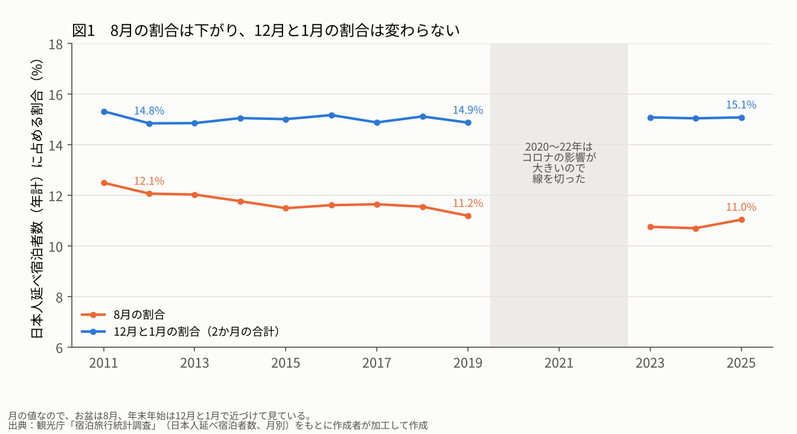
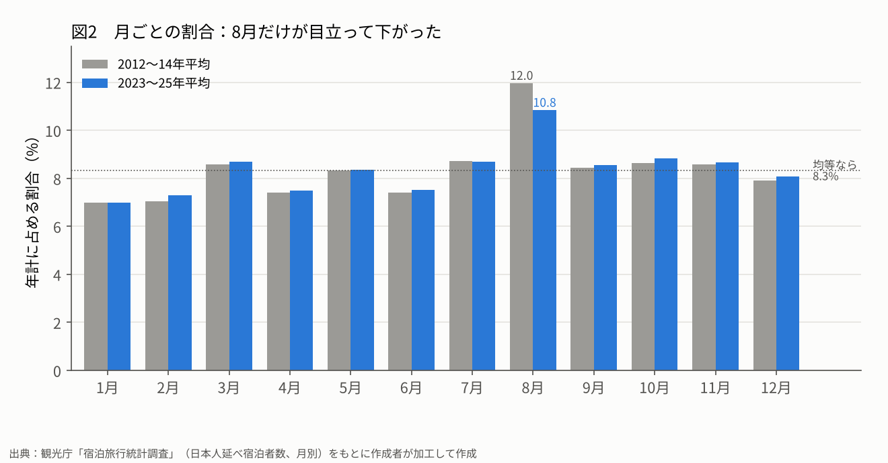
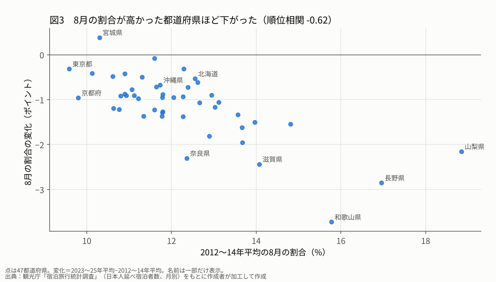
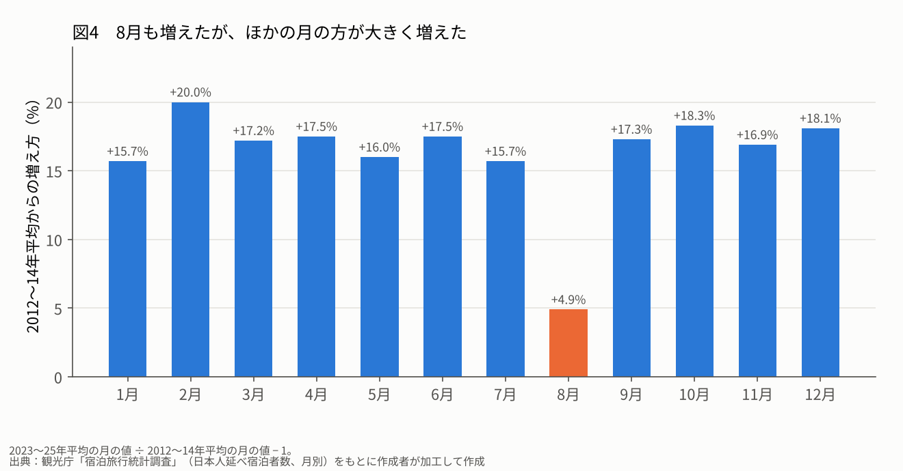

# F462 日本人の旅行は、お盆と年末年始への集中が弱まったのか？ 8月の割合は12.0%→10.8%に下がったが、8月が減ったのではなくほかの月が増えた。12月と1月の割合は変わらない

## 結論（先に）

- 日本人の延べ宿泊者数のうち8月の割合は、2012〜14年平均の11.96%から2023〜25年平均の10.83%へ、1.12ポイント下がりました。47都道府県のうち46で下がっています。
- ただし8月の宿泊が減ったわけではありません。8月は5,077万→5,326万人泊で4.9%増え、ほかの11か月は17.3%増えました。8月の割合の下がり方（−1.12ポイント）は、「ほかの月が増えた」分（−1.61ポイント）でほぼ説明できます。
- 年末年始に近い「12月と1月の割合」は14.92%→15.07%で、下がっていません。月の値で見る限り、年末年始への集中が弱まった形は見えません。
- 8月の割合がもともと高かった都道府県（山梨、長野、和歌山など）ほど大きく下がりました（順位相関 −0.62）。

## 問い

日本人の旅行は、お盆と年末年始への集中が弱まったのか？ 休み方改革や、平日の旅行・ワーケーションのすすめなどが言われてきました。観光庁「宿泊旅行統計調査」の月別の日本人延べ宿泊者数で、繁忙期への集中が弱まったかを確かめました。宿・観光の仕事をしている人や、休みの取り方の記事を読む人を想定しています。

## データ（出典）

- 観光庁「宿泊旅行統計調査」推移表のシート「旧2-2」都道府県別 日本人延べ宿泊者数（月別、2011年1月〜2025年12月、確定値）
- 2026年1月分から調査の層の分け方が変わったため、2026年の値は使っていません。
- 月の値しかないので、お盆は「8月」、年末年始は「12月と1月」で近づけて見ています。
- 2020〜2022年はコロナの影響が大きいので、主な比較は2012〜14年平均と2023〜25年平均です（2011年は震災の影響があるので除きました）。
- 47都道府県の合計と全国の値の差は、どの月も70人泊以下でした（四捨五入の差）。

## 事前の計画

PLAN.md に、集中の物差しを計算する前に仮説と外れの基準を書きました。

| 仮説 | 外れの基準 | 結果 | 判定 |
|---|---|---|---|
| H1：全国の8月の割合は0.3ポイント以上下がる | 低下0.3未満か上昇 | 11.96% → 10.83%（−1.12ポイント） | 支持 |
| H2：12か月の偏り（1日あたりのジニ係数）は小さくなる | 同じか大きい | 0.0663 → 0.0556 | 支持 |
| H3：8月の割合が下がった都道府県は過半（24以上） | 23以下 | 46 | 支持 |
| H4：もとの8月の割合が高いほど下がり方が大きい（順位相関 < −0.3） | −0.3以上 | −0.62 | 支持 |

## やったこと

- 都道府県×年×月の日本人延べ宿泊者数を取り出し、年ごとに月の割合を計算しました。
- 月の日数の違い（2月が短いなど）をならすため、ジニ係数と変動係数は1日あたりの値で計算しました。
- 都道府県の図は散布図で、悪い順・良い順の並びにはしていません。

## 分かったこと

### 図1 8月の割合は下がり、12月と1月の割合は変わらない



8月の割合は2012年12.07%から2019年11.19%へゆっくり下がり（2012〜19年の傾きは年−0.10ポイント）、2023年10.76%、2024年10.70%、2025年11.04%でした。12月と1月の割合は、コロナの前もあとも15%前後で動いていません。5月（大型連休）の割合も8.34%→8.35%でほぼ同じでした。

### 図2 月ごとの割合：8月だけが目立って下がった



2012〜14年平均と2023〜25年平均をくらべると、8月の割合は−1.12ポイントで、ほかの月は−0.01〜+0.26ポイントの小さな動きでした。いちばん上がったのは2月（+0.26ポイント）、次が10月（+0.19ポイント）です。どの年もいちばん多い月は8月のままです（2020・2021年を除く）。

### 図3 8月の割合が高かった都道府県ほど下がった



2012〜14年平均の8月の割合は、都道府県で9.6%から18.8%まで開いていました。山梨（18.8%→16.7%）、長野（17.0%→14.1%）、和歌山（15.8%→12.1%）のように、夏の旅先として8月の割合が高かったところほど大きく下がっています。上がったのは宮城（+0.39ポイント）だけでした。

## 問い直し（結果を見てから足した）

8月の割合が下がったのを見て、「8月が減ったのか、ほかの月が増えたのか」を足しました（03b_requestion.py）。



- 8月の日本人延べ宿泊者数は、2012〜14年平均5,077万人泊、2023〜25年平均5,326万人泊で、4.9%増えました。
- ほかの11か月の合計は3億7,398万→4億3,857万人泊で、17.3%増えました。月ごとには+15.7%（1月・7月）から+20.0%（2月）です。
- 8月の割合の変化（−1.12ポイント）を分けると、8月が増えた分が+0.48ポイント、ほかの月が増えた分が−1.61ポイントでした。
- つまり「8月に行く人が減った」のではなく、「8月以外の宿泊が大きく増えた」ことで割合が下がっています。8月以外の増え方には、仕事の宿泊も入っています（この表では旅行と仕事を分けられません）。

## 頑健性

| 確かめたこと | 結果 | 結論への影響 |
|---|---|---|
| コロナの前の期間でも下がっていたか（2012〜19年の傾き） | 8月の割合は年−0.10ポイント、ジニ係数は年−0.0018 | コロナの前から少しずつ下がっていた |
| 2017〜19年平均と2023〜25年平均 | 8月の割合11.46%→10.83%、ジニ係数0.0578→0.0556 | 向きは同じ。コロナの前の数年とくらべると差は小さい |
| 1日あたりにならさないジニ係数 | 0.0723→0.0610 | 同じ |
| ほかの物差し（いちばん多い月÷月の平均、変動係数） | 1.41→1.28、0.140→0.107 | 同じ |
| 単年（2012年と2025年） | 8月の割合12.07%→11.04%、ジニ係数0.0666→0.0601 | 同じ向き。ただし2025年は2024年より8月の割合が上がった |
| 都道府県：2017〜19年平均とくらべる | 47のうち40で8月の割合が下がった | 過半は変わらない |
| 都道府県：ジニ係数 | 47のうち42で小さくなった | 同じ |

## 言えないこと

- 月の値なので、お盆の数日や年末年始の数日への集中は分かりません。12月と1月の割合が変わらなくても、その中の特定の日への集中が変わった可能性はあります。
- 宿泊した人の数なので、日帰り旅行は入りません。仕事の宿泊も入っていて、旅行だけの動きとは違います。
- 連休の並び（曜日のめぐり）は年ごとに違い、単年の値を動かします。2025年に8月の割合が上がった理由は分かりません。
- 8月は宿が満室に近く、受け入れられる量が上限になって増えにくい可能性があります（推測。この表では確かめられません）。
- 割合が下がったことが、休みの取り方が変わった結果なのかは、このデータでは分かりません。

## 仕事で使うなら

- 「繁忙期への集中が弱まった」と言うときは、割合だけでなく繁忙期の量そのものも並べると、誤解が減ります。8月は減っておらず、むしろ増えています。
- 月の統計で年末年始を語るのは難しいので、12月と1月の割合が動いていないことは「月の単位では見えない」と書くのが安全です。
- 都道府県で比べるときは、もとの8月の割合の高さで分けると形がつかみやすくなります。

## 計画からの変更

- 問い直し（8月の量とほかの月の量）を結果を見てから足しました。

## 再現のしかた

```sh
pip install -r requirements.txt
sh src/run_all.sh          # ネットにつながず data/raw から全部作る
# python3 src/01_fetch.py  # 元データを取り直すときだけ（ネットが必要）
```

| ファイル | 役割 |
|---|---|
| src/01_fetch.py | 観光庁のサイトから推移表（Excel）を取得（run_all.sh からは呼ばない） |
| src/02_build.py | シート「旧2-2」を読み、全国と47都道府県の合計の一致を確かめる |
| src/03_analysis.py | 月の割合、ジニ係数、都道府県、仮説の判定、頑健性 |
| src/03b_requestion.py | 問い直し（8月の量とほかの月の量） |
| src/04_figures.py | 図4枚 |

所要時間は数秒（CPU 1つ）。乱数は使っていません。再実行の確かめは results/repro_check.txt にあります。

## 関連する記事
- F336「日本人の国内旅行は、減っているのか？」：国内旅行の量の増減を見た記事。本記事は、宿泊の月ごとの集中（8月・年末年始）を見た点が違います。

## レビューで直したこと

独立レビュー（2026-11-17）で、数字の照合・再実行・図を確かめ、次を直しました。直したあとに /tmp の新しいフォルダで流し直し、results と figures がすべて一致することを確かめています。

| # | 指摘 | 直し方 |
|---|---|---|
| 1 | 既存の看板記事との関係が README に書かれていなかった | 「関連する記事」に番号と違いを1文で書いた |

## 出典

- 観光庁「宿泊旅行統計調査」：https://www.mlit.go.jp/kankocho/tokei_hakusyo/shukuhakutokei.html

（いずれも観光庁「宿泊旅行統計調査」をもとに作成者が加工して作成）
