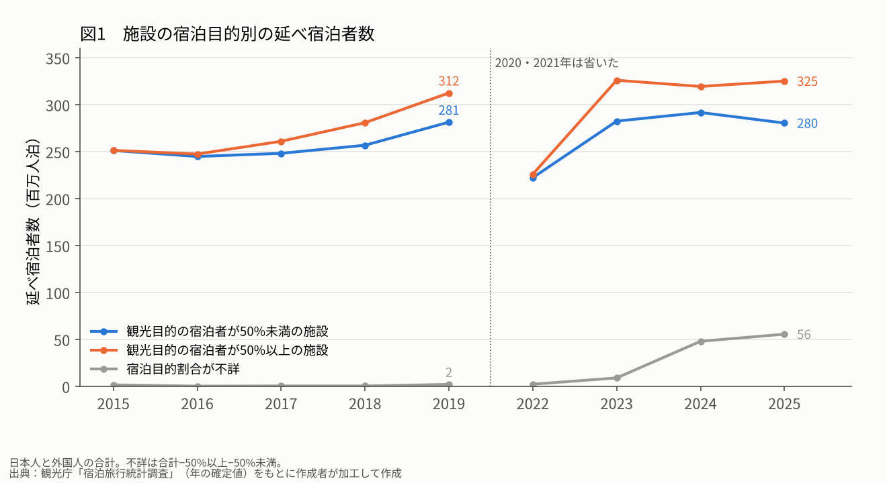
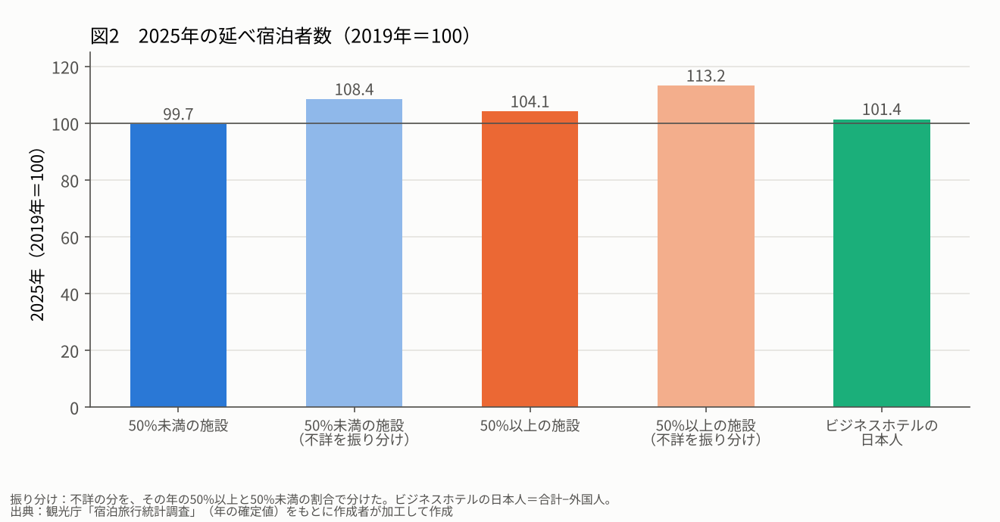
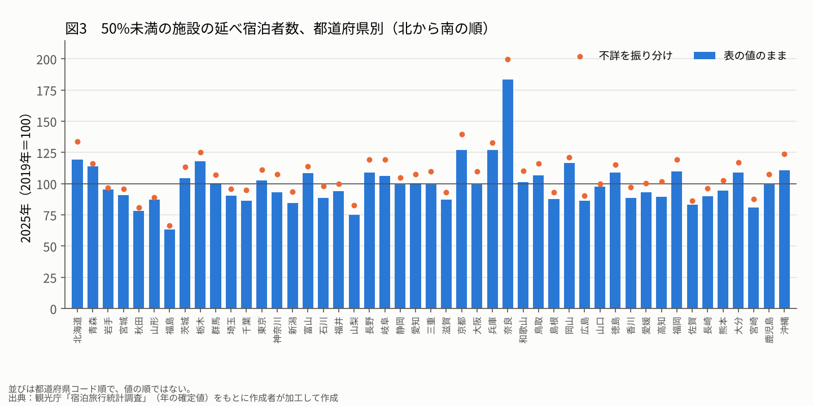
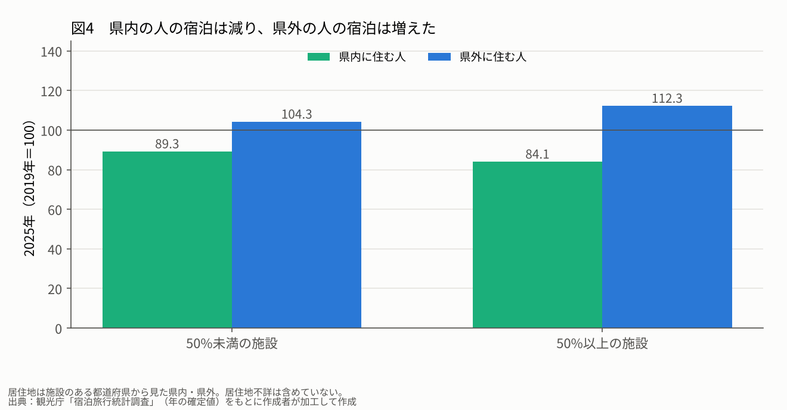

# F463 出張などビジネスの宿泊は、コロナ前に戻ったのか？ 観光客が半分未満の宿の延べ宿泊は2025年に2019年の99.7%でほぼ横ばい。観光客の多い宿（104.1%）より戻りは弱い

## 結論（先に）

- 「観光目的の宿泊者が50%未満」の施設（出張などの客が多い宿）の延べ宿泊者数は、2019年2億8,136万人泊、2025年2億8,042万人泊で、2019年の99.7%でした。「50%以上」の施設は104.1%、全体は110.9%です。
- 50%未満の施設はコロナの前は伸びていました（2015→2019年で+12%）。2023年100.4%、2024年103.7%、2025年99.7%と、2019年の水準で止まっています。
- ただし「宿泊目的割合が不詳」の分が2019年の214万人泊（0.4%）から2025年の5,559万人泊（8.4%）に増えています。不詳を割合で振り分けると、50%未満の施設は108.4%、50%以上は113.2%になります。「2019年に戻った」とは言えますが、「戻っていない」とまでは言えません。どちらの数え方でも、50%未満の施設の方が戻りは弱めでした。
- 50%未満の施設で、県外に住む人の宿泊は104.3%に増え、県内に住む人の宿泊は89.3%に減りました。

## 問い

出張などビジネスの宿泊は、コロナ前に戻ったのか？ オンライン会議が広がり「出張は戻らない」とも言われます。観光庁「宿泊旅行統計調査」は、施設を「観光目的の宿泊者が50%以上」と「50%未満」に分けて延べ宿泊者数を出しています。50%未満の施設の宿泊を出張などの宿泊の目安として、2019年に戻ったかを確かめました。宿・出張・観光の仕事をしている人を想定しています。

## データ（出典）

- 観光庁「宿泊旅行統計調査」年の確定値（2015〜2019年、2022〜2025年。2020・2021年は省きました）
  - 第2表：宿泊目的割合（2区分）別 延べ宿泊者数（全国・都道府県）
  - 第4表：施設タイプ別 延べ宿泊者数と、うち外国人
  - 第9表：宿泊目的割合×居住地（県内・県外）別 延べ宿泊者数
- 延べ宿泊者数は日本人と外国人の合計です（第2表に日本人だけの区分はありません）。
- 宿泊目的割合は施設が答える区分で、「観光目的の宿泊者が50%未満」の施設にも観光客は泊まります。50%未満の施設の宿泊＝出張の宿泊ではありません。
- 不詳＝合計−50%以上−50%未満。47都道府県の合計と全国の値が一致することを年ごとに確かめました。

## 事前の計画

PLAN.md に仮説と外れの基準を書きました。表の取り出しの点検で全国の値を見ていたので、H1・H2 は見えた値の確かめで、H3・H4 は見ていない集計についての仮説です（PLAN.md に明記）。

| 仮説 | 外れの基準 | 結果 | 判定 |
|---|---|---|---|
| H1：50%未満の施設の2025年は2019年の105%未満 | 105%以上 | 99.7% | 支持（確かめ） |
| H2：50%未満の施設の2019年比は50%以上の施設より低い | 同じか高い | 99.7% 対 104.1% | 支持（確かめ） |
| H3：50%未満の施設で2019年を下回る都道府県が過半（24以上） | 23以下 | 27 | 支持。ただし不詳を振り分けると19で外れ |
| H4：三大都市圏の8都府県の2019年比は、ほかの39道県より低い | 同じか高い | 101.0% 対 98.6% | 外れ（大都市圏の方がやや高い） |

## やったこと

- 年の確定値の Excel から、第2表・第4表・第9表の年計を取り出しました。
- 不詳の分は、その年・その地域の50%以上と50%未満の割合で振り分けた値も作り、表の値のままと並べました。
- 都道府県の図は都道府県コード順（北から南）で、値の順には並べていません。

## 分かったこと

### 図1 50%未満の施設は2019年の水準で止まっている



2015年は50%以上と50%未満の施設がどちらも2億5,100万人泊ほどでした。2019年には50%以上が3億1,242万人泊（+24%）、50%未満が2億8,136万人泊（+12%）に伸びました。2022年に50%未満は2億2,224万人泊まで下がり、2023年2億8,247万、2024年2億9,166万、2025年2億8,042万人泊でした。同じ期間に不詳が2024年4,803万、2025年5,559万人泊に増えています。

### 図2 数え方で「戻った度合い」は変わるが、50%未満の方が弱い



2025年の2019年比は、50%未満の施設が表のままで99.7%、不詳を振り分けて108.4%でした。50%以上の施設は104.1%と113.2%です。施設タイプで見ると、ビジネスホテルの日本人の延べ宿泊は2億2,486万→2億2,797万人泊で101.4%、シティホテルの日本人は94.5%でした（タイプ不詳も2025年に5,158万人泊あります）。

### 図3 都道府県別：2019年を下回るのは表のままで27、振り分けると19



50%未満の施設の2025年の2019年比は、都道府県の中央値で99.3%でした。表のままでは27都道府県で2019年を下回り、不詳を振り分けると19に減ります。三大都市圏の8都府県の合計は101.0%（振り分けると110.3%）、ほかの39道県の合計は98.6%（同106.2%）で、大都市圏の方がやや高い結果でした。奈良県（1.8倍）はもとの人数が少ない県です。

## 問い直し（結果を見てから足した）

50%未満の施設が横ばいなのを見て、「誰の宿泊が減ったのか」を、施設のある都道府県から見た居住地（県内・県外）で足しました（03b_requestion.py）。



- 50%未満の施設で、県外に住む人の宿泊は2億541万→2億1,430万人泊（104.3%）、県内に住む人の宿泊は6,024万→5,379万人泊（89.3%）でした。
- 50%以上の施設でも、県外112.3%、県内84.1%で、県内の人の宿泊が減っています。
- 50%未満の施設の宿泊のうち県内の人の割合は、2015年23.0%、2019年21.4%、2025年19.2%と下がり続けています。
- 県内の人の宿泊が減った理由（近くへの出張や会議が減ったのか、など）は、この表では分かりません（推測は控えます）。

## 頑健性

| 確かめたこと | 結果 | 結論への影響 |
|---|---|---|
| 不詳を割合で振り分ける | 50%未満108.4%、50%以上113.2% | 「戻っていない」とは言えなくなる。50%未満の方が弱いのは同じ |
| 終わりの年を2023年にする | 50%未満100.4%（振り分け101.5%）、50%以上104.3% | 同じ（不詳が少ない年でもほぼ横ばい） |
| 終わりの年を2024年にする | 50%未満103.7%（振り分け111.4%）、50%以上102.2% | この年だけは50%未満の方が高い |
| くらべる年を2018年にする | 50%未満109.2%、50%以上115.8% | 同じ向き |
| ビジネスホテルの日本人で見る | 101.4%（2023年は109.1%） | 2019年の水準とほぼ同じ |
| 都道府県で不詳を振り分ける | 2019年を下回るのは19 | H3 は振り分けで外れる |

## 言えないこと

- 50%未満の施設の宿泊は、出張の宿泊そのものではありません。観光客も外国人も入っています。
- 施設の区分は施設の答えによるので、同じ施設が年によって区分を変えることがあります。観光客が増えた宿が「50%以上」に移れば、50%未満の数は小さく出ます。
- 不詳が2024年から大きく増えた理由と、その中身は分かりません。結論はこの不詳の扱いに左右されます。
- 1人あたりの泊数、日帰りの出張、出張の回数は分かりません。
- 県内・県外の区分では、居住地不詳（外国人の一部などを含むと考えられる、推測）を除いています。

## 仕事で使うなら

- 2024年以降の宿泊目的別の数字は、不詳の大きさをあわせて示さないと、50%未満・50%以上のどちらも小さく見えます。
- 「出張が戻ったか」を語るときは、施設の区分とタイプの両方で見て、幅で示すのが安全です（この記事では2019年比99.7〜108.4%）。
- 県内の人の宿泊の減り方が大きいので、地域の宿では県内の客と県外の客を分けて見ると動きがつかみやすくなります。

## 計画からの変更

- 問い直し（県内・県外）を結果を見てから足しました。

## 再現のしかた

```sh
pip install -r requirements.txt
sh src/run_all.sh          # ネットにつながず data/raw から全部作る
# python3 src/01_fetch.py  # 元データを取り直すときだけ（ネットが必要）
```

| ファイル | 役割 |
|---|---|
| src/01_fetch.py | 観光庁のサイトから年の確定値の Excel 9ファイルを取得（run_all.sh からは呼ばない） |
| src/02_build.py | 第2表・第4表・第9表の年計を読み、合計との一致を確かめる |
| src/03_analysis.py | 推移、2019年比、都道府県、仮説の判定、頑健性 |
| src/03b_requestion.py | 問い直し（県内・県外） |
| src/04_figures.py | 図4枚 |

所要時間は十秒ほど（CPU 1つ）。乱数は使っていません。再実行の確かめは results/repro_check.txt にあります。

## レビューで直したこと

独立レビュー（2026-11-17）で、数字の照合・再実行・図を確かめ、次を直しました。直したあとに /tmp の新しいフォルダで流し直し、results と figures がすべて一致することを確かめています。

| # | 指摘 | 直し方 |
|---|---|---|
| 1 | 図4の凡例が「50%以上の施設・県外」の棒の数字（112.3）に重なって読めなかった | 図4の凡例を上の中央に横並びで置き、縦軸の上限を145にして重なりをなくした |

## 出典

- 観光庁「宿泊旅行統計調査」：https://www.mlit.go.jp/kankocho/tokei_hakusyo/shukuhakutokei.html

（いずれも観光庁「宿泊旅行統計調査」をもとに作成者が加工して作成）
