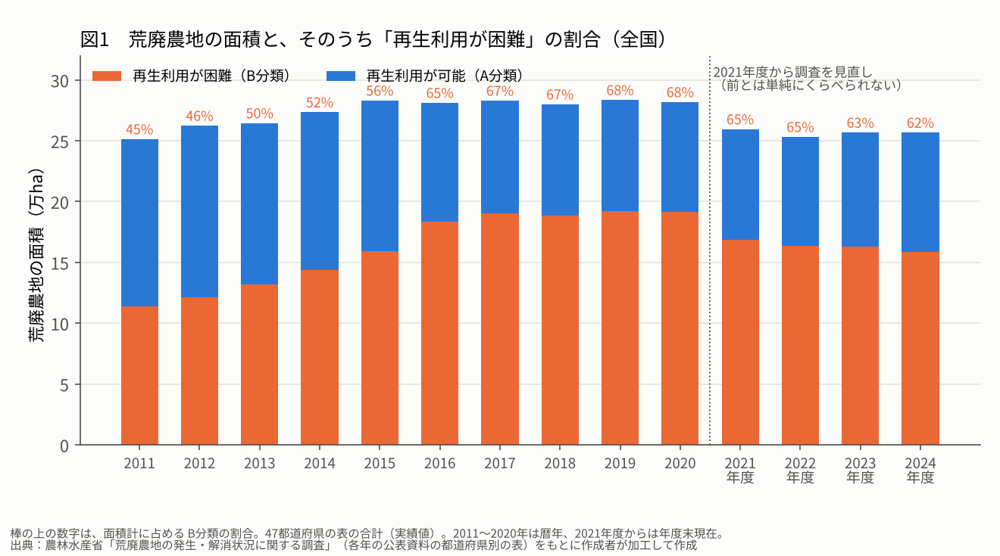
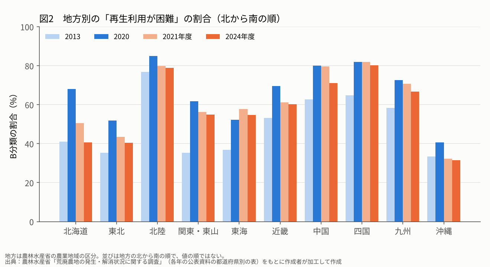
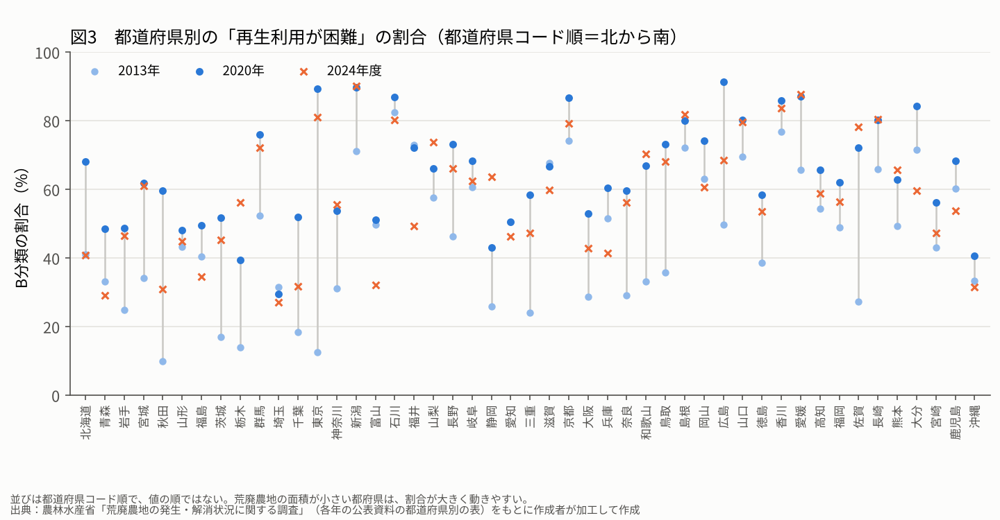
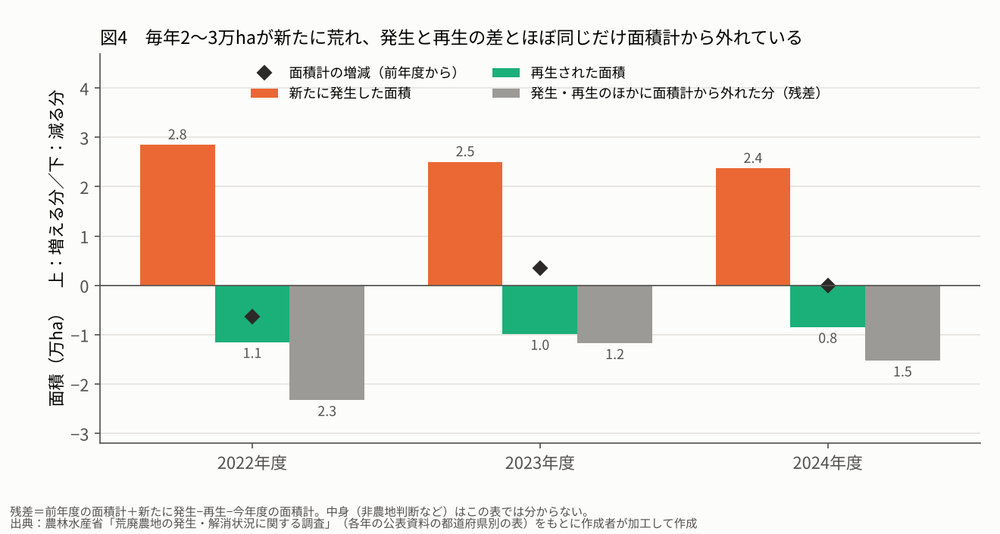

# F464 荒れた農地は、「再生できない」ほうが増えているのか？ 再生困難の割合は2011年45%→2020年68%に上がったが、2021年度の見直し後は65%→62%に下がった

## 結論（先に）

- 荒廃農地（耕作をやめて荒れ、ふつうの農作業では作物が作れない農地）のうち「再生利用が困難（B分類）」の面積は、2011年の11.4万haから2020年の19.2万haに増え、割合は45.3%から68.0%に上がりました。面積計は25.1万→28.2万haで、増えた分の多くは B でした。
- 2011〜2020年の B の割合の上昇は、10の地方すべて、47都道府県のうち44で見られました（2013→2020年）。ただし2015→2016年の1年で8.9ポイント上がっていて、上昇の一部はこの1年に集まっています。
- 2021年度に調査が見直され（非農地判断＝農地でないと判断して台帳から外すことの徹底など）、それより前とは単純にくらべられません。2021年度から2024年度では、B は16.9万→15.9万ha（−5.9%）に減り、割合は65.0%→61.8%に下がりました。
- 2022〜2024年度の3年間に、新たに荒れた面積は7.7万ha、再生された面積は3.0万haでした。それでも面積計はほぼ横ばいで、差の5.0万ha（新たな発生の65%）は、発生と再生のほかの理由で面積計から外れています（中身はこの表では分かりません）。
- まとめると、「再生できないほうが増えた」は2020年まではその通りですが、2021年度からは B が減る向きに変わっています。この減り方は、荒れが戻ったというより、台帳から外す扱いが進んだ影響が大きいと考えられます（推測）。

## 問い

荒れた農地は、「再生できない」ほうが増えているのか？ 荒廃農地は全国で25〜28万haほどで、全体の面積は大きくは動いていません。一方で、農林水産省は荒廃農地を「再生利用が可能（A分類）」と「再生利用が困難（B分類。森林のようになっているなど）」に分けて公表しており、中身が B に移っているとも言われます。全体が横ばいでも中身が変わっていれば、地域で使える農地の見え方は変わります。農地・地域づくり・農業の支援にかかわる人を想定して、公表された都道府県別の表で、B の面積と割合がいつ・どこで増えたのかを確かめました。

## データ（出典）

- 農林水産省「荒廃農地の発生・解消状況に関する調査」各年の公表資料（PDF）の資料2「都道府県別の荒廃農地面積」
  - 2011〜2020年（暦年の調査）と2021〜2024年度（年度末現在）の14回分
  - 列：荒廃農地の面積計、A分類、B分類、再生利用された面積。2013年からは農用地区域（農業振興地域の中で農業に使うと決めた区域）の内数、2021年度からは「新たに発生した面積」もあります
- 都道府県別の表は実績値です。2015年までの全国の見出しの値（推計値）とは少し違います。この記事の全国の値は47都道府県の合計です
- PDF の表は pdftotext で抜き出し、年ごとに47都道府県の合計と全国の行の差が±10ha 以内、A＋B と面積計の差が±5ha 以内であることを確かめました（results/build_checks.csv）
- 2021年度の調査から、調査の一本化と調査内容の見直し、非農地判断の徹底、ドローンなどによる調査精度の向上があり、農水省は「特に B分類が減少したため、前年度までとの単純比較はできない」と注記しています。この記事でも2020年と2021年度の間を切れ目として扱います
- 石川県の一部の市町は、能登半島地震のため2023・2024年度の調査ができず、前の年度の面積が使われています（農水省の注記）

## 事前の計画

PLAN.md に仮説と外れの基準を書きました。PDF の抜き出しを確かめるときに全国の行を見ていたので、H1・H2 は見えた値の確かめで、H3・H4 は集計していなかった値についての仮説です（H4 は2024年度の県の表を目で見ていたので、半分は見えていました。PLAN.md に明記）。

| 仮説 | 外れの基準 | 結果 | 判定 |
|---|---|---|---|
| H1：B の割合は2011→2020年に15ポイント以上上がった | 15ポイント未満 | 45.3%→68.0%（+22.7） | 支持（確かめ） |
| H2：2021→2024年度に B の面積は減った | 同じか増えた | 16.9万→15.9万ha（−9,991ha） | 支持（確かめ） |
| H3：10地方のうち8以上で、B の割合が2013→2020年に上がった | 7以下 | 10地方すべて（+7.2〜+27.0ポイント） | 支持 |
| H4：2024年度の B の割合は、中国・四国・九州のすべてで全国より高い | 1つでも全国以下 | 中国71.0%、四国80.2%、九州66.6%（全国61.8%）。北陸78.8%も高い | 支持 |

## やったこと

- 14回分の PDF から都道府県別の表を抜き出し、年×都道府県の表にしました（2018年の PDF は字の対応表が壊れていたので、数字を戻して読み、合計の一致で確かめました）。
- 全国・地方・都道府県の B の割合（B ÷ 面積計）を出しました。地方は農水省の農業地域の区分で、図は北から南の順です。値の順には並べていません。
- 2021年度からの「新たに発生」「再生された」と面積計の動きをくらべました（問い直し）。

## 分かったこと

### 図1 2020年までは B が増え、2021年度からは減っている



面積計は2011年の25.1万haから2015年の28.3万haに増え、2020年まで28万ha前後でした。中身は A が13.8万→9.0万ha に減り、B が11.4万→19.2万ha に増えました。B の割合は45.3%→68.0%です。2021年度は面積計25.9万ha、B 16.9万ha（65.0%）で、2024年度は25.7万ha、B 15.9万ha（61.8%）でした。A は2022年度の9.0万ha から2024年度の9.8万ha に少し増えています。

### 図2 地方別：西日本と北陸で B の割合が高い



2013→2020年に、B の割合は10の地方すべてで上がりました（沖縄+7.2〜北海道+27.0ポイント）。2024年度の B の割合は、四国80.2%、北陸78.8%、中国71.0%、九州66.6%、近畿60.2%で、北海道40.7%、東北40.4%、沖縄31.5%は低めでした。2021年度から2024年度に、B の割合は10の地方すべてで下がりました（沖縄−0.8〜北海道−9.8ポイント）。

### 図3 都道府県別：ほとんどの県で2020年までに上がった



2013→2020年に B の割合が上がったのは47都道府県のうち44でした。都道府県の中央値は2011年45.4%、2020年65.6%、2024年度58.8%です。荒廃農地の面積が小さい都府県（東京都など）は、割合が大きく動きます。

## 問い直し（結果を見てから足した）

2021年度から B が減っていたので、「荒れが減ったのか、台帳から外れたのか」を、毎年の出入りで見ました（03b_requestion.py）。残差＝前年度の面積計＋新たに発生−再生−今年度の面積計 です。



- 2022〜2024年度の3年間に、新たに発生した面積は7万7,171ha、再生された面積は2万9,782haでした。発生は再生の2.5倍です（2021〜2024年度の4回でくらべた値。2021年度の「再生」は16か月分）。
- 発生と再生だけなら面積計は4.7万ha 増えるはずですが、実際の面積計は2,836ha 減りました。差の5万225ha（1年あたり1万6,742ha、新たな発生の65.1%）は、発生と再生のほかの理由で面積計から外れています。
- 残差は47都道府県のすべてで正でした。
- この残差の中身は表にありません。非農地判断で台帳から外れた分や、調べ直しによる差が考えられます（推測）。B の減少は、荒れた農地が戻ったことより、こうした扱いの影響が大きいと読むのが表に沿っています（推測）。

## 頑健性

| 確かめたこと | 結果 | 結論への影響 |
|---|---|---|
| 農用地区域内だけで見る | B の割合 2013年39.8%→2020年59.3%（+19.5）、2021年度56.0%→2024年度52.7% | 同じ向き。区域内の方が B の割合は低い |
| 始まりを2013年にする | 49.8%→68.0%（+18.2） | 同じ（15ポイント以上） |
| 2015→2016年の1年を除く | 2011→2015年+11.0、2015→2016年+8.9、2016→2020年+2.8ポイント | 上昇の一部は2016年の1年に集中。2016年以降はゆるやか |
| 都道府県の中央値で見る | 2011年45.4%→2020年65.6%（+20.2）、2024年度58.8% | 同じ向き |
| 2021→2024年度の B の減少が一部の県に集まっていないか | B が減ったのは21都道府県、増えたのは26。減り方の大きい5県の合計は全国の減少の128% | 全国の減少は一部の県の大きな減少による（大分県は−5,157ha） |

## 言えないこと

- B の増加が「荒れが進んだ」からか、「判定のしかた・調査の進め方が変わった」からかは、この表だけでは分けられません。2015→2016年の急な変化の理由も、表からは分かりません。
- 2021年度の調査の見直しの前後は、単純にはくらべられません（農水省の注記）。この記事の「2011→2024年度」は通しの比較ではありません。
- 残差（面積計から外れた分）の中身（非農地判断、宅地などへの転用、調べ直し）は分かりません。
- 荒廃農地にあたらない「耕作されていないが、まだ荒れていない農地」は、この調査の外です。
- 石川県の一部の市町は2023・2024年度に前の年度の値が使われていて、その分の動きは表に出ません。
- 面積の割合は、市町村・農業委員会の現地での判定に左右されます。県ごとの判定の差は分かりません。

## 仕事で使うなら

- 荒廃農地の「全体の面積」だけでは中身の変化が見えないので、A と B を分けて示すと誤解が減ります。
- 2021年度より前と後の数字を並べるときは、調査の見直しの注記を一緒に示すのが安全です。
- 毎年の「新たに発生」と「再生」をあわせて見ると、面積計が横ばいでも出入りが大きいことが分かります。

## 計画からの変更

- 問い直し（毎年の出入りと残差）を、結果を見てから足しました。
- 頑健性に「B の減少が一部の県に集まっていないか」の数え方（減った県の数と、減り方の大きい5県の割合）を具体的にしました。

## 再現のしかた

```sh
pip install -r requirements.txt
sh src/run_all.sh            # ネットにつながず data/kouhai_pref_raw.csv から全部作る
# python3 src/01_fetch.py    # 元の PDF を取り直すときだけ（ネットが必要）
# python3 src/01b_extract.py # PDF から表を抜き出し直すときだけ（pdftotext が必要）
```

| ファイル | 役割 |
|---|---|
| src/01_fetch.py | 農水省のサイトから14回分の公表資料（PDF）を取得（run_all.sh からは呼ばない） |
| src/01b_extract.py | PDF の都道府県別の表を data/kouhai_pref_raw.csv に抜き出す（run_all.sh からは呼ばない） |
| src/02_build.py | 合計の一致を確かめ、data/panel.csv を作る |
| src/03_analysis.py | 全国・地方・都道府県の B の割合、仮説の判定、頑健性 |
| src/03b_requestion.py | 問い直し（毎年の出入りと残差） |
| src/04_figures.py | 図4枚 |

所要時間は数秒（CPU 1つ）。乱数は使っていません。再実行の確かめは results/repro_check.txt にあります。

## レビューで直したこと

| # | 指摘 | 直し方 |
|---|---|---|
| 1 | PDF の都道府県別の表は農水省の地域ブロックの順（神奈川の次が山梨・長野・静岡、その後に新潟・富山・石川・福井・岐阜）なのに、01b_extract.py が行の順を都道府県コードの順として県名を当てていたため、15〜22行目の8県（新潟〜静岡）の名前がずれていた。北陸・関東東山・東海の地方の値と図2・図3が違っていた（全国の値・題名・仮説の判定は変わらない） | PDF の表の順で県名を当て、都道府県コードは名前から引くように直した。2011・2018・2024年の PDF を画像で開き、長野・石川・山梨などの値が表と合うことを確かめた。全体を流し直した |
| 2 | 直した結果、2024年度の北陸の B の割合は69.1%→78.8%（四国に次ぐ2番目）、2021→2024年度は「北陸を除く9地方で低下」→「10地方すべてで低下」になった | 図2の見出し、本文、H4 の表、note の本文を新しい値に合わせた |
| 3 | note の図4の節の見出し「ほぼ同じだけ台帳から外れている」は、何と同じかがあいまいで（残差は新たな発生の65%）、台帳から外れたかどうかは表から分からない | 「発生と再生の差とほぼ同じだけ面積計から外れている」に直した |

## 出典

- 農林水産省「荒廃農地の現状と対策」（荒廃農地の調査結果の掲載ページ）：https://www.maff.go.jp/j/nousin/tikei/houkiti/index.html
- 各年の公表資料（PDF）の URL は data/raw/SOURCES.md にあります。

（いずれも農林水産省「荒廃農地の発生・解消状況に関する調査」をもとに作成者が加工して作成）
