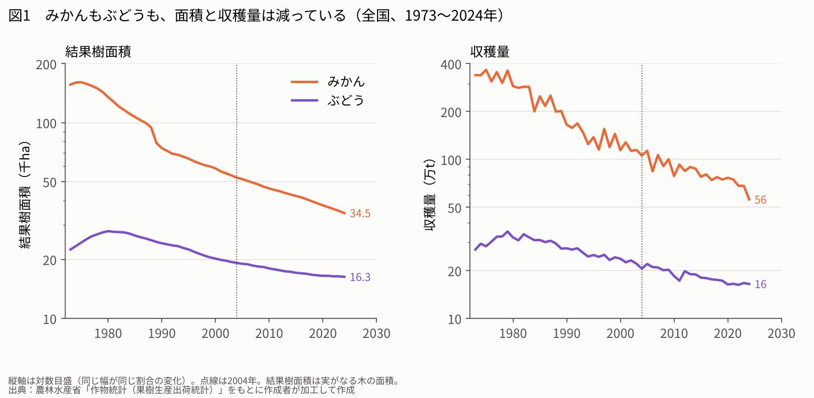
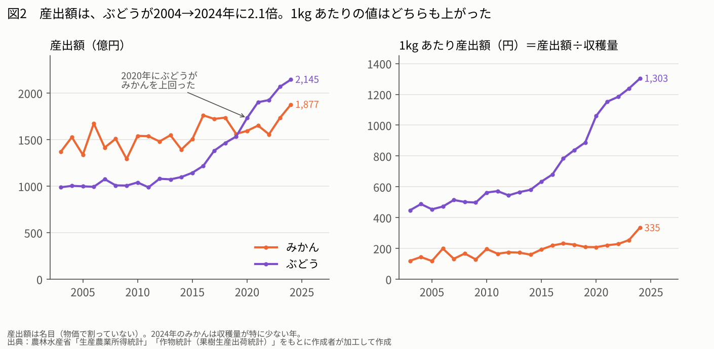
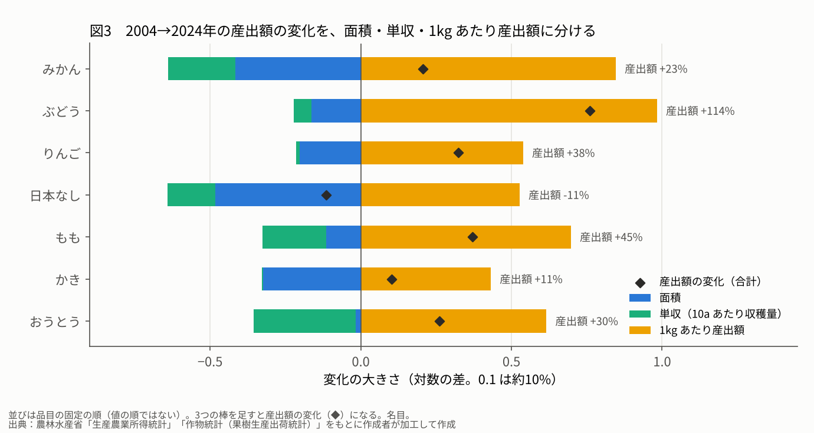
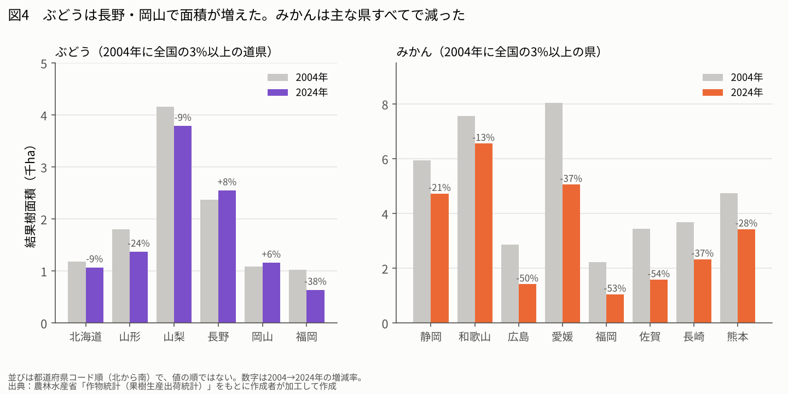

# F465 「みかんは減り、ぶどうは増えた」は、果物の生産でどこまで本当か？ ぶどうも面積は2004年比15%減。増えたのは産出額（名目）で、1,003億円→2,145億円（2.1倍）

## 結論（先に）

- みかんが減ったのは本当です。結果樹面積（実がなる木の面積）は2004年の5万2,300haから2024年の3万4,500ha（−34.0%）、収穫量は106万tから56万t（−47.2%）に減りました。面積のピークは1975年の16万700haでした。
- ぶどうも、面積と収穫量は減っています。結果樹面積は1万9,200haから1万6,300ha（−15.1%）、収穫量は20万5,600tから16万4,600t（−19.9%）です。面積のピークは1980年の2万7,900haでした。「ぶどうが増えた」は、面積や量では成り立ちません。
- 増えたのは産出額（売上にあたる額。名目）です。ぶどうは1,003億円から2,145億円（2.1倍）に増え、2020年からはみかんを上回っています。みかんの産出額も1,526億円から1,877億円（+23.0%）に増えました。
- 産出額の変化を分けると、ぶどうもみかんも、面積と単収（10a あたり収穫量）は下げる向き、1kg あたり産出額が上げる向きでした。1kg あたり産出額はぶどうが488円→1,303円（2.67倍）、みかんが144円→335円（2.33倍）です。
- 1kg あたり産出額の上昇は、ほかの主な果物（りんご・日本なし・もも・かき・おうとう）でも見られ、2014年からの10年で速まりました。ぶどうが目立つのは、値の上がり方に加えて、収穫量の減り方が小さかったためです。

## 問い

「みかんは減り、ぶどうは増えた」は、果物の生産でどこまで本当か？ 果物の売り場や報道では、みかんは作る人が減り、ぶどう（シャインマスカットなど）は伸びている、という見方をよく聞きます。農林水産省の「果樹をめぐる情勢」も、果実の産出額は増える傾向にあり、卸売の数量が減るなかで卸売価格が上がっていると説明しています。ただ、「増えた」「減った」が面積の話か、収穫量の話か、産出額の話かで答えは変わりえます。果物の産地・流通・食品の仕事をしている人を想定して、同じ年で面積・収穫量・産出額をそろえて確かめました。

## データ（出典）

- 農林水産省「作物統計（果樹生産出荷統計）」長期累年：品目別の結果樹面積・収穫量・出荷量（全国1973〜2024年の13品目。みかん・ぶどうは都道府県別も）
- 農林水産省「生産農業所得統計」：各年の「主要農産物の産出額と構成比」（2003〜2024年の全国の品目別の産出額）と、果実の産出額の合計（累年）
- 産出額は名目で、物価で割っていません。1kg あたり産出額＝産出額÷収穫量 は、農家が受け取る価格そのものではありません（加工用や自家用の分も収穫量に入ります）。
- 産出額の表は上位50位（2020年からは100位）までなので、くり・すもも・キウイフルーツ・西洋なしは年が欠けます。この記事でくらべたのは、2003〜2024年がそろう7品目です。
- ぶどうの都道府県別は、全国調査の年（1973〜1994、1997、2004、2009、2014、2020年）以外は主な産地の県だけです。全国調査の年は、都道府県の合計が全国とほぼ一致することを確かめました（results/build_checks.csv）。

## 事前の計画

PLAN.md に仮説と外れの基準を書きました。Excel の様式を確かめるときに、みかんとぶどうの全国の表の最初と最後の数年（1973〜1980年、2020〜2024年）と、産出額の表の上位の品目の並び（7つの年）を見ていました。途中の年の値、産出額の値、分解、頑健性は見ていません（PLAN.md に明記）。

| 仮説 | 外れの基準 | 結果 | 判定 |
|---|---|---|---|
| H1：みかんの面積と収穫量は2004→2024年に20%以上減った | どちらかの減少が20%未満 | 面積−34.0%、収穫量−47.2% | 支持 |
| H2：ぶどうの面積は2024年に2004年より少ない | 同じか多い | 1万9,200→1万6,300ha（−15.1%） | 支持 |
| H3：ぶどうの産出額は2004→2024年に50%以上増えた | 50%未満 | +113.9% | 支持 |
| H4：1kg あたり産出額の伸びは、ぶどうの方がみかんより大きい | 同じか小さい | 2.67倍 対 2.33倍 | 支持。ただし2009年から見るとほぼ同じ（頑健性） |

## やったこと

- 果樹の累年の表から、全国の13品目と、みかん・ぶどうの47都道府県の面積・収穫量・出荷量を読み取りました。
- 産出額の表から、各年の品目別の産出額（全国の合計の行）を読み取りました。
- 産出額＝面積×単収×1kg あたり産出額 として、2004→2024年の変化を対数で3つに分けました（3つの対数の差を足すと産出額の対数の差になります）。
- 都道府県は、2004年に全国の面積の3%以上だった道県を、都道府県コード順（北から南）に並べました。値の順には並べていません。

## 分かったこと

### 図1 みかんもぶどうも、面積と収穫量は減っている



みかんの結果樹面積は1975年の16万700haから2024年の3万4,500haへ、ぶどうは1980年の2万7,900haから1万6,300haへ減りました。2004→2024年では、みかんが面積−34.0%・収穫量−47.2%、ぶどうが面積−15.1%・収穫量−19.9%です。2024年のみかんは収穫量が特に少ない年で（10a あたり1,622kg。2004年は2,027kg）、単年でくらべると減り方が大きく出ます。

### 図2 産出額はぶどうが2.1倍になり、2020年にみかんを上回った



ぶどうの産出額は2004年の1,003億円から2024年の2,145億円に増えました。2020〜2024年はみかんより大きく、果実の産出額の合計に占める割合は13.2%→21.2%に上がりました。みかんは1,526億円→1,877億円で、割合は20.0%→18.6%です。果実の産出額の合計は7,627億円→1兆112億円でした。

### 図3 7品目すべてで1kg あたり産出額が上がり、6品目では面積・単収の減少を上回った



2004→2024年の産出額の変化を分けると、7品目すべてで面積が減り、1kg あたり産出額が上がっていました。1kg あたり産出額の伸びは、ぶどう+167.1%、みかん+133.0%、もも+100.8%、おうとう+85.1%、りんご+71.3%、日本なし+69.3%、かき+53.9%でした。産出額が増えたのは7品目中6品目で、日本なしは−10.9%でした。

### 図4 ぶどうは長野・岡山で面積が増え、みかんは主な県すべてで減った



2004年に全国の面積の3%以上だった道県で見ると、ぶどうは長野（+7.6%）と岡山（+6.4%）で増え、山梨（−8.9%）、山形（−23.9%）、北海道（−9.3%）、福岡（−38.1%）で減りました。2004年と2024年の両方に数字がある25都道府県のうち、ぶどうの面積が増えたのは3でした。みかんは、両方に数字がある20府県のすべてで減りました。

## 問い直し（結果を見てから足した）

ぶどうの産出額の伸びが2015年ごろから目立つことを見て、「伸びはいつ起きたのか」「ぶどうだけの動きか」を、10年ごとの年率でくらべました（03b_requestion.py）。

- ぶどうの産出額の年率は、2004→2014年が+0.9%、2014→2024年が+6.9%でした。1年で10%以上増えた年は2017年（+13.4%）と2020年（+13.0%）です。
- 1kg あたり産出額の年率は、ぶどうが+1.8%→+8.4%、みかんが+1.0%→+7.7%、りんごが−0.3%→+5.9%で、7品目すべてで2014年からの10年の方が速くなっていました。
- 2014→2024年の収穫量の年率は、ぶどう−1.4%、みかん−4.4%、日本なし−4.4%、おうとう−4.9%でした。ぶどうの産出額が大きく伸びたのは、値の上がり方に加えて、量の減り方が小さかったためです。
- 1kg あたりの値の上昇が、品種の入れ替わり（大粒の品種など）か、量が減ったことによる値上がりかは、この表では分けられません（推測は控えます）。

## 頑健性

| 確かめたこと | 結果 | 結論への影響 |
|---|---|---|
| 3年平均でくらべる（2003〜2005年と2022〜2024年） | ぶどう 産出額+105.4%・面積−14.8%・1kg あたり+168.6%。みかん +22.0%・−32.6%・+111.7% | 同じ |
| 1kg あたりを出荷量で割る | ぶどう+159.4%、みかん+125.5% | 同じ |
| くらべ始めを2009年にする | ぶどう 産出額+113.2%・1kg あたり+161.9%。みかん +45.3%・+160.4% | 1kg あたりの伸びはほぼ同じになる（H4 は弱い） |
| ほかの主な果物と並べる | 7品目すべてで1kg あたり産出額が上がり（+53.9〜+167.1%）、面積が減った | 「量が減り、値が上がった」は果物に広く共通 |

## 言えないこと

- 品種別（シャインマスカットなど）の面積は、近年の累年の表に数字がなく、ぶどうの中の入れ替わりは分かりません。
- 産出額は名目で、物価の上昇の分を含みます。
- 1kg あたり産出額の上昇が、品種・品質の変化によるのか、量が減ったことによる値上がりかは分けられません。
- 輸入の果物、加工用の量、家計の買い方は見ていません。
- 2024年のみかんは収穫が特に少ない年で、終わりの年の選び方で数字が動きます（3年平均でも確かめました）。
- ぶどうの都道府県別は、全国調査の年以外は主な産地の県だけで、小さな産地の動きは分かりません。

## 仕事で使うなら

- 「ぶどうが増えた」を伝えるときは、面積・収穫量（減った）と産出額（増えた）を分けて示すと誤解が減ります。
- 産出額の伸びを見るときは、面積・単収・1kg あたり産出額に分けると、どこが動いたかが分かります。
- みかんのように表年・裏年がある品目は、単年ではなく数年の平均でくらべると安定します。

## 計画からの変更

- 問い直し（伸びの時期と、ほかの果物との比較）を、結果を見てから足しました。
- 産地の図は、2004年に全国の面積の3%以上だった道県に絞りました（小さな県は年が欠けるため）。

## 再現のしかた

```sh
pip install -r requirements.txt
sh src/run_all.sh          # ネットにつながず data/raw から全部作る
# python3 src/01_fetch.py  # 元データを取り直すときだけ（ネットが必要）
```

| ファイル | 役割 |
|---|---|
| src/01_fetch.py | e-Stat から果樹の累年の表（107ファイル）と産出額の表（23ファイル）を取得（run_all.sh からは呼ばない） |
| src/02_build.py | Excel を読み、全国・都道府県・産出額の CSV を作る。都道府県の合計と全国の一致を確かめる |
| src/03_analysis.py | 推移、分解、仮説の判定、頑健性、主な産地 |
| src/03b_requestion.py | 問い直し（10年ごとの年率） |
| src/04_figures.py | 図4枚 |

所要時間は十秒ほど（CPU 1つ）。乱数は使っていません。再実行の確かめは results/repro_check.txt にあります。

## レビューで直したこと

| # | 指摘 | 直し方 |
|---|---|---|
| 1 | 題名の「増えたのは産出額」は名目の額で、物価の上昇の分を含む（本文には書いてあるが題名にない） | 題名を「増えたのは産出額（名目）で」に直し、status・note の1行目もそろえた |
| 2 | 図3の節の見出し「どの果物も、1kg あたり産出額の上昇が面積の減少を補っている」は言い過ぎ（日本なしは産出額−10.9%で、補えていない） | 「7品目すべてで1kg あたり産出額が上がり、6品目では面積・単収の減少を上回った」に直した（note も同じ） |
| 3 | 図4の右（みかん）の小見出しが「道県」だが、みかんの対象に北海道は入らない | みかんは「県」と出すように 04_figures.py を直し、図を作り直した |

## 出典

- 農林水産省「作物統計（果樹生産出荷統計）」長期累年（e-Stat）：https://www.e-stat.go.jp/stat-search/files?toukei=00500215&tstat=000001013427
- 農林水産省「生産農業所得統計」（e-Stat）：https://www.e-stat.go.jp/stat-search/files?toukei=00500206&tstat=000001015617
- 農林水産省「果樹をめぐる情勢」（問いの背景）：https://www.maff.go.jp/j/seisan/ryutu/fruits/attach/pdf/index-263.pdf
- 各ファイルの URL は data/raw/SOURCES.md にあります。

（いずれも農林水産省「作物統計（果樹生産出荷統計）」「生産農業所得統計」をもとに作成者が加工して作成）
