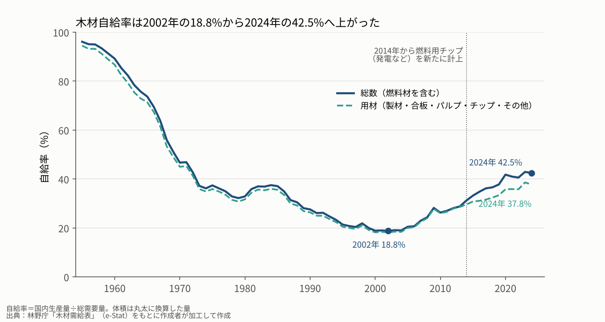
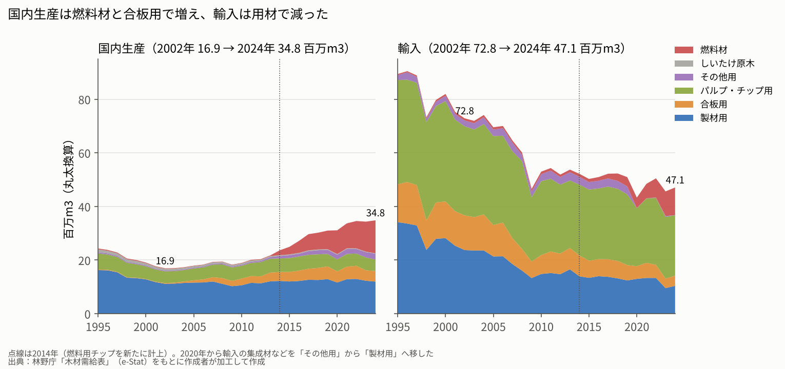
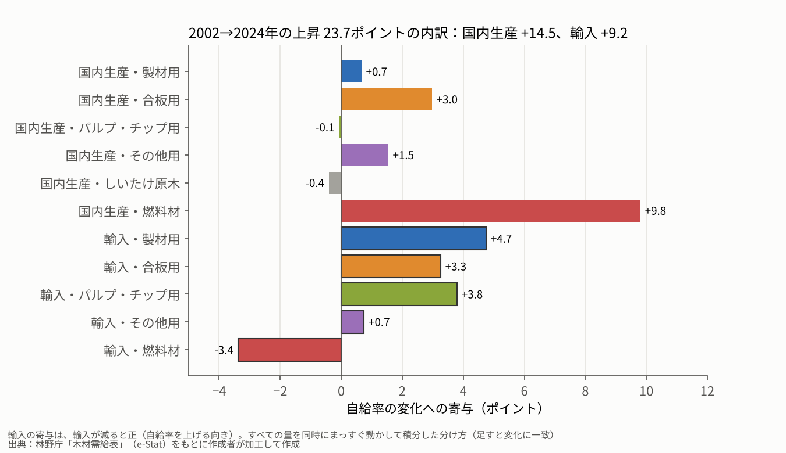
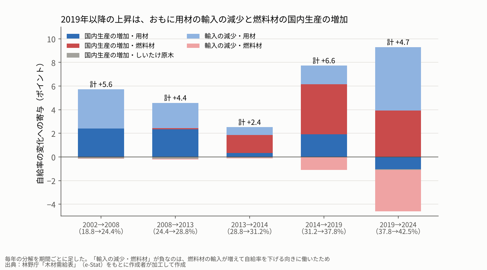

# F466 国産の木材の割合（自給率）は、なぜ上がったのか？ 2002年18.8%→2024年42.5%。上昇23.7ポイントのうち国産の増加が14.5（うち燃料材9.8）、輸入の減少が9.2。燃料材を除くと輸入の減少が7割

## 結論（先に）

- 木材自給率（国内生産量÷総需要量）は、最も低かった2002年の18.8%から2024年の42.5%へ、23.7ポイント上がりました。用材（製材・合板・パルプ・チップなど）だけの自給率も18.2%から37.8%へ上がっています。
- 上昇を分けると、国内生産の増加による分が14.5ポイント、輸入の減少による分が9.2ポイントでした。国内生産は1,692万m3から3,481万m3へ2.1倍、輸入は7,284万m3から4,707万m3へ35%減り、総需要量は8,976万m3から8,187万m3へ9%減りました。
- 国内生産の増加の分のうち最も大きいのは燃料材（＋9.8ポイント）で、19万m3から1,229万m3に増えました。ただし2014年から、発電などで使う燃料用チップを新たに統計に入れており、この増加には統計の範囲が広がった分が含まれます。燃料材は輸入も増えたので、国内と輸入を合わせた燃料材の寄与は＋6.4ポイント（上昇の27%）でした。
- 燃料材を除いた自給率（18.8%→38.0%）で分けると、輸入の減少による分が13.4ポイント（7割）で、国内生産の増加による分（5.7ポイント）を大きく上回りました。用材の上昇は、おもに輸入が減ったことによります。
- 用材の中では、国内生産は合板用が28万m3から394万m3に増えた分（＋3.0ポイント）が最も大きく、輸入は製材用（＋4.7）、パルプ・チップ用（＋3.8）、合板用（＋3.3）の減少が効いていました。

## 問い

国産の木材の割合（自給率）は、なぜ上がったのか？ 森林・林業白書は、国産材の生産量の増加と木材自給率の上昇によって林業が活力を回復しつつある、と書いています。一方で、木材の総需要は住宅の着工の減少などで縮んでおり、割合が上がったのは分母が小さくなったから、つまり輸入が減ったからだ、という見方もあります。さらに近年は木質バイオマス発電の燃料材が増えています。木材・住宅・製紙・エネルギーの仕事をしている人や、林業の話題を追っている人を想定して、上昇のうち「国産が増えた分」「輸入が減った分」「燃料材の分」がそれぞれどれだけかを、同じ表で分けて確かめました。

## データ（出典）

- 林野庁「木材需給表」長期累年（e-Stat、2024年の値は2025-11-21 公表）
  - 木材需要（供給）量累年統計：総需要量と、用途別（製材用・合板用・パルプ・チップ用・その他用・しいたけ原木・燃料材）の国内生産・輸入、自給率（用材・総数）。1955〜2024年、全国、年
  - 供給量累年統計：輸入の丸太と製品の別
  - 需要量累年統計：輸出量（総需要量は輸出を含みます）
- 体積は、輸入した製品も丸太に換算した量（千m3）です。金額ではありません。
- 統計の区分の変更：2014年から木質バイオマス発電施設などで使われた燃料用チップを新たに計上し、項目名を「薪炭材」から「燃料材」に変えています。2020年から輸入の集成材などを「その他用」から「製材用」へ移しています（表の注記）。
- 列の名前は、Excel の見出し（結合セルを広げた複数行）の文字から付けました（results/build_header_map.csv）。用途の和と小計、国内生産と輸入の和と総需要量が四捨五入の範囲（1千m3）で一致すること、計算した自給率が表の自給率と小数1けたで全年一致することを確かめました（results/build_checks.csv）。

## 事前の計画

PLAN.md に、仮説と「こうなったら外れ」の基準を、分解の集計の前に書きました。取得前に林野庁の公表（2024年の自給率42.5%など）と白書の数字を見ていたこと、Excel の様式の確かめで1955〜1958年の行を見たことも PLAN.md に書いています。

| 仮説 | 外れの基準 | 結果 | 判定 |
|---|---|---|---|
| H1：上昇のうち国内生産の増加による分は、輸入の減少による分より大きい | 国内生産の分が輸入の分以下 | 国内生産14.5、輸入9.2ポイント | 支持。ただし燃料材を除くと逆（5.7対13.4） |
| H2：燃料材（国内と輸入の合計）は上昇の3分の1以上を説明する | 3分の1未満 | 6.4ポイント（27%） | 外れ |
| H3：用材の国内生産の増加では、合板用の寄与が最も大きい | ほかの用途の方が大きい | 合板用3.0、その他用1.5、製材用0.7、パルプ・チップ用−0.1 | 支持 |
| H4：輸入の減少による分では、製材用の寄与が最も大きい | ほかの用途の方が大きい | 製材用4.7、パルプ・チップ用3.8、合板用3.3 | 支持 |

## やったこと

- 自給率を s＝D÷(D＋M)（D：国内生産、M：輸入）と書き、用途ごとの D と M（国内6用途、輸入5用途）に分けました。
- 2002年から2024年へ、すべての量を同時にまっすぐ動かす道筋に沿って、自給率の変化を少しずつ足し上げ（数値積分、2万きざみ）、用途×国内・輸入の寄与に分けました。寄与を足すと自給率の変化に一致します（ずれは本計算で1e-9ポイント以下、頑健性の計算を含めても1e-8ポイント以下）。輸入が減ると自給率を上げる向きなので、輸入の寄与は「減った分」が正になります。
- 起点は1990年以降で自給率が最も低かった年（2002年）を表から選びました。

## 分かったこと

### 図1 自給率は2002年を底に上がり、2020年代は4割台



自給率は1955年の96.1%から下がり続け、2002年に18.8%で底をつけました。その後は上がり、2023年に42.9%、2024年に42.5%でした。2009年に28.2%へ跳ねたのは、前年から輸入が6,009万m3から4,653万m3へ急に減ったためで、2010年は26.3%に戻っています。用材の自給率も2002年18.2%から2024年37.8%へ上がり、総数との差は2014年以降に開きました。

### 図2 国内生産は燃料材と合板用で増え、輸入は用材で減った



2002→2024年で、国内生産の燃料材は19万m3から1,229万m3、合板用は28万m3から394万m3、その他用は29万m3から218万m3に増えました。製材用は1,114万m3から1,196万m3でほぼ横ばいです。輸入では製材用が2,371万m3から1,036万m3、合板用が1,295万m3から379万m3、パルプ・チップ用が3,324万m3から2,257万m3へ減り、燃料材だけが79万m3から1,031万m3へ増えました。輸入を形で見ると、丸太が1,487万m3から252万m3、製品が5,719万m3から3,424万m3に減っています。

### 図3 上昇23.7ポイントの内訳：国内生産が14.5、輸入が9.2



最も大きいのは国内生産の燃料材（＋9.8）で、次が輸入の製材用の減少（＋4.7）、パルプ・チップ用の減少（＋3.8）、合板用の減少（＋3.3）、国内生産の合板用（＋3.0）でした。燃料材の輸入の増加は−3.4で、自給率を下げる向きに働きました。

2020年から輸入の集成材などが「その他用」から「製材用」へ移りました（表の注記）。輸入のその他用の減少（＋0.7）の大半はこの移し替えによるもので、そのぶん輸入の製材用の減少（＋4.7）は小さく出ています。用途どうしの移し替えなので、輸入全体の寄与（9.2）は変わらず、製材用が最大という H4 の判定も変わりません。

### 図4 上昇の時期によって、効いたものが違う



「問い直し」で足した図です（下で説明します）。

## 問い直し（結果を見てから足した）

燃料材を除くと国内と輸入の大小が逆になることを見て、「上昇はいつ、何によって起きたのか」を足しました（03b_requestion.py）。毎年の変化を同じ方法で分け、期間ごとに足しました（足し上げの合計は23.7ポイントで、直接の分解と一致します）。

| 期間 | 自給率 | 変化 | 国内・用材 | 国内・燃料材 | 輸入の減少・用材 | 輸入の減少・燃料材 |
|---|---|---|---|---|---|---|
| 2002→2008 | 18.8→24.4% | ＋5.6 | ＋2.4 | 0.0 | ＋3.3 | 0.0 |
| 2008→2013 | 24.4→28.8% | ＋4.4 | ＋2.4 | ＋0.1 | ＋2.1 | 0.0 |
| 2013→2014 | 28.8→31.2% | ＋2.4 | ＋0.3 | ＋1.5 | ＋0.7 | 0.0 |
| 2014→2019 | 31.2→37.8% | ＋6.6 | ＋1.9 | ＋4.2 | ＋1.6 | −1.1 |
| 2019→2024 | 37.8→42.5% | ＋4.7 | −1.0 | ＋3.9 | ＋5.4 | −3.5 |

（しいたけ原木の小さな寄与は表から省いています。results/requestion_periods.csv にあります）

- 2013年までの上昇（10.0ポイント）は、用材の国内生産の増加と輸入の減少がほぼ半分ずつでした。
- 2013→2014年は、燃料材の国内生産が23万m3から184万m3に1年で増えました。燃料用チップを新たに計上した年で、この1年の上昇2.4ポイントのうち1.5ポイントが国内の燃料材です。
- 2014→2019年は国内の燃料材（＋4.2）が最も大きく、2019→2024年は用材の輸入の減少（＋5.4）と国内の燃料材（＋3.9）が大きく、用材の国内生産は−1.0でした。2019年以降の上昇は、国産の用材が増えたからではありません。

## 頑健性

| 確かめたこと | 自給率 | 変化 | 国内生産の分 | 輸入の分 | 結論への影響 |
|---|---|---|---|---|---|
| 本計算（2002→2024年） | 18.8→42.5% | 23.7 | 14.5 | 9.2 | — |
| 起点を2000年にする | 18.9→42.5% | 23.7 | 12.1 | 11.6 | 国内の分が上だが差は小さい |
| 起点を2010年にする | 26.3→42.5% | 16.2 | 13.5 | 2.7 | 国内の分が大きい（2009年の輸入の急減が起点に入らないため） |
| 燃料材を除く | 18.8→38.0% | 19.2 | 5.7 | 13.4 | 逆になる：用材では輸入の減少が主 |
| 3年平均（2001〜2003年→2023〜2024年） | 19.0→42.7% | 23.7 | 14.1 | 9.7 | 同じ |
| 2要因のシャープレイ値（国内・輸入の合計だけで分ける） | 同上 | 23.7 | 14.8 | 8.9 | 同じ |
| 毎年の分解の足し上げ（連鎖） | 同上 | 23.7 | 15.3 | 8.4 | 同じ |

「国内生産の分が輸入の分より大きい」は、燃料材を含めるかどうかで変わります。分け方（積分・シャープレイ値・連鎖）や平均の取り方では変わりませんでした。

## 言えないこと

- 国産が増えた理由（合板工場が原料を国産のすぎなどに替えたこと、補助、価格、為替など）は、この表では分けられません。
- 燃料材の国内生産の増加のうち、2014年に統計の範囲が広がった分と、実際に伐って使う量が増えた分は分けられません。2013年以前にも燃料用チップの一部が別の形で使われていた可能性があります（推測）。
- 体積は丸太に換算した量で、金額や付加価値ではありません。
- 輸入が減った理由（住宅の着工の減少、紙の需要の減少、海外の供給や価格）は、この表では分けられません。
- 全国の表で、地域や樹種の違いは見ていません。
- 国内生産の「その他用」（表の注記では枕木・電柱・くい丸太・足場丸太など）が29万m3から218万m3に増えた（寄与＋1.5）中身は、この表では分かりません。
- 分解の値は分け方で少し動きます（国内の分は14.1〜15.3ポイント）。

## 仕事で使うなら

- 自給率の上昇を説明するときは、燃料材を含む総数と、用材の自給率を並べると誤解が減ります。
- 「国産が増えた」と「輸入が減った」は、量の推移（図2）と寄与（図3）を分けて示すと伝わりやすくなります。
- 2014年と2020年に区分の変更があるので、その前後をまたぐ用途別の比較は注記を添えて使うのが安全です。

## 計画からの変更

- 頑健性に「毎年の分解の足し上げ（連鎖）」を足しました（問い直しの計算から）。
- 輸入の丸太と製品の別は図にせず、本文の数字だけにしました。
- 積分のきざみは計画では決めていませんでした。2万きざみで、ずれが1e-8ポイント以下（本計算は1e-9ポイント以下）になることを確かめました。

## 再現のしかた

```sh
pip install -r requirements.txt
sh src/run_all.sh          # ネットにつながず data/raw から全部作る
# python3 src/01_fetch.py  # 元データを取り直すときだけ（ネットが必要）
```

| ファイル | 役割 |
|---|---|
| src/01_fetch.py | e-Stat から木材需給表の長期累年3表（Excel）を取得（run_all.sh からは呼ばない） |
| src/02_build.py | 見出しの文字で列を選び、data/wood_national.csv を作る。合計と自給率の一致を確かめる |
| src/common.py | 分解の関数（数値積分、シャープレイ値） |
| src/03_analysis.py | 推移、2002→2024年の分解、仮説の判定、頑健性 |
| src/03b_requestion.py | 問い直し（毎年の分解の足し上げ、輸入の丸太・製品の別） |
| src/04_figures.py | 図4枚 |

所要時間は数秒（CPU 1つ）。乱数は使っていません。再実行の確かめは results/repro_check.txt にあります。

## レビューで直したこと

独立レビューで、再実行（14ファイル一致）、元の Excel の見出しと2002・2013・2014・2024年の行、本文の数字と results、図4枚を確かめました。

| # | 指摘 | 直し方 |
|---|---|---|
| 1 | 題名の「国産の増加14.5」の多くが燃料材（2014年から燃料用チップを新たに計上）で、題名だけでは用材の国産が増えたように読める | 題名を「国産の増加が14.5（うち燃料材9.8）」にした（status・note の1行目もそろえた） |
| 2 | 2020年の輸入の「その他用」→「製材用」の移し替えで、用途別の輸入の寄与（製材用4.7・その他用0.7）が動く | 図3の節に注記を足した（輸入全体の寄与と H4 の判定は変わらない） |
| 3 | 国内の「その他用」の増加の中身が不明なことが「言えないこと」になかった | 1項目足した |

## 出典

- 林野庁「木材需給表」長期累年（e-Stat）：https://www.e-stat.go.jp/stat-search/files?page=1&toukei=00501000&tstat=000001021364&cycle=0&tclass1=000001031549
- 林野庁「令和6年木材需給表」の公表（問いの背景）：https://www.rinya.maff.go.jp/j/press/kikaku/251121.html
- 林野庁「令和7年度 森林・林業白書」第2章第1節（問いの背景）：https://www.rinya.maff.go.jp/j/kikaku/hakusyo/r7hakusyo_h/all/chap2_1_1.html
- 各ファイルの URL は data/raw/SOURCES.md にあります。

（いずれも林野庁「木材需給表」をもとに作成者が加工して作成）
