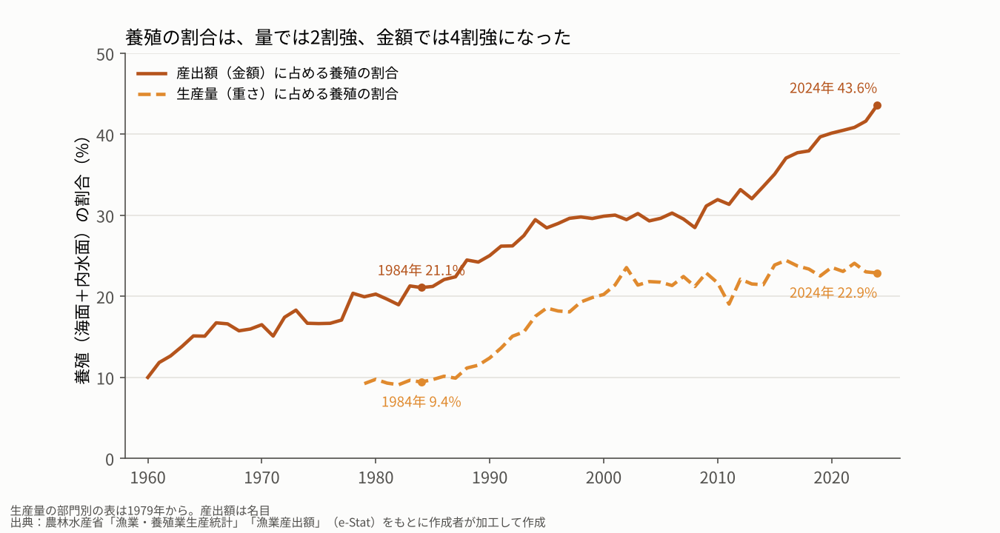
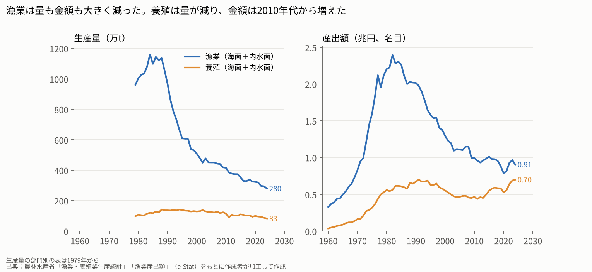
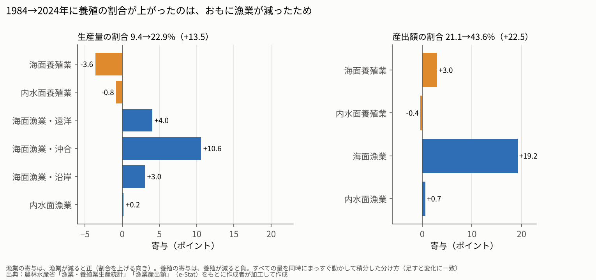
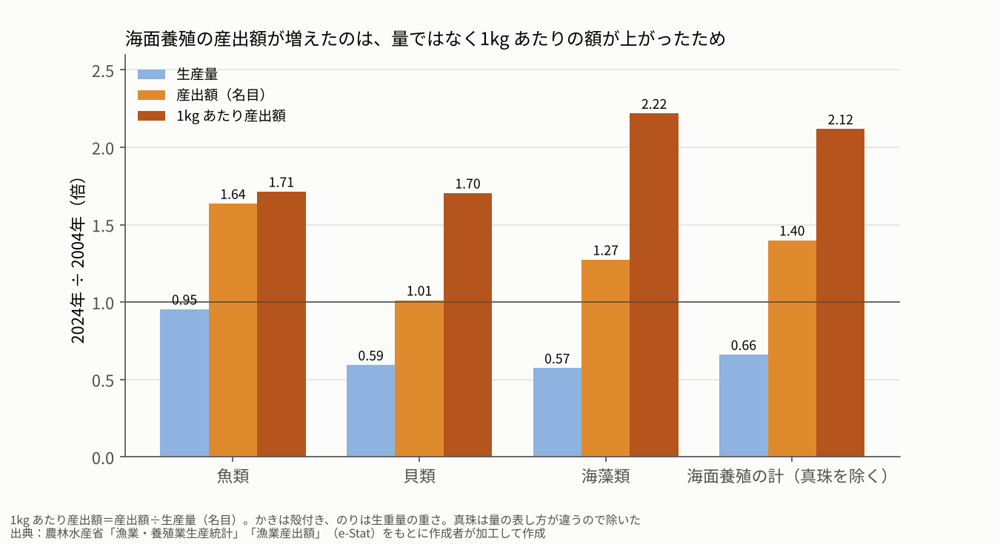

# F467 魚をとる漁業が減るなか、養殖はどれだけ支えているのか？ 養殖の割合は量で22.9%、金額で43.6%。割合が上がったのはおもに漁業が減ったためで、養殖の量も1988年から42%減

## 結論（先に）

- 2024年の漁業・養殖業の生産量364万tのうち、養殖（海面＋内水面）は83万tで22.9%でした。産出額（名目）では1兆6,055億円のうち6,998億円で43.6%です。量では2割強、金額では4割強を養殖が占めています。
- 総生産量が最も多かった1984年（1,282万t）とくらべると、養殖の割合は量で9.4%→22.9%、金額で21.1%→43.6%に上がりました。
- 割合が上がったのは、おもに漁業が減ったためです。量の割合の上昇13.5ポイントを分けると、漁業の減少が＋17.9（うち沖合が＋10.6）、養殖の減少が−4.4でした。養殖の量そのものも、最も多かった1988年の143万tから2024年の83万tへ42%減っています。量では、養殖は漁業の減少を埋めていません。
- 2004年からの20年に限ると、様子が違います。量の割合は21.8%→22.9%でほぼ横ばいですが、金額の割合は29.3%→43.6%に上がり、その上昇14.3ポイントのうち9.4ポイントは養殖の産出額の増加によるものでした。
- 海面養殖の産出額の2004→2024年の増加（1,736億円）の72%は魚類（ぶり類・まだい・くろまぐろなど）でした。海面養殖全体（真珠を除く）では、量が0.66倍に減り、1kg あたり産出額が2.12倍になって、産出額は1.40倍になりました。

## 問い

魚をとる漁業が減るなか、養殖はどれだけ支えているのか？ 海で魚をとる漁業の漁獲量は大きく減りました（既存の看板記事 F143・113 は漁獲の減り方を魚種別に扱っています）。世界では養殖が漁業と並ぶ規模になったと言われる一方、日本の養殖は量が伸びていないとも言われます。水産白書（令和6年度）は、2023年の生産量は前年より減ったが、生産額は2003年以降で最も高い水準と書いています。水産・食品・流通・地域の仕事をしている人を想定して、量と金額の両方で「養殖がどれだけを占めるか」「割合が上がったのは養殖が増えたからか、漁業が減ったからか」を長い期間でそろえて確かめました。

## データ（出典）

- 農林水産省「漁業・養殖業生産統計」長期累年（e-Stat）
  - 部門別累年統計 生産量（1979〜2024年）：海面漁業（遠洋・沖合・沿岸）、海面養殖業、内水面漁業、内水面養殖業
  - 養殖魚種別収獲量（1956〜2024年）、海面漁業魚種別漁獲量（海藻類に使う）、内水面漁業・養殖業魚種別生産量、海面漁業種類別漁獲量（照合に使う）
- 農林水産省「漁業産出額」長期累年（e-Stat）：総括表（1960〜2024年の4部門）、魚種別産出額 海面養殖業（1960〜2024年）
- 産出額は名目で、物価で割っていません。割合（養殖÷全体）は物価の影響を受けにくい一方、1kg あたり産出額は物価の影響を含みます。
- 養殖の量には、殻付きのかき、生重量ののりなど、重さの量り方で大きく出るものが含まれます。
- 部門別の表の単位は2002年まで千t、2003年から t です（表の注記）。内水面漁業は調べる河川・湖沼の範囲が何度か変わっています。2011年は震災で一部のデータが失われた県があります。
- 列の名前は、Excel の見出し（結合セルを広げた複数行）の文字から付けました（results/build_header_map.csv）。部門の和と計、部門別の表と魚種別の表の合計、産出額の4部門の和と総額が、四捨五入の範囲で一致することを確かめました（results/build_checks.csv）。

## 事前の計画

PLAN.md に仮説と「こうなったら外れ」の基準を、集計の前に書きました。取得前に水産白書の2023年の数字を見ていたこと、様式の確かめで最初の数年の行を見たことも書いています。

| 仮説 | 外れの基準 | 結果 | 判定 |
|---|---|---|---|
| H1：養殖の量の割合は、総生産量が最も多かった年（1984年）より2024年の方が10ポイント以上高い | 10ポイント未満 | 9.4%→22.9%（＋13.5） | 支持 |
| H2：2024年の養殖の金額の割合は、量の割合より10ポイント以上高い | 差が10ポイント未満 | 43.6%対22.9%（差20.7） | 支持 |
| H3：養殖の量は、ピークの年から2024年までに20%以上減った | 20%未満 | 1988年143万t→83万t（−41.7%） | 支持 |
| H4：海面養殖の産出額の2004→2024年の増加に最も寄与したのは魚類 | ほかの群の方が大きい | 魚類＋1,250億円（増加の72%） | 支持 |

## やったこと

- 養殖（海面＋内水面）の割合を、量（1979〜2024年）と金額（1960〜2024年）で出しました。
- 割合 s＝養殖÷（養殖＋漁業）の変化を、部門ごとの寄与に分けました。すべての量を同時にまっすぐ動かす道筋に沿って変化を少しずつ足し上げる方法（数値積分）で、寄与を足すと変化に一致します（ずれは1e-7ポイント以下）。漁業が減ると割合を上げる向き、養殖が減ると下げる向きです。
- 海面養殖の産出額を品目群（魚類・貝類・海藻類・真珠・その他）に分け、2004→2024年の増減を見ました。

## 分かったこと

### 図1 養殖の割合は、量では2割強、金額では4割強



量の割合は1984年の9.4%から上がり、2016年の24.4%が最も高く、2024年は22.9%でした。金額の割合は1960年の10.0%から長く上がり続け、2024年の43.6%が最も高い値です。金額の割合が量の割合より大きいのは、養殖の1kg あたり産出額が漁業より高いためです（2024年は養殖841円、漁業323円。養殖は真珠の額を含む）。

### 図2 漁業は量も金額も大きく減った。養殖は量が減り、金額は2010年代から増えた



漁業（海面＋内水面）の量は1984年の1,161万tから2024年の280万tへ、産出額は2兆3,062億円から9,057億円へ減りました。養殖の量は1984年の121万tから1988年の143万tまで増えたあと減り、2024年は83万tです。養殖の産出額は1984年の6,162億円、2004年の4,632億円を経て、2024年は6,998億円でした。

### 図3 1984→2024年に割合が上がったのは、おもに漁業が減ったため



量の割合の上昇13.5ポイントのうち、海面漁業の沖合の減少が＋10.6、遠洋が＋4.0、沿岸が＋3.0、内水面漁業が＋0.2で、海面養殖の減少が−3.6、内水面養殖が−0.8でした。金額の割合の上昇22.5ポイントでは、海面漁業の減少が＋19.2、海面養殖の増加が＋3.0でした。

### 図4 海面養殖の産出額の増加は、量ではなく1kg あたりの額による



「問い直し」で足した図です（下で説明します）。

## 問い直し（結果を見てから足した）

2004年以降は養殖の産出額の増加が金額の割合を押し上げていたことを見て、「養殖の産出額が増えたのは、量が増えたからか、1kg あたりの額が上がったからか」を足しました（03b_requestion.py）。

| 品目群（海面養殖） | 生産量 | 産出額（名目） | 1kg あたり産出額 |
|---|---|---|---|
| 魚類 | 0.95倍 | 1.64倍 | 749円→1,284円（1.71倍） |
| 貝類 | 0.59倍 | 1.01倍 | 161円→274円（1.70倍） |
| 海藻類 | 0.57倍 | 1.27倍 | 245円→543円（2.22倍） |
| 計（真珠を除く） | 0.66倍 | 1.40倍 | 327円→692円（2.12倍） |

（2004→2024年。results/requestion_value_split.csv）

- どの品目群も量は減るか横ばいで、産出額の増加は1kg あたりの額の上昇によるものでした。
- 海藻類の1kg あたりの額は、2004→2014年はほぼ変わらず（0.998倍）、2014→2024年に2.22倍になりました。のりの不作の年が続いたことによる値上がりの可能性があります（推測。この表では確かめていません）。
- 魚類の中では、ぶり類が1,093億円→1,426億円、まだいが507億円→775億円、ぎんざけが36億円→136億円でした。くろまぐろは2024年に594億円で、2004年は品目の区分がありません。
- 1kg あたりの額は名目で、物価全体の上昇の分を含みます。品質や品目の入れ替わりとの区別はできません。

## 頑健性

| 確かめたこと | 量の割合 | 量：漁業の減少の分／養殖の分 | 金額の割合 | 金額：漁業の減少の分／養殖の分 | 結論への影響 |
|---|---|---|---|---|---|
| 本計算（1984→2024年） | 9.4→22.9% | ＋17.9／−4.4 | 21.1→43.6% | ＋19.9／＋2.6 | — |
| 3年平均（前後1年） | 9.6→23.0% | ＋17.2／−3.8 | 21.2→42.6% | ＋18.9／＋2.5 | 同じ |
| 海面だけ | 8.8→22.4% | ＋17.2／−3.7 | 18.0→39.8% | ＋18.4／＋3.4 | 同じ |
| 海藻類を除く（量） | 5.2→16.7% | ＋12.5／−1.0 | — | — | 割合は下がるが、漁業の減少が主なのは同じ |
| 起点1990年 | 12.4→22.9% | ＋17.2／−6.7 | 25.0→43.6% | ＋17.7／＋0.8 | 同じ |
| 起点2004年 | 21.8→22.9% | ＋8.3／−7.2 | 29.3→43.6% | ＋4.8／＋9.4 | 金額は養殖の増加が主になる |

「割合が上がったのは漁業が減ったため」は、量では起点や定義を変えても同じでした。金額は、2004年からの20年に限ると養殖の産出額の増加の方が大きく効いています。

## 言えないこと

- 養殖の量が減った理由（えさの値段、漁場、需要、担い手、海の環境など）は、この表では分けられません。
- 1kg あたり産出額の上昇が、物価全体の上昇か、品質・品目の変化か、量が減ったことによる値上がりかは分けられません。
- 輸入の水産物は含みません。国内で食べる魚のうち養殖がどれだけかは、この記事の数字からは言えません。
- 産出額は名目です。割合は物価の影響を受けにくいものの、漁業と養殖で値上がりの速さが違えば割合も動きます。
- 地域別は見ていません。
- 内水面漁業は調べる範囲が変わっていて、長い期間の比較には向きません（割合への寄与は小さい）。

## 仕事で使うなら

- 「養殖の割合が上がった」を伝えるときは、量（2割強）と金額（4割強）を分け、割合の上昇はおもに漁業の減少によることを添えると誤解が減ります。
- 養殖の産出額の伸びを見るときは、量と1kg あたりの額に分けると、どちらが動いたかが分かります。
- かき（殻付き）やのり（生重量）は重さが大きく出るので、量の割合をくらべるときは海藻類を除いた値も並べると安全です。

## 計画からの変更

- 量の割合は部門別の表のある1979年から出しました（それより前は部門の分け方をそろえられないため）。
- 海面漁業の種類別と魚種別の表は、1963年以前で漁獲量の計が一致しないため、照合は1964年以降にしました（分析には使っていません）。
- 起点を変える頑健性に2004年を入れ、結果を見て金額の分解を問い直しにつなげました。

## 再現のしかた

```sh
pip install -r requirements.txt
sh src/run_all.sh          # ネットにつながず data/raw から全部作る
# python3 src/01_fetch.py  # 元データを取り直すときだけ（ネットが必要）
```

| ファイル | 役割 |
|---|---|
| src/01_fetch.py | e-Stat から長期累年の7表（Excel）を取得（run_all.sh からは呼ばない） |
| src/common.py | 見出しの文字で列の名前を作る読み取り、割合の分解（数値積分） |
| src/02_build.py | 部門別の量・金額と品目群の CSV を作り、合計の一致を確かめる |
| src/03_analysis.py | 割合の推移、分解、品目群、仮説の判定、頑健性 |
| src/03b_requestion.py | 問い直し（産出額の変化を量と1kg あたりの額に分ける） |
| src/04_figures.py | 図4枚 |

所要時間は十秒ほど（CPU 1つ）。乱数は使っていません。再実行の確かめは results/repro_check.txt にあります。

## レビューで直したこと

独立レビューで、再実行（17ファイル一致）、元の表（部門別の生産量の2002・2003年の単位の切り替え、産出額の総括表の「捕鯨業」の列、海面養殖の魚種別産出額の参考の種苗生産額の列）と本文の数字、図4枚を確かめました。

| # | 指摘 | 直し方 |
|---|---|---|
| 1 | 題名の「割合が上がったのは漁業が減ったため」は、2004年からの金額の割合では養殖の産出額の増加の方が大きい（＋9.4対＋4.8）ので、言い切りが強い | 題名を「おもに漁業が減ったため」にした（status・note の1行目もそろえた）。本文はもともと「おもに」と2004年起点の違いを書いている |

## 出典

- 農林水産省「漁業・養殖業生産統計」長期累年（e-Stat）：https://www.e-stat.go.jp/stat-search/files?page=1&toukei=00500216&tstat=000001015174&cycle=0&tclass1=000001034726
- 農林水産省「漁業産出額」長期累年（e-Stat）：https://www.e-stat.go.jp/stat-search/files?page=1&toukei=00500208&tstat=000001015664&cycle=0&tclass1=000001034725
- 水産庁「令和6年度 水産白書」（問いの背景）：https://www.jfa.maff.go.jp/j/kikaku/wpaper/R6/attach/pdf/250606_2-8.pdf
- 各ファイルの URL は data/raw/SOURCES.md にあります。

（いずれも農林水産省「漁業・養殖業生産統計」「漁業産出額」をもとに作成者が加工して作成）
