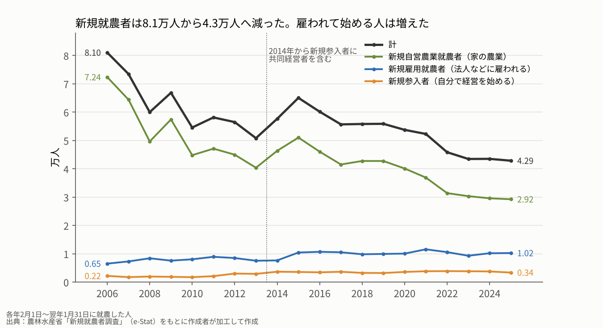
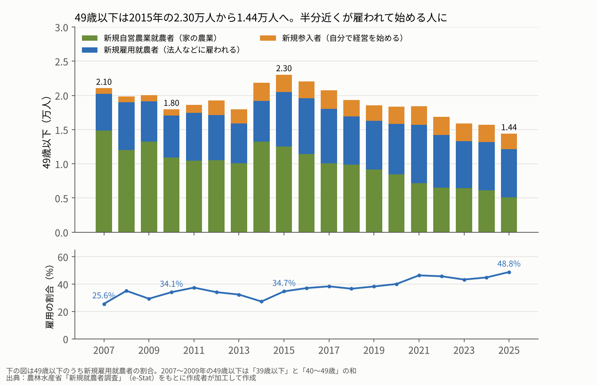
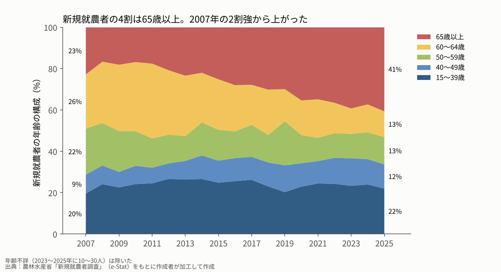
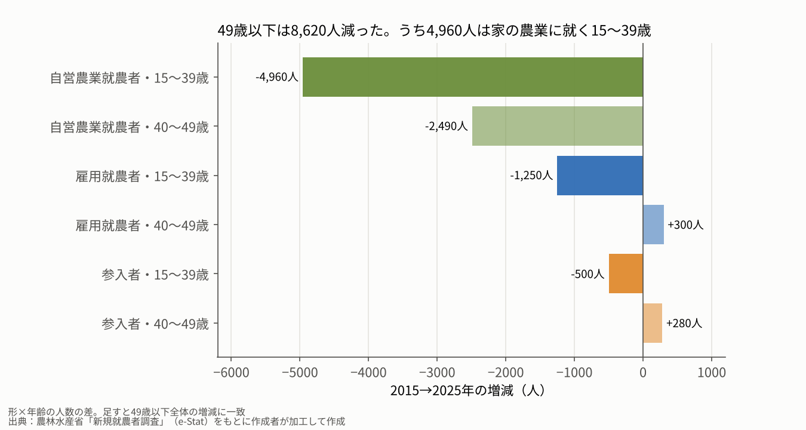

# F468 新しく農業を始める人は、増えているのか？ 2006年8.1万人→2025年4.3万人と減った。増えたのは雇われて始める人で、49歳以下の48.8%を占める

## 結論（先に）

- 新しく農業を始めた人（新規就農者）は、2006年の8万1,030人から2025年の4万2,850人に減りました（−47.1%。2007年からは−41.7%）。増えてはいません。
- 減ったのは、家の農業に就く人（新規自営農業就農者）です。7万2,350人から2万9,240人になりました。一方、法人などに雇われて始める人（新規雇用就農者）は6,510人から1万250人に増え、全体に占める割合は8.0%から23.9%に上がりました。自分で経営を始める人（新規参入者）は2,180人から3,360人です（2014年から数え方が広がっています）。
- 49歳以下は2007年の2万1,050人から2025年の1万4,410人に減りました。全体より減り方が小さく、49歳以下の割合は28.7%から33.6%に上がりました。最も多かったのは2015年の2万3,030人です。
- 49歳以下のうち雇われて始める人の割合は、2010年の34.1%から2025年の48.8%に上がりました。若い人の就農の半分近くは、雇われる形です。
- 2015年から2025年の49歳以下の減少8,620人のうち、4,960人（58%）は家の農業に就く15〜39歳の減少でした。新規就農者全体では65歳以上が40.7%（2007年は22.8%）を占めます。

## 問い

新しく農業を始める人は、増えているのか？ 農林水産省の2025年の調査結果の概要は、新規就農者が4万2,850人で前年から1.5%減り、49歳以下は1万4,410人で8.3%減ったと書いています。一方で、「法人に雇われて農業を始める人が増えた」「若い人の就農は雇用が中心になった」という見方もあります。農業・食品・地域の仕事をしている人や、農業の担い手の話題を追っている人を想定して、就農の形（家の農業に就く・雇われる・自分で始める）と年齢を分け、2006年からの20年で確かめました。

## データ（出典）

- 農林水産省「新規就農者調査」各年の表1「就農形態別新規就農者数」（e-Stat、2008〜2025年の公表の19ファイル）。各年の表には直近の2〜4年分が載るので、年ごとに使う公表を決めました（2006〜07年は2008年公表、2008〜09年は2009年の平成21年分の公表、2010〜13年は2013年公表、2014〜17年は2017年公表、2018〜21年は2021年公表、2022〜25年は2025年公表）。
- 就農の形の定義：新規自営農業就農者は、個人経営体の世帯員で、学生や勤めから「主に自営農業」に変わった人。新規雇用就農者は、法人などに年7か月以上の常雇いとして新たに雇われた人（外国人技能実習生などを除く）。新規参入者は、土地や資金を自分で用意して新たに経営を始めた人。
- 各年の人数は、その年の2月1日から翌年1月31日までに就農した人です。
- 年齢：2006〜2009年は「39歳以下」と「40〜49歳」の和を49歳以下としました。2006年の40歳以上はほかの年齢と合わせた区分しかないので、49歳以下は2007年からです。
- 範囲・定義の変更（表の注記）：2014年から新規参入者に「共同経営者」を含みます。震災・熊本地震で調べられなかった地域を除いた年があります。自営・雇用は農林業センサスを母集団にしています。
- 読み取り：列は見出しの文字（形の名前と年の名前）で、行は行の名前で選びました。同じ年が載るほかの公表と照らすと、705の組み合わせで値が一致しました。2010・2011年の公表は、震災の地域を除いた参考値の列が加わっているため、2009・2011年の新規参入者で差が出ます（主には使っていません）。形の和と計の差は最大10人、年齢の和と計の差は最大20人で、10人単位の四捨五入の範囲です（results/build_checks.csv、build_release_compare.csv）。

## 事前の計画

PLAN.md に仮説と「こうなったら外れ」の基準を、集計の前に書きました。様式の確かめで、計や49歳以下の行の値を多くの年で見ていたことも書いています。そのため H1 は外れにくいことが分かっていた仮説です。

| 仮説 | 外れの基準 | 結果 | 判定 |
|---|---|---|---|
| H1：計は2007→2025年に30%以上減った | 減り方が30%未満 | −41.7% | 支持（見た値から予想できていた） |
| H2：49歳以下の割合は2007年より2025年の方が高い | 同じか低い | 28.7%→33.6% | 支持 |
| H3：49歳以下に占める雇用就農の割合は2010→2025年に10ポイント以上上がった | 10ポイント未満 | 34.1%→48.8%（＋14.7） | 支持 |
| H4：2025年の新規自営農業就農者のうち60歳以上は5割以上 | 5割未満 | 70.0% | 支持 |

## やったこと

- 19ファイルの表1を読み、形（計・自営・雇用・参入）×年齢（49歳以下・39歳以下・50〜59歳・60〜64歳・65歳以上など）×年の表にしました。
- 49歳以下の割合、49歳以下の中の形の割合、年齢の構成を出しました。
- 49歳以下の増減を、形ごと（問い直しでは形×年齢ごと）の人数の差に分けました（足すと全体の増減に一致します）。

## 分かったこと

### 図1 新規就農者は減り、雇われて始める人は増えた



計は2006年の8万1,030人から、2015年の6万5,030人の山をはさんで、2025年の4万2,850人に減りました。家の農業に就く人は7万2,350人から2万9,240人に減りました。雇われて始める人は6,510人から増え、2021年の1万1,570人が最も多く、2025年は1万250人です。自分で経営を始める人は2,180人から3,360人ですが、2014年から共同経営者を数えに入れたので、その前後はそのままくらべられません。

### 図2 49歳以下は2015年をピークに減り、半分近くが雇われて始める人に



49歳以下は2007年2万1,050人、2010年1万7,970人、2015年2万3,030人、2025年1万4,410人でした。49歳以下の中の形の割合は、2007年は家の農業70.5%・雇用25.6%・参入3.9%、2025年は家の農業35.3%・雇用48.8%・参入16.0%です。2007→2025年の49歳以下の減少6,640人は、家の農業の−9,770人を、雇用の＋1,650人と参入の＋1,480人が一部埋めた形です。

### 図3 新規就農者の4割は65歳以上



新規就農者全体の年齢の構成は、65歳以上が2007年の22.8%から2025年の40.7%に上がりました。15〜39歳は2007年19.5%、2025年21.9%で、大きくは変わっていません。家の農業に就く人に限ると、60歳以上が2007年の53.9%から2025年の70.0%に上がりました。勤めを終えてから家の農業に就く人が中心だと読めます（就農前の仕事の表は使っていないので、推測です）。

### 図4 2015年以降の49歳以下の減少は、家の農業に就く若い人の減少



「問い直し」で足した図です（下で説明します）。

## 問い直し（結果を見てから足した）

49歳以下は2015年まで増え、その後減っていました。「2015年からの減少は、どの形のどの年齢で起きたのか」を足しました（03b_requestion.py）。

| 形・年齢 | 2015年 | 2025年 | 増減 | 減少に占める割合 |
|---|---|---|---|---|
| 家の農業・15〜39歳 | 7,890人 | 2,930人 | −4,960人 | 58% |
| 家の農業・40〜49歳 | 4,640人 | 2,150人 | −2,490人 | 29% |
| 雇用・15〜39歳 | 6,430人 | 5,180人 | −1,250人 | 15% |
| 雇用・40〜49歳 | 1,550人 | 1,850人 | ＋300人 | −3% |
| 参入・15〜39歳 | 1,790人 | 1,290人 | −500人 | 6% |
| 参入・40〜49歳 | 730人 | 1,010人 | ＋280人 | −3% |

- 減少8,620人の86%（7,450人）は、家の農業に就く49歳以下の減少でした。
- 雇われて始める15〜39歳も1,250人減っていて、「雇用が増えて若い人を支えている」とは言えない期間です。49歳以下の中で雇用の割合が上がったのは、家の農業の減り方が大きかったためです。
- 形ごとの49歳以下の割合は、家の農業が24.6%→17.4%、雇用が76.5%→68.6%、参入が70.6%→68.5%でした（2015→2025年）。

## 頑健性

| 確かめたこと | 計の変化 | 49歳以下の割合 | 49歳以下のうち雇用の割合 | 結論への影響 |
|---|---|---|---|---|
| 本計算（計・49歳以下は2007→2025年、雇用の割合は2010→2025年） | −41.7% | 28.7→33.6% | 34.1→48.8% | — |
| 新規参入者を除く（自営＋雇用。2014年の定義の変更を避ける） | −44.9% | 28.2→30.7% | 35.9→58.1% | 同じ |
| 39歳以下で見る（2006→2025年） | −47.1% | 18.2→21.9% | 25.3→55.2% | 同じ |
| 3年平均（2007〜09年・2010〜12年→2023〜25年） | −35.2% | 30.4→35.5% | 35.2→45.5% | 同じ |
| 起点を2015年にする | −34.1% | 35.4→33.6% | 34.7→48.8% | 49歳以下の割合は下がる |
| 使う公表を替える（重なる年をほかの公表の値に） | 値が同じ | 同じ | 同じ | 同じ（2009・2011年の参入者の参考値を除く） |

「減っている」「49歳以下の中で雇用の割合が上がった」は、どの確かめでも同じでした。「49歳以下の割合が上がった」は、ピークの2015年から見ると成り立ちません。

## 言えないこと

- 就農した人がその後も続けているか（定着）は、この調査では分かりません。
- 増減の理由（支援の制度、景気、農地、所得、家族の事情など）は分けられません。
- 雇われて始める人の増加が、農業法人の増加によるのか、ほかの理由によるのかは分けられません。
- 家の農業に就く人の数は、農林業センサスの母集団（個人経営体の数）の減少の影響を受けます。母集団が減った分と、一つの家から就く人の割合の変化は分けていません。
- 地域別は見ていません。
- 年齢は就農した年の年齢で、同じ人を追った数字ではありません。

## 仕事で使うなら

- 「新規就農者」を伝えるときは、家の農業に就く人・雇われる人・自分で始める人を分けると、増減の向きの違いが見えます。
- 若い人の就農を見るときは、49歳以下の人数と、その中の形の割合を並べると誤解が減ります。
- 2014年（新規参入者の定義）とセンサスの年（2015・2020年）の前後は、注記を添えてくらべるのが安全です。

## 計画からの変更

- 2010・2011年の公表は参考値の列で列の位置がずれるので、主には使わないことにしました（照合の対象には残しました）。
- 頑健性に「起点を2015年にする」を足しました（問い直しの結果から）。

## 再現のしかた

```sh
pip install -r requirements.txt
sh src/run_all.sh          # ネットにつながず data/raw から全部作る
# python3 src/01_fetch.py  # 元データを取り直すときだけ（ネットが必要）
```

| ファイル | 役割 |
|---|---|
| src/01_fetch.py | e-Stat から各年の表1（19ファイル）を取得（run_all.sh からは呼ばない） |
| src/common.py | 見出しの文字（形・年）と行の名前で表1を読む |
| src/02_build.py | 年ごとに使う公表を選び data/new_farmers.csv を作る。公表どうしの照合と合計の確かめ |
| src/03_analysis.py | 推移、割合、49歳以下の増減の内訳、仮説の判定、頑健性 |
| src/03b_requestion.py | 問い直し（2015→2025年の49歳以下の減少を形×年齢に分ける） |
| src/04_figures.py | 図4枚 |

所要時間は十秒ほど（CPU 1つ）。乱数は使っていません。再実行の確かめは results/repro_check.txt にあります。

## レビューで直したこと

独立レビューで、再実行（16ファイル一致）、元の表（2008年公表の2006年の縦に結合された年齢の区分、2013年公表の2010・2011年の「1)」つきの40〜44歳の値、2017・2025年公表の行）と本文の数字、図4枚を確かめました。

| # | 指摘 | 直し方 |
|---|---|---|
| 1 | note の「ほかの年の公表と照らすと、値は一致しました」は、2009・2011年の新規参入者（参考値の列のずれ）を除いた話 | note に除いた範囲を書き足した |

## 出典

- 農林水産省「新規就農者調査」（e-Stat）：https://www.e-stat.go.jp/stat-search/files?toukei=00500236&tstat=000001015194
- 農林水産省「新規就農者調査」令和7年 調査結果の概要（問いの背景、e-Stat）：https://www.e-stat.go.jp/stat-search/file-download?statInfId=000040492349&fileKind=2
- 各ファイルの URL は data/raw/SOURCES.md にあります。

（いずれも農林水産省「新規就農者調査」をもとに作成者が加工して作成）
