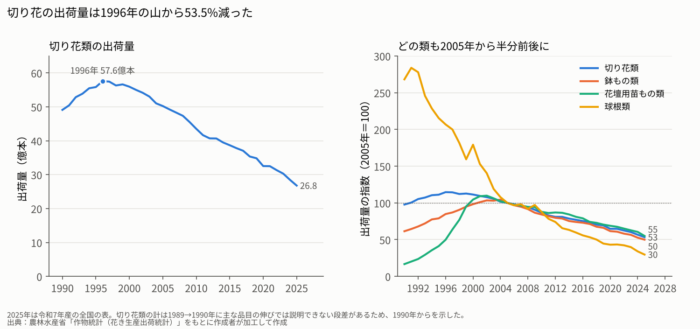
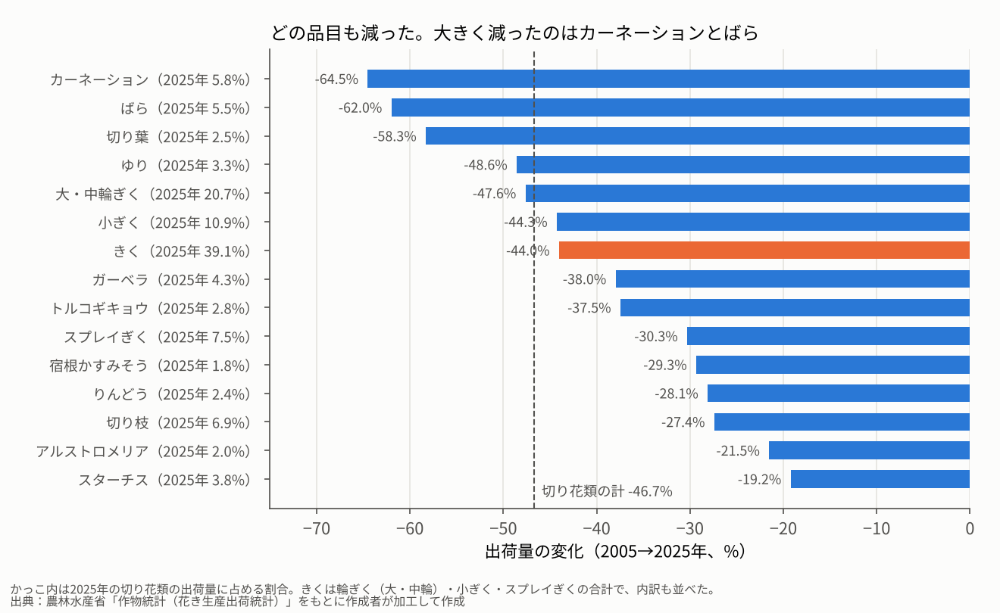
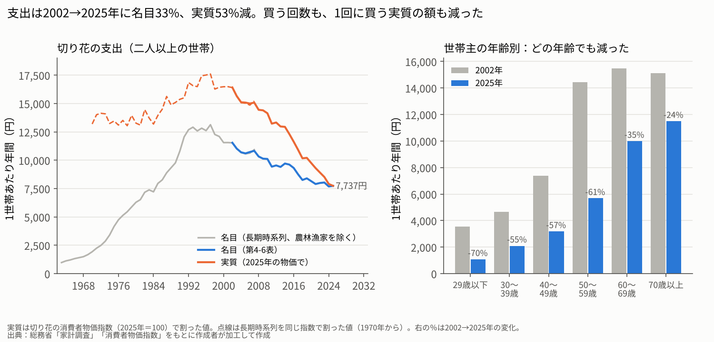
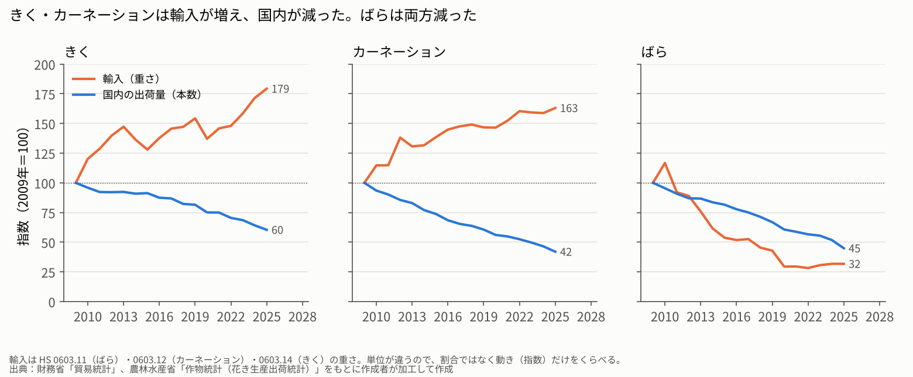

# F469 花の生産は、どれだけ減ったのか？ 切り花の出荷量は1996年の57.6億本から2025年の26.8億本へ53.5%減。家計の切り花の支出は実質で半分以下に

## 結論（先に）

- 切り花の出荷量は、1996年の57.6億本を山に、2025年には26.8億本まで減りました（−53.5%）。2005年からでも−46.7%です。減り方は2005〜2015年の年−2.6%から、2015〜2025年の年−3.6%へ速まっています。
- 鉢もの類（2004年の山から−52.2%）、花壇用苗もの類（2002年の山から−49.9%）も、山から半分前後に減りました。球根類は1991年の山から−89.6%です。
- 切り花の品目で見ると、2005→2025年に、きくの内訳を含む15品目すべてで出荷量が減りました。大きく減ったのはカーネーション（−64.5%）とばら（−62.0%）で、きく（−44.0%）は切り花全体（−46.7%）とほぼ同じ減り方でした。
- 家計（二人以上の世帯）の切り花の支出は、2002年の1万1,540円から2025年の7,737円へ名目で33.0%減りました。切り花の値上がり（消費者物価指数で+42.2%）を除いた実質では52.9%減です。名目の減少は買う回数の減少（100世帯あたり1,054回→694回）で、1回あたりの名目の額（1,095円→1,115円）はほぼ同じでした。物価が42.2%上がったので、1回あたりの実質の額は28.4%減った計算です。
- 生鮮の切り花の輸入（重さ）は、2009→2025年に18.1%増えました。きく（+79.3%）とカーネーション（+63.1%）は輸入が増え、国内の出荷が減りました。ばらは輸入も−68.2%と、国内（−55.1%）より大きく減っています。

## 問い

花の生産は、どれだけ減ったのか？ 農林水産省の「花きの現状について」（2026年6月）は、切り花の国内の流通の約3割が輸入で、家計の切り花の購入額は長く少しずつ減っていると説明しています。花の生産・市場・小売や、冠婚葬祭・ギフトにかかわる仕事をしている人の間では、「花が売れない」「産地が縮んだ」という話をよく聞きます。どの花が、いつから、どれだけ減ったのかを、家計の支出や輸入と並べて確かめました。

## データ（出典）

- 農林水産省「作物統計（花き生産出荷統計）」長期累年：品目別の作付（収穫）面積と出荷量（全国、1976〜2024年）。切り花類・鉢もの類・花壇用苗もの類・球根類。2025年は令和7年産の全国の表
- 総務省「家計調査」二人以上の世帯 第4-6表（2002〜2025年）：切り花の年間支出と購入頻度（100世帯あたりの買った回数）、世帯主の年齢階級別。長期時系列（農林漁家世帯を除く、1963〜2007年）
- 総務省「消費者物価指数」：切り花の品目別指数（2025年＝100）
- 財務省「貿易統計」：切り花（HS 0603）の輸入の重さと金額（2009〜2025年）。生鮮の切り花は 0603.11〜0603.19 で、乾燥・染色などの 0603.90 は除きました
- 出荷量は本数、輸入は重さで単位が違います。割合は出さず、動き（指数）だけをくらべました。
- 切り花類の計は、1989→1990年に34.2億本から49.1億本へ段差があります。主な品目の伸びでは説明できないので、調べる範囲が変わったとみて（推測）、山や変化は1990年以降で見ました。
- 品目・年齢・列は見出しの文字で選び、2025年の表の対前年産比との一致と、年齢別の支出の加重平均と「平均」の一致を確かめました（results/build_checks.csv）。

## 事前の計画

PLAN.md に仮説と外れの基準を書きました。表の様式を確かめるときに、切り花の2016〜2024年と2025年の出荷量を見ていました。家計の名目の支出は、読み取りの点検で2002〜2025年の値が出力されたあとに仮説を置いたので、H3 は実質の値（計算前）で立てました（PLAN.md に明記）。

| 仮説 | 外れの基準 | 結果 | 判定 |
|---|---|---|---|
| H1：切り花の出荷量は、2025年に山の年より40%以上少ない | 40%未満 | 1996年の57.6億本から−53.5% | 支持 |
| H2：2005→2025年の減り方は、きくの方が切り花類の計より大きい | 同じか小さい | きく−44.0%、計−46.7% | 外れ（ほぼ同じで、わずかに小さい） |
| H3：家計の切り花の実質の支出は、2002→2025年に50%以上減った | 50%未満 | −52.9% | 支持（名目は点検で見ていた） |
| H4：切り花の輸入の重さは、2009→2025年に増えた | 同じか減った | +18.1% | 支持 |

## やったこと

- 切り花類・鉢もの類・花壇用苗もの類・球根類の出荷量と面積の推移、山の年、2005年＝100 の指数を出しました。
- 切り花の品目ごとに、2005→2025年の出荷量の変化をくらべました。
- 家計の支出を物価で割り、買う回数と1回あたりの額に分けました。
- 輸入の重さと国内の出荷量（本数）を、きく・カーネーション・ばらで2009年＝100 の指数にして並べました。

## 分かったこと

### 図1 切り花の出荷量は1996年の山から53.5%減った



切り花の出荷量は1996年の57.6億本が山で、2005年に50.2億本、2015年に38.7億本、2025年に26.8億本でした。2005年＝100 で見ると、2025年は切り花類53、花壇用苗もの類55、鉢もの類50、球根類30です。作付面積は1999年が山で、2025年はそこから41.1%少なくなっています。

### 図2 どの品目も減った。大きく減ったのはカーネーションとばら



2005→2025年の出荷量は、カーネーション−64.5%、ばら−62.0%、切り葉−58.3%、ゆり−48.6%、きく−44.0%で、減り方の小さいスターチスでも−19.2%でした。きくは2025年も切り花の39.1%を占める最大の品目で、切り花全体の減少（23.5億本）のうち35.1%はきくの減少でした。きく・カーネーション・ばらの3つで57.4%です。きくの中では、輪ぎく（大・中輪）が−47.6%、小ぎくが−44.3%、スプレイぎくが−30.3%でした。

### 図3 家計の支出は実質で半分以下に。買う回数も、1回あたりの実質の額も減った



二人以上の世帯の切り花の支出は、長期時系列（農林漁家世帯を除く）では1997年の1万3,130円が山でした。第4-6表では2002年の1万1,540円から2025年の7,737円へ33.0%減りました。切り花の物価は同じ期間に42.2%上がっていて、2025年の物価で直した実質の支出は1万6,415円から7,737円へ52.9%減です。買う回数は100世帯あたり1,054回から694回（−34.2%）、1回あたりの額は1,095円から1,115円（+1.8%）でした。名目の額がほぼ同じなのに物価は42.2%上がったので、1回あたりの実質の額は28.4%減りました（本数や花の質のどちらが減ったかは分かりません）。実質の減少52.9%は、回数の減少と1回あたりの実質の額の減少が重なったものです。

### 図4 きく・カーネーションは輸入が増え、国内が減った



生鮮の切り花の輸入は、2009年の3,852万kg（283.1億円）から2025年の4,550万kg（490.2億円）になりました。重さの山は2012年です。2009→2025年に、きくの輸入は+79.3%（2025年は2,625万kg）、カーネーションは+63.1%（1,133万kg）で、同じ期間の国内の出荷量はきく−39.6%、カーネーション−58.0%でした。ばらは輸入が−68.2%（152万kg）、国内が−55.1%で、両方とも減っています。

## 問い直し（結果を見てから足した）

家計の名目の支出の減少が「買う回数」の減少だったのを見て、それが世帯の年齢の構成が変わったためか、どの年齢でも減ったためかを分けました（03b_requestion.py、2002年と2025年の年齢階級別の支出と世帯の割合を使う対称なシフトシェア分解）。

- 世帯主の年齢の6区分のすべてで支出が減りました。29歳以下−69.6%、30〜39歳−54.9%、40〜49歳−56.9%、50〜59歳−60.6%、60〜69歳−35.4%、70歳以上−23.9%です。
- 支出の多い70歳以上の世帯の割合は14.7%から34.5%に増えました。年齢の構成だけなら、平均の支出は1,289円増える向きでした。
- 年齢の中での減少は−5,088円で、実際の減少（−3,800円）より大きくなります。高齢の世帯が増えたことが、減少を和らげていた計算です。
- 2002年の50〜59歳は1万4,427円でしたが、2025年の50〜59歳は5,679円です。同じ年齢でも、今の世代の方が切り花の支出が少ないと読めます（推測。同じ人を追った調査ではありません）。

## 頑健性

| 確かめたこと | 結果 | 結論への影響 |
|---|---|---|
| 3年平均（2003〜05年→2022〜24年） | 切り花類−41.6%、きく−38.0% | 同じ（H2 も外れのまま） |
| 作付面積でくらべる（2005→2025年） | 切り花類−34.9%、きく−39.5% | 面積ではきくの減り方が大きい（H2 は指標で変わる） |
| 家計：第4-6表と長期時系列（農林漁家を除く）の2002〜07年 | 差は最大0.9%。2002→07年の変化は−6.2%と−5.2% | 同じ |
| 輸入を金額で見る（2009→2025年） | +73.2%（重さは+18.1%） | 増えた向きは同じ。金額は円安・値上がりを含む |

## 言えないこと

- 出荷量は本数、輸入は重さで、国内の流通に占める輸入の割合はこのデータでは出せません（農林水産省の資料では2023年に本数で29.5%）。
- 家計調査は個人が買う分で、葬儀・ブライダル・飲食店などの業務用の需要は入っていません。
- 出荷量の減少が、需要の減少か、生産者の減少か、輸入への置きかわりかは分けられません。
- 1989→1990年の段差の理由は確かめていません（調べる範囲の変更とみたのは推測です）。
- 年齢別の支出の比較は年齢の区分ごとの断面で、同じ世代を追ったものではありません。
- 品種や花の大きさ・質の変化は分かりません。

## 仕事で使うなら

- 「花が売れない」を数字で伝えるときは、出荷量（本数）・家計の支出（名目と実質）・輸入（重さ）を分けて示すと誤解が減ります。
- 家計の支出は、買う回数と1回あたりの額に分けると、どこが動いたかが分かります。この期間、名目で動いたのは回数でした。実質で見るときは物価で割った1回あたりの額も並べます。
- 年齢の構成の変化を除いて見ると、どの年齢でも減っていて、高齢化はむしろ減少を和らげていました。

## 計画からの変更

- 切り花類の計に1989→1990年の段差があったので、山の年や変化は1990年以降で見ることにしました（計画では範囲を決めていませんでした）。
- 問い直し（年齢の構成と年齢の中の分解）を、結果を見てから足しました。

## 再現のしかた

```sh
pip install -r requirements.txt
sh src/run_all.sh          # ネットにつながず data/raw から全部作る
# python3 src/01_fetch.py  # 元データを取り直すときだけ（ネットが必要）
```

| ファイル | 役割 |
|---|---|
| src/01_fetch.py | 花き・家計・物価の Excel と CSV（31ファイル）と、貿易統計の CSV（17年分、gzip）を取得（run_all.sh からは呼ばない） |
| src/02_build.py | 見出しの文字で品目・年齢・列を選び、data/ に CSV を作る。点検を results/build_checks.csv に出す |
| src/03_analysis.py | 推移、品目別、家計、輸入、仮説の判定、頑健性 |
| src/03b_requestion.py | 問い直し（年齢の構成と年齢の中の分解） |
| src/04_figures.py | 図4枚 |

所要約10秒（CPU 1つ）。乱数なし。再実行の確かめは results/repro_check.txt。

## レビューで直したこと

| # | 指摘 | 直し方 |
|---|---|---|
| 1 | 「減ったのは買う回数」は名目の分解。物価が42.2%上がったので、実質では1回あたりの額も28.4%減っていて、実質の減少（52.9%）を回数だけのせいと読める書き方になっていた | 03_analysis.py で1回あたりの実質の額の変化（pct_real_per_purchase）を出し、結論・図3の題・note を「買う回数も、1回あたりの実質の額も減った」に直した |
| 2 | 年齢別の比較は支出の値なのに「買う回数が少ない」と書いていた | 「支出が少ない」に直した |

## 出典

- 農林水産省「作物統計（花き生産出荷統計）」（e-Stat）：https://www.e-stat.go.jp/stat-search/files?toukei=00500215&tstat=000001013427&tclass1=000001032289
- 総務省「家計調査」（e-Stat）：https://www.e-stat.go.jp/stat-search/files?toukei=00200561&tstat=000000330001
- 総務省「消費者物価指数」（e-Stat）：https://www.e-stat.go.jp/stat-search/files?toukei=00200573
- 財務省「貿易統計」統計品別表（e-Stat）：https://www.e-stat.go.jp/stat-search/files?toukei=00350300&tstat=000001013141
- 農林水産省「花きの現状について」（2026年6月、問いの背景）：https://www.maff.go.jp/j/seisan/kaki/flower/attach/pdf/index-128.pdf
- 各ファイルの URL は data/raw/SOURCES.md にあります。

（いずれも農林水産省「作物統計（花き生産出荷統計）」、総務省「家計調査」「消費者物価指数」、財務省「貿易統計」をもとに作成者が加工して作成）
