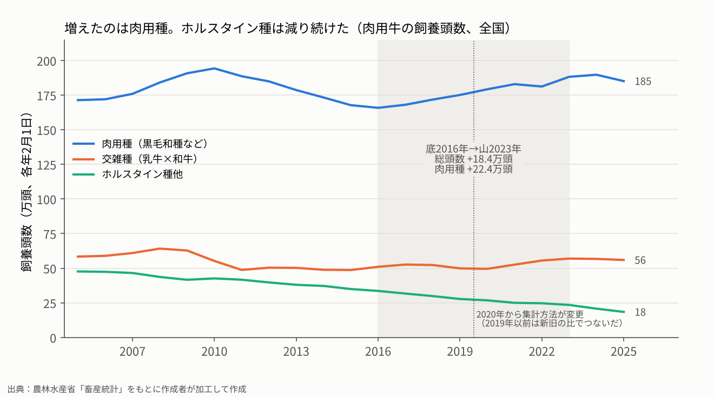
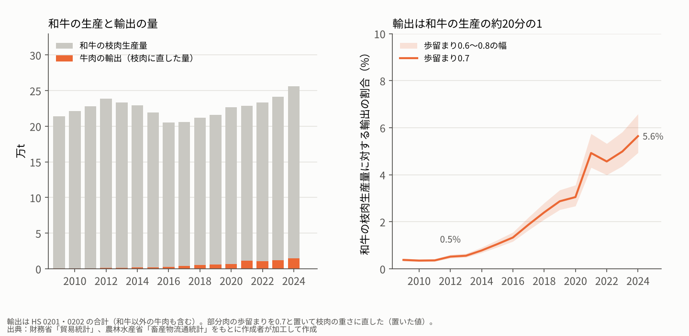
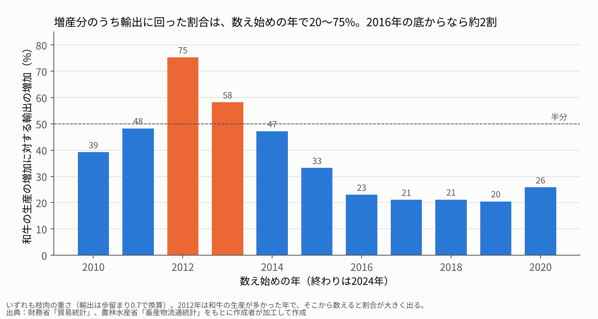
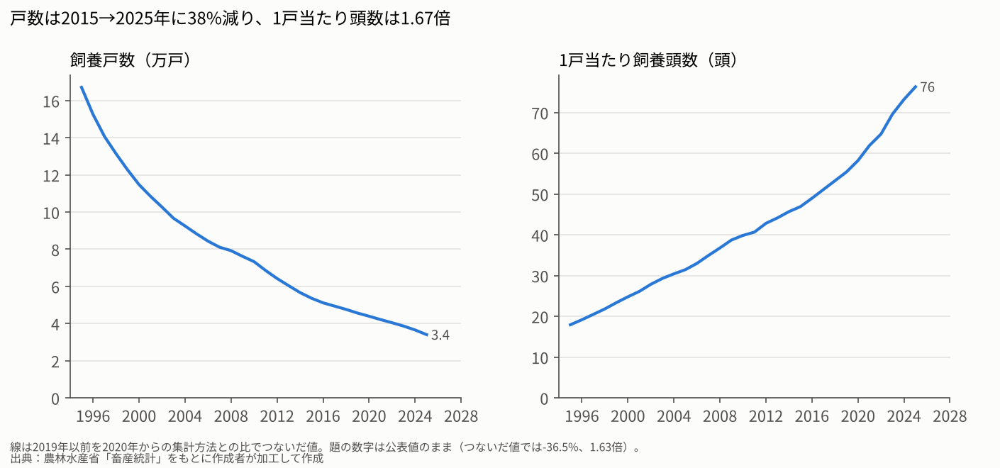

# F470 肉用牛の頭数が増えたのは、和牛の輸出のおかげか？ 輸出は和牛の生産の5.6%。増産分のうち輸出に回った割合は数え始めの年で20〜75%、2016年の底からなら23%

## 結論（先に）

- 肉用牛の頭数は、2016年の250.3万頭（2020年からの集計方法にそろえた値）から2023年の268.7万頭へ、18.4万頭（+7.4%）増えました。増えたのは肉用種（黒毛和種など）で+22.4万頭、交雑種（乳牛と和牛をかけ合わせた牛）も+6.0万頭でした。ホルスタイン種は−10.1万頭で、減り続けています。
- 牛肉の輸出は、2012年の863t（50.6億円）から2025年の1万1,859t（716.5億円）へ13.7倍になりました。ただ、2024年の輸出を枝肉の重さに直すと、同じ年の和牛の枝肉生産量（25万6,133t）の5.6%です。部分肉の歩留まりの置き方（0.6〜0.8）を変えても4.9〜6.6%でした。
- 和牛の枝肉生産量は2016年の20万5,068tを底に増えました。2016→2024年の増加5万1,066tのうち、輸出の増加（枝肉換算）は1万1,720t、23.0%です。残りの8割近くは国内に回った計算です。
- ただし、数え始めを和牛の生産が多かった2012年にすると、増加1万7,544tのうち75.3%が輸出の増加にあたります。「増産分のどれだけが輸出に回ったか」は、数え始めの年で20.5〜75.3%まで動きます。
- この記事のデータで分かるのは量の釣り合いまでです。輸出が頭数を増やしたかどうか（因果）は分けられません。

## 問い

肉用牛の頭数が増えたのは、和牛の輸出のおかげか？ 農林水産省の資料では、2025年の牛肉の輸出が731億円・1万2,628t になったこと、肉用牛の頭数が2017年ごろから増え、2024・2025年に減ったことが紹介されています（「畜産・酪農に関する基本的な事項」2026年2月）。二つが並ぶと「輸出が伸びたから牛が増えた」と読みたくなりますが、量と品種を並べないと、どこまで言えるかは分かりません。畜産・食肉の流通、外食・小売、食品の輸出にかかわる仕事をしている人を想定して、頭数・生産・輸出を同じ単位にそろえて確かめました。

## データ（出典）

- 農林水産省「畜産統計」長期累年：肉用牛の飼養戸数・飼養頭数（全国、各年2月1日、1960〜2025年）。肉用種、乳用種（ホルスタイン種他・交雑種）、子取り用めす牛（子牛を産ませるためのめす牛）、1戸当たり頭数
- 農林水産省「畜産物流通統計」長期累年：成牛のと畜頭数と枝肉生産量（和牛・乳牛・交雑牛、全国、暦年、1985〜2024年）と、食肉中央卸売市場の和牛の1kg あたり卸売価格（1996〜2024年）
- 財務省「貿易統計」統計品別表（輸出）：HS 0201（生鮮・冷蔵の牛肉）と 0202（冷凍の牛肉）の数量・金額（2009〜2025年、各年1〜12月の確定値）
- 畜産統計は2020年から、牛の個体識別のデータベースなどを使う集計に変わりました。2019年は旧・新の両方の値があり、総頭数は旧250.3万頭、新252.7万頭です。この記事では、2019年の新÷旧の比（総頭数で1.0096）を2018年以前に掛けて、新の水準にそろえた系列を主に使いました。
- 貿易統計の牛肉には和牛でない牛肉も入ります（和牛だけの区分はありません）。輸出をすべて和牛とみなすので、和牛に対する割合は大きめに出ます。
- 輸出の量は製品の重さです。部分肉の歩留まり（枝肉に対する部分肉の重さの割合）を0.7と置き（置いた値）、1÷0.7倍して枝肉の重さに直しました。
- 表の列は見出しの文字で選び、内訳と計の一致、2025年の値の読み直しを確かめました（results/build_checks.csv）。

## 事前の計画

PLAN.md に仮説と外れの基準を書きました。表の様式を確かめるときに見た値（頭数の2021〜2025年など）は PLAN.md に書いています。品種別の変化や輸出の割合は計算していませんでした。

| 仮説 | 外れの基準 | 結果 | 判定 |
|---|---|---|---|
| H1：底から山までの総頭数の増加の60%以上は肉用種による | 60%未満 | 2016→2023年の増加18.4万頭に対し、肉用種+22.4万頭（121.5%） | 支持 |
| H2：2024年の輸出（枝肉換算）は和牛の枝肉生産量の10%未満 | 10%以上 | 5.6%（歩留まり0.6〜0.8で4.9〜6.6%） | 支持 |
| H3：2012→2024年の輸出の増加は、和牛の生産の増加の半分に届かない | 半分以上 | 75.3%（歩留まり0.6〜0.8で65.9〜87.9%） | 外れ（数え始めの年で大きく動く。問い直しを参照） |
| H4：飼養戸数は2015→2025年に30%以上減り、1戸当たり頭数は1.5倍以上 | どちらかが届かない | 戸数−37.5%、1戸当たり45.8→76.3頭（1.67倍） | 支持 |

## やったこと

- 頭数の変化を、肉用種・ホルスタイン種他・交雑種に分けました。底は2010〜2019年で総頭数が最も少ない年、山は2020〜2025年で最も多い年です。
- 輸出を枝肉の重さに直し、和牛の生産に対する割合と「何頭分か」を出しました。
- 輸出の増加と和牛の生産の増加をくらべました。数え始めの年で答えが変わったので、問い直しで2010〜2020年の各年から数えました。
- 戸数と1戸当たり頭数の推移を見ました。

## 分かったこと

### 図1 増えたのは肉用種。ホルスタイン種は減り続けた



肉用牛の総頭数（集計方法をそろえた値）は、2016年の250.3万頭から2023年の268.7万頭へ18.4万頭増えました。内訳は、肉用種+22.4万頭（+13.5%）、交雑種+6.0万頭、ホルスタイン種他−10.1万頭です。肉用種の増加は総頭数の増加より大きく、ホルスタイン種の減少を打ち消していました。子牛を産ませる子取り用めす牛も+7.5万頭（+13.3%）増えています。2023→2025年は総頭数が9.2万頭（−3.4%）減り、うちホルスタイン種他が−5.0万頭、肉用種が−3.1万頭、子取り用めす牛が−3.4万頭でした。

### 図2 輸出は13.7倍になったが、和牛の生産の約20分の1



牛肉の輸出は2012年の863tから2024年の1万113t、2025年の1万1,859tに増えました。2024年の輸出を枝肉に直すと約1万4,400tで、和牛の枝肉生産量25万6,133tの5.6%です（2012年は0.5%）。和牛1頭あたりの枝肉重量（2024年472.1kg）で割ると、約3万600頭分にあたります。2024年の和牛のと畜頭数は54万2,515頭でした。金額でくらべると割合は大きく、輸出額は、和牛の枝肉生産量に中央卸売市場の価格（2024年2,291円/kg）を掛けた額の10.8%でした。値の高い部位が多く輸出されているためと考えられます（推測。部位別には確かめていません）。

### 図3 増産分のうち輸出に回った割合は、数え始めの年で20〜75%。2016年の底からなら約2割



和牛の枝肉生産量は、2012年の23万8,589tから2016年の20万5,068tまで減り、その後2024年の25万6,133tまで増えました。2016→2024年の増加5万1,066tのうち、輸出の増加は1万1,720t（23.0%）です。輸出を全部和牛とみなした下限でも、国内に回った和牛は2019年の20万9,615tから2024年の24万1,686tへ増えています。

### 図4 戸数は4割近く減り、1戸当たりの頭数は1.67倍に



飼養戸数は2015年の5万4,400戸から2025年の3万4,000戸へ37.5%減りました。1戸当たり頭数は45.8頭から76.3頭（1.67倍）です。頭数が増えた2016〜2023年も戸数は減り続けました。

## 問い直し（結果を見てから足した）

H3 が外れたのを見て、「増産分のどれだけが輸出に回ったか」が数え始めの年でどれだけ変わるかを確かめました（03b_requestion.py）。

- 2010〜2020年の各年から2024年までで数えると、輸出の増加の割合は20.5%（2019年から）〜75.3%（2012年から）でした。11の年のうち9の年で半分未満です。
- 割合が大きく出るのは2012・2013年から数えたときです。この2年は和牛の生産が多く（2012年は23万8,589t）、2024年までの増加が1万7,544tと小さいためです。
- 頭数（と畜頭数）で見ても同じで、2019→2024年の和牛のと畜頭数の増加8万4,611頭に対し、輸出の増加は1万7,448頭分（20.6%）でした。
- 計画の2012年は、和牛の生産の山だと知らずに選んでいました。

## 頑健性

| 確かめたこと | 結果 | 結論への影響 |
|---|---|---|
| 歩留まりを0.6・0.7・0.8にする（2024年の割合） | 6.6%／5.6%／4.9% | 同じ（10%未満） |
| 歩留まりを0.6・0.7・0.8にする（2012→2024年の増加の比） | 87.9%／75.3%／65.9% | 同じ（どれも半分以上） |
| 2019年の旧・新をつながない | 底2016年→山2023年、増加20.8万頭のうち肉用種+24.0万頭（115.4%） | 同じ |
| 3年平均（2010〜12年→2022〜24年） | 輸出の割合5.1%、増加の比80.1% | 同じ |
| 金額でくらべる（2024年） | 10.8% | 量より大きい。部位の構成で変わる |

## 言えないこと

- 輸出と頭数の関係は量の釣り合いで、輸出が頭数を増やしたかどうか（因果）は言えません。頭数の増減には、子牛の価格や増頭を後押しする国の事業など、この記事で見ていない理由も関係していると考えられます（推測）。
- 貿易統計の牛肉には和牛でない牛肉も入ります。和牛に対する割合は大きめに出ています。
- 枝肉への直し方（歩留まり0.7）は置いた値です。部位の構成で変わります。
- 畜産統計は2020年に集計の方法が変わりました。2019年以前は比でつないだ値です。
- 頭数は2月1日時点の「いる牛」、枝肉生産量は1年間に「出た肉」で、時点がずれます。
- 2025年の輸出の割合は、生産量の表が2024年までのため出せていません。

## 仕事で使うなら

- 「輸出が伸びた」と伝えるときは、伸び率（13.7倍）と、国内の生産に対する大きさ（約5.6%）を並べると誤解が減ります。
- 増産分のどれだけが輸出かを示すときは、数え始めの年で20〜75%まで動くので、基準年とその理由を一緒に示すと読み違いが減ります。
- 量と金額では割合が違います（5.6%と10.8%）。どちらで見ているかを書き分けると比較しやすくなります。

## 計画からの変更

- 問い直し（数え始めの年を変える）を、結果を見てから足しました。
- 和牛のと畜頭数で「何頭分か」を出す計算を、図2・問い直しの説明のために足しました。

## 再現のしかた

```sh
pip install -r requirements.txt
sh src/run_all.sh          # ネットにつながず data/raw から全部作る
# python3 src/01_fetch.py  # 元データを取り直すときだけ（ネットが必要）
```

| ファイル | 役割 |
|---|---|
| src/01_fetch.py | e-Stat から畜産統計・畜産物流通統計の Excel（4ファイル）と貿易統計の CSV（17年分、gzip）を取得（run_all.sh からは呼ばない） |
| src/02_build.py | 見出しの文字で列を選び、頭数・と畜・枝肉・価格・輸出の CSV を data/ に作る。点検を results/build_checks.csv に出す |
| src/03_analysis.py | 頭数の分解、輸出の割合、仮説の判定、頑健性 |
| src/03b_requestion.py | 問い直し（数え始めの年を変える） |
| src/04_figures.py | 図4枚 |

所要時間は数秒（CPU 1つ）。乱数なし。再実行の確かめは results/repro_check.txt。

## レビューで直したこと

| # | 指摘 | 直し方 |
|---|---|---|
| 1 | 題名の「2016年の底からの増産分のうち輸出に回ったのは23%（2012年から数えると75%）」は、結果を見てから選んだ基準年を主に出し、数え始めの年で20〜75%と動くことが伝わりにくい | 題名・図3の題・note を「増産分のうち輸出に回った割合は数え始めの年で20〜75%、2016年の底からなら23%」に直した（status・md の1行目も合わせた） |
| 2 | 図4の線は2019年以前を比でつないだ値だが、題の数字（−38%、1.67倍）は公表値のままで、注記と食い違っていた | 図4の注記に「題の数字は公表値のまま（つないだ値では−36.5%、1.63倍）」を足した |

## 出典

- 農林水産省「畜産統計」（e-Stat）：https://www.e-stat.go.jp/stat-search/files?toukei=00500222&tstat=000001015614
- 農林水産省「畜産物流通調査」（e-Stat）：https://www.e-stat.go.jp/stat-search/files?toukei=00500227&tstat=000001044816
- 財務省「貿易統計」統計品別表（e-Stat）：https://www.e-stat.go.jp/stat-search/files?toukei=00350300&tstat=000001013141
- 農林水産省「畜産・酪農に関する基本的な事項」（2026年2月、問いの背景）：https://www.maff.go.jp/j/chikusan/kikaku/lin/attach/pdf/index-101.pdf
- 各ファイルの URL は data/raw/SOURCES.md にあります。

（いずれも農林水産省「畜産統計」「畜産物流通統計」、財務省「貿易統計」をもとに作成者が加工して作成）
