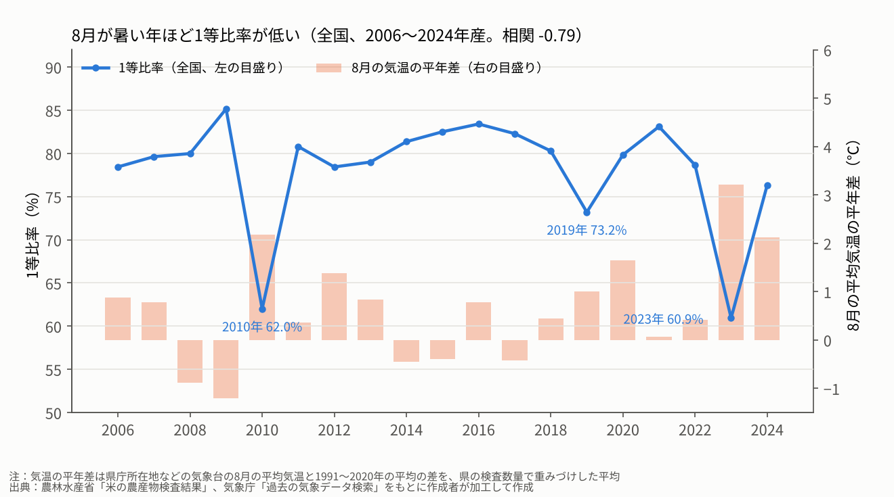
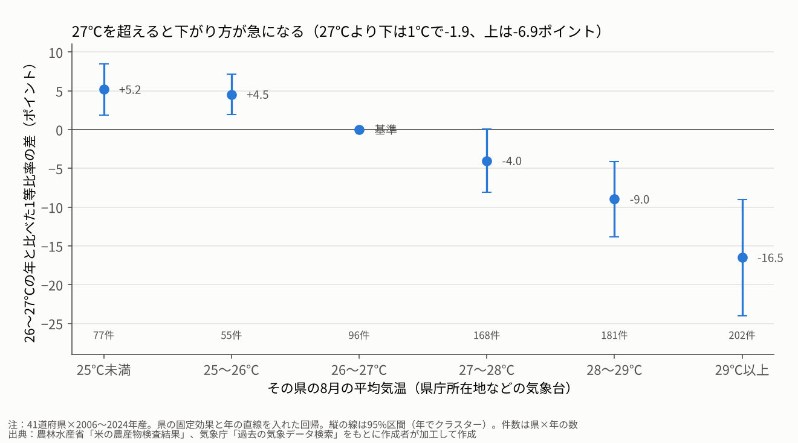
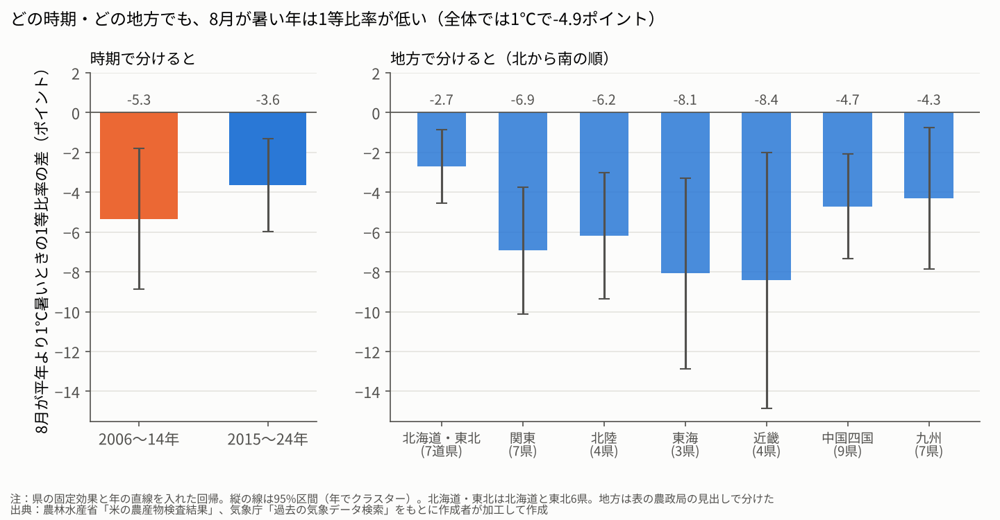
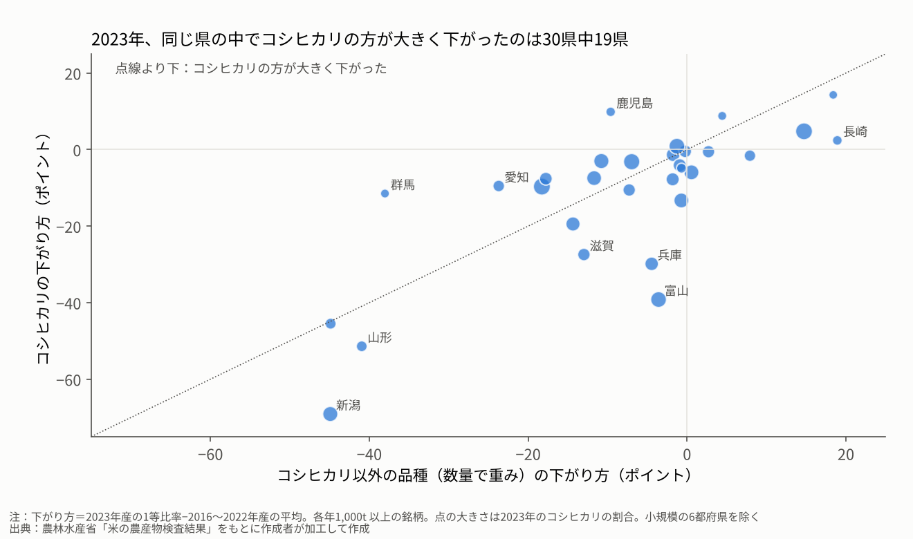

# F471 暑い夏に米の「一等」の割合は、どれだけ下がるのか？ 8月が27℃を超えると1℃ごとに5.6〜6.9ポイント低い。平年より1℃暑い年は2.9〜4.9ポイント低い

## 結論（先に）

- 2006〜2024年産の41道府県で、8月の平均気温が平年（1991〜2020年の平均）より1℃高い年は、その県の水稲うるち玄米の1等比率（検査で「1等」になった数量の割合）が平均4.9ポイント低くなっていました（95%区間 −6.9〜−3.0）。全国に共通の年の動きを除くと（年の固定効果）−2.9ポイントに小さくなるので、幅を持って「1℃で約3〜5ポイント」と読むのが安全です。
- 下がり方は一様ではありません。8月の平均気温が27℃より下では1℃あたり−1.9ポイントですが、27℃より上では−6.9ポイントと、3.6倍の急さでした。年の固定効果を入れても、27℃より上は−5.6、下は−0.5ポイントで、「27℃より上で急」は残りました。26〜27℃の年と比べると、29℃以上の年は16.5ポイント低くなっています。
- 2006〜2014年と2015〜2024年に分けると、1℃あたりの下がり方は−5.3から−3.6ポイントへ、3割ほど小さくなりました。ただし年の固定効果を入れると前半−2.2、後半−3.1ポイントと逆になり、この差は頑健ではありません。2023年は全国の1等比率が60.9%と2010年（62.0%）より低く、「暑さに強くなった」とは言えません。
- 7つの地方のどこでも、暑い8月は1等比率を下げていました（1℃あたり−2.7〜−8.4ポイント）。
- 問い直しで、2023年の下がり方を同じ県の中で比べると、コシヒカリの方が他の品種より大きく下がった県は30県中19県でした。品種で差は出ますが、県によってばらつきます。

## 問い

暑い夏に米の「一等」の割合は、どれだけ下がるのか？ 農林水産省の「地球温暖化影響調査レポート」では、出穂期（穂が出る時期）以降の高温で白未熟粒（白く濁った粒）が出たことがたびたび報告され、令和5年版では水稲で白未熟粒の影響が全国で5割程度の地域に見られたとされています。等級が下がると、1等の米を前提にした取引の量や品質の見通しが変わります。

米の卸・小売・外食の調達や品質管理、産地の営農・出荷の担当の人を想定し、「何℃でどれだけ下がるのか」「最近は下がりにくくなったのか」「地方で違うのか」を、県×年の公的なデータで数えました。

## データ（出典）

- 農林水産省「米の農産物検査結果」確定値（各年産の翌年10月31日現在）：都道府県別の水稲うるち玄米の等級別検査数量（2006〜2024年産。2006〜2015年は PDF、2016年以降は Excel）。1等比率は「1等の数量÷総計」で計算し直し、表に印刷された比率との差が0.1ポイント以下であることを確かめました。全国の値は、別に公表されている「1等比率の推移」と19年すべてで一致しました（results/build_checks.csv）。
- 同じ Excel の「銘柄別検査数量」（品種×産地、2016〜2024年産）：問い直しに使いました。
- 気象庁「過去の気象データ検索」：県庁所在地などの気象台（埼玉は熊谷、滋賀は彦根）の日平均気温の月平均値。
- 県名・地方名は、表の行の順ではなく見出しの文字で付けました。地方は表の農政局の見出しで分けています。照合のため、山形2023年（41.8%）、秋田2023年（53.5%）、高知2006年（12.4%）、栃木2014年（96.3%）、香川2009年（15.8%）、福岡2006年（5.9%）を元の表と照らしました。
- 主な分析の対象は、検査数量の19年平均が1万t 以上の41道府県です（東京・神奈川・山梨・大阪・和歌山・沖縄を除く）。

## 事前の計画

分析の前に PLAN.md に仮説と外れの基準を書きました。ファイルを確かめるときに全国の1等比率の推移と、照合用の数県の値を見ています（PLAN.md に記載）。気温との関係は計算していませんでした。

| 仮説 | 外れの基準 | 結果 | 判定 |
|---|---|---|---|
| H1：8月が1℃暑いと3ポイント以上下がる | b が −3 より0に近い、または区間が0を含む | −4.93（−6.90〜−2.97） | 支持（ただし年の固定効果では−2.89） |
| H2：27℃から上で急になる | 上の傾きが下の傾きの2倍未満 | 下 −1.93、上 −6.85（3.6倍） | 支持 |
| H3：最近は同じ暑さで下がりにくい | 後半の傾きの大きさが前半より3割以上小さくない | −5.33 → −3.64（31.8%小さい。差の区間 +0.42〜+3.07） | 主の推定では支持（基準ぎりぎり）。年の固定効果では −2.15 → −3.07 と逆になり、頑健ではない |
| H4：どの地方でも下がる | どれかの地方で b ≥ 0 | 7地方すべてで負 | 支持 |

## やったこと

1. 等級別検査数量を19年分読み、県×年の1等比率を作りました（41道府県×19年＝779件）。
2. 8月の平均気温を、その地点の1991〜2020年の8月の平均との差（平年差）にしました。
3. 1等比率を、県の固定効果（県ごとのもともとの水準）、年の直線、8月の平年差で説明する回帰を当てました。標準誤差は年でクラスターしました（同じ年の天候は全国で共通に効くため）。
4. 8月の実の気温を1℃刻みの区間に分け、26〜27℃の年との差を出しました。27℃で折れる折れ線も当てました。
5. 前半（2006〜2014年）と後半（2015〜2024年）、7つの地方に分けて同じ回帰を当てました。前後の差の区間は、県を単位にしたブートストラップ（2,000回）で出しました。

## 分かったこと

### 全国でも、8月が暑い年に1等比率が下がる



- 全国の1等比率は、2010年に62.0%、2023年に60.9%まで下がりました。どちらも8月が平年よりかなり暑かった年です（41道府県の平均で+1.8℃と+2.2℃）。
- 全国の1等比率と、検査数量で重みをつけた8月の平年差の相関は−0.79でした。
- 2019年（73.2%）のように、8月の暑さがそれほどでない年にも下がっています。暑さ以外の理由（害虫や台風、日照など）があると考えられますが、このデータでは確かめていません（推測）。

### 27℃を超えると、下がり方が急になる



- 26〜27℃の年と比べて、27〜28℃の年は−4.0、28〜29℃は−9.0、29℃以上は−16.5ポイントでした。
- 27℃で折れる線では、下が1℃あたり−1.9、上が−6.9ポイントです。折れる位置を26〜28℃で動かしても、上の傾き（−6.3〜−7.9）は下の傾き（−0.5〜−3.2）より大きいままでした（results/h2_knots.csv）。
- 県×年の7割が27℃以上で、北の県より西の県に多く集まっています。気温の区間の差には、地域の違いが一部混ざっている可能性があります。

### 時期と地方：どこでも下がるが、後半はやや小さい



- 1℃あたりの下がり方は、前半が−5.3、後半が−3.6ポイントでした。後半の方が31.8%小さく、差の95%区間（+0.4〜+3.1）は0を含みません。
- ただしレビューで、年の固定効果（県でクラスター）を入れて同じ比べ方をすると、前半−2.15（区間 −4.51〜+0.20）、後半−3.07（−5.19〜−0.94）と、後半の方が大きくなりました。前後の差は、暑い年の並び方（前半に2010年、後半に2023年）に左右されている可能性があり、「最近は下がりにくい」とは言い切れません。
- 地方別（北から南）では、北海道・東北 −2.7、関東 −6.9、北陸 −6.2、東海 −8.1、近畿 −8.4、中国四国 −4.7、九州 −4.3ポイントでした。区間は広く、地方の差が意味のある差かどうかは、このデータでは言えません。
- 北海道・東北は8月の気温がもともと低く（平均25.0℃）、27℃を超える年が少ないことが、下がり方の小ささに表れていると考えられます（推測）。

## 問い直し（結果を見てから足した）

前半と後半で下がり方が違った（H3）ので、「品種の入れ替わり」が効いているかを一部だけ確かめました。銘柄別の表（2016〜2024年産）で、2023年産の1等比率と、同じ県・同じ品種の2016〜2022年産の平均との差（下がり方）を、コシヒカリとそれ以外の品種で比べました（各年1,000t 以上の銘柄）。



- 両方がある30県のうち、コシヒカリの方が大きく下がったのは19県でした。差の中央値は−3.3ポイントです。
- 2023年の数量で重みをつけると、コシヒカリは−28.2、それ以外は−14.0ポイントでした。ただしこの差の多くは新潟（コシヒカリ 73.4%→4.3%）から来ています。新潟では、同じ年の新之助は95.3%→94.8%とほとんど下がっていません。
- 逆に、コシヒカリの方が下がらなかった県も11県あり、品種だけで下がり方が決まるわけではありません。全国の検査数量に占めるコシヒカリの割合は、2016年31.2%、2024年27.4%と少しずつ下がっています。

## 頑健性

| 確かめ | 8月が1℃暑いときの差（ポイント） | 95%区間 | 結論 |
|---|---|---|---|
| 主（8月の平年差、41道府県、重みなし） | −4.93 | −6.90〜−2.97 | — |
| 気温を7〜8月の平均に | −5.99 | −9.22〜−2.76 | 変わらない |
| 気温を8〜9月の平均に | −4.96 | −7.05〜−2.87 | 変わらない |
| 47都道府県すべて | −4.88 | −6.82〜−2.95 | 変わらない |
| 検査数量で重み | −4.43 | −6.54〜−2.31 | 変わらない |
| 2010年と2023年を除く | −3.37 | −4.46〜−2.27 | 小さくなるが負 |
| 年の固定効果（同じ年の県の間の差だけ） | −2.89 | −4.74〜−1.05 | 小さくなるが負（H1 の3ポイントに届かない） |
| 標準誤差を県でクラスター | −4.93 | −6.29〜−3.58 | 変わらない |
| H2：年の固定効果で27℃の折れ線（上／下の傾き） | −5.57／−0.53 | 上 −7.84〜−3.30／下 −2.14〜+1.08 | 27℃より上で急なことは残る（レビューで追加） |
| H3：年の固定効果で前半／後半 | −2.15／−3.07 | 前半 −4.51〜+0.20／後半 −5.19〜−0.94 | 前後の大小が逆になる（レビューで追加） |

H1 の確かめ（上の8行）はどれも負で、区間は0を含みませんでした。大きさは−2.9〜−6.0ポイントの幅で動きます。全国に共通の年の動きを除くと小さくなるので、「1℃で約5ポイント」のうち一部は、暑い年にたまたま重なった別の理由かもしれません。

## 言えないこと

- 県庁所在地の気温は、田んぼの多い地域の気温と違います。出穂の時期も県や品種で違い、8月の平均がいちばん効く時期とは限りません。
- 1等比率が下がる理由は暑さだけではありません（カメムシ、台風、日照、雨など）。この分析では分けていません。
- 前半と後半の差（H3）が、品種の入れ替わりによるのか、栽培の工夫によるのか、暑い年の並び方によるのかは分けられません。問い直しは2023年の1年だけです。
- 検査を受ける米は生産量の一部で、検査を受ける割合は県・年で違います。
- 等級と価格・食味の関係は扱っていません。
- 地方の傾きの差は区間が重なっていて、どの地方が弱いとは言えません。

## 仕事で使うなら

- 8月の気温の見通しと、この記事の「27℃より上で1℃あたり約6〜7ポイント」を並べると、1等比率が下がる大きさの目安を話す材料になります。
- 品種ごとの下がり方は県で違うので、全国の平均より、産地・品種ごとの過去の値を並べて見る方が実態に近くなります。

## 計画からの変更

- 計画どおりに進めました。頑健性に「標準誤差を県でクラスター」を表に足しました（計画では主の推定に並べると書いた分）。
- 問い直し（コシヒカリとそれ以外の比較）は、H3 の結果を見てから足しました。

## 再現のしかた

```sh
pip install -r requirements.txt
sh src/run_all.sh          # ネットにつながず data/raw から全部作る
# python3 src/01_fetch.py  # 元データを取り直すときだけ（ネットと pdftotext が必要）
```

| ファイル | 役割 |
|---|---|
| src/01_fetch.py | 農林水産省の Excel・PDF（20ファイル）と気象庁の地点別の表（47地点）を取得し、PDF の文字を pdftotext で data/raw/pdf_text/ に取り出す（run_all.sh からは呼ばない） |
| src/02_build.py | 見出しの文字で県名・地方名・列を選び、data/panel.csv・varieties.csv・jma_monthly_temp.csv を作る。照合を results/build_checks*.csv に出す |
| src/03_analysis.py | H1〜H4 と頑健性。results/main.json ほか |
| src/03b_requestion.py | 問い直し（2023年のコシヒカリとそれ以外） |
| src/04_figures.py | 図4枚 |
| src/common.py | 固定効果の回帰など |

所要時間は約40秒（CPU 1つ。ほとんどがブートストラップ2,000回）。乱数の種は20261116。再実行の確かめは results/repro_check.txt（20ファイル一致）。

## 関連する記事

- 111（米の収量と夏の気温）：収量（量）を見た記事です。この記事は等級（質）を、県×年の1等比率で見ています。

## レビューで直したこと

| # | 指摘 | 直し方 |
|---|---|---|
| 1 | 題名の「1℃暑いと4.9ポイント低い」は、年の固定効果では−2.9で、主の推定だけを言い切っていた | 題名を、頑健性で残った「27℃より上で1℃ごとに5.6〜6.9ポイント」を先にし、平年差は「2.9〜4.9ポイント」と幅で書いた。「下がる」を「低い」に |
| 2 | 27℃の折れ線（H2）が年の固定効果でも残るかを確かめていなかった | 03_analysis.py に追加。上−5.57、下−0.53で残った（main.json の review_yearfe） |
| 3 | H3「後半は3割小さい」は、年の固定効果では逆（−2.15→−3.07）になる | 結論・仮説の表・図3の節・頑健性の表に書き足し、「言い切れない」とした |
| 4 | 既存の記事111（米の収量と夏の気温）との関係が書かれていなかった | 「関連する記事」を足した |
| 5 | 図3の題「暑い8月は1等比率を下げる」が因果のように読める | 「8月が暑い年は1等比率が低い」に直した |

## 出典

- 農林水産省「米の農産物検査結果」：https://www.maff.go.jp/j/seisan/syoryu/kensa/kome/index.html
- 気象庁「過去の気象データ検索」：https://www.data.jma.go.jp/stats/etrn/index.php
- 農林水産省「令和5年地球温暖化影響調査レポート」の公表について（問いの背景）：https://www.maff.go.jp/j/press/nousan/kankyo/240930.html
- 各ファイルの URL は data/raw/SOURCES.md にあります。

（いずれも農林水産省「米の農産物検査結果」、気象庁「過去の気象データ検索」をもとに作成者が加工して作成）
