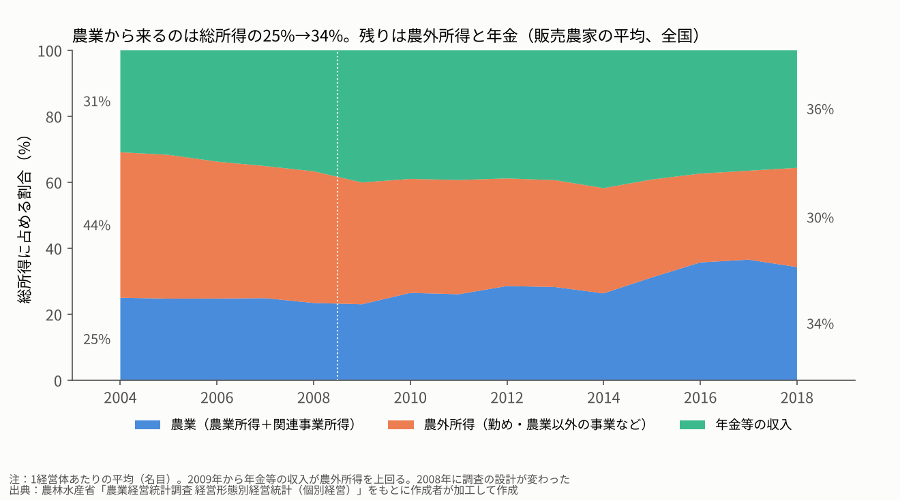
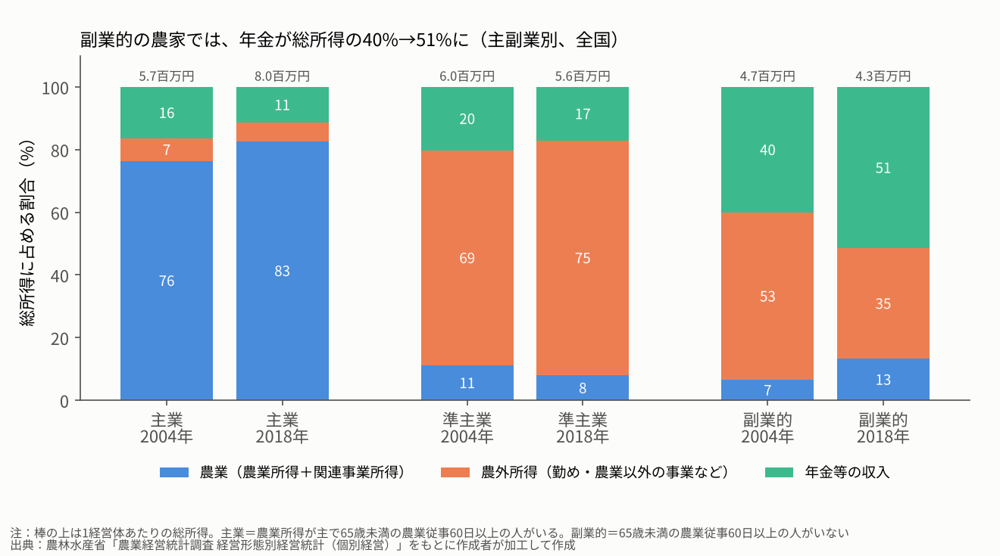
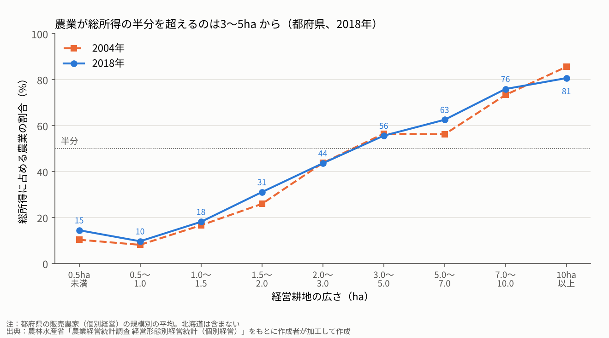
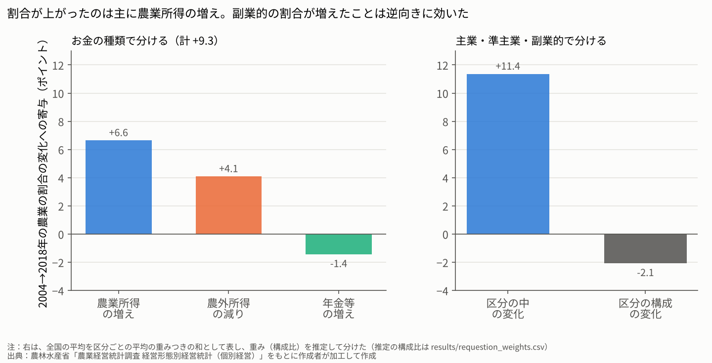

# F472 農家の暮らしは、農業以外の所得にどれだけ頼っているのか？ 項目がある最後の年の2018年、販売農家の平均で総所得の66%が農外所得と年金。農業の割合は2004年の25%から34%に上がった

## 結論（先に）

- 農業をしている世帯（販売農家の個別経営）の平均で、2018年の総所得510.8万円のうち、農業から来たのは34.2%でした。農外所得（勤めや農業以外の事業）が30.1%、年金等の収入が35.7%で、合わせて3分の2が農業以外です。
- 農業の割合は、2004年の24.9%から9.3ポイント上がりました。分けると、農業所得の増えが+6.6、農外所得の減りが+4.1、年金等の増えが−1.4ポイントです。2009年からは、年金等の収入が農外所得を上回っています。
- 主業・副業的で姿がまったく違います。主業では農業が76〜83%を占め、副業的では6〜14%でした。副業的の農家では、年金等の収入が総所得の40.0%から51.5%に増えました。
- 都府県では、農業が総所得の半分を超えるのは経営耕地3〜5ha の層からでした（15年のうち10年。残りの5年は5〜7ha から）。
- 問い直しで、全国の割合の上がり方を「区分の中の変化」と「区分の構成の変化」に分けると、中の変化が+11.4、構成の変化が−2.1ポイントでした（構成は推定）。
- 2019年から調査が変わり、農外所得と年金等の収入が集められなくなったため、この記事で分かるのは2018年までです。

## 問い

農家の暮らしは、農業以外の所得にどれだけ頼っているのか？ 日本の農家の多くは兼業で、農業の所得は暮らしの一部だとよく言われます。では、総所得のうち農業から来る分はどれくらいで、勤めの所得と年金はどれくらいなのか。それは15年でどう変わり、主業の農家と副業的な農家、小さい経営と大きい経営でどう違うのか。

農業・農村の統計を読む人、地域の金融機関や農協で農家の家計を見る人、農業の担い手について話す人を想定して、農林水産省の「農業経営統計調査」で数えました。

## データ（出典）

- 農林水産省「農業経営統計調査 経営形態別経営統計（個別経営）」（e-Stat）。対象は販売農家（個別経営）の1経営体あたりの平均（千円、名目）です。
  - 長期累年の「全国年次別統計表 (1) 経営の概要と分析指標」（2004〜2018年）
  - 各年の「農業の主副業別統計表」と「都府県の経営耕地規模別統計表」の「経営の概要と分析指標」（2004〜2018年、各15ファイル）
- 主副業の区分：主業＝農業所得が主（世帯の所得の5割以上）で、65歳未満で年60日以上農業をする人がいる。準主業＝農外所得が主で、そのような人がいる。副業的＝そのような人がいない。
- 総所得は、農業所得＋農業生産関連事業所得（加工・直売など）＋農外所得＋年金等の収入です。この記事の「農業の割合」は、（農業所得＋農業生産関連事業所得）÷総所得です。
- 表の向き（項目が行か列か）は年で違うので、項目と区分は見出しの文字で選びました。読み取った値は、4つの和が総所得に一致すること（全部で210行、ずれは0）で確かめました（results/build_checks.csv）。
- 2008年に調査の設計が変わり、集計した経営体は2007年の6,902から2008年の4,725に減りました。
- 2019年からの「個人経営体」の表には、農外所得・年金等の収入・総所得の項目がありません（2019〜2024年の表を開いて確かめました）。このため2018年で止めています。

## 事前の計画

分析の前に PLAN.md に仮説と外れの基準を書きました。表の読み取りを確かめるときに、全国の15年分と、主副業別・規模別の2004年と2018年の値を見ています（PLAN.md に記載）。割合や分解は計算していませんでした。

| 仮説 | 外れの基準 | 結果 | 判定 |
|---|---|---|---|
| H1：農業の割合は2004→2018年に5ポイント以上上がる | 5ポイント未満 | 24.9%→34.2%（+9.3） | 支持 |
| H2：上がり方は「農外所得の減り」の寄与の方が「農業所得の増え」より大きい | 農外の寄与が小さい | 農業所得 +6.6、農外所得 +4.1 | 外れ |
| H3：主業は15年すべて75%以上、副業的は15年すべて15%以下 | どれか1年でも外れる | 主業 76.4〜83.3%、副業的 6.1〜14.4% | 支持 |
| H4：半分を超える最小の規模区分は3〜5ha か、隣の区分まで | 2つ以上動く年がある | 3〜5ha が10年、5〜7ha が5年 | 支持 |

## やったこと

1. 長期累年の表から、全国の農業所得・関連事業所得・農外所得・年金等の収入・総所得を15年分読み、割合を出しました。
2. 2004→2018年の割合の変化を、農業・農外・年金の3つの金額の変化の寄与に分けました（割合を平均の点のまわりで1次の式に分ける方法。残りの交差の項は0.0001ポイント未満）。
3. 主副業別の表（全国）から、主業・準主業・副業的の内訳を15年分出しました。
4. 都府県の規模別の表から、農業の割合が5割を超える最も小さい規模区分を年ごとに出しました。

## 分かったこと

### 農業から来るのは総所得の3分の1。残りは農外所得と年金



- 総所得は2004年508.3万円、2018年510.8万円で、ほとんど変わっていません。中身は、農業が126.7万円→174.8万円、農外所得が224.1万円→153.6万円、年金等が157.5万円→182.4万円でした。
- 農業の割合は2009年の23.0%がいちばん低く、2017年の36.5%がいちばん高くなっています。2015〜2017年に大きく上がりました。
- 年金等の収入は2009年に農外所得を上回り、そのあとは総所得の4割前後を占めています。

### 主業と副業的では、暮らしの柱が違う



- 主業では、農業が総所得の76.4%（2004年）→82.7%（2018年）でした。総所得は573.2万円→800.7万円です。
- 準主業では、農外所得が68.6%→74.9%を占めていて、勤めが柱です。
- 副業的では、農外所得が53.4%→35.2%に減り、年金等が40.0%→51.5%に増えました。総所得は468.6万円→425.5万円です。経営主が高齢になり、勤めから年金に移ったことを表していると考えられますが、このデータで一人ひとりは追えません（推測）。

### 規模で見ると、半分を超えるのは3〜5ha から



- 2018年の都府県で、農業の割合は0.5〜1.0ha で10%、2.0〜3.0ha で44%、3.0〜5.0ha で56%、10ha 以上で81%でした。
- 2004年と2018年の線はほとんど重なっています。広さが同じなら、農業に頼る度合いは15年であまり変わっていません。
- 5割を超える最も小さい区分は、15年のうち10年が3〜5ha、5年（2008・2009・2011・2013・2014年）が5〜7ha でした。

## 問い直し（結果を見てから足した）

H2 が外れ、農業所得の増えが割合を押し上げていたことが分かりました。では、それは「主業の農家の農業所得が増えた」ような区分の中の変化なのか、「農業の割合が高い層が増えた」ような構成の変化なのか。全国の平均（農業・農外・年金の3つの金額）を、主業・準主業・副業的の平均の重みつきの和として表し、重み（推定の構成比）を年ごとに求めて分けました（重みの和は1、重みは0以上。当てはめのずれは最大5.2千円）。



- 推定の構成比は、副業的が64.6%（2004年）→71.3%（2018年）、主業が22.4%→19.7%、準主業が13.0%→9.0%でした。
- 割合の変化+9.3ポイントのうち、区分の中の変化が+11.4、構成の変化が−2.1ポイントでした。農業の割合の低い副業的が増えたことは、全国の割合を下げる向きに効いています。
- この構成比は、平均の金額から逆算した推定で、農林業センサスなどの経営体数そのものではありません。

## 頑健性

| 確かめ | 変化（ポイント） | 農業所得の寄与 | 農外所得の寄与 | 年金等の寄与 | 結論 |
|---|---|---|---|---|---|
| 主（2004→2018年） | +9.3 | +6.6 | +4.1 | −1.4 | — |
| 年金を除いた農業依存度（2004→2018年） | +17.1（36.1%→53.2%） | — | — | — | H1 は変わらない |
| 2008→2018年（調査の設計の変更のあと） | +10.9 | +9.6 | +1.9 | −0.7 | H1・H2 とも変わらない |
| 3年平均（2004〜06年→2016〜18年） | +10.7 | +8.1 | +4.2 | −1.6 | H1・H2 とも変わらない |
| 2007年を旧の減価償却の値に | 2007年の割合が+0.09 | — | — | — | 変わらない |
| H3 を農業依存度で | 主業の最小91.3%、副業的の最大31.1% | — | — | — | 主業は変わらない。副業的は15%を超える（定義による） |

H1 と H2 の判定は、どの確かめでも変わりませんでした。H3 の副業的は、年金を分母に入れるかどうかで大きく変わります。副業的の農家では年金の比重が大きいためです。

## 言えないこと

- 平均の値なので、世帯ごとのばらつき（農業だけで暮らす副業的の世帯がいるか、など）は分かりません。
- 2019年以降は分かりません（調査の項目がありません）。
- 毎年の標本は同じ経営体ではありません。主業から副業的に移った世帯、やめた世帯は追えません。
- 物価で割っていない名目の値です。
- 構成比（問い直し）は推定で、実際の経営体数の構成とは違う可能性があります。
- 規模別は都府県だけです。北海道は規模が大きく、別の姿になると考えられます（推測）。

## 仕事で使うなら

- 「農家の所得」と言うとき、農業所得だけか、世帯の総所得かで、話がまったく変わります。主業・副業的の区分と一緒に示すと誤解が減ります。
- 副業的の農家では年金が総所得の半分を占めていたので、高齢化の話と農業の話は、同じ表の上で並べて見るのが実態に近いです。

## 計画からの変更

- 計画どおりに進めました。H3 の頑健性（農業依存度で見る）を表に足しました。
- 問い直し（構成と中身に分ける）は、H2 の結果を見てから足しました。

## 再現のしかた

```sh
pip install -r requirements.txt
sh src/run_all.sh          # ネットにつながず data/raw から全部作る
# python3 src/01_fetch.py  # 元データを取り直すときだけ（ネットが必要）
```

| ファイル | 役割 |
|---|---|
| src/01_fetch.py | e-Stat の一覧のページから、見出しの文字で表を選んで取得（31ファイル、run_all.sh からは呼ばない） |
| src/02_build.py | 表の向きを見分け、見出しの文字で項目と区分を選び、data/ の CSV 3つを作る。4つの和＝総所得を確かめる |
| src/03_analysis.py | H1〜H4、分解、頑健性 |
| src/03b_requestion.py | 問い直し（構成と中身に分ける） |
| src/04_figures.py | 図4枚 |

所要時間は約3秒（CPU 1つ）。乱数なし。再実行の確かめは results/repro_check.txt（16ファイル一致）。

## レビューで直したこと

| # | 指摘 | 直し方 |
|---|---|---|
| 1 | 題名だけでは、分かるのが2018年までだと読み取りにくく、「25%から34%」の起点の年がなかった | 題名に「項目がある最後の年の2018年」と「2004年の」を足した |

## 出典

- 農林水産省「農業経営統計調査」：https://www.maff.go.jp/j/tokei/kouhyou/noukei/
- e-Stat 農業経営統計調査の統計表一覧：https://www.e-stat.go.jp/stat-search/files?toukei=00500201&tstat=000001013460
- 各ファイルの URL は data/raw/SOURCES.md にあります。

（いずれも農林水産省「農業経営統計調査」をもとに作成者が加工して作成）
