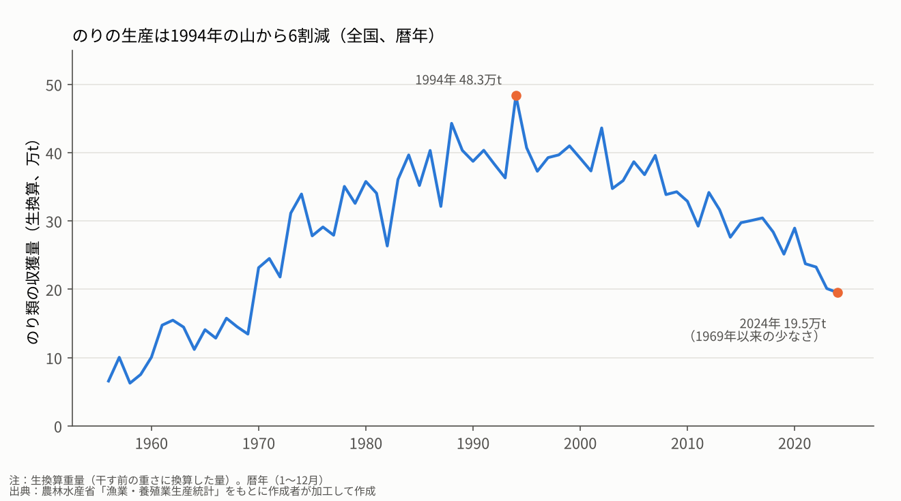
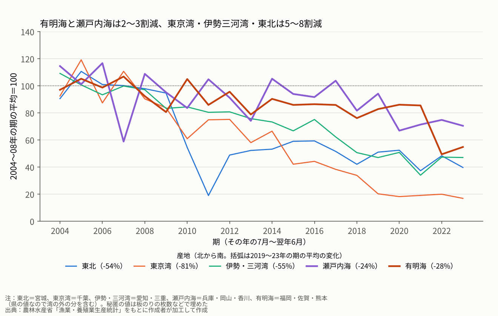
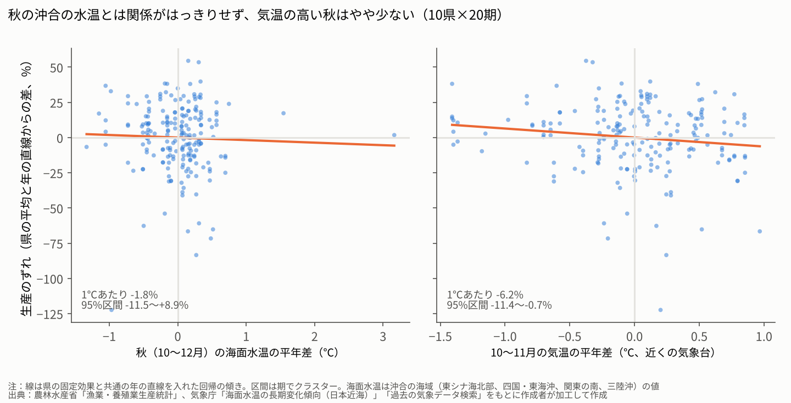
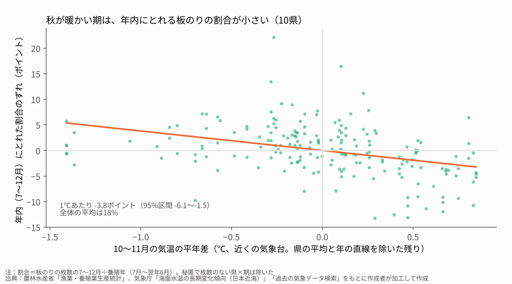

# F473 のりの生産は、なぜ減ったのか？ 2019〜23年の期は2004〜08年より37%少ない。秋の水温や気温を入れても、年4%の下がりの96%以上は説明されずに残る

## 結論（先に）

- のり類の収獲量（全国、暦年）は1994年の48.3万t が山で、2024年は19.5万t でした。山から6割減り、1969年以来の少なさです。
- 養殖の期（7月〜翌年6月）で比べると、2019〜23年の期の平均23.2万t は、2004〜08年の期の平均36.9万t より37.0%少なくなっています。
- 産地（北から南）で見ると、東北−54%、東京湾−81%、伊勢・三河湾−55%、瀬戸内海−24%、有明海−28%でした。減った量では有明海が全国の減り分の36%を占めますが、減り方（%）は有明海と瀬戸内海が小さく、全国に占める有明海の割合は47%から54%に上がりました。
- 主な10県で、秋（10〜12月）の沖合の海面水温が平年より1℃高い期の生産は−1.8%でしたが、区間は−11.5〜+8.9%で0をまたぎ、はっきりした関係は見えませんでした。水温を入れても、年あたり約4%の下がりはほとんど変わりません（99%が残る）。
- 一方、産地の近くの気象台の10〜11月の気温で見ると、1℃高い期は−6.2%（−11.4〜−0.7%）でした。問い直しで、暖かい秋は年内（7〜12月）にとれる板のりの割合が1℃あたり3.8ポイント小さいことも分かりました。暑い秋の期はとれ始めが遅い、という関係です。ただし気温を入れても年の下がりは96.1%が残り（年−4.1%→−4.0%）、この20年の10〜11月の気温の上がり方（10県の平均で年0.025℃）に−6.2%／℃を掛けても年0.2%ほどで、長い下がりの説明にはなっていません。

## 問い

のりの生産は、なぜ減ったのか？ 水産庁の資料（2026年3月）では、のりの生産はピーク時の5〜6割程度まで落ち込み、その理由として生産者の減少、海水温の上昇、栄養塩（海の中の窒素やりんなど）の低下、植物プランクトンとの栄養の奪い合い、魚や鳥による食害が挙げられています。このうち、公的な統計でどこまで確かめられるのかを調べました。

のりを仕入れる食品・外食・コンビニの調達担当、水産の統計を読む人、産地の漁協や自治体の人を想定しています。

## データ（出典）

- 農林水産省「漁業・養殖業生産統計」（e-Stat）
  - 各年の「海面養殖業 都道府県別 のり類収獲量」（2004〜2024年の表）。養殖年（7月〜翌年6月）の生換算重量（干す前の重さに換算した量）と、板のりの枚数（7〜12月と翌年1〜6月）を使いました。
  - 長期累年「養殖魚種別収獲量累年統計」（全国、1956〜2024年、暦年）
- 気象庁「海面水温の長期変化傾向（日本近海）」の海域平均海面水温の平年差（秋＝10〜12月）：東シナ海北部、四国・東海沖、関東の南、三陸沖
- 気象庁「過去の気象データ検索」：佐賀・高松・名古屋・千葉・仙台の気象台の月平均気温
- 列は見出しの文字（「生換算重量（7月〜翌年6月）」「のり類養殖（7〜12月）」など）で選び、県は行の見出しの文字で選びました。全国の暦年の値は長期累年の表と21年すべてで一致し、板のりの枚数は「7〜12月＋翌年1〜6月＝養殖年」が767行で1千枚以内で合いました（results/build_checks.csv）。
- 2024年の表は2023年の期の値を改めて載せていて、数県で数十t 改定されていました（全国で−94t）。2023年の期は新しい値を使いました。
- 秘匿（x）で欠けた主な県×期の8つは、板のりの枚数×前後の年の「t／千枚」の比などで埋めました（results/imputed.csv）。

## 事前の計画

分析の前に PLAN.md に仮説と外れの基準を書きました。表を確かめるときに全国の期の値と佐賀の値を見ています（PLAN.md に記載）。産地ごとの減り方や水温との関係は計算していませんでした。

| 仮説 | 外れの基準 | 結果 | 判定 |
|---|---|---|---|
| H1：全国は2019〜23年の期が2004〜08年より30%以上少ない | 30%未満 | −37.0% | 支持 |
| H2：減り方（%）は瀬戸内海の方が有明海より大きい | 小さい | 瀬戸内海 −24.5%、有明海 −28.3% | 外れ |
| H3：秋の海面水温が高い期ほど生産が少ない | 区間が0を含む | −1.8%（−11.5〜+8.9%） | 外れ |
| H4：年の下がりのうち水温で説明される分は半分未満 | 水温を入れて年の直線が50%未満しか残らない | 99%が残る（−4.1%→−4.1%／年） | 支持 |

## やったこと

1. 全国の期の生産を2004〜2023年の20期で並べ、長期累年で1956年からの位置を見ました。
2. 主な10県（期の平均が7,000t 以上）を5つの産地にまとめ、2004〜08年と2019〜23年の5期平均で減り方を比べました。
3. 10県×20期のパネルで、log（生産）を県の固定効果、共通の年の直線、秋の海面水温の平年差で説明する回帰を当てました（標準誤差は期でクラスター）。県と海域の対応は、宮城→三陸沖、千葉→関東の南、愛知・三重・兵庫・岡山・香川→四国・東海沖、福岡・佐賀・熊本→東シナ海北部です。
4. 水温を入れる前と後で、年の直線の大きさを比べました。

## 分かったこと

### 山から6割減、1969年以来の少なさ



- 全国の暦年の収獲量は、1956年の6.6万t から増え、1994年の48.3万t が山でした。2000年代から下がり、2024年は19.5万t です。
- 養殖の期では、2004年の期37.6万t、2022年の期19.5万t（20期でいちばん少ない）、2023年の期19.5万t でした。

### 減り方は産地で大きく違う



- 2004〜08年→2019〜23年の5期平均で、東北（宮城）−54.3%、東京湾（千葉）−81.2%、伊勢・三河湾（愛知・三重）−54.8%、瀬戸内海（兵庫・岡山・香川）−24.5%、有明海（福岡・佐賀・熊本）−28.3%でした。
- 減った量で見ると、有明海が4.9万t（全国の減り分の36.1%）、瀬戸内海が2.2万t（15.9%）です。
- 有明海は2021年の期までは2004〜08年の平均の76〜107%の範囲でしたが、2022年の期に49%まで落ちました。宮城の2011年の期の落ち込みは東日本大震災の年です。

### 秋の沖合の水温とは、関係がはっきりしない



- 秋の海面水温が平年より1℃高い期の生産は−1.8%（95%区間 −11.5〜+8.9%）でした。
- 共通の年の直線は、水温を入れる前が年−4.1%、入れたあとも年−4.1%でした。下がりのほとんどは、この海面水温では説明されません。この20年で沖合の秋の海面水温は年0.015℃前後（三陸沖は0.085℃）しか上がっておらず、年4%の下がりを説明するには小さすぎます。
- 産地の近くの気象台の10〜11月の気温では、1℃高い期は−6.2%（−11.4〜−0.7%）でした。気温を入れても年の直線は年−4.0%で、96.1%が残ります。この20年の10〜11月の気温の上がり方は年0.025℃（10県の平均）なので、−6.2%／℃を掛けても年0.2%ほどです（レビューで追加）。湾の中の水温は沖合より気温に近い動きをすると考えられますが、このデータでは確かめていません（推測）。

## 問い直し（結果を見てから足した）

H3 が外れ、気温では関係が見えたので、「暖かい秋は、とれ始めが遅れるのか」を確かめました。板のりの枚数で、養殖年のうち年内（7〜12月）にとれた割合を、同じ回帰で説明しました（10県、枚数のある188の県×期）。



- 年内の割合の平均は18%で、10〜11月の気温が1℃高い期は3.8ポイント小さくなっていました（95%区間 −6.1〜−1.5）。沖合の海面水温では−1.0ポイント（−3.3〜+1.2）で、はっきりしません。
- 瀬戸内海3県の年内の割合は、2004年の期の13.7%から2023年の期の3.1%に下がりました。有明海3県は25〜35%前後で、決まった向きはありません。
- 暖かい秋の期は、とれ始めが遅く、量も少し少ない、という関係です。ただし、長い下がりの大きさとは桁が違います。

## 頑健性

| 確かめ | 1℃あたりの生産の差 | 95%区間 | 結論 |
|---|---|---|---|
| 主（10県、秋の海面水温、共通の年の直線） | −1.8% | −11.5〜+8.9% | — |
| 10〜11月の気温（近くの気象台） | −6.2% | −11.4〜−0.7% | 気温では負で、0を含まない |
| 埋めた値を使わない5県（兵庫・岡山・香川・佐賀・熊本） | −6.5% | −18.0〜+6.7% | 0を含む |
| 2022・2023年の期を除く | −3.7% | −16.3〜+10.8% | 0を含む |
| 県ごとの年の直線 | −1.4% | −10.8〜+9.1% | 0を含む |

海面水温では、どの確かめでも区間が0を含みました。H4（年の直線の大部分が残る）は、2022・2023年の期を除いても98.6%が残り、水温の代わりに気温を入れても96.1%が残り、変わりませんでした。

## 言えないこと

- 栄養塩、植物プランクトン、食害、生産者の数は、このデータにありません。年4%の下がりがどれによるかは分けられません。
- 海面水温は沖合の海域の平均で、湾の中の水温とは違います。気温での結果は、水温の代わりとしての近似です。
- 県の値には湾の外の分も入ります（たとえば福岡の豊前海、熊本の八代海）。
- 秘匿の値を8つ埋めています。埋めない5県では区間が広がりました。
- 量だけを扱い、品質（色落ち）や価格は扱っていません。
- 相関であって、因果ではありません。

## 仕事で使うなら

- 秋の気温の高さは、その期のとれ始めの遅れの目安として見られます（年内の割合で1℃あたり約4ポイント）。
- 長い下がりは産地ごとに大きさが違うので、全国の数字より、仕入れ先の産地の5期平均を並べて見る方が実態に近くなります。

## 計画からの変更

- 頑健性に使う気象台は、計画どおり5地点です。兵庫・岡山は高松、福岡・熊本は佐賀の値で代えました。
- 問い直し（年内にとれた割合）は、H3 の結果を見てから足しました。

## 再現のしかた

```sh
pip install -r requirements.txt
sh src/run_all.sh          # ネットにつながず data/raw から全部作る
# python3 src/01_fetch.py  # 元データを取り直すときだけ（ネットが必要）
```

| ファイル | 役割 |
|---|---|
| src/01_fetch.py | e-Stat の一覧から見出しの文字で表を選んで取得（22ファイル）、気象庁の海面水温（5海域）と気温（5地点）を取得（run_all.sh からは呼ばない） |
| src/02_build.py | 見出しの文字で県・列を選び、data/ の CSV 5つを作る。全国の値と長期累年、枚数の和を確かめる |
| src/03_analysis.py | 秘匿の値を埋め、H1〜H4、頑健性 |
| src/03b_requestion.py | 問い直し（年内にとれた割合） |
| src/04_figures.py | 図4枚 |

所要時間は約6秒（CPU 1つ）。乱数なし。再実行の確かめは results/repro_check.txt（19ファイル一致）。

## レビューで直したこと

| # | 指摘 | 直し方 |
|---|---|---|
| 1 | 題名は「沖合の水温では説明できず」だけで、気温で負の関係が出たことと、気温でも長い下がりが説明できるかが書かれていなかった | 03_analysis.py に、気温を入れたときの年の直線（96.1%が残る）と気温の上がり方（年0.025℃）を足し（main.json の review_air）、題名を「秋の水温や気温を入れても、年4%の下がりの96%以上は説明されずに残る」に直した |
| 2 | 「暖かい秋はとれ始めを遅らせ、量も減らす」が因果のように読める | 「暖かい秋の期は、とれ始めが遅く、量も少し少ない、という関係」に直した |

## 出典

- 農林水産省「漁業・養殖業生産統計」（e-Stat）：https://www.e-stat.go.jp/stat-search/files?toukei=00500216&tstat=000001015174
- 気象庁「海面水温の長期変化傾向（日本近海）」：https://www.data.jma.go.jp/kaiyou/data/shindan/a_1/japan_warm/japan_warm.html
- 気象庁「過去の気象データ検索」：https://www.data.jma.go.jp/stats/etrn/index.php
- 水産庁「ノリ養殖における食害防除のために」（2026年3月、問いの背景）：https://www.jfa.maff.go.jp/j/saibai/attach/pdf/norimeguji-11.pdf
- 各ファイルの URL は data/raw/SOURCES.md にあります。

（いずれも農林水産省「漁業・養殖業生産統計」、気象庁「海面水温の長期変化傾向（日本近海）」「過去の気象データ検索」をもとに作成者が加工して作成）
