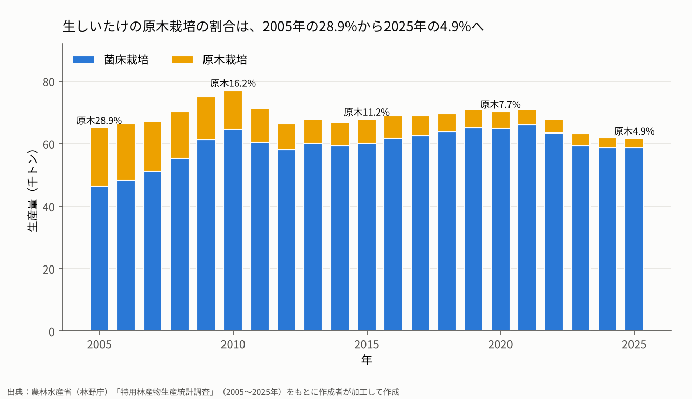
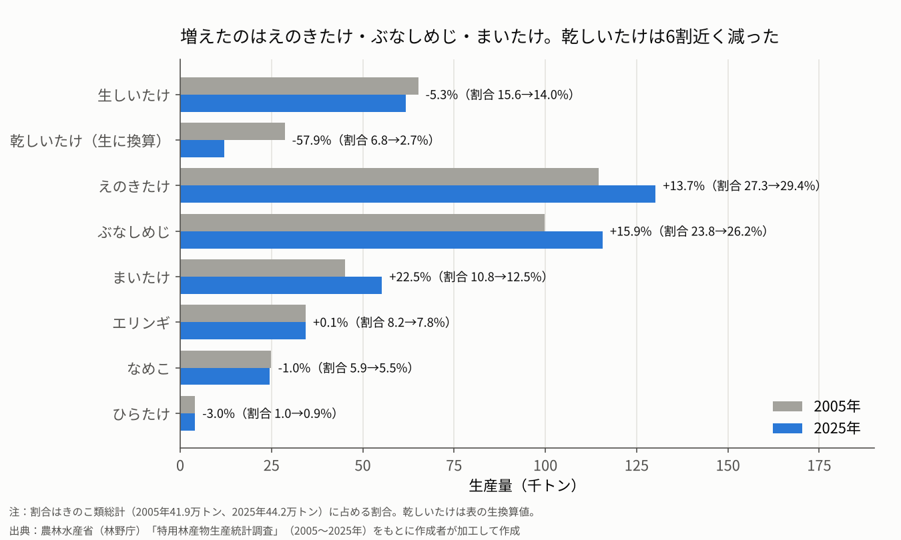
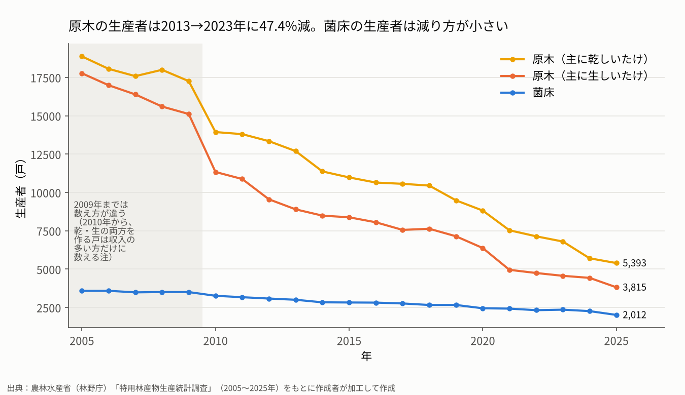
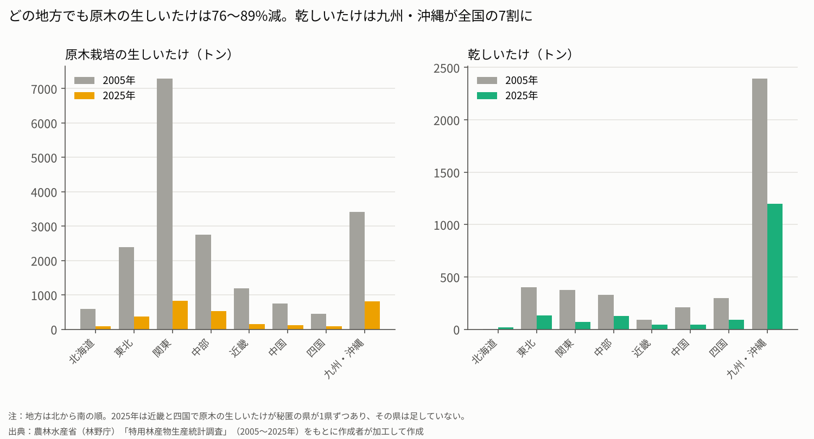

# F474 しいたけなどきのこの生産は、どう変わったのか？ 生しいたけの原木栽培の割合は2005年28.9%→2025年4.9%。原木の生産者は10年で47%減り、えのきたけ・ぶなしめじ・まいたけが増えた

## 結論（先に）
- 生しいたけの生産量は、2005年6.52万トン、2010年に7.71万トンの山をつけ、2025年は6.18万トンでした。中身は大きく入れ替わり、原木栽培は1.88万トンから0.30万トンへ84.1%減り、菌床栽培は4.64万トンから5.88万トンへ増えました。原木の割合は28.9%から4.9%です。
- 菌床の生しいたけも、2021年の6.61万トンを山に、2025年は11.1%減りました。2021→2025年の生しいたけの減少（0.93万トン）の8割近くは菌床の減少です。
- 原木しいたけの生産者は、2013年2万1,590戸から2023年1万1,359戸へ47.4%減りました。白書の「10年で半減」とほぼ同じです。菌床の生産者の減り方は同じ期間で21.5%でした。
- きのこ類全体は2011年の47.2万トンが山で、2025年は44.2万トンです。しいたけ（乾は生に換算）の割合は22.4%から16.7%に下がり、えのきたけ・ぶなしめじ・まいたけが増えました。
- 乾しいたけは4,091トンから1,724トンへ57.8%減りました。九州・沖縄の割合は58.6%から69.6%に上がっています。

## 問い
しいたけは、木を切ったほだ木で育てる「原木栽培」と、おが粉などを固めたブロックで育てる「菌床栽培」があります。林野庁の「令和6年度 森林・林業白書」は、原木しいたけの生産者が高齢化で減り、10年間で半減したと書いています（出典の節）。

では、生産量で見ると原木から菌床へどれだけ入れ替わったのか。乾しいたけと輸入はどう動き、しいたけの外のきのこと比べてどうか。林業・特用林産の行政、きのこの流通や小売に関わる人が、統計の表から自分で確かめられる形にしました。政策や価格の良し悪しは扱いません。

## データ（出典）
- 農林水産省（林野庁）「特用林産物生産統計調査」（特用林産基礎資料）2005〜2025年の各年の表（e-Stat）
  - しいたけの生産量（乾・生 × 原木・菌床、都道府県別）、しいたけ生産者数（原木・菌床別）、きのこ類の生産量（品目別）
  - 主要特用林産物需給総括表（生産・輸入・輸出。3年ごとの表をつないで2005〜2025年）
  - 原木伏込量及び菌床数の推移（2025年版。原木伏込量はほだ木にするために植菌して置いた原木の量）
- 年はいずれも暦年です。表は年によって列の並びが3通り（2005〜2009年、2010〜2019年、2020〜2025年）あるため、見出しの文字で列を決め、毎年確かめました。

## 事前の計画
[PLAN.md](PLAN.md)（2026-11-18 19:31、割合・寄与・地方別の集計の前に作成）。表の形を確かめるときに各年の全国の行を画面に出したため、生産量と生産者数の全国の値は計画の前に目にしています。仮説は盲検の検定ではなく、「どこまで言い切れるか」の基準として置きました。

| 仮説 | 外れの基準 | 結果 | 判定 |
|---|---|---|---|
| H1 生しいたけの原木の割合が2005→2025年に20ポイント以上下がる | 20ポイント未満 | 28.9% → 4.9%（−24.0） | 支持 |
| H2 原木しいたけ生産者が2013→2023年に45%以上減る（白書の「半減」） | 45%未満 | 21,590 → 11,359戸（−47.4%） | 支持 |
| H3 きのこ類総計に占めるしいたけが3ポイント以上下がる | 3ポイント未満 | 22.4% → 16.7%（−5.7） | 支持 |
| H4 菌床の生しいたけは2005年より多いが、山は2025年より前で、山から5%以上減 | どれかを満たさない | 山は2021年、山から −11.1% | 支持 |

## やったこと
1. 各年の Excel（xls・xlsx、計72本）から、全国の行と都道府県の行を読み出しました（02_build.py）。生しいたけ・乾しいたけの生産量は、しいたけの表・きのこ類の表・需給総括表の3つで、どの年も差が0.5トン以内でした。
2. 割合、生しいたけの増減の原木・菌床への分け方、生産者1戸あたりの量、輸入を含めた国内生産の割合を出しました（03_analysis.py）。
3. 結果を見てから、地方別に原木の生産が残っているところを見ました（03b_requestion.py）。

## 分かったこと

### 1. 生しいたけは原木から菌床へ入れ替わった（図1）


- 2005→2025年の生しいたけの増減（−3,436トン）は、原木の −15,828トンと菌床の +12,391トンに分かれます。
- 2005→2010年は菌床が +18,257トン増えて、原木の減少（−6,365トン）を上回りました。2021→2025年は菌床が −7,325トン、原木が −1,984トンで、どちらも減っています。
- 輸入を含めると、生しいたけの国内生産の割合は2005年74.3%から2025年94.5%に上がりました。輸入は2.25万トンから0.36万トンに減っています。

### 2. 増えたのはえのきたけ・ぶなしめじ・まいたけ（図2）


- 2005→2025年に、えのきたけは +13.7%、ぶなしめじは +15.9%、まいたけは +22.5% でした。3つできのこ類総計の7割近くになります（2025年に29.4%・26.2%・12.5%）。
- 乾しいたけ（生に換算した値）は −57.9%、割合は6.8%から2.7%になりました。乾しいたけは国内生産の割合が2005年33.0%、2025年29.0%で、輸入が多い品目です。
- 乾しいたけは、2010年に98.9%が原木栽培でしたが、2025年は84.2%で、菌床の乾しいたけが少しずつ増えています。

### 3. 原木の生産者は10年で約半分、菌床は2割減（図3）


- 原木の生産者（乾・生の計）は2013→2023年に47.4%減りました。期間を2010→2025年にすると63.6%減です。
- 菌床の生産者は、2013→2023年に21.5%、2010→2025年に38.3%減りました。
- 1戸あたりの生しいたけは、菌床が2010年19.8トンから2025年29.2トンに増え、原木（主に生しいたけを作る戸）は1.10トンから0.79トンに減りました。菌床は少ない戸数で大きく作る形に寄っています。
- 原木伏込量は、表に載っている年（1970年代前半と1976〜79年・1981年は載っていない）の中では1980年の2億6,085万本が最大で、2005年5,414万本、2025年1,054万本でした。

## 問い直し（結果を見てから足した）


原木の生産はどこに残っているのかを、都道府県の値を地方別（北から南の順）に足して、2005年と2025年で比べました。

- 原木の生しいたけは、どの地方でも76〜89%減りました（北海道 −85.0%、東北 −84.7%、関東 −88.7%、中部 −80.7%、近畿 −87.3%、中国 −84.9%、四国 −82.2%、九州・沖縄 −76.4%）。
- 全国の原木の生しいたけに占める割合は、関東が38.7%から27.6%に下がり、九州・沖縄が18.1%から26.9%に上がりました。
- 地方の中で生しいたけに占める原木の割合は、2005年に関東48.0%・九州・沖縄43.3%でしたが、2025年はどの地方も10%未満です。
- 乾しいたけは九州・沖縄が全国の58.6%から69.6%になりました。
- 2025年は近畿と四国に、原木の生しいたけが秘匿（x）の県が1県ずつあります。足せた量は全国の98.8%です。

## 頑健性

| 確かめたこと | 結果 | 結論は変わったか |
|---|---|---|
| H1 端を3年平均（2005〜07年→2023〜25年） | 原木の割合 26.6% → 5.5% | 変わらない |
| H3 端を3年平均 | しいたけの割合 21.7% → 17.0% | 変わらない |
| H3 乾を生に換算せず、生しいたけだけ | 15.6% → 14.0% | 下がり方は1.6ポイントに小さくなる。減ったのは主に乾しいたけ |
| 生しいたけ・乾しいたけの3つの表の照合 | 差は最大0.5トン | 変わらない |
| 生産者数の2009→2010年の段差 | 原木 −21.9%（次の5年 −23.4%） | 1年で5年分の減り方。数え方の注が付いた年なので、主に2010年以降で見た |
| H2 期間を2015→2025年 | −52.4% | 変わらない |
| H2 期間を2010→2020年 | −39.9% | 「半減」は期間の取り方で変わる |
| 生産者数の2020→2021年の段差（レビューで追加） | 原木 −17.8%（表に数え方の変更の注はない） | 1年としては大きい。理由は表からは分からない |
| H2 2013→2023年から2020→2021年の1年を除く（レビューで追加） | −36.0% | 2021年の段差が数え方によるものなら、10年の減り方は4割弱になる。「半減」はこの1年に左右される |
| H4 菌床の山を3年移動平均で見る | 中心は2020年 | 山が2020年前後にあることは変わらない |

## 言えないこと
- 入れ替わりの理由（担い手の年齢、原木やおが粉の入手、価格、需要の変化）は、この表だけでは分けられません。
- 生産者数は「戸」の数で、規模や働く人の数ではありません。2009年以前は数え方が違うため、長い期間の比較はできません。
- 菌床栽培には、海外で作られた菌床を国内で育てたものも入ります。表の上ではその区別はできません。
- 乾しいたけの生換算は、表の値（どの年も重さの7倍）をそのまま使いました。
- 都道府県には秘匿の値があり、地方の合計は全国とわずかに合いません。
- 原木の生産者は2020→2021年の1年で17.8%減りました。表に数え方の変更の注はありませんが、実際の減少か、調べ方の変化かは分けられません。

## 仕事で使うなら
- 「しいたけ」とまとめず、原木・菌床、乾・生に分けて見ると、動きの違いがはっきりします。
- 生産者数の比較では、2010年の数え方の注と、比べる期間の取り方を一緒に示すと、誤解が減ります。
- いずれも生産の記述で、取引や政策の判断の根拠にはしないでください。

## 計画からの変更
- 計画の手法4（1戸あたり）は、原木は「主に生しいたけを作る戸」で割りました。乾と生の両方を作る戸は収入の多い方に数えられるため、1戸あたりの値は目安です。
- 需給総括表の輸入は、乾しいたけ・生しいたけだけを使いました（ほかのきのこは輸入の行が「…」の年が多いため）。

## 再現のしかた
```
sh src/run_all.sh
```
オフラインで、data/raw の72本の表から data の中間 CSV 6本、results、figures を作ります（約4秒）。元データを取り直すときは `python3 src/01_fetch.py`（e-Stat の各年の一覧ページから表題の文字で表を選びます。約3分）。Python 3.13 で確かめました。

| ファイル | 役割 |
|---|---|
| src/01_fetch.py | e-Stat から各年の表を取る（run_all.sh では呼ばない） |
| src/02_build.py | 見出しの文字で列を決め、全国・都道府県の値を CSV にする |
| src/03_analysis.py | 割合、増減の分解、1戸あたり、輸入、頑健性（main.json ほか） |
| src/03b_requestion.py | 問い直し：地方別（北から南） |
| src/04_figures.py | 図4枚 |

repro_check：/tmp に写し、02 以降が作るファイルを消してから流し直し、results と figures の12ファイルと data の6ファイルがすべて cmp で一致しました（所要3〜4秒、独立レビューのあとにも再実行、results/repro_check.txt）。

## レビューで直したこと

| # | 指摘 | 直し方 |
|---|---|---|
| 1 | 原木の生産者は2020→2021年にも1年で17.8%減っており、注の変更がないまま2013→2023年の「47%減」に効いている | 03_analysis.py に段差と「その1年を除いた10年の変化（−36.0%）」を足し、頑健性の表と言えないことに書いた |
| 2 | 原木伏込量の表は1976〜79年・1981年などが載っておらず、「1980年が最大」は載っている年の中での話 | 本文の書き方を「表に載っている年の中では」に直した |

## 出典
- 農林水産省「特用林産物生産統計調査」のページ：https://www.maff.go.jp/j/tokei/kouhyou/tokuyo_rinsan/index.html
- e-Stat の各年の表（例：2025年）：https://www.e-stat.go.jp/stat-search/files?page=1&layout=datalist&lid=000001489412 （各ファイルの URL は data/raw/SOURCES.md）
- 林野庁「令和6年度 森林・林業白書」第Ⅱ章第2節：https://www.rinya.maff.go.jp/j/kikaku/hakusyo/r6hakusyo/attach/pdf/zenbun-42.pdf

（いずれも 農林水産省（林野庁）「特用林産物生産統計調査」をもとに作成者が加工して作成）
