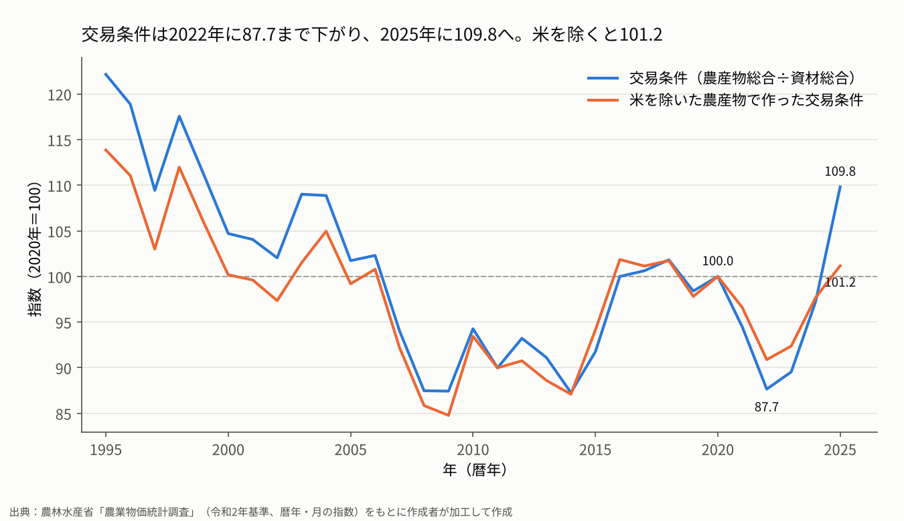
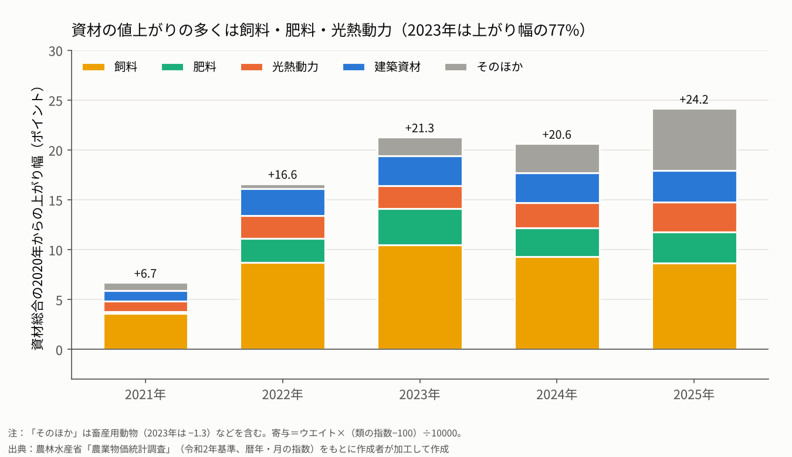
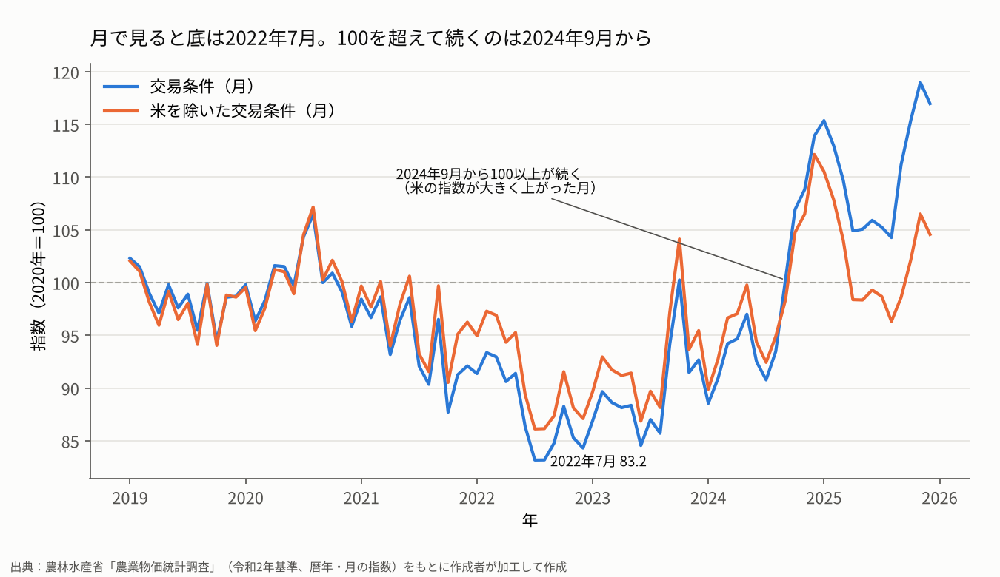
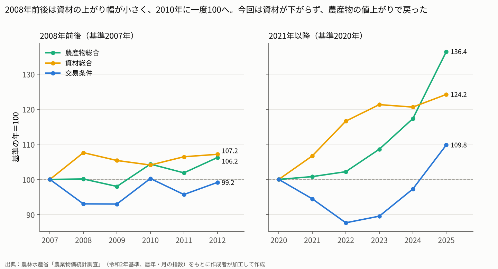

# F475 農家が買う資材の値段と売る値段の差は、広がったのか？ 交易条件は2022年に87.7まで下がり、2025年は109.8。米を除くと101.2で、資材は2020年より24%高いまま

## 結論（先に）
- 農家が売る値段（農産物価格指数）を、買う値段（農業生産資材価格指数）で割った「交易条件」（2020年＝100、暦年）は、2021年の94.5から2022年に87.7まで下がりました。差は2022〜2023年にいちばん開き、平均は88.6です。
- 資材総合は2020年から2023年に21.3ポイント上がり、そのうち77.2%が飼料・肥料・光熱動力の3つでした（飼料だけで10.5ポイント）。
- 2025年の交易条件は109.8で、2020年を上回りました。ただし資材総合は124.2で下がっていません。戻ったのは農産物の値上がり（2020年比 +36.4ポイント。類ごとの寄与の合計36.5のうち米が14.8ポイント＝40.5%）によるものです。
- 米を除いた農産物で作り直すと、2025年の交易条件は101.2です。さらに野菜も除くと98.9で、100をわずかに下回ります。
- 畜産物÷飼料は2022〜2025年の平均で80.5と、全体（96.1）より低いままでした。2025年も89.1です。

## 問い
2021年からの肥料・飼料・燃料の値上がりで、「農家の買う値段が売る値段より速く上がり、差が広がった」と言われてきました。農林水産省の「令和6年度 食料・農業・農村白書」も、資材の価格指数は2021年以降に肥料・飼料の高騰で上がり、農産物の価格指数は2024年8月以降に米・野菜で上がり、交易条件の指数は長く100を下回ったが2024年10月以降は100を上回った、とまとめています（出典の節）。

では、差はどれだけ開き、どこまで戻ったのか。戻ったのは米の値上がりだけによるのか。農業の経営や食品の調達に関わる人が、表から自分で確かめられる形にしました。価格や政策の良し悪しは扱いません。

## データ（出典）
- 農林水産省「農業物価統計調査」確報（令和2年基準、2025年まで。e-Stat、2026-07-31 公開）
  - 表1(1)ア 農産物の類別価格指数（月・年）、表2(1)ア 農業生産資材の類別価格指数（月・年）
  - 表1(4)・表2(4) 品目別ウエイト（ウエイト＝指数を作るときの重み。合計10000）
- 年の値は**暦年**（1〜12月）の指数を使いました。表の注にあるとおり、この表の年平均は1994年以前が年度、1995年以降が暦年です。そのため年の分析は1995〜2025年です。1995年より前は、月の値から自分で暦年の平均を作り、方向を見るためだけに使いました。
- 交易条件 ＝ 農産物総合 ÷ 農業生産資材総合 × 100。「米を除く農産物」は、総合と米の指数とウエイト（米1572）から作りました。

## 事前の計画
[PLAN.md](PLAN.md)（2026-11-18 19:15、集計の前に作成）。下見で、2025年の年平均の先頭の列（農産物総合136.4、米194.0、資材総合124.2、肥料140.3）と、白書の2025年2月の値は目にしていました。

| 仮説 | 外れの基準 | 結果 | 判定 |
|---|---|---|---|
| H1 交易条件の2022〜2023年平均は95以下 | 95より大きい | 88.59（底は2022年の87.65） | 支持 |
| H2 資材の2020→2023年の上昇のうち、肥料・飼料・光熱動力の寄与が70%以上 | 70%未満 | 77.2% | 支持 |
| H3 2025年の交易条件は100以上、米を除くと100未満 | 米を除いても100以上 | 109.82／米を除くと101.17 | 外れ |
| H4 畜産物÷飼料の2022〜2025年平均は全体より低い | 全体以上 | 80.49（全体96.07） | 支持 |

H3 は外れました。米を除いても101.2で、わずかに100を上回ります。野菜、果実、畜産物も2020年より上がっていたためです（2025年の寄与：野菜8.0、畜産物8.9、果実2.6ポイント）。

## やったこと
1. e-Stat の Excel 4本から、見出しの「階層」と名前の行で列に名前を付け、年（暦年・年度の別つき）と月の長い表にしました（02_build.py）。2025年の値（農産物総合136.4・米194.0・麦93.3、資材総合124.2・肥料140.3）を元の表と照らしました。
2. ウエイトで類を足し戻すと、2020〜2025年の公表の総合と0.07ポイント以内で合いました（main.json の class_sum_check）。このため、寄与（ウエイト×（類の指数−100）÷10000）で上がり幅を分けました（03_analysis.py）。
3. 結果を見てから、2008年前後の値上がりのときと並べました（03b_requestion.py）。

## 分かったこと

### 1. 差は2022年にいちばん開き、2025年に逆転した（図1）


- 交易条件は2020年の100から、2021年94.5、2022年87.7、2023年89.5と下がり、2024年97.3、2025年109.8と戻りました。
- 長い目で見ると、1995年の122.2から2019年の98.4まで、1年あたり約0.95%ずつ下がってきました（1995〜2019年の直線の傾き）。2022年の87.7は、2008〜2009年（87.5・87.4）とほぼ同じ深さです。
- 米を除いた交易条件は、2022年90.9、2025年101.2です。2021〜2023年は米を除いた方が高く、2025年は米を除いた方が約8.7ポイント低くなりました。米の値段が、下がるときも上がるときも差を大きくしていました。

### 2. 資材の値上がりの4分の3は飼料・肥料・光熱動力（図2）


- 資材総合の2020→2023年の上がり幅21.3ポイントのうち、飼料10.5、肥料3.7、光熱動力2.3ポイントで、3つで77.2%です。建築資材も3.0ポイントありました。
- 2025年までで見ると上がり幅は24.2ポイントで、3つの割合は61.0%に下がりました。飼料と肥料の指数が2023年から少し下がった一方、農機具（113.6）や建築資材など、ほかの資材がゆっくり上がり続けたためです。
- 2025年の指数は、肥料140.3、飼料137.7、光熱動力134.8で、どれも2020年より3割以上高いままです。

### 3. 月で見ると、底は2022年7月、100を超え続けるのは2024年9月から（図3）


- 月の交易条件の底は2022年7月の83.2でした。2023年10月に一度100.3まで上がりましたが、続きませんでした。
- 2024年9月からは2025年12月まで、すべての月で100以上です（2024〜2025年の24か月のうち16か月）。米を除くと100以上は9か月で、2025年4〜9月は100を下回りました。
- 2025年12月は116.97、米を除くと104.56です。米の指数は2025年9月から220を超えています。
- 白書の2025年2月の値（資材123.0、農産物136.0）と比べると、確報の月の値は資材123.1、農産物139.1でした。農産物の差は、白書の時点の値（第1報）がのちに直されたためと考えます（推測）。白書は100を上回ったのを2024年10月以降としていますが、確報の月の値では2024年9月が100.25で、わずかに100を上回ります。この1か月の違いも同じ理由と考えます（推測）。

## 問い直し（結果を見てから足した）


1つ前の大きな値上がり（2008年前後、肥料・飼料・燃料）と比べて、戻り方は同じかを見ました。基準の年（2007年・2020年）を100とし、0〜5年後を並べました（図4）。

- 2008年前後：資材総合の山は107.6（2008年）、交易条件の底は93.0（2009年）でした。2010年に資材が104.1まで下がり、農産物が104.4に上がって、交易条件は100.3に一度戻りました。5年後（2012年）は99.2です。
- 2021年以降：資材総合は124.2まで上がり、5年後の2025年もその高さのままです。交易条件の底は87.7（2022年）で、基準の年からの下がり方は2008年前後の底（93.0）より5ポイントほど深くなりました。なお、2020年＝100の同じ物差しで並べると、2022年の87.7と2008〜2009年の87.5・87.4はほぼ同じ水準です（図1）。前回は直前の2007年がすでに94.0と低かったため、基準の年から測ると浅く見えます。戻ったのは5年後で、農産物が136.4まで上がったためです。
- まとめると、今回の差は前回より大きく開き、資材が下がることでは戻っていません。農産物の値段が上がることで戻りました。

## 頑健性

| 確かめたこと | 結果 | 結論は変わったか |
|---|---|---|
| 月の値で底を見る | 2022年7月に83.17 | 変わらない（年の底と同じ2022年） |
| 12か月移動平均で底を見る | 2023年6月に86.27 | 底の時期は2022〜2023年の幅の中 |
| 基準を2015〜2019年平均にする | 2022〜23年平均89.93、2025年111.48 | 変わらない（2020年基準と同じ形） |
| 米と野菜を除いた交易条件 | 2022〜23年平均91.36、2025年98.93 | 2025年は100を下回る。「米を除いても100以上」は野菜も除くと成り立たない |
| 月から作った暦年で長期の傾き（1964〜2025年） | 年あたり −0.40% | 長い目では下がる向き（1995〜2019年は −0.95%） |
| 月から作った暦年と公表の暦年の差 | 最大7.11ポイント（1997年）、2005年以降は最大1.42 | 作り方が違うため、長期は向きだけを見る |

## 言えないこと
- 交易条件は値段の比です。農家の所得や経営が良くなったか悪くなったかは分かりません。売る量、補助金、経費の中身は入っていません。
- 資材のウエイトは全国の平均的な買い方で、作物や地域で大きく違います。たとえば畜産の経営では飼料の重みがずっと大きく、図の全体の数字は当てはまりません。
- 2020年＝100 は基準の置き方です。2020年が「ふつう」の年という意味ではありません。基準を2015〜2019年にしても形は同じでした。
- 値上がりの原因（為替、国際価格、天候、需給）は、この表だけでは分けられません。
- 米を除く計算は、年のウエイトを使った近似です。表の作り方（月ごとのウエイト）と完全には同じになりません。

## 仕事で使うなら
- 農業の経営を見るときに、交易条件を「米を含む／除く」の2本で並べ、どの品目が差を動かしているかを確かめる材料になります。
- 畜産なら畜産物÷飼料のように、経営の形に近い組で比を作ると、全体の数字とのずれが見えます。
- いずれも値段の比の記述で、取引や価格の判断の根拠にはしないでください。

## 計画からの変更
- 計画の手法4にあった「米÷（肥料・農業薬剤・光熱動力）」は計算して annual_tot.csv に入れましたが（2022年68.1、2025年148.5）、本文の結論には使っていません。米の値段の振れが大きく、比が米の値段とほぼ同じ動きになるためです。
- 長期の比較は、計画どおり月の値から暦年を作りましたが、1990年代に公表の年の値と最大7ポイントずれたため、向きを見るだけにしました。

## 再現のしかた
```
sh src/run_all.sh
```
オフラインで、data/raw の Excel 4本から data/index_long.csv・data/weights_class.csv、results、figures を作ります（約3秒）。元データを取り直すときは `python3 src/01_fetch.py`。Python 3.13 で確かめました。

| ファイル | 役割 |
|---|---|
| src/01_fetch.py | e-Stat から Excel 4本を取る（run_all.sh では呼ばない） |
| src/02_build.py | 見出しの文字で列に名前を付け、年・月・ウエイトの CSV を作る |
| src/03_analysis.py | 交易条件、寄与、米を除いた指数、頑健性（main.json ほか） |
| src/03b_requestion.py | 問い直し：2008年前後との比較 |
| src/04_figures.py | 図4枚 |

repro_check：/tmp/rep_F475 に写し、02 以降が作るファイルを消してから流し直し、results と figures の13ファイルと data の2ファイルがすべて cmp で一致しました（所要3秒、results/repro_check.txt）。

## レビューで直したこと

| # | 指摘 | 直し方 |
|---|---|---|
| 1 | 図1の節では2022年の底は「2008〜2009年とほぼ同じ深さ」、問い直しでは「前回より5ポイントほど深い」とあり、物差しの違い（2020年＝100の水準か、基準の年からの下がり方か）が書かれていなかった | 問い直しの節と note に、2つの物差しの違いと、前回は2007年がすでに94.0だったことを書き足した |
| 2 | 白書は100を上回ったのを2024年10月以降とするが、図3・本文は2024年9月から | 確報では2024年9月が100.25でわずかに上回ることを書き、違いの理由は推測と明記した |

## 出典
- 農林水産省「農業物価統計調査」確報 令和7年（令和2年基準）：https://www.e-stat.go.jp/stat-search/files?page=1&layout=datalist&lid=000001485296 （各ファイルの URL は data/raw/SOURCES.md）
- 農林水産省「農業物価統計調査」のページ：https://www.maff.go.jp/j/tokei/kouhyou/noubukka/index.html
- 農林水産省「令和6年度 食料・農業・農村白書」特集（農業生産資材と農産物の価格指数、交易条件指数）：https://www.maff.go.jp/j/wpaper/w_maff/r6/r6_h/trend/part1/chap0/c0_1_02.html

（いずれも 農林水産省「農業物価統計調査」をもとに作成者が加工して作成）
