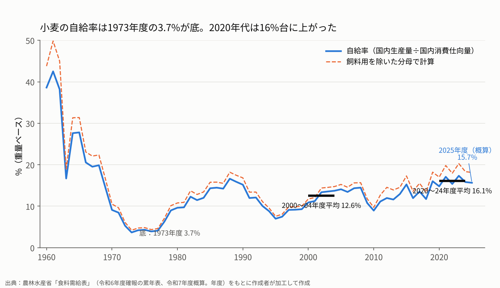
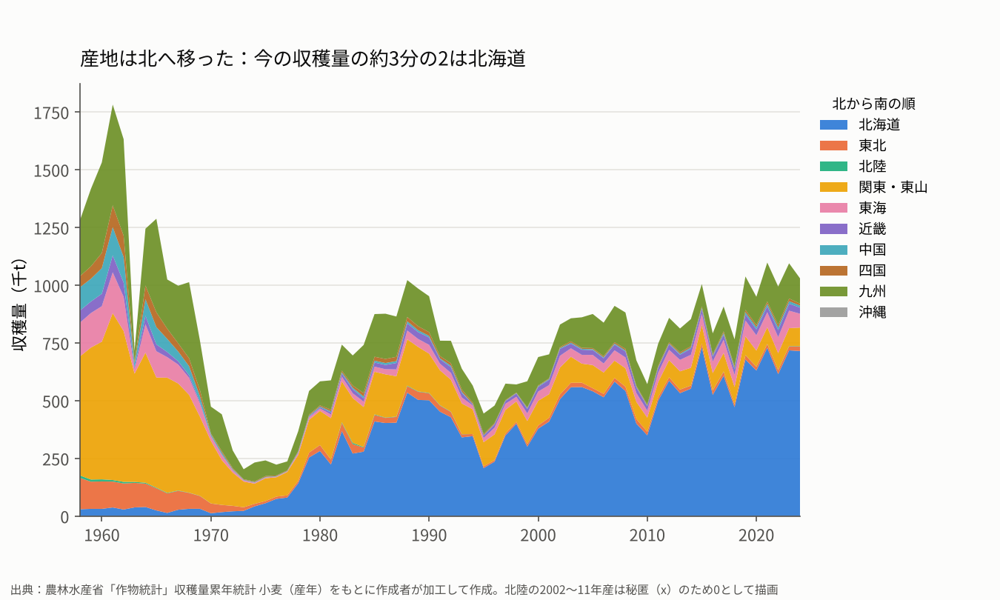
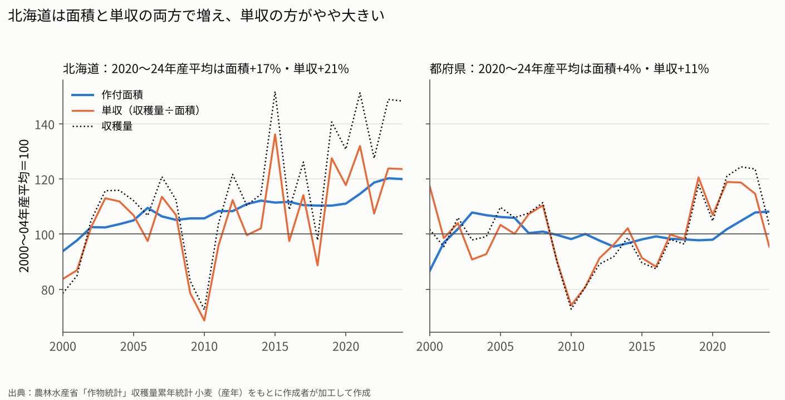
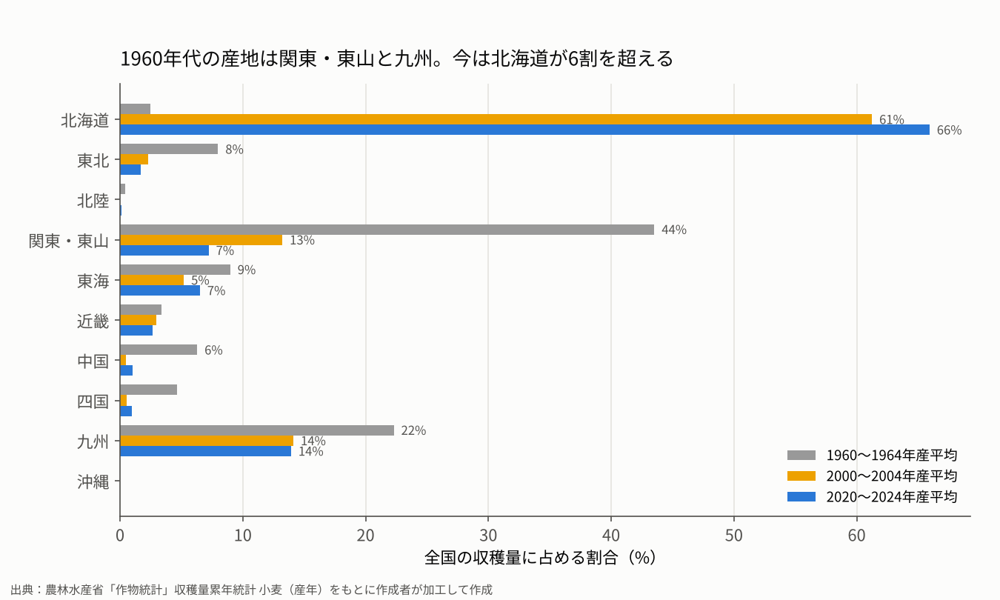

# F476 小麦の国産の割合は、上がったのか？ 2000〜04年度平均12.6%→2020〜24年度16.1%。増産の81%は北海道で、消費はほぼ横ばい

## 結論（先に）
- 小麦の品目別自給率（国内生産量÷国内消費仕向量、重量）は、2000〜04年度平均の12.6%から2020〜24年度平均の16.1%へ、3.5ポイント上がりました。2025年度（概算）は15.7%です。
- 上がったのは国内の生産が増えたためです。生産量は5年平均で787千tから1,033千tへ31%増えました。消費（国内消費仕向量）は2.5%増えていて、自給率を少し押し下げる向きでした。
- 増えた生産量（246千t）の81%は北海道でした。九州（13%）と東海（11%）も増え、関東・東山は減りました（−12%）。地方は北から南の順に並べています。
- 北海道の増産（+41%）は、作付面積（+17%）と単収（10aあたりの収量、+21%）の両方によるもので、単収の方がやや大きく効いていました。
- 長い目で見ると、今の16%台は1975年度以降で最も高い水準ですが、1988年度（16.6%）とほぼ同じで、1960年度（38.6%）には遠く及びません。1973年度の3.7%が底です。

## 問い
小麦はほとんどを輸入に頼っています。農林水産政策研究所は2015年ごろ、パン向けの新しい品種（北海道の「ゆめちから」、九州の「ミナミノカオリ」）の広がりなどで国産麦の需要が伸び、生産も広がっていると紹介しました。農林水産省の自給率のページは、2025年度（概算）の小麦の自給率を16%としています（出典の節）。

では、国産の割合は本当に上がったのか。上がったなら、作る量と使う量のどちらによるのか。作る量なら、どの地方で、面積と単収のどちらによるのか。小麦を調達する人や食料の統計を読む人が、元の表から確かめられる形にしました。政策や価格の良し悪しは扱いません。

## データ（出典）
- 農林水産省「食料需給表」確報 令和6年度 品目別累年表 小麦（1960〜2024年度）と、令和7年度（2025年度）概算の統計表。値は**年度**（4月〜翌3月）です。
  - 自給率 ＝ 国内生産量 ÷ 国内消費仕向量 ×100。国内消費仕向量（国内で使われた量）は生産＋輸入−輸出−在庫の増加で、飼料用・加工用も含みます。
  - 2024年度は、累年表と令和7年度 Excel の確定値のシートで、主な列がすべて一致しました（data/check_fbs_2024.csv）。
- 農林水産省「作物統計」収穫量累年統計 小麦（全国は1878年産から、北海道・都府県・9地方は1958年産から2024年産まで）。値は**産年**（その年に収穫した麦）です。地方の名前は、表の見出し（4行目）の文字で付けました。
  - 需給表の t 年度の生産量と作物統計の t 年産の収穫量は、1960〜2024年の65年で差が最大0.5千t（丸め）でした（小麦は初夏に収穫するため）。
  - 北海道＋9地方の合計は、全国と5年平均で40t以内（2000〜04年産は15t、2020〜24年産は40t）で一致しました。北陸の2002〜2011年産は秘匿（x）で、平均は取れる年だけで計算しました（北陸は2020〜24年産平均で全国の0.1%ほどです）。

## 事前の計画
[PLAN.md](PLAN.md)（2026-11-18 20:18、集計の前に作成）。下見で、需給表の1960〜1977年度と2017〜2024年度の行、2025年度概算の行、作物統計の2022〜2024年産の一部の行、農水省のページの16%は目にしていました。

| 仮説 | 外れの基準 | 結果 | 判定 |
|---|---|---|---|
| H1 自給率の2020〜24年度平均は2000〜04年度平均より3ポイント以上高い | 3ポイント未満 | 12.56%→16.08%（+3.52） | 支持（ただし頑健性の一部で3を下回る） |
| H2 全国の増産のうち北海道が70%以上 | 70%未満 | 80.9% | 支持 |
| H3 北海道の増産は単収の寄与が面積より大きい | 面積の方が大きい | 単収54.8%・面積45.2%（対数の分解） | 支持（差は小さい） |
| H4 消費仕向量の変化は±5%以内で、自給率の上昇の7割以上は生産から | ±5%を超える、または7割未満 | 消費+2.5%、生産の寄与110% | 支持 |

H4 の「110%」は、生産の増加が上昇の1.1倍分、消費の増加が −0.1倍分という意味です。

## やったこと
1. 需給表と作物統計の表から、見出しの文字で列と地域名を決めて、年度・産年の表を作りました（02_build.py）。
2. 自給率の推移と、5年平均どうしの変化を、対数で生産と消費に分けました（ln 自給率 ＝ ln 生産 − ln 消費）。地方の増え方、北海道と都府県の面積・単収の分解も出しました（03_analysis.py）。
3. 結果を見てから、1960年代と今の産地の違いを足しました（03b_requestion.py）。

## 分かったこと

### 1. 自給率は1973年度の3.7%が底で、2020年代は16%台（図1）


- 1960年度は38.6%、1973年度に3.7%まで下がり、その後は1988年度16.6%、2000年度10.9%、2010年度8.9%と上下しました。
- 2020〜24年度の平均16.1%は、2000年代（13.0%）・2010年代（12.5%）の平均より高く、2023年度の17.3%は1975年度以降で最大です。
- 年ごとの振れは大きく、2010〜2025年度では8.9%（2010年度）から17.3%（2023年度）まで動きました。
- 飼料用を分母から除くと、2020〜24年度平均は18.7%です。輸入の飼料用小麦が2000〜04年度の438千tから2020〜24年度の891千tへ倍増したため、分母の消費仕向量が押し上げられています。

### 2. 増えた生産の8割は北海道（図2）


- 全国の収穫量は、2000〜04年産平均787千tから2020〜24年産平均1,033千tへ246千t増えました。
- 地方別の増加は、北海道+199千t、東北−1千t、北陸+1千t、関東・東山−30千t、東海+26千t、近畿+5千t、中国+7千t、四国+6千t、九州+33千t、沖縄はほぼ0でした（北から南の順）。
- 北海道の割合は61.2%から65.9%に上がりました。

### 3. 北海道は面積と単収の両方で増えた（図3）


- 北海道（5年平均どうし）：面積は110千haから129千ha（+17%）、単収は10aあたり438kgから529kg（+21%）、収穫量は+41%でした。
- 都府県：面積+4%、単収+11%、収穫量+15%です。
- 北海道の単収は、2010年産に2000〜04年産平均の0.69倍まで落ち、2015年産には1.36倍になりました。面積は2020年ごろから緩やかに増えています。

## 問い直し（結果を見てから足した）


今の16%台は1960年代に遠く及びません。1960年代はどこで作っていて、なぜ下がったのか。3つの期間の地方の割合を並べ、1960年代から1970年代への低下を生産と消費に分けました。

- 1960〜64年産の全国の収穫量は平均1,381千t（作付面積597千ha）で、関東・東山が44%、九州が22%、北海道は2%でした。産地は北海道ではなく、関東から九州の麦作でした。
- 1971〜75年度の平均の自給率は5.1%で、1960〜64年度の32.5%から下がりました。低下（対数）の87%は生産の減少（1,381千t→280千t）、13%は消費の増加（4,244千t→5,434千t）によるものです。
- 今は北海道が66%、関東・東山は7%です。同じ「国産」でも、作る地方がほぼ入れ替わりました。
- 計算上は、今の消費仕向量のまま1960〜64年度平均の自給率（32.5%）にするには、生産量が約2,089千t（今の約2倍）必要です。これは規模の目安で、目標の良し悪しを言うものではありません。

## 頑健性

| 確かめたこと | 自給率（前→後） | 差 | 生産の寄与 | 消費の変化 | 結論は変わったか |
|---|---|---|---|---|---|
| 基本：2000〜04→2020〜24年度の平均 | 12.56→16.08% | +3.52 | 110% | +2.5% | — |
| 単年：2000→2024年度 | 10.90→15.83% | +4.92 | 108% | +3.0% | 変わらない |
| 3年平均：2000〜02→2022〜24年度 | 11.83→16.16% | +4.33 | 109% | +2.9% | 変わらない |
| 2025年度（概算）を含む：2001〜05→2021〜25年度 | 13.19→16.24% | +3.05 | 116% | +3.4% | 変わらない（3をわずかに超える） |
| 分母から飼料用を除く | 13.50→18.67% | +5.17 | 84% | −5.1% | 上がり幅は大きくなる。消費（飼料を除く）が減った分も効く |
| 生産量を中心3か年移動平均に：2001〜05→2019〜23 | 13.14→15.77% | +2.62 | 115% | +2.8% | 上がった向きは同じ。ただし H1 の3ポイントは下回る |
| 起点を1995〜99年度に | 8.39→16.08% | +7.68 | 103% | +1.8% | 変わらない（起点が低い分、差は大きい） |

どの取り方でも自給率は上がり、主な理由は生産の増加でした。上がり幅は2.6〜5.2ポイントと、端の年の豊凶で変わります。

## 言えないこと
- 重量の割合です。パン用・めん用・菓子用など、用途ごとの国産の割合は分かりません。
- 生産が増えた原因（品種、交付金などの政策、価格、米からの転作）は、この表だけでは分けられません。
- 単収の伸びが技術によるのか天候によるのかは、5年平均をとっても断定できません。北海道の単収は年によって3割以上動きます。
- 輸入の時期や在庫の増減で単年の消費仕向量が動き、単年の自給率もぶれます。
- 2025年度は概算で、のちに直されることがあります。作物統計の地方別は2024年産までです。

## 仕事で使うなら
- 国産小麦の量を見るときは、単年ではなく3〜5年の平均と、北海道の単収の振れを合わせて見ると、ぶれを過大に読まずに済みます。
- 自給率の分母には輸入の飼料用が入るため、食用の話をするときは「飼料用を除いた分母」も並べると読み違いが減ります。
- いずれも記述で、調達や価格の判断の根拠にはしないでください。

## 計画からの変更
- 北陸の2002〜2011年産が秘匿（x）だったため、地方の5年平均は取れる年だけで計算しました。図2では0として描いています。

## 再現のしかた
```
sh src/run_all.sh
```
オフラインで data/raw から data の中間 CSV 3本、results、figures を作ります（約3秒、Python 3.13）。元データの取り直しは `python3 src/01_fetch.py`。

| ファイル | 役割 |
|---|---|
| src/01_fetch.py | 元データを取る（run_all.sh では呼ばない） |
| src/02_build.py | 見出しの文字で列と地域名を決め、年度・産年の表を作る。2024年度の照合 |
| src/03_analysis.py | 自給率、生産と消費への分解、地方別、面積と単収、頑健性（main.json ほか） |
| src/03b_requestion.py | 問い直し：1960年代と今の産地 |
| src/04_figures.py | 図4枚 |

repro_check：/tmp/rep_F476 に写し、02 以降が作るファイルを消してから流し直し、results と figures の13ファイルと data の3ファイルがすべて cmp で一致しました（所要4秒、results/repro_check.txt）。

## 関連する記事
- F281「食料自給率の目標と、実際の動きの差はどこから来ているか？」：カロリーベースの総合の自給率を品目に分けた記事。この記事は小麦1品目の重量の自給率を、地方と面積・単収まで分けた点が違います。

## レビューで直したこと

独立レビュー（2026-11-18）で、再実行（16ファイル一致）、本文の数字と results の照合、元の表（需給表の1973・2024年度の行、作物統計の北海道・北陸・九州の2000〜2024年産の行と見出しの地域名）との照合、図4枚を確かめました。

| # | 指摘 | 直し方 |
|---|---|---|
| 1 | 「北海道＋9地方の合計は全国と15t以内で一致」は2000〜04年産だけの値で、2020〜24年産は40tの差 | 「40t以内（2000〜04年産は15t、2020〜24年産は40t）」に直した |
| 2 | 「北陸は全国の0.1%未満」だが、2020〜24年産平均ではちょうど0.10% | 「0.1%ほど」に直した（README・note） |
| 3 | 北海道の単収の「5年平均の0.69倍」が、どの5年か分からない | 「2000〜04年産平均の0.69倍」に直した（README・note。図3の基準と同じ） |
| 4 | 似た主題の既存記事への案内がない | 「関連する記事」に F281 を足した |

H1 の上がり幅が端の年の取り方で2.6〜5.2ポイント動くこと、移動平均では3ポイントを下回ることは、本文の頑健性の表と判定欄にすでに書かれていて、題名は5年平均の値をそのまま示しているので、題名は変えていません。

## 出典
- 農林水産省「食料需給表」：https://www.maff.go.jp/j/zyukyu/fbs/ （令和6年度確報の品目別累年表 小麦：https://www.e-stat.go.jp/stat-search/file-download?statInfId=000040422813&fileKind=1 ）
- 農林水産省「作物統計」収穫量累年統計 小麦（e-Stat の長期累年）：https://www.e-stat.go.jp/stat-search/files?page=1&toukei=00500215&tstat=000001013427&cycle=0&tclass1=000001032288&tclass2=000001034728&layout=datalist （各ファイルの URL は data/raw/SOURCES.md）
- 農林水産省「品目別自給率」のページ：https://www.maff.go.jp/j/zyukyu/zikyu_ritu/011.html
- 農林水産政策研究所「国産麦の需要、新品種導入や品質向上で増加 これに対応して生産も拡大」：https://www.maff.go.jp/primaff/seika/pickup/2015/15_06.html

（いずれも 農林水産省「食料需給表」「作物統計」をもとに作成者が加工して作成）
