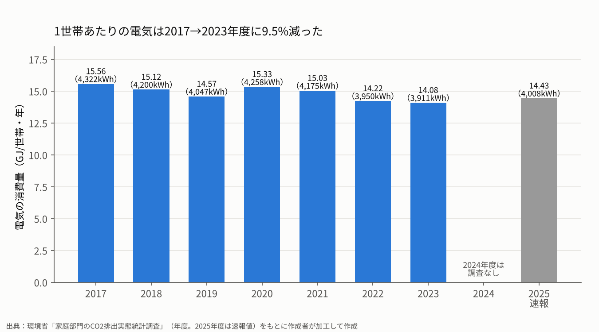
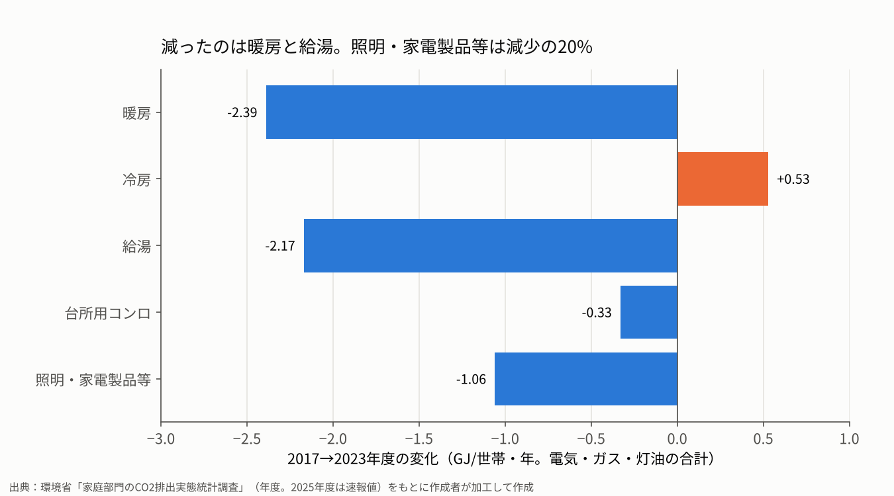
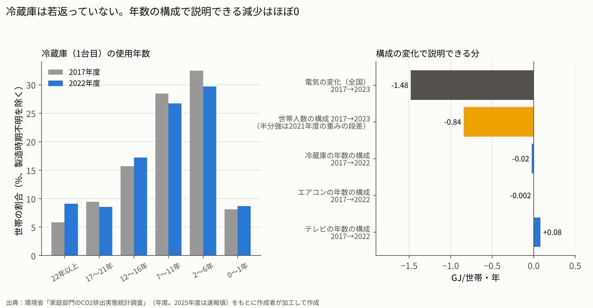
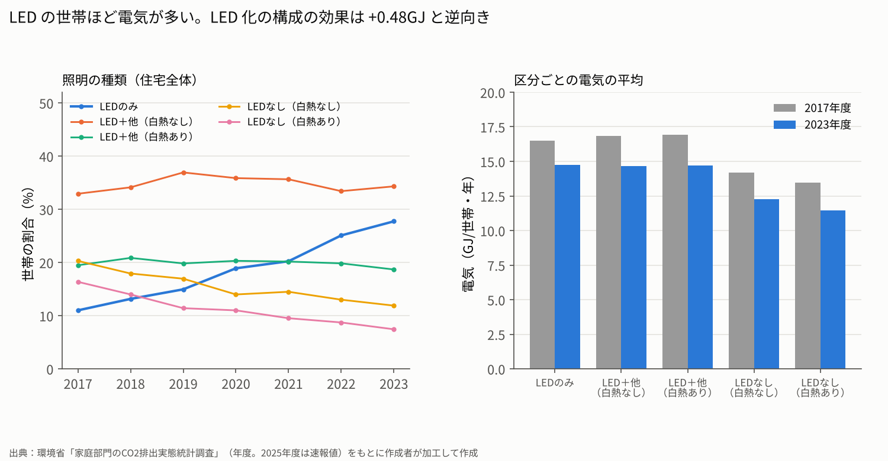

# F477 家庭の電気の使用量が減ったのは、家電の買い替えによるのか？ 2017→2023年度に9.5%減。冷蔵庫の年数の構成で説明できるのは約2%で、どの年数の区分の中でも同じように減っていた

## 結論（先に）
- 1世帯あたりの年間の電気の消費量は、2017年度の15.56GJ（約4,322kWh）から2023年度の14.08GJ（約3,911kWh）へ9.5%減りました。2025年度（速報）は14.43GJです。
- 冷蔵庫（1台目）の使用年数の分布は、2017→2022年度で若くなっていません（6年以内の割合 40.6%→38.4%、12年以上 31.0%→34.8%）。年数の分布の変化で説明できる電気の減少は −0.02GJ で、減少の約2%でした。エアコン・テレビでもほぼ0か逆向きです。
- 同じ使用年数の区分の中で、電気はどの区分でも減っていました。減少のほとんどは「家電が新しい世帯が増えた」ではなく、区分の中の変化です。
- 世帯人数の構成の変化（1人・2人の世帯の増加）は、計算の上では減少（−1.48GJ）のうち −0.84GJ、57%にあたります。ただし、この表の世帯人数の割合は調査の重み（抽出率調整の世帯数分布）で決まっていて、1人世帯の割合は2017〜2020年度は33.55%、2021〜2023年度は37.35%で固定です。−0.84GJ のうち −0.47GJ は重みが替わった2020→2021年度の段差で、重みが同じ期間（2017→2020、2021→2023年度）の構成の効果は −0.24GJ と −0.16GJ でした。57%は「世帯人数で説明できる量」の上限の目安として読んでください。
- 用途別（電気・ガス・灯油の合計）では、減ったのは暖房（−2.39GJ）と給湯（−2.17GJ）が大きく、照明・家電製品等（−1.06GJ）は減少の20%でした。

## 問い
家電は年々省エネになっています。資源エネルギー庁の省エネ性能カタログは、今の冷蔵庫は10年前の製品より約21〜30%（451〜500Lの例）、省エネタイプのエアコンは約14%省エネだとしています（出典の節）。一方、環境省「家庭部門のCO2排出実態統計調査」では、1世帯あたりの電気の消費量が2017年度から減っています。

では、この減少は家電の買い替え（家電が新しい世帯が増えたこと）で説明できるのか。世帯が小さくなったことや、用途の違いはどれくらい効いているのか。家庭のエネルギーの統計を読む人や、電力の需要を見通す人に向けて、公表の表から分けられる範囲で分けました。買い替えをすすめるかどうか、料金や政策は扱いません。

## データ（出典）
- 環境省「家庭部門のCO2排出実態統計調査」（e-Stat）。値は**年度**です。2024年度は調査がなく、2025年度は速報値です。
  - 時系列第2表：世帯人数・世帯類型などの区分別の年間エネルギー種別消費量（2017〜2023年度）
  - 各年度の全国の第6-2-2表：冷蔵庫・エアコン・テレビ（1台目）の製造時期や照明の種類の区分別の、電気の平均と世帯数分布（抽出率調整）
  - 各年度の全国の第7-1-1表（参考）：用途別のエネルギー消費量（電気・ガス・灯油の合計）
  - 令和7年度速報の図1-3（全国の推移）
- 列は見出しの文字（「電気」と「平均」など）で決めました。各表の1行目の年度と3行目の「全国」を確かめています。時系列第2表と速報の図1-3の全国の電気は、2017〜2023年度で一致しました（差0）。
- 使用年数：製造時期は5年刻みなので、5年違いの2017年度と2022年度では区分がそろいます（2017年度の「2011〜2015年」と2022年度の「2016〜2020年」はどちらも約2〜6年）。製造時期「不明」（約7%）は除きました。

## 事前の計画
[PLAN.md](PLAN.md)（2026-11-18 20:29、集計の前に作成）。下見で、全国の電気の推移（15.56→14.08GJ）、世帯人数「1人」の行、2017・2022年度の製造時期別の世帯数分布の列は目にしていました。

| 仮説 | 外れの基準 | 結果 | 判定 |
|---|---|---|---|
| H1 2017→2023年度の電気の減少は5%以上 | 5%未満 | −9.51% | 支持 |
| H2 用途の合計の減少のうち、照明・家電製品等が半分以上 | 半分未満 | 19.6% | 外れ |
| H3 冷蔵庫の年数の分布の変化が説明するのは減少の4分の1未満 | 4分の1以上 | 1.7% | 支持 |
| H4 世帯人数の構成の変化が減少の2割以上を説明 | 2割未満 | 56.9% | 支持（重みの段差に注意） |

H2 は外れました。減少の中心は暖房（44%）と給湯（40%）でした。

## やったこと
1. 17本の Excel から、使う区分の行を見出しの文字で取り出し、長い表にしました（02_build.py）。
2. 全国の平均の変化を、区分の割合の変化（構成）と区分の中の変化に分けました。両年の平均を重みにする対称な分け方で、2つの合計は変化に一致します（03_analysis.py）。
3. 結果を見てから、照明の LED 化で同じ分解をしました（03b_requestion.py）。

## 分かったこと

### 1. 電気は9.5%減り、2025年度は少し戻った（図1）


- 2017年度15.56GJ、2019年度14.57GJ、2020年度15.33GJ、2023年度14.08GJ、2025年度（速報）14.43GJでした。2017→2023年度で −1.48GJ（約 −411kWh）です。
- 2020年度は在宅が増えた年で、一度増えています。2019→2023年度だけを見ると −3.4%です。

### 2. 減ったのは暖房と給湯（図2）


- 用途別の合計は33.25GJから27.83GJへ −5.42GJ でした。暖房 −2.39、給湯 −2.17、照明・家電製品等 −1.06、台所用コンロ −0.33、冷房 +0.53GJ です。
- 照明・家電製品等は10.79GJから9.73GJへ9.8%減りましたが、合計の減少に占める割合は20%でした。
- この表は電気だけでなくガス・灯油を含みます。暖房や給湯が電気で行われる世帯では、その分も電気の減少に入ります。

### 3. 冷蔵庫は若返っておらず、年数の構成ではほぼ説明できない（図3）


- 冷蔵庫（1台目）の使用年数の割合（2017→2022年度）は、0〜1年 8.1→8.7%、2〜6年 32.4→29.7%、7〜11年 28.5→26.7%、12〜16年 15.7→17.2%、17〜21年 9.5→8.5%、22年以上 5.8→9.1%でした。平均の年数（区分の中央で近似）は9.3年から9.9年に延びました。
- 製造時期が分かる世帯の電気の平均は −1.40GJ で、そのうち年数の構成の変化は −0.02GJ（1.7%）、区分の中の変化が −1.38GJ でした。
- 使用年数2〜6年の世帯の電気は15.47→13.91GJ、22年以上は14.61→13.13GJ と、どの区分でも同じように減っています。
- 2022年度の断面では、新しい冷蔵庫（6年以内）の世帯は古い（12年以上）世帯より、2人以上世帯で5.8%、単身世帯で2.4%電気が少なく、全体では1.3%少ないだけでした。世帯の型をそろえると差が大きくなります。

## 問い直し（結果を見てから足した）


冷蔵庫・エアコン・テレビの年数で説明できないなら、ほかの「買い替え」である照明の LED 化はどうか。第6-2-2表の照明の種類（住宅全体）で、2017→2023年度を同じ形で分けました。

- LED だけを使う世帯は11.0%から27.7%に、LED を使う世帯（併用を含む）は63.4%から80.7%に増えました。
- ところが、どの年も LED を使う世帯の方が電気が多く（2023年度：LED のみ14.74GJ、LED なし11.47〜12.25GJ）、構成の変化の効果は +0.48GJ と逆向きでした。区分の中の変化は −2.04GJ です。
- LED を使う世帯は、住宅が広い・人数が多いなど、もともと電気を多く使う世帯だと考えられます（推測）。区分の平均の比べ方では、機器の効果と世帯の違いが混ざることが、ここでもはっきり出ました。

## 頑健性

| 確かめたこと | 構成の効果（GJ） | 全体の変化（GJ） | 構成の割合 | 結論は変わったか |
|---|---|---|---|---|
| 基本：冷蔵庫、2017→2022年度 | −0.024 | −1.399 | 1.7% | — |
| 年の組：冷蔵庫、2018→2023年度 | −0.002 | −1.139 | 0.2% | 変わらない |
| エアコン、2017→2022／2018→2023年度 | −0.002／−0.026 | −1.616／−1.269 | 0.1%／2.0% | 変わらない |
| テレビ、2017→2022／2018→2023年度 | +0.083／+0.180 | −1.334／−1.003 | 逆向き | 変わらない（テレビは古くなった） |
| 世帯類型（8区分）、2017→2023年度 | −0.667 | −1.481 | 45.0% | 変わらない（構成の効果は大きい） |
| 世帯人数、2017→2020年度（重みが同じ） | −0.239 | −0.227 | 105% | 構成は効くが小さい |
| 世帯人数、2020→2021年度（重みが替わる年） | −0.470 | −0.308 | 153% | 構成の効果の半分強がこの段差 |
| 世帯人数、2021→2023年度（重みが同じ） | −0.165 | −0.947 | 17.4% | 2021年度以降は区分の中の減少が大きい |

家電の年数の構成で説明できる分は、どの年の組・機器でも ±0.2GJ の中でした。世帯人数の構成の効果は、重みが替わる2020→2021年度に集まっていて、その年の前後を分けると小さくなります。

## 言えないこと
- 表は区分の平均で、世帯ごとのデータではありません。新しい家電を持つ世帯がほかの点（人数、住宅、収入）でも違う影響は、分けきれません。問い直しの LED はその例です。
- 「区分の中の変化」には、同じ年数でも新しい型の家電に替わった効果（5年後の「2〜6年」は5年新しい製品）が含まれます。この表では、それと天候や使い方の変化を分けられません。
- 見ているのは世帯全体の電気で、冷蔵庫など機器ごとの電気ではありません。家電は「1台目」だけです。
- 気温は調整していません。暖房の減少には、冬の暖かさの違いが入っている可能性があります（推測）。
- 世帯数分布の重みが2021年度に替わった理由は、調査の資料で確かめていません（母集団の推計の更新と考えます。推測）。

## 仕事で使うなら
- 家庭の電気の見通しでは、家電の年数の分布だけでなく、世帯人数の構成と暖房・給湯の動きを並べて見ると、減少の中身を取り違えにくくなります。
- 機器の有無で区分した平均を比べるときは、世帯の型をそろえた表（世帯類型別など）も並べると、機器の効果を大きく見誤りにくくなります。
- いずれも記述で、料金や買い替えの判断の根拠にはしないでください。

## 計画からの変更
- 頑健性に、世帯数分布の重みが替わる2020→2021年度の分解を足しました（世帯人数の構成の効果がこの段差に集まっていたため）。
- 用途別の表は電気だけに分けられないため、電気・ガス・灯油の合計で見ました（計画の段階では電気の内訳がないことを確かめていませんでした）。

## 再現のしかた
```
sh src/run_all.sh
```
オフラインで data/raw の Excel 17本から data の中間 CSV 4本、results、figures を作ります（約10秒、Python 3.13）。元データの取り直しは `python3 src/01_fetch.py`。

| ファイル | 役割 |
|---|---|
| src/01_fetch.py | 元データを取る（run_all.sh では呼ばない） |
| src/02_build.py | 見出しの文字で列を決め、使う区分の長い表を作る |
| src/03_analysis.py | 推移、用途別、世帯人数と家電の年数の分解、頑健性（main.json ほか） |
| src/03b_requestion.py | 問い直し：照明の LED 化 |
| src/04_figures.py | 図4枚 |

repro_check：/tmp/rep_F477 に写し、02 以降が作るファイルを消してから流し直し、results と figures の13ファイルと data の4ファイルがすべて cmp で一致しました（所要12秒、results/repro_check.txt）。

## 関連する記事
- 189「1世帯あたりのCO2排出量は、寒い地域ほど多いのか」：同じ環境省の調査の2023年度を地方別に比べた記事。この記事は2017〜2023年度の変化を、家電の年数と世帯人数の構成に分けた点が違います。

## レビューで直したこと

独立レビュー（2026-11-18）で、再実行（17ファイル一致）、本文の数字と results の照合、元の Excel（時系列第2表の世帯人数「1人」の行、2022年度の第6-2-2表の冷蔵庫の製造時期の行と1〜3行目）との照合、図4枚を確かめました。

| # | 指摘 | 直し方 |
|---|---|---|
| 1 | 題名の「世帯人数の構成は57%」が強すぎる。表の世帯人数の割合は調査の重みで決まり（1人世帯は2017〜2020年度33.55%、2021〜2023年度37.35%で固定）、57%の半分強は2021年度の重みの段差 | 題名から57%を外し、この記事でいちばん確かな結果（年数の構成は約2%、どの年数の区分の中でも同じように減った）に替えた。結論・note に重みが固定であることと「上限の目安」を書き足した |
| 2 | 題名の「〜のせいか」は原因を決めつける言い方に近い | 「〜によるのか」に替えた（status・md の1行目・md のファイル名もそろえた） |
| 3 | 図3の「世帯人数の構成 −0.84」に段差の注記がない | 図3の項目名に「半分強は2021年度の重みの段差」を足した（04_figures.py） |
| 4 | 省エネ性能カタログの「約21〜30%」の条件が書かれていない | 「451〜500Lの例」を足した（カタログの元のページで確かめた） |
| 5 | 似た主題の既存記事への案内がない | 「関連する記事」に 189 を足した |

区分の平均の比べ方なのでほかの違いが混ざること（LED で逆向き）、用途別がガス・灯油を含む合計であること、気温を調整していないことは「言えないこと」に書かれています。

## 出典
- 環境省「家庭部門のCO2排出実態統計調査」（e-Stat）：https://www.e-stat.go.jp/stat-search/files?page=1&toukei=00650408 （各ファイルの URL は data/raw/SOURCES.md）
- 環境省 調査のページ：https://www.env.go.jp/earth/ondanka/ghg/kateiCO2tokei.html
- 資源エネルギー庁「省エネ性能カタログ」家電の選び方：https://www.enecho.meti.go.jp/category/saving_and_new/saving/general/choice/

（いずれも 環境省「家庭部門のCO2排出実態統計調査」をもとに作成者が加工して作成）
