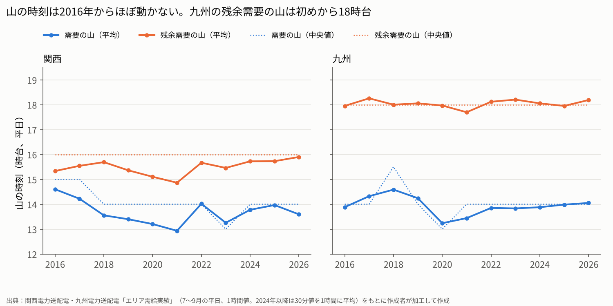
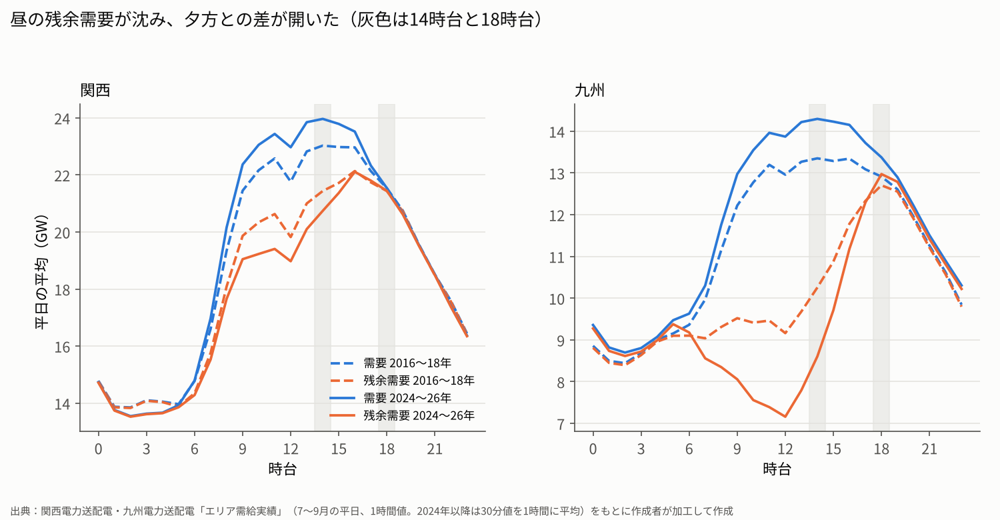
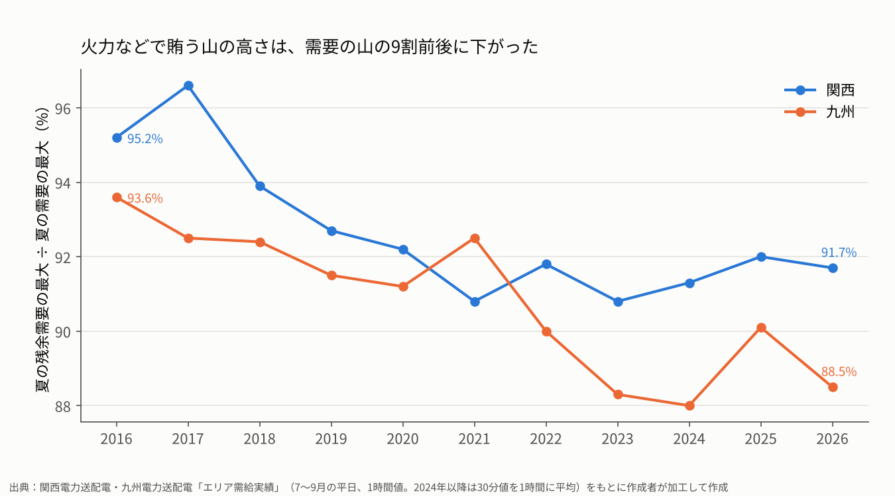
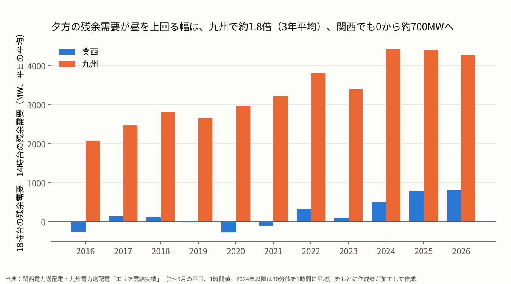

# F478 夏の電力の需要のピークは、太陽光で夕方にずれたのか？ 需要の山は14時台のまま。太陽光を引いた残りの山は九州では2016年の時点で既に18時台、昼との差は2.4→4.4GWに開いた

## 結論（先に）
- 夏（7〜9月）の平日の需要（エリア需要）の山の時刻は、関西・九州とも中央値で14時台のままでした。2016〜18年と2024〜26年で、平均ではむしろ0.3〜0.4時間早くなっています。
- 需要から太陽光と風力を引いた「残余需要」（火力・水力・揚水などで賄う分）の山は、関西で16時台、九州で18時台でした。九州は2016年の夏からすでに18時台で、時刻としてはその後動いていません。
- 変わったのは時刻ではなく形です。平日の平均で「18時台の残余需要−14時台の残余需要」は、九州で2,448MW（2016〜18年）から4,369MW（2024〜26年）へ、関西で −1MW から700MW へ開きました。
- 夏の残余需要の最大は、需要の最大の何割かで見ると、関西で95.2%→91.6%、九州で92.8%→88.9%（3年平均）に下がりました。太陽光の発電量は夏の需要の、関西で3.6%→7.1%、九州で10.5%→18.5%です。
- 地域は北から南（関西、九州）の順に並べています。

## 問い
夏の1日で電気がいちばん使われるのは、昼過ぎと言われてきました。一方、太陽光の発電が増えると、需要から太陽光を引いた残り（残余需要）の山は、太陽光が落ちる夕方へずれるはずです。資源エネルギー庁の「2024年度夏季の電力需給対策について」は、住宅用の太陽光が2023年夏の最大需要日（7月18日）の15時の需要を約1.2%（約65万kW）押し下げたと推計しています。同じ資料は、2024年5月に東京エリアの予備率が下がった例を18時30分〜19時の時間帯で示していて、夕方の時間帯が注目されていることが分かります（出典の節）。

では、実際の夏の需要の山と残余需要の山の時刻は、どう動いたのか。需給や調達を見る人、電気の使い方の計画にかかわる人に向けて、公開の実績データで確かめました。料金・投資・政策の良し悪しは扱いません。

## データ（出典）
- 関西電力送配電と九州電力送配電の「エリア需給実績」。2016〜2023年度は1時間値（MWh）、2024年以降は30分値（MW 平均）を1時間に平均しました。夏＝7月1日〜9月30日、2016〜2026年の11の夏です。
- 使った列：エリア需要、太陽光発電実績、太陽光出力制御量、風力発電実績、風力出力制御量。残余需要＝エリア需要−太陽光実績−風力実績。
- 時刻はその1時間の始まり（「14時台」＝14:00〜15:00）。30分値の時刻は、関西が30分の始まり、九州が30分の終わりなので、1時間の始まりにそろえました。各夏・各エリアとも2,208時間（92日×24）がそろっています。
- 平日＝土日・祝日（内閣府の CSV）・8月13〜16日を除いた日（各夏58〜60日）。

## 事前の計画
[PLAN.md](PLAN.md)（2026-11-18 20:38、集計の前に作成）。計画では東京と九州を比べる予定でしたが、東京電力パワーグリッドのサイトが取得スクリプトからの取得を拒否（HTTP 403）したため、集計の前に関西に替えました（PLAN.md の追記）。その確認のときに関西の2026年9月1〜8日の30分値を目にしています。

| 仮説（東京→関西に読み替え） | 外れの基準 | 結果 | 判定 |
|---|---|---|---|
| H1 関西の需要の山の時刻（中央値）は1時間以上遅くはなっていない | 1時間以上遅い | 14→14時台（平均 −0.35時間） | 支持 |
| H2 関西の残余需要の山は、2024〜26年に需要の山より2時間以上遅い | 2時間未満 | 2.0時間（16−14） | 支持（基準ちょうど） |
| H3 関西の山の時刻の差は、2016〜18年より1時間以上開いた | 1時間未満 | 0時間（中央値）、+0.62時間（平均） | 外れ |
| H4 九州の差は関西より大きい | 関西以下 | 九州4時間、関西2時間 | 支持 |

H3 は外れました。1時間刻みの中央値では、関西の残余需要の山は2016年から16時台のままです。

## やったこと
1. 1時間値にそろえて、夏の長い表を作りました（02_build.py）。
2. 日ごとに、需要の最大の時刻と残余需要の最大の時刻を出し、夏ごと・期間ごとに集計しました（03_analysis.py）。
3. 結果を見てから、平日の時刻ごとの平均の形（昼と夕方の差）を足しました（03b_requestion.py）。

## 分かったこと

### 1. 山の時刻はほとんど動いていない（図1）


- 需要の山（平日の中央値）は、関西で2016・2017年が15時台、2018年以降はおおむね14時台、九州は14時台が中心でした。
- 残余需要の山（中央値）は、関西が11の夏すべてで16時台、九州がすべてで18時台でした。九州では、残余需要の山が17時台以降の日が2016〜18年も97.2%ありました。
- 関西では、残余需要の山が17時台以降の日が2016〜18年の6.2%から2024〜26年の17.0%に増えました。2026年の夏だけで見ると33.9%です。

### 2. 昼の残余需要が沈み、夕方との差が開いた（図2）


- 九州の平日14時台の平均は、需要が13,350→14,295MW と増えた一方、太陽光が3,047→5,605MW と増え、残余需要は10,256→8,604MW に下がりました。18時台の残余需要は12,704→12,973MW でほぼ同じです。
- 関西の14時台の太陽光は1,571→3,198MW、残余需要は21,437→20,741MW でした。18時台は21,436→21,442MW と変わっていません。

### 3. 火力などで賄う山の高さは、需要の山の9割前後に（図3）


- 夏の残余需要の最大÷夏の需要の最大は、関西が2016年95.2%から2026年91.7%、九州が93.6%から88.5%でした。3年平均では関西95.2%→91.6%、九州92.8%→88.9%です。
- 夏の需要の最大の時刻は、関西・九州とも多くの夏で13〜14時台、残余需要の最大の時刻は関西16時台（2023年は15時台、2026年は17時台）、九州18時台でした。

## 問い直し（結果を見てから足した）


時刻が動かないなら、何が変わったのか。平日の時刻ごとの平均から「18時台の残余需要−14時台の残余需要」を夏ごとに出しました。

- 九州は2016年2,075MW、2020年2,974MW、2024年4,427MW と、ほぼ一貫して開きました。2024〜2026年は4,427・4,409・4,270MW で、ここ3年は横ばいです。3年平均で2,448→4,369MW、14時台の需要に対して18.3%→30.6%です。
- 関西は2016〜2021年は −270〜+141MW と0の前後でしたが、2022年326MW、2024年506MW、2025年785MW、2026年810MW と開き始めています。
- 「山が夕方にずれる」は、九州ではすでに2016年に起きていて、その後は「夕方の山と昼の谷の差が深くなる」形で進んでいる、と読めます。関西はその手前の段階にあるように見えます（推測）。

## 頑健性

| 確かめたこと | 関西：需要の山（中央値） | 関西：残余の山 | 九州：需要の山 | 九州：残余の山 | 結論は変わったか |
|---|---|---|---|---|---|
| 基本：平日、2016〜18→2024〜26年 | 14→14 | 16→16 | 14→14 | 18→18 | — |
| 期間の端：2016〜17→2024〜25年 | 15→14 | 16→16 | 14→14 | 18→18 | 関西は差が1→2時間に開く（H3 は端の取り方で変わる） |
| 全日（土日・祝日を含む） | 15→14 | 16→16 | 15→14 | 18→18 | 関西・九州とも需要の山が1時間早まる |
| 需要の上位10日 | 15→14 | 16→16 | 14→14 | 18→18 | 関西で残余の山が17時台以降の日が0%→20% |
| 残余＝需要−太陽光（風力を引かない） | 14→14 | 16→16 | 14→14 | 18→18 | 変わらない |
| 太陽光・風力の出力制御を足し戻す | 14→14 | 16→16 | 14→14 | 18→18 | 変わらない（夏の制御は少なく、九州で太陽光の約0.2%） |

山の時刻は、どの取り方でも関西16時台・九州18時台で、需要の山が遅くなった組み合わせはありませんでした。関西で差が「開いた」と言えるかは、期間の端の取り方で変わります。

## 言えないこと
- エリア需要は、屋根の太陽光の自家消費の分だけ小さく見えます。需要の山の時刻や高さには、その影響が入っています。
- 気温は調整していません。2026年の関西で夕方の山の日が多かったのが暑さによるのかは、この分析では分かりません。
- 1時間刻みの時刻なので、30分ほどのずれは中央値に出ません。平均や割合で補いましたが、細かい動きは見えません。
- 残余需要の山が、そのまま需給の厳しい時刻とは言えません。厳しさは、その時刻の供給力（火力の停止、揚水、連系線）にもよります。
- 東京など他のエリアは見ていません。

## 仕事で使うなら
- 夏の需給や調達を見るときは、需要の山（昼）と残余需要の山（夕方）を分けて並べ、両方の時刻と高さを追うと、見るべき時間帯を取り違えにくくなります。
- 「18時台−14時台」の残余需要の差は、太陽光の増え方を1つの数で追う目安になります。
- いずれも記述で、料金・投資・調達の判断の根拠にはしないでください。

## 計画からの変更
- 東京を関西に替えました（上の「事前の計画」）。仮説の基準は変えていません。
- 頑健性の「需要の上位10日」は、夏ごとに需要の最大の大きい10日を選び、土日・祝日も含めました。

## 再現のしかた
```
sh src/run_all.sh
```
オフラインで data/raw の CSV 35本から data/summer_hourly.csv、results、figures を作ります（約6秒、Python 3.13）。元データの取り直しは `python3 src/01_fetch.py`。

| ファイル | 役割 |
|---|---|
| src/01_fetch.py | 元データを取る（run_all.sh では呼ばない） |
| src/02_build.py | 見出しの文字で列を決め、時刻をそろえて夏の1時間値の表を作る |
| src/03_analysis.py | 日ごとの山の時刻、夏ごと・期間ごとの集計、頑健性（main.json ほか） |
| src/03b_requestion.py | 問い直し：時刻ごとの平均の形、18時台−14時台 |
| src/04_figures.py | 図4枚 |

repro_check：/tmp/rep_F478 に写し、02 以降が作るファイルを消してから流し直し、results と figures の12ファイルと data の1ファイルがすべて cmp で一致しました（所要6秒、results/repro_check.txt）。

## 関連する記事
- F67「気温が1℃上がると、電気の使用量は何%増えるか？」：気温と需要の関係を見た記事。この記事は気温を扱わず、太陽光を引いた残余需要の山の時刻を見た点が違います。

## レビューで直したこと

独立レビュー（2026-11-18）で、再実行（13ファイル一致）、本文の数字と results の照合、元の CSV（九州2016年度第2四半期の1時間値から、平日の残余需要の「18時台−14時台」2,075MW と山の時刻の中央値18時台を別に計算し直して一致）、30分値の時刻の付け方（九州は 0:30 始まりで30分の終わり）、図4枚を確かめました。01_fetch.py の User-Agent はスクリプトであることをそのまま名乗るもので、ブラウザに見せかける処理や、拒否を回り道する処理はありません（東京電力のサイトは回り道せず関西に替えています）。

| # | 指摘 | 直し方 |
|---|---|---|
| 1 | 題名の「九州で2016年から18時台」は、2016年に18時台へ移ったと読める。データは2016年に始まるので、いつ移ったかは分からない | 「九州では2016年の時点で既に18時台」に直し、最後を「2.4→4.4GWに開いた」とした（status・README・note の1行目） |
| 2 | 資源エネルギー庁の資料の紹介で、18時30分〜19時の予備率が夏の見通しのように読める | 元の資料で確かめ、2024年5月に東京エリアの予備率が下がった例であること、太陽光の押し下げは2023年7月18日15時の約1.2%（約65万kW）であることを書いた（README・note） |
| 3 | 九州の差が「ほぼ一貫して開いた」とだけあり、2024〜2026年の横ばいが書かれていない | 2024〜2026年は4,427・4,409・4,270MW で横ばいと足した |
| 4 | 図4の題の「九州で約2倍」は単年の比べ方で、本文の3年平均（2,448→4,369MW、約1.8倍）と合わない | 図4の題を「約1.8倍（3年平均）」に直した（04_figures.py） |
| 5 | 似た主題の既存記事への案内がない | 「関連する記事」に F67 を足した |

時刻が1時間刻みであること、H3 が期間の端で変わること、気温を調整していないこと、東京を見ていないことは本文に書かれています。

## 出典
- 関西電力送配電「エリア需給実績」：https://www.kansai-td.co.jp/denkiyoho/area-performance/past.html
- 九州電力送配電「エリア需給実績」：https://www.kyuden.co.jp/td_area_jukyu/jukyu.html
- 内閣府「国民の祝日について」：https://www8.cao.go.jp/chosei/shukujitsu/gaiyou.html
- 資源エネルギー庁「2024年度夏季の電力需給対策について」（2024年6月3日、電力・ガス基本政策小委員会）：https://www.meti.go.jp/shingikai/enecho/denryoku_gas/denryoku_gas/pdf/075_11_00.pdf

（いずれも 関西電力送配電・九州電力送配電「エリア需給実績」をもとに作成者が加工して作成）
