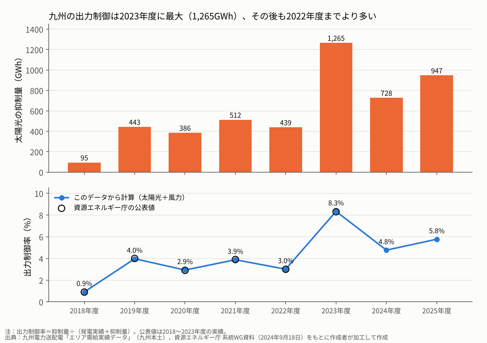
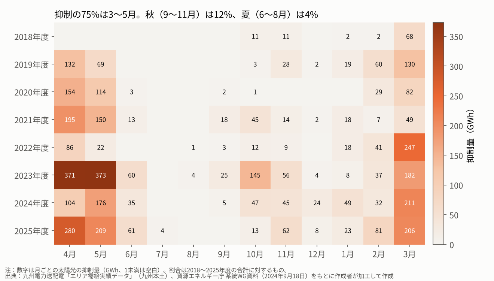
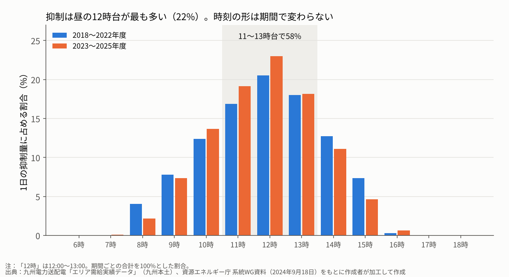
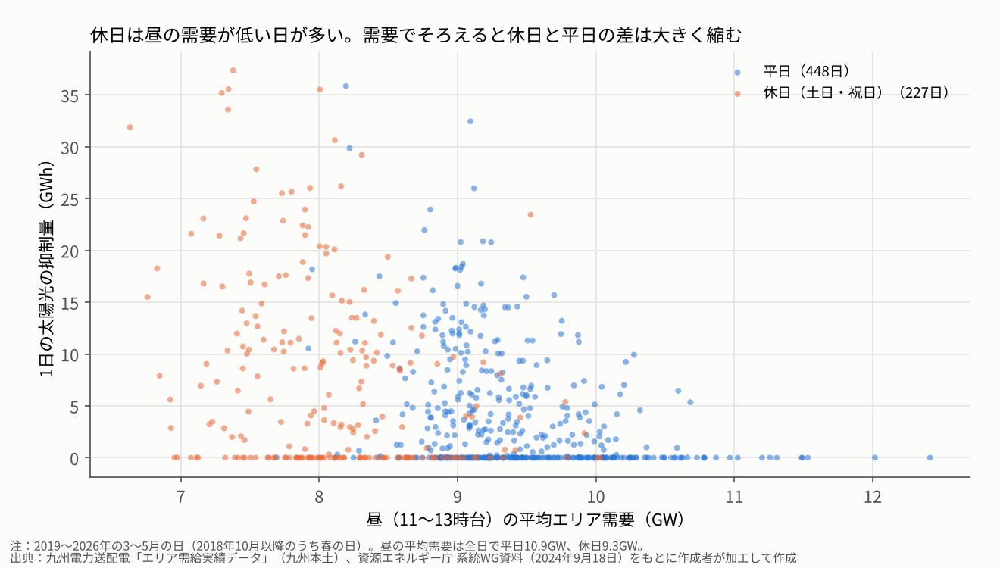

# F479 太陽光の発電を止める「出力制御」は、どの季節・時間に増えたのか？ 九州では抑制の75%が3〜5月、58%が昼の11〜13時台。2023年度以降の年平均は2022年度までの2.6倍

## 結論（先に）
- 九州本土で太陽光の出力制御が始まった2018年度から2025年度までの抑制量は、合計4,815GWh（ギガワット時）でした。年度ごとでは2023年度の1,265GWh が最大で、2024年度 728GWh、2025年度 947GWh と、2022年度まで（年平均375GWh）より多い水準が続いています。2023〜2025年度の年平均（980GWh）は、2018〜2022年度の2.6倍です。
- 季節では、抑制量の75.0%が3〜5月に集まっていました。最も多いのは4月（27.4%）です。秋（9〜11月）は11.5%、夏（6〜8月）は3.8%でした。
- 時刻では、11〜13時台の3時間で58.4%を占め、最も多いのは12時台（22.0%）でした。
- 休日（土日・祝日・年末年始）は日数では全体の33.6%ですが、抑制量では55.4%を占め、1日あたりの抑制量は平日の2.45倍でした。
- 結果を見てから足した問い直しでは、休日の多さの大半は「昼の需要が低いこと」で説明でき、昼の需要と太陽光の出力でそろえると、休日の上乗せは1日1.73GWhから0.68GWhへ縮みました（約4割が残る）。

## 問い
太陽光の発電が多すぎて電気が余りそうなとき、送配電の会社は発電所に発電を止めてもらいます。これが「出力制御」です。資源エネルギー庁の審議会の資料では、出力制御は需要が少なく太陽光の出力が大きい時期・時間帯に起きやすいとされ、九州エリアの出力制御率は2023年度に8.3%と示されています。

では、出力制御は実際にどの季節・どの時刻・どの曜日に増えたのでしょうか。発電事業や電気の使い方の計画にかかわる人に向けて、九州本土の時間ごとのデータで確かめます。

## データ（出典）
- 九州電力送配電「エリア需給実績データ」（九州本土）。2016〜2023年度は1時間値（MWh）、2024・2025年度は30分値（MW平均。0.5を掛けて MWh にし、1時間ごとに足した）。使った列は、エリア需要（地域全体の電気の使用量）、太陽光の発電実績と抑制量、風力の発電実績と抑制量です。
- 内閣府「国民の祝日」CSV（休日の判定）。
- 資源エネルギー庁 系統ワーキンググループ資料（2024年9月18日）の九州の出力制御率（照合に使う）。
- 期間は2016年4月〜2026年3月（87,648時間）。2026年度は途中で速報値を含むため外しました。抑制量は2018年10月から入っています。
- 九州にしぼったのは、本土で最初に出力制御が始まり、時間ごとのデータが最も長く取れるためです。
- 九州電力送配電の CSV 56個と祝日の CSV を data/raw に同梱しました（合計7.4MB）。

## 事前の計画
[PLAN.md](PLAN.md)（2026-11-16 12:36、集計の前に作成）。下見では、ファイルの先頭の数行と、資源エネルギー庁の資料の年度ごとの出力制御率だけを見ました。

| 仮説 | 外れの基準 | 結果 | 判定 |
|---|---|---|---|
| H1 年間の抑制量の半分以上が3〜5月 | 50%未満 | 75.0% | 支持 |
| H2 11〜13時台で半分以上、最も多い時刻もこの中 | 50%未満、または最多がこの外 | 58.4%、最多は12時台 | 支持 |
| H3 休日の1日あたりの抑制量は平日の1.5倍以上 | 1.5倍未満 | 2.45倍 | 支持 |
| H4 2023〜2025年度の年平均は2018〜2022年度の2倍以上 | 2倍未満 | 2.61倍（980÷375GWh） | 支持 |

## やったこと
1. 二つの形式の CSV を1時間ごとの表（data/hourly.csv）にそろえ、休日の印を付けました（02_build.py）。30分値の時刻は「その30分の終わり」なので、30分戻してから足しています。
2. 年度ごとの抑制量・抑制率・抑制のあった日数、月・時刻・休日ごとの割合を出し、仮説を判定しました。自分で計算した率を、資源エネルギー庁の公表値と並べました（03_analysis.py）。
3. 結果を見てから、休日の多さが需要の低さで説明できるかを回帰で確かめました（03b_requestion.py）。

## 分かったこと

### 1. 2023年度に跳ね上がり、その後も高い（図1）

太陽光の抑制量は、2018年度 95GWh、2019年度 443GWh、2020年度 386GWh、2021年度 512GWh、2022年度 439GWh のあと、2023年度に1,265GWh へ跳ね上がりました。2024年度は728GWh、2025年度は947GWh です。抑制率（抑制量÷（発電実績＋抑制量））は、太陽光だけで2023年度8.60%、2024年度4.87%、2025年度5.93%でした。抑制のあった日は、2018年度の42日から、2023年度以降は年148〜158日に増えています。

太陽光と風力を合わせて計算した率は、資源エネルギー庁の公表値（2018〜2023年度）と最大0.04ポイントの差で一致しました。このデータの抑制量が、公表されている出力制御とそろっていることの確かめになります。

### 2. 抑制の4分の3は3〜5月（図2）

2018〜2025年度の合計で、3月 24.4%、4月 27.4%、5月 23.1% で、3か月で75.0%でした。秋（9〜11月）は11.5%、冬（12〜2月）は9.7%、夏（6〜8月）は3.8%です。春は冷暖房が少なく需要が低い一方、太陽光の出力が大きい時期です（この理由づけはデータで分けておらず推測です）。2023年度は4・5月がそれぞれ370GWh 台でした。

### 3. 抑制は昼の3時間に集中（図3）

11〜13時台の3時間で58.4%、12時台だけで22.0%です。抑制は7時台から16時台の間にしかありません。2018〜2022年度と2023〜2025年度を比べると、後の期間の方が昼に寄り（11〜13時台で55.4%→60.3%）、8時台や15時台の割合は小さくなりましたが、形はほぼ同じです。

### 4. 休日に多いが、多くは需要の低さ（図4）

休日の1日あたりの抑制量は2,714MWh、平日は1,108MWh で、2.45倍でした。一方、昼（11〜13時台）の平均需要は、平日10.9GW、休日9.3GW と、休日は1.6GW ほど低い日でした。図4のように、抑制の多い日は昼の需要が低い側に集まっています。

## 問い直し（結果を見てから足した）

### 休日に多いのは「休日だから」か「需要が低いから」か
H3 で休日が平日の2.45倍とわかったので、休日の上乗せのうち、どれだけが昼の需要の低さで説明できるかを確かめました。2018年10月〜2026年3月の2,739日について、1日の抑制量を「休日かどうか」で説明する回帰（年度×月の固定効果、つまり同じ年月の中での比較）に、昼の平均需要と昼の太陽光の出力（実績＋抑制量）を足しました。

| モデル | 休日の上乗せ（GWh/日） | 標準誤差 | 決定係数 |
|---|---|---|---|
| 休日だけ（年度×月の固定効果） | 1.731 | 0.177 | 0.369 |
| ＋昼の需要・昼の太陽光の出力 | 0.684 | 0.158 | 0.557 |
| 3〜5月だけ（同じ説明の変数） | 1.647 | 0.578 | — |

- 昼の需要と太陽光の出力でそろえると、休日の上乗せは1.73GWh から0.68GWh に縮み、約4割（39.5%）が残りました。昼の需要が1GW 低いと、抑制量は1日0.69GWh 多くなる関係でした。
- 3〜5月の日を昼の需要の0.5GW 刻みに分け、同じ刻みの中で休日と平日を比べると、差の平均はむしろ −1.2GWh（休日の方が少ない）でした。ただし、同じ刻みに休日と平日が両方十分にある刻みは少なく、比べ方で符号が変わるほど不確かです。
- まとめると、休日の多さの大半は、休日に昼の需要が低いことと重なっています。需要でそろえたあとに残る上乗せは小さく、比べ方によっては見えません。

## 頑健性

| 確かめ方 | 3〜5月の割合 | 9〜11月の割合 | 11〜13時台の割合 | 最多の時刻 | 休日÷平日（1日あたり） |
|---|---|---|---|---|---|
| 本線：2018〜2025年度、太陽光の抑制量 | 75.0% | 11.5% | 58.4% | 12時台 | 2.45 |
| 期間：2018〜2022年度 | 79.8% | 8.4% | 55.4% | 12時台 | 2.62 |
| 期間：2023〜2025年度 | 71.8% | 13.5% | 60.3% | 12時台 | 2.35 |
| 定義：抑制のあった時間の数 | 54.1% | 19.9% | 43.3% | 12時台 | 1.45 |
| 定義：太陽光＋風力の抑制量 | 74.9% | 11.5% | 58.0% | 12時台 | 2.47 |
| 最大の年度（2023年度）を除く | 75.6% | 9.3% | 58.7% | 12時台 | 2.65 |
| 公表の出力制御率との照合 | 2018〜2023年度の差は最大0.04ポイント | | | | |

- 春に集中し、昼に集中する形は、期間・定義を変えても変わりませんでした。
- 抑制の「量」でなく「時間の数」で数えると、春の割合は54.1%、昼の3時間は43.3%、休日の倍率は1.45倍まで下がります。春や休日は、抑制が起きる時間が多いだけでなく、1時間あたりの抑制量も大きいということです。この数え方では H3 の基準（1.5倍）をわずかに下回ります。
- 2023〜2025年度は、秋の割合が8.4%から13.5%に上がりました。

## 言えないこと
- 出力制御が2023年度に増えた理由（太陽光の導入量、原子力や火力の運転、連系線（地域間の送電線）の使い方、需要の変化）を、このデータだけで分けることはできません。
- 九州本土以外のエリアのことは言えません。
- 抑制量は送配電会社の計算値で、個々の発電所の損失ではありません。
- 休日の上乗せの回帰は相関で、「休日だから抑制が増える」という因果を示すものではありません。
- 将来の出力制御の量や季節の形は言えません。

## 仕事で使うなら
- 九州の出力制御の量を見るときは、年度の合計だけでなく、3〜5月の休日の昼に集中していることを前提にすると読み違えにくいです。
- 年度・月・時刻の集計は results/fy_summary.csv、fy_month_gwh.csv、hour_share.csv、日ごとの値は results/daily.csv にあります。

## 計画からの変更
- 計画どおりに進めました。問い直し（休日と需要）は計画の候補の中から結果を見て選びました。
- 頑健性に「抑制のあった時間の数」を入れた結果、休日の倍率が1.45倍と H3 の基準を下回ったことを、そのまま載せています（本線の判定は量で行う計画どおり）。

## 再現のしかた
```
sh src/run_all.sh        # オフライン。所要約5秒
python3 src/01_fetch.py  # 元データを取り直すときだけ（ネットを使う）
```

| ファイル | 中身 |
|---|---|
| src/01_fetch.py | 元データを data/raw に取る（run_all.sh からは呼ばない） |
| src/02_build.py | 二つの形式をそろえて data/hourly.csv（1時間ごと）を作る |
| src/03_analysis.py | 年度・月・時刻・休日の集計、仮説、頑健性 → results/main.json ほか |
| src/03b_requestion.py | 問い直し（休日と需要の回帰） → results/requestion.json・daily.csv・requestion_demand_bins.csv |
| src/04_figures.py | 図4枚 |

repro_check：/tmp/rep_F479 に写して流し、15ファイル（results 10、figures 4、data 1）がすべて cmp で一致、所要5秒（results/repro_check.txt）。乱数は使っていません。

## レビューで直したこと

独立レビュー（2026-11-17）で、数字の照合・再実行・図を確かめ、次を直しました。直したあとに /tmp の新しいフォルダで流し直し、results と figures がすべて一致することを確かめています。

| # | 指摘 | 直し方 |
|---|---|---|
| 1 | 図2の色の帯（カラーバー）の目盛りの数字と見出しが図の右の端で切れていた | 図2の右の余白を広げ（subplots_adjust の right を0.97→0.90）、目盛りと見出しが全部出るようにした |

## 出典
- 九州電力送配電「エリア需給実績データ」：https://www.kyuden.co.jp/td_area_jukyu/jukyu.html （個々のファイルの URL は data/raw/SOURCES.md）
- 内閣府「国民の祝日について」祝日の CSV：https://www8.cao.go.jp/chosei/shukujitsu/syukujitsu.csv
- 資源エネルギー庁「再生可能エネルギーの出力制御の抑制に向けた取組等について」（系統ワーキンググループ、2024年9月18日）：https://www.meti.go.jp/shingikai/enecho/shoene_shinene/shin_energy/keito_wg/pdf/052_01_00.pdf

（いずれも 九州電力送配電「エリア需給実績データ」ほか をもとに作成者が加工して作成）
