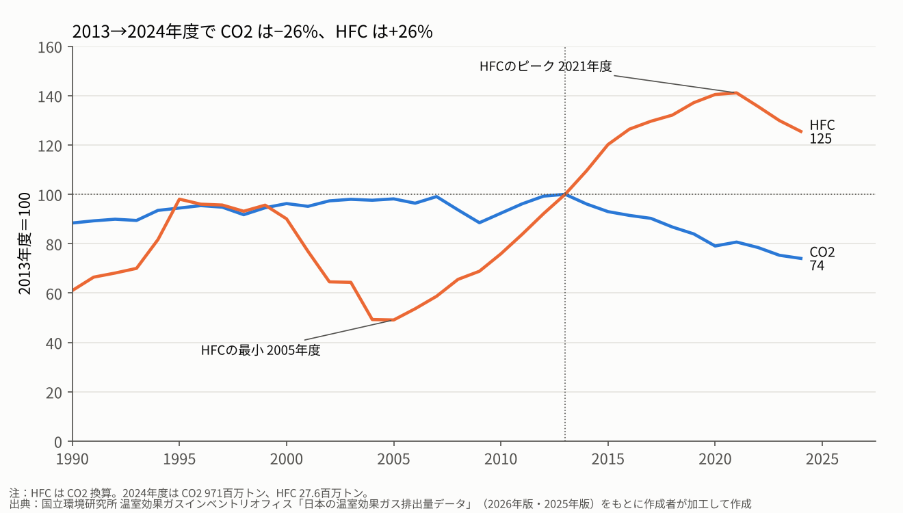
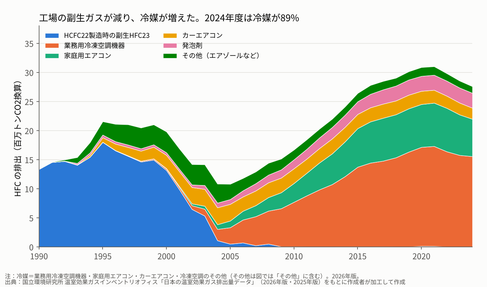
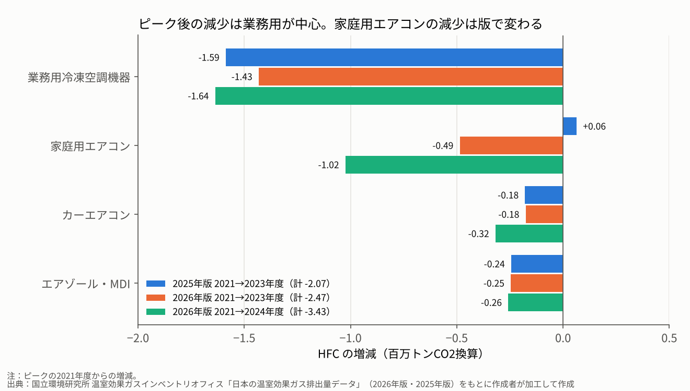
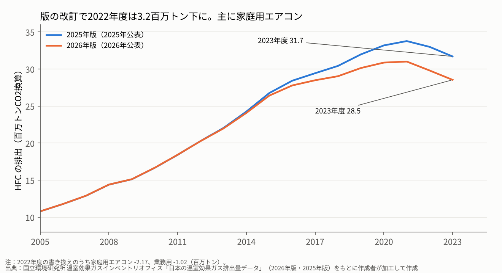

# F480 CO2 は減っても、代替フロン（HFC）の排出は増えたのか？ 2013→2024年度で CO2 は26%減、HFC は26%増。HFC は2005年度の2.6倍だが、2021年度をピークに11%減った

## 結論（先に）
- 2013年度から2024年度に、CO2 の排出は1,312百万トンから971百万トンへ26.0%減りました。同じ期間に、代替フロンの一つ HFC（ハイドロフルオロカーボン類）の排出は22.0百万トンから27.6百万トン（CO2 に換算した量）へ25.5%増えました。
- HFC の排出は2005年度の10.8百万トンが最も少なく、2021年度の31.0百万トンがピークでした。2024年度（27.6百万トン）は最も少なかった年の2.56倍で、ピークより11.1%少ない値です。
- 中身は入れ替わりました。1990年代の HFC はほぼ工場の副生ガス（HCFC22 を作るときに出る HFC23）でしたが、2005年度までに13.4→0.5百万トンへ減りました。代わりに冷蔵庫やエアコンの冷媒が増え、2024年度は HFC の88.6%が冷媒からです。
- 2021年度からの減少（−3.43百万トン）の約半分（47.7%）は業務用冷凍空調機器から来ていました。家庭用エアコンも減少の30%を占めますが、この部分は統計の版の改訂で大きく書き換わっていて、一つ前の版では減っていませんでした。

## 問い
CO2 の排出は2013年度から減り続けています。一方、冷蔵庫やエアコンの冷媒に使われる HFC は、オゾン層を壊す物質（HCFC など）の代わりとして使われるようになり、増えてきたと説明されてきました。国立環境研究所の2024年度の排出量の詳細資料も、HFCs は2005年から2021年まで年々増え、2022年から3年続けて減ったとしています。

この記事では、HFC が本当に CO2 と逆向きに増えたのか、何が増やし、何が減らし始めたのかを、用途別の数字で確かめます。温室効果ガスの数字を読む人、冷凍・空調の機器にかかわる人のための記事です。

## データ（出典）
- 国立環境研究所 温室効果ガスインベントリオフィス（GIO）「日本の温室効果ガス排出量データ」2026年版（1990〜2024年度）。シート「1.Summary」（ガス別、百万トン CO2 換算）と「8.F-gas」（HFC・PFC・SF6・NF3 の用途別、千トン CO2 換算）。
- 照合用に、一つ前の2025年版（1990〜2023年度）の同じシート。
- CO2 換算は、インベントリの地球温暖化係数（ガスごとに CO2 の何倍効くかを表す係数）をそのまま使いました。「発生しない（NO）」は0としました。
- 二つの Excel を data/raw に同梱しました（合計約2.7MB）。

## 事前の計画
[PLAN.md](PLAN.md)（2026-11-16 12:43、集計の前に作成）。下見では、シートの形を確かめるときに1990・2023・2024年度の HFC の値が目に入り、既存の記事 jodn 183 の一文（HFCs は2004年度10.8→2021年度31.0百万トン）も読んでいました。

| 仮説 | 外れの基準 | 結果 | 判定 |
|---|---|---|---|
| H1 HFC は最も少ない年から2024年度までに2倍以上 | 2倍未満 | 2005年度 10.8 → 2024年度 27.6百万トン（2.56倍） | 支持 |
| H2 ピークは2022年度以前で、2024年度はピークより5%以上少ない | ピークが2023年度以降、または5%未満の減少 | ピーク2021年度、−11.1% | 支持 |
| H3 2024年度の HFC の8割以上が冷媒 | 80%未満 | 88.6% | 支持 |
| H4 2013→2024年度で CO2 は20%以上減り、HFC は増えた | CO2 の減少が20%未満、または HFC が減少 | CO2 −26.0%、HFC +25.5% | 支持 |

## やったこと
1. 二つの版の Excel から、ガス×用途×年度×版の長い表（data/fgas_long.csv）を作りました。用途の合計が HFC の計と一致することを確かめています（02_build.py）。
2. HFC のピークと最も少ない年、CO2 との比較、用途別の増減（1990→2005、2005→2021、2021→2024年度）を出し、仮説を判定しました（03_analysis.py）。
3. 結果を見てから、ピーク後の減少がどの機器から来たか、版で答えが変わるかを確かめました（03b_requestion.py）。

## 分かったこと

### 1. CO2 と逆向きに動いた（図1）

2013年度を100とすると、2024年度は CO2 が74、HFC が125 です。HFC は2005年度に2013年度の約半分まで下がったあと、2021年度まで上がり続けました。温室効果ガス全体に占める HFC の割合は、2005年度0.8%、2013年度1.6%、2021年度2.7%、2024年度2.6% です。

### 2. 工場の副生ガスから冷媒へ（図2）

1990年度の HFC 13.4百万トンは、ほぼすべて HCFC22 の製造で出る副生 HFC23（13.35百万トン）でした。これが2005年度までに0.5百万トンに減ったため、HFC 全体はいったん下がりました。一方、冷媒の HFC は2005年度7.1百万トンから2021年度27.4百万トンに増えました。2005→2021年度の増加（+20.2百万トン）のうち、業務用冷凍空調機器が +14.4、家庭用エアコンが +6.3 です。2024年度の内訳は、業務用 15.5、家庭用エアコン 6.4、発泡剤 2.6、カーエアコン 1.9百万トンでした。

### 3. ピーク後の減少は業務用が中心（図3）

2021→2024年度の減少 −3.43百万トンのうち、業務用冷凍空調機器が −1.64（47.7%）、家庭用エアコンが −1.02（29.8%）、カーエアコンが −0.32（9.3%）、エアゾールなどが −0.26（7.5%）でした。

## 問い直し（結果を見てから足した）

### ピーク後の減少は、どの機器から来たのか。版で変わるか
H2 で「ピークを過ぎた」ことが分かったので、その減少の出どころを、二つの版で比べました（図3・図4）。



| 版・期間 | 計 | 業務用冷凍空調機器 | 家庭用エアコン | カーエアコン | エアゾール・MDI |
|---|---|---|---|---|---|
| 2025年版 2021→2023年度 | −2.07 | −1.59 | +0.06 | −0.18 | −0.24 |
| 2026年版 2021→2023年度 | −2.47 | −1.43 | −0.49 | −0.18 | −0.25 |
| 2026年版 2021→2024年度 | −3.43 | −1.64 | −1.02 | −0.32 | −0.26 |

- 業務用の減少（−1.4〜−1.6）は、どちらの版でもほぼ同じでした。
- 家庭用エアコンは、2025年版では2021→2023年度に +0.06（減っていない）でしたが、2026年版では −0.49 です。2026年版では、2022年度の HFC 全体が3.19百万トン下に書き換わり、そのうち2.17百万トンが家庭用エアコン、1.02百万トンが業務用でした。
- 「ピークは2021年度」という答えはどちらの版でも同じですが、「家庭用エアコンからの排出が減り始めた」という読みは、版の改訂でできた部分が大きいと言えます。国立環境研究所の詳細資料は、2023→2024年度の減少の理由として家庭用エアコンの廃棄時の回収の増加などを挙げていますが、その大きさはこの表からは確かめられません。

## 頑健性

| 確かめ方 | ピークの年 | ピークの値 | 最小の年 | 最後の年の値 | ピーク比 | 2005年度比 |
|---|---|---|---|---|---|---|
| 本線：2026年版 HFC 計 | 2021 | 31.01 | 2005 | 27.58（2024） | −11.1% | 2.56倍 |
| 2025年版 HFC 計 | 2021 | 33.77 | 2005 | 31.70（2023） | −6.1% | 2.94倍 |
| 副生 HFC23 を除く HFC | 2021 | 30.90 | 1990（0.06） | 27.57（2024） | −10.8% | 2.68倍 |
| 3年移動平均でピークを決める | 2020 | 30.67 | 2005 | 27.58（2024） | −10.1% | 2.56倍 |
| 代替フロン等4ガス 計 | 1996 | 56.25 | — | 32.24（2024） | −42.7% | 1.25倍 |

- HFC のピーク（2020〜2021年度）と、最も少ない年からの倍率（2.5〜2.9倍）は、版・定義を変えても同じ向きでした。
- 副生 HFC23 を除くと、HFC は1990年度のほぼ0から一度も大きく下がらずに増え続けており、「2005年度の谷」は副生ガスの減少でできたものです。
- 代替フロン等4ガスの合計では、ピークは1996年度で、2024年度は1990年度より少ない（0.97倍）です。PFC と SF6 が大きく減ったためで、「代替フロンが増えた」と言えるのは HFC だけです。
- 国立環境研究所の詳細資料の数字（2024年度 2,760万トン、2013年度比 +25.5%）と、このデータの値は一致しました。

## 言えないこと
- 排出量は機器の台数や漏れる割合の仮定から推計した値で、版で書き換わります（2022年度は3.19百万トン）。最新の年ほど書き換わりやすいと考えられます（推測）。
- 減少の理由（フロン排出抑制法による回収の強化、温暖化係数の小さい冷媒への切り替え、機器の入れ替え）を、この表で分けることはできません。
- 温暖化への効き方は地球温暖化係数の選び方で変わります。ここではインベントリの CO2 換算をそのまま使いました。
- オゾン層を壊す物質（CFC・HCFC）の排出はこの表に入っていないので、冷媒全体の排出が減ったかどうかは言えません。

## 仕事で使うなら
- HFC の数字を引くときは、版（公表年）を書き添えると、あとで比べられます。最近の年は版で1割ほど動くことがあります。
- 用途別の年度ごとの値は results/series_2026.csv、版の比較は results/vintage_revision.csv にあります。

## 計画からの変更
- 計画どおりに進めました。問い直し（ピーク後の減少の出どころ）は、計画の候補を結果を見て選び、版の比較を足しました。
- 頑健性の表に「2005年度比」の列を足しました。副生 HFC23 を除くと最小の年が1990年度（ほぼ0）になり、最小の年からの倍率が意味を持たないためです。

## 再現のしかた
```
sh src/run_all.sh        # オフライン。所要約3秒
python3 src/01_fetch.py  # 元データを取り直すときだけ（ネットを使う）
```

| ファイル | 中身 |
|---|---|
| src/02_build.py | 二つの版の Excel から data/fgas_long.csv を作る |
| src/03_analysis.py | ピーク・分解・CO2 との比較・仮説・頑健性 → results/main.json ほか |
| src/03b_requestion.py | 問い直し → results/requestion.json・requestion_post_peak.csv・requestion_vintage_2022_by_use.csv |
| src/04_figures.py | 図4枚 |

repro_check：/tmp/rep_F480 に写して流し、13ファイル（results 8、figures 4、data 1）がすべて cmp で一致、所要3秒（results/repro_check.txt）。乱数は使っていません。

## 関連する記事
- jodn 183「日本の排出量の減少は、どの部門がけん引したか」：同じインベントリで、2013→2024年度の総排出量の減少を部門別に分けた記事。本記事は、そこで「増えた区分」として一行で触れられた HFC を、用途と版に分けて見た点が違います。
- F329「日本の CO2 排出が減ったのは、何のおかげか？」：CO2 の減少の要因を見た記事。本記事は、CO2 と逆に動いた代替フロン（HFC）を見た点が違います。

## レビューで直したこと

独立レビュー（2026-11-17）で、数字の照合・再実行・図を確かめ、次を直しました。直したあとに /tmp の新しいフォルダで流し直し、results と figures がすべて一致することを確かめています。

| # | 指摘 | 直し方 |
|---|---|---|
| 1 | 図1の注の2024年度の CO2「972百万トン」が、小数1桁に丸めた971.5をもう一度丸めた値で、本文の971百万トン（元の値971.48）と食い違っていた | 03_analysis.py で CO2 の値を小数2桁で残すようにし、図1の注を971百万トンにそろえた |
| 2 | 既存の看板記事との関係が README に書かれていなかった | 「関連する記事」に番号と違いを1文で書いた |

## 出典
- 国立環境研究所 温室効果ガスインベントリオフィス「日本の温室効果ガス排出量データ」：https://www.nies.go.jp/gio/archive/ghgdata/index.html （ファイルの URL は data/raw/SOURCES.md）
- 国立環境研究所「2024年度の我が国の温室効果ガス排出量及び吸収量（詳細）」：https://www.nies.go.jp/pr/news-and-updates/2026/qu9bd600000by3sp-att/qu9bd600000by6ot.pdf

（いずれも 国立環境研究所「日本の温室効果ガス排出量データ」をもとに作成者が加工して作成）
