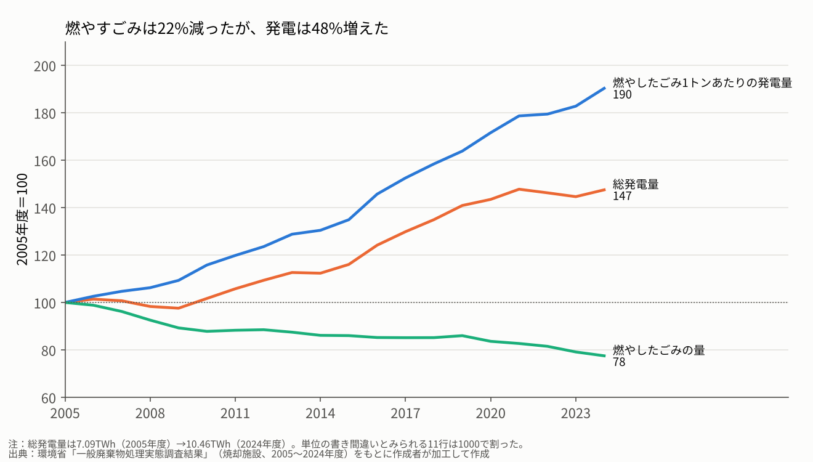
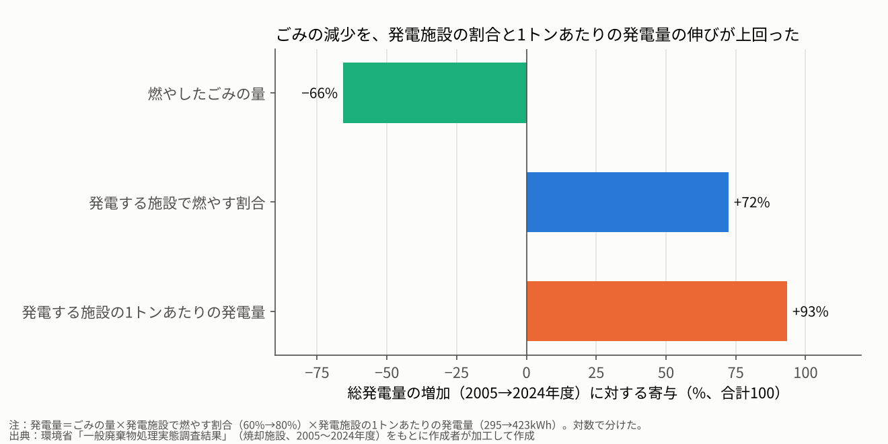
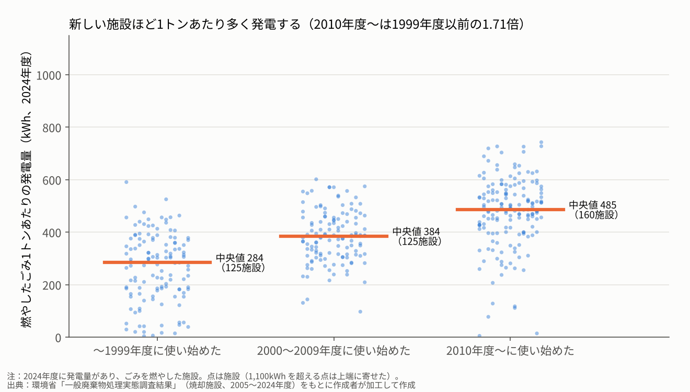
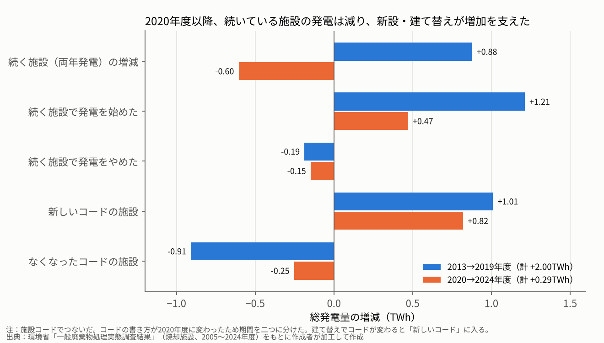

# F481 ごみを燃やす施設の発電は、どこまで増えたのか？ 燃やすごみは22%減ったが、発電は2005→2024年度で48%増え10.5TWh に。増加は発電施設の割合と1トンあたりの発電量の伸び

## 結論（先に）
- ごみ焼却施設の総発電量は、2005年度の7.09TWh（テラワット時＝10億kWh）から2024年度の10.46TWh へ、47.5%増えました。同じ期間に、焼却施設で燃やしたごみの量は39.8百万トンから30.8百万トンへ22.5%減っています。
- 増え方を「燃やしたごみの量 × 発電する施設で燃やす割合 × 発電する施設の1トンあたりの発電量」に分けると、寄与はそれぞれ −66%、+72%、+93% でした。ごみの減少の分を、発電する施設への集約と、1トンあたりの発電量の伸びの両方で上回った形です。
- 発電する施設で燃やすごみの割合は60.5%から80.1%に、発電する施設の1トンあたりの発電量は295kWh から423kWh になりました。施設の数は1,318から1,014に減り、発電する施設は274から410に増えています。
- 2024年度に発電している施設のうち、2010年度以降に使い始めた施設の1トンあたりの発電量（中央値485kWh）は、1999年度以前の施設（284kWh）の1.71倍でした。
- 結果を見てから足した問い直しでは、2020→2024年度は、続いている施設の発電がむしろ減り（−0.60TWh）、新設・建て替えと発電を始めた施設が増加を支えていました。

## 問い
ごみを燃やす熱で発電する「ごみ発電」は、ごみからエネルギーを取り戻す方法として話題になります。一方で、燃やすごみの量は減っています。ごみが減るなかで発電は増えたのか、増えたなら、それは何のおかげか（ごみの量、発電する施設の割合、1トンあたりの発電量）を確かめます。市町村のごみ処理や地域の電気にかかわる人のための記事です。

## データ（出典）
- 環境省「一般廃棄物処理実態調査結果」の「施設整備状況」→「焼却施設」の表（施設ごと）。2005〜2024年度の20年分（20ファイル、計15MB を data/raw に同梱）。
- 使った列：年間処理量（t）、処理能力（t/日）、使用開始年度、発電能力（kW）、総発電量（MWh）、施設コード。列の位置は年で違うので、見出しの文字で探しました（02_build.py）。
- 直し方：総発電量が「発電能力×1年の時間」の10倍を超える11行は、kWh で書いた書き間違いとみなし1000で割りました（2008年度・2019年度の合計がほかの年の数倍になっていたため）。

## 事前の計画
[PLAN.md](PLAN.md)（2026-11-16 12:48）。列を探すスクリプトの確かめのときに、年度ごとの総発電量と全体の1トンあたりの発電量を一度見てしまったので、「総発電量が増えたか」は仮説にせず、分け方と施設の比べ方に仮説を置きました。

| 仮説 | 外れの基準 | 結果 | 判定 |
|---|---|---|---|
| H1 増加のうち1トンあたりの発電量の寄与が100%以上 | 100%未満 | 93.3% | 外れ |
| H2 2010年度以降の施設の1トンあたりの発電量（中央値）は1999年度以前の1.5倍以上 | 1.5倍未満 | 1.71倍（平均では1.79倍） | 支持 |
| H3 処理能力100t/日以上の施設のうち発電施設は75%以上 | 75%未満 | 70.0% | 外れ |
| H4 発電施設の設備利用率は5ポイント以上は上がっていない | 5ポイント以上上がった | 55.7%→53.4%（−2.3） | 支持 |

H1 は、1トンあたりの発電量の伸びだけではごみの減少を補いきれず、発電する施設で燃やす割合の上昇（+72%）も必要だった、という意味で外れました。

## やったこと
1. 20年分の表から必要な列を抜き出し、data/facilities.csv にしました（02_build.py）。
2. 年度ごとの合計、増加の分解（対数の差で3つに分ける）、2024年度の施設の比較、規模別の発電施設の割合を出しました（03_analysis.py）。
3. 結果を見てから、施設コードで年度をつなぎ、増加が施設の入れ替えから来たのかを確かめました（03b_requestion.py）。

## 分かったこと

### 1. ごみは減り、発電は増えた（図1）

2005年度を100とすると、2024年度は燃やしたごみの量が78、総発電量が147、燃やしたごみ1トンあたりの発電量（全施設）が190 です。総発電量は2021年度の10.47TWh のあと横ばいです。

### 2. 発電施設への集約と1トンあたりの伸び（図2）

発電する施設の発電能力の合計は1.45GW から2.24GW に増えました。設備利用率（発電量 ÷（発電能力×時間））は55.7%から53.4%でほぼ変わらず、増加は設備を増やしたことによるものです。

### 3. 新しい施設ほど1トンあたり多く発電する（図3）

2024年度に発電している施設の1トンあたりの発電量（中央値）は、1999年度以前に使い始めた施設 284kWh（125施設）、2000〜2009年度 384kWh（125施設）、2010年度以降 485kWh（160施設）でした。処理能力別の発電施設の割合は、200t/日以上で88.0%、100〜200t/日で49.6%、50〜100t/日で21.2% です（2005年度はそれぞれ73.8%、19.4%、4.5%）。小さい施設ほど発電の設備は少なく、100t/日以上でまとめると70.0%でした。

## 問い直し（結果を見てから足した）

### 増加は施設の入れ替えから来たのか（図4）

H2 で新しい施設ほど1トンあたりの発電量が多いと分かったので、増加のうちどれだけが施設の入れ替えから来たかを、施設コードで年度をつないで確かめました。コードの書き方が2020年度に変わったため、2013→2019年度と2020→2024年度に分けています。

| 内訳（TWh） | 2013→2019年度 | 2020→2024年度 |
|---|---|---|
| 続いている施設（両年とも発電）の増減 | +0.88 | −0.60 |
| 続いている施設で発電を始めた分 | +1.21 | +0.47 |
| 続いている施設で発電をやめた分 | −0.19 | −0.15 |
| 新しいコードの施設（新設・建て替え） | +1.01 | +0.82 |
| なくなったコードの施設（廃止・建て替え） | −0.91 | −0.25 |
| 計 | +2.00 | +0.29 |

- 2013→2019年度は、続いている施設の伸び（+0.88）と、同じコードのまま発電を始めた施設（65施設、+1.21）が増加の中心でした。新設と廃止はほぼ相殺しています。
- 2020→2024年度は、続いている施設の発電が −0.60TWh 減り、新しいコードの施設（+0.82）と発電を始めた施設（+0.47）がそれを上回りました。続いている発電施設の1トンあたりの発電量は411kWh で変わっていないので、減ったのは燃やすごみの量の分と考えられます（推測）。
- 同じ場所で建て替えたときにコードが変わるか変わらないかは、表からは分かりません。「発電を始めた」の中にも建て替えが含まれている可能性があります（推測）。

## 頑健性

| 確かめ方 | 総発電量の増加 | ごみの量の寄与 | 発電施設で燃やす割合の寄与 | 1トンあたりの寄与 | 設備利用率 |
|---|---|---|---|---|---|
| 本線：書き間違いを直す、2005→2024年度 | +47.5% | −65.6% | +72.3% | +93.3% | 55.7→53.4% |
| 能力×時間を超える72行を除く | +47.7% | −65.6% | +72.3% | +93.3% | 55.5→53.2% |
| 期間：2013→2024年度 | +30.9% | −44.8% | +63.7% | +81.2% | 52.9→53.4% |
| 900kWh/t 超の施設を除く | +49.1% | −63.4% | +70.7% | +92.7% | 55.6→53.4% |

どの確かめ方でも、二つの要因（施設の割合と1トンあたり）がそれぞれごみの減少を上回る形は同じで、H1 の「1トンあたりだけで100%以上」はどれでも届きませんでした。H2 は平均で見ても1.79倍でした。

## 言えないこと
- 発電の増加が交付金などの政策のおかげかどうかは、この表からは分かりません。
- 施設の中で使った電気と外に送った電気の割合は、列のない年があるので扱っていません。
- 回答の書き間違い（単位など）が、直した11行のほかにも残っている可能性があります。
- 施設の建て替えと新設は、施設コードからは区別できません。
- 都道府県ごとの比較や順位は扱っていません。

## 仕事で使うなら
- ごみ発電の量を見るときは、ごみの量の減少と、施設の建て替えによる設備の増加が逆向きに効いていることを前提にすると読み違えにくいです。
- 年度ごとの合計は results/yearly.csv、規模別の発電施設の割合は results/gen_share_by_size.csv にあります。

## 計画からの変更
- 頑健性1の「除く行」は、計画では37行と書きましたが、発電能力が空欄で発電量がある行も含めた結果72行になりました。結論は変わりません。
- 問い直しは、施設コードの書き方が2020年度に変わっていたため、計画の「2013→2024年度」を二つの期間に分けました。

## 再現のしかた
```
sh src/run_all.sh        # オフライン。所要約12秒
python3 src/01_fetch.py  # 元データを取り直すときだけ（ネットを使う）
```

| ファイル | 中身 |
|---|---|
| src/02_build.py | 20ファイルから必要な列を抜き出し data/facilities.csv を作る |
| src/03_analysis.py | 合計・分解・施設の比較・仮説・頑健性 → results/main.json ほか |
| src/03b_requestion.py | 問い直し（施設の入れ替え） → results/requestion.json・requestion_entry_exit.csv |
| src/04_figures.py | 図4枚 |

repro_check：/tmp/rep_F481 に写して流し、12ファイル（results 7、figures 4、data 1）がすべて cmp で一致、所要12秒（results/repro_check.txt）。乱数は使っていません。

## レビューで直したこと

独立レビュー（2026-11-17）で数字の照合・再実行・図を確かめ、直すところはなかった。

## 出典
- 環境省「一般廃棄物処理実態調査結果」：https://www.env.go.jp/recycle/waste_tech/ippan/stats.html （各年度のファイルの URL は data/raw/SOURCES.md）

（いずれも 環境省「一般廃棄物処理実態調査結果」をもとに作成者が加工して作成）
