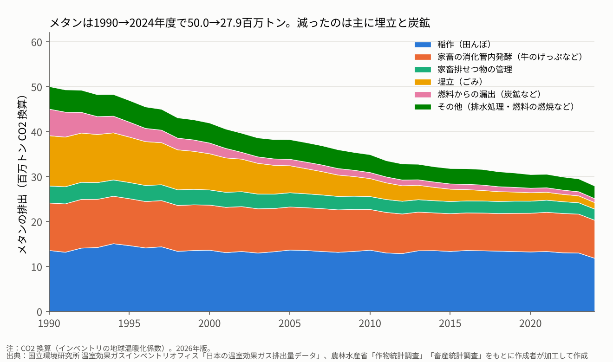
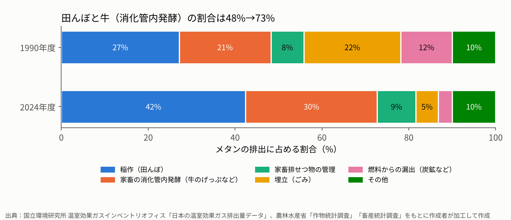
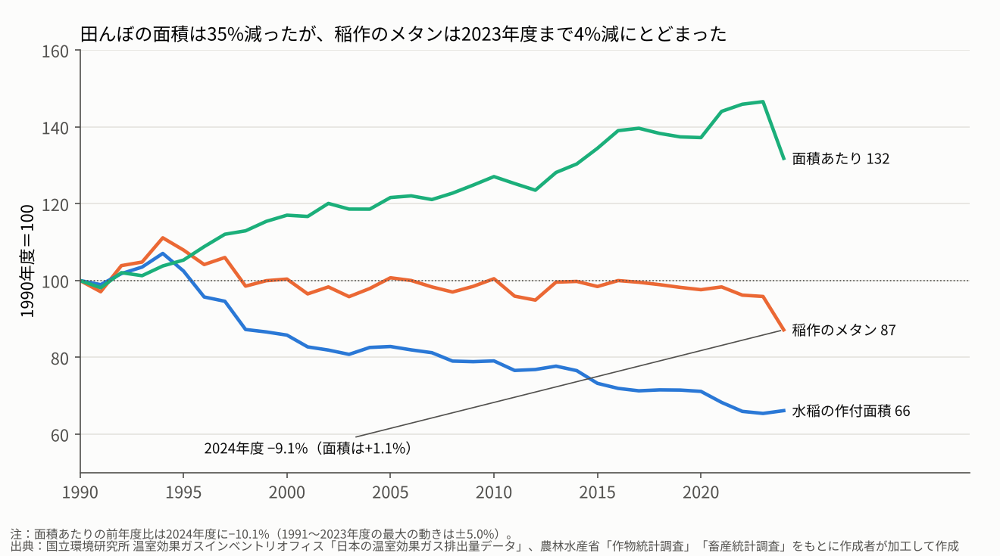
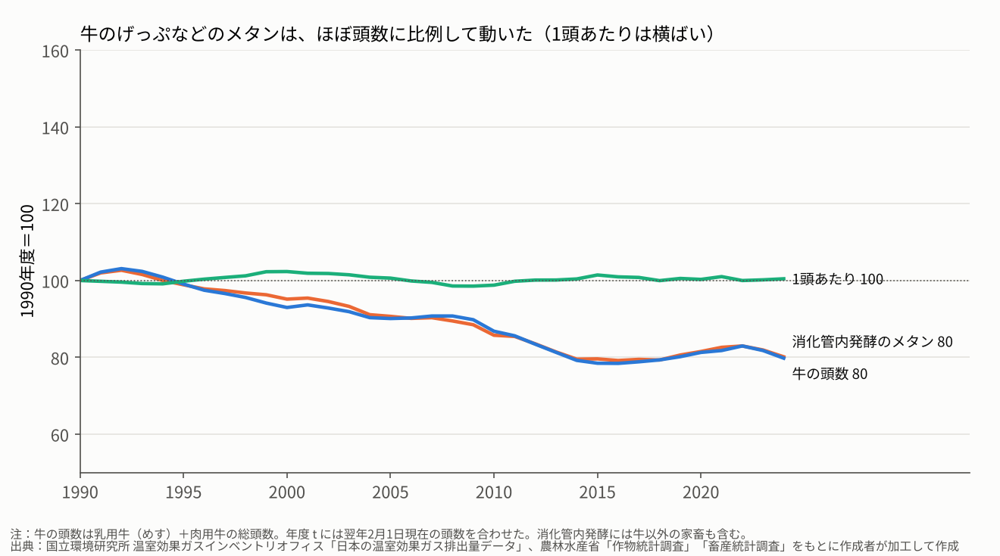

# F482 メタンの排出は、田んぼと牛でどれだけを占めるのか？ 2024年度は73%（1990年度は48%）。牛の分は頭数に比例したが、田んぼの面積あたりの排出は2023年度まで47%増えていた

## 結論（先に）
- 日本のメタン（CH4）の排出は、1990年度の50.0百万トンから2024年度の27.9百万トン（CO2 換算）に減りました。そのうち稲作（田んぼ）が42.4%、家畜の消化管内発酵（牛のげっぷなど）が30.3%で、合わせて72.7%を占めます。1990年度は48.2%でした。
- 割合が上がったのは、田んぼと牛が増えたからではなく、ほかが大きく減ったからです。1990→2024年度の減少（−22.1百万トン）のうち、44.0%は埋立（ごみ）、22.7%は燃料からの漏出（炭鉱など）で、稲作は7.9%、消化管内発酵は9.5%でした。
- 牛の分は頭数にほぼ比例していました。牛の頭数（乳用牛＋肉用牛）は1990年度の487万頭から2024年度の389万頭に減り、1頭あたりの排出は2.17トンでほとんど変わりません（+0.5%）。
- 田んぼは違いました。水稲の作付面積は1990→2023年度で35%減りましたが、稲作のメタンは4%しか減らず、面積あたりの排出は6.6トン/ha から9.7トン/ha へ47%増えていました（推計に使う係数の変化と考えられます）。
- 結果を見てから足した問い直しでは、2024年度の稲作の減少（−9.1%）は、面積が1.1%増えたなかでの面積あたりの減少（−10.1%）で、1991年度以降で最も大きな動きでした。

## 問い
メタンは CO2 に次ぐ温室効果ガスで、日本では田んぼ（水を張った田の土の中で微生物が出す）と牛のげっぷが大きいと言われます。では、実際にどれだけの割合なのか、30年でどう変わったのか、田んぼの面積や牛の頭数の変化で説明できるのかを確かめます。温室効果ガスの数字を読む人、農業にかかわる人のための記事です。

## データ（出典）
- 国立環境研究所 温室効果ガスインベントリオフィス「日本の温室効果ガス排出量データ」2026年版（1990〜2024年度）のシート「6.CH4」（分野別、CO2 換算）。照合用に2025年版。
- 農林水産省「作物統計調査」収穫量累年統計 水稲 全国：作付面積（子実用）。
- 農林水産省「畜産統計調査」乳用牛・肉用牛の飼養頭数累年統計 全国（各年2月1日現在）。2019年に集計方法が変わり、2019年は（旧）と（新）の2つの値があります。本線は（新）を使いました。
- 年の合わせ方：作付面積はその年の産、牛の頭数は翌年2月1日現在の値を、その年度の値としました。
- 5つのファイルを data/raw に同梱しました（合計約2.9MB）。

## 事前の計画
[PLAN.md](PLAN.md)（2026-11-16 12:58）。この記事は予備の題材 R38 に替えたものです（元の問いは瀬戸内海の水質。REPLACED.md 参照）。下見では、メタンのシートの1990年代前半と2023・2024年度の値（稲作・消化管内発酵・埋立・合計）が目に入っていたため、「2024年度の割合」そのものは仮説にしませんでした。

| 仮説 | 外れの基準 | 結果 | 判定 |
|---|---|---|---|
| H1 稲作の面積あたりの排出は1990→2023年度で ±10% の範囲 | ±10% を超えた | +46.6% | 外れ |
| H2 消化管内発酵の1頭あたりは1990→2024年度で5%以上増えた | 5%未満の増加、または減少 | +0.5% | 外れ |
| H3 稲作の前年度比と面積の前年比の相関は0.5以上 | 0.5未満 | 0.79 | 支持 |
| H4 2013→2024年度の減少率は、合計より田んぼ＋牛の方が小さい | 同じか大きい | 合計 −14.8%、田んぼ＋牛 −8.2% | 支持 |

## やったこと
1. 2つの版のメタンの分野別の表と、作付面積・牛の頭数の表を作りました（02_build.py）。
2. 分野別の割合、1990→2024年度の減少の内訳、面積あたり・頭数あたりの値を出し、仮説を判定しました（03_analysis.py）。
3. 結果を見てから、2024年度の稲作の減少を面積と面積あたりに分けました（03b_requestion.py）。

## 分かったこと

### 1. 減ったのは主に埋立と炭鉱（図1）

埋立は11.2→1.4百万トン、燃料からの漏出は5.9→0.9百万トンに減りました。稲作は13.6→11.8、消化管内発酵は10.6→8.5百万トンです。

### 2. 田んぼと牛の割合は48%から73%に（図2）

農業全体（家畜排せつ物の管理などを含む）では81.7%です。埋立の割合は22.4%から5.2%に下がりました。2013→2024年度では、合計が −14.8% に対し、田んぼ＋牛は −8.2% でした。

### 3. 田んぼの面積あたりの排出は増えていた（図3）

年ごとの増減は面積とよく連動します（前年度比の相関0.79）。しかし長い目で見ると、面積が35%減る間に排出は4%しか減っていません。インベントリの稲作の排出は、面積に「有機物（稲わらなど）を入れたかどうか」などで変わる係数を掛けて推計されています。面積あたりの上昇は、この係数の前提となる田んぼの管理の変化を映していると考えられますが、この表からは確かめられません（推測）。

### 4. 牛は頭数に比例（図4）

消化管内発酵の排出と牛の頭数は、1990年度＝100でどちらも2024年度に80で、1頭あたりは2.17トン前後で横ばいでした。

## 問い直し（結果を見てから足した）

### 2024年度の稲作の減少は、面積で説明できるか
H1・H3 から「年ごとの動きは面積と連動するが、水準は面積あたりの変化で動く」と分かったので、2024年度の減少を分けました。

- 稲作のメタンは2023→2024年度に −9.1%（13.02→11.84百万トン）。作付面積は +1.1%、面積あたりは −10.1%（9.69→8.71トン/ha）でした。
- 面積あたりの前年度比が ±5.0% を超えた年は1991〜2023年度に一度もなく（最大は2021年度）、2024年度の −10.1% は最も大きな動きです。面積あたりは2014年度ごろの水準に戻りました。
- 国立環境研究所の2024年度の詳細資料は、稲作などの減少の理由を「水田への有機物施用量の減少」としています。面積では説明できず、推計に使う田んぼの管理の変化で動いた、という読みと合います。

## 頑健性

| 確かめ方 | 期間 | 面積あたりの変化 | 1頭あたりの変化 | 前年度比の相関 | 期末の田んぼ＋牛の割合 |
|---|---|---|---|---|---|
| 本線：2026年版、頭数は翌年2月 | 1990→2023 | +46.6% | +0.2% | 0.79 | 73.4% |
| 2025年版 | 1990→2023 | +45.4% | −0.0% | 0.81 | 73.3% |
| 頭数は同じ年の2月 | 1990→2023 | +46.6% | −3.5% | 0.79 | 73.4% |
| 2019年は（旧）でつなぐ | 1990→2023 | +46.6% | +0.2% | 0.79 | 73.4% |
| 期間：1990→2018年度 | 1990→2018 | +38.3% | −0.0% | 0.83 | 70.1% |
| 期間：2005→2023年度 | 2005→2023 | +20.5% | −0.4% | 0.50 | 73.4% |

- 面積あたりの上昇（H1 外れ）と、1頭あたりの横ばい（H2 外れ）は、版・年の合わせ方・期間を変えても同じでした。
- 2005→2023年度にすると、前年度比の相関は0.50に下がり、H3 の基準ぎりぎりです。最近は面積以外の要因で動く年が増えています。
- 国立環境研究所の詳細資料の数字（2024年度のメタン 2,790万トン、2013年度比 −14.8%）と、このデータの値は一致しました。

## 言えないこと
- インベントリの排出量は、面積や頭数に係数を掛けた推計で、田んぼや牛の実測ではありません。面積あたり・1頭あたりの動きは、推計の作り方を映しています。
- 面積あたりが増えた理由（稲わらのすき込み、水の管理など）は、この表では分けられません。
- 消化管内発酵には牛以外の家畜（めん羊・豚など）も含まれますが、頭数は牛だけで割っています（牛以外はごく小さいと考えられます。推測）。
- 他の国との比べ方や、メタンを減らす方法の良し悪しは扱っていません。

## 仕事で使うなら
- 田んぼのメタンは面積だけでは決まらず、推計の前提となる田んぼの管理で年に1割動くことがある、と読むと数字の変化を説明しやすいです。
- 分野別の年度ごとの値は results/ch4_series.csv、減少の内訳は results/decline_by_sector.csv にあります。

## 計画からの変更
- 計画どおりに進めました。問い直しは計画の候補（2024年度の稲作）を選びました。

## 再現のしかた
```
sh src/run_all.sh        # オフライン。所要約2秒
python3 src/01_fetch.py  # 元データを取り直すときだけ（ネットを使う）
```

| ファイル | 中身 |
|---|---|
| src/02_build.py | メタンの表（2版）と作付面積・頭数の表 → data/ch4_long.csv・activity.csv |
| src/03_analysis.py | 割合・減少の内訳・面積あたり・頭数あたり・仮説・頑健性 → results/main.json ほか |
| src/03b_requestion.py | 問い直し（2024年度の稲作） → results/requestion.json・requestion_rice_yoy.csv |
| src/04_figures.py | 図4枚 |

repro_check：/tmp/rep_F482 に写して流し、12ファイル（results 6、figures 4、data 2）がすべて cmp で一致、所要2秒（results/repro_check.txt）。乱数は使っていません。

## 関連する記事
- F480「CO2 は減っても、代替フロン（HFC）の排出は増えたのか？」：同じインベントリの代替フロンを用途別に見た記事。

## レビューで直したこと

独立レビュー（2026-11-17）で数字の照合・再実行・図を確かめ、直すところはなかった。

## 出典
- 国立環境研究所 温室効果ガスインベントリオフィス「日本の温室効果ガス排出量データ」：https://www.nies.go.jp/gio/archive/ghgdata/index.html
- 国立環境研究所「2024年度の我が国の温室効果ガス排出量及び吸収量（詳細）」：https://www.nies.go.jp/pr/news-and-updates/2026/qu9bd600000by3sp-att/qu9bd600000by6ot.pdf
- 農林水産省「作物統計調査」「畜産統計調査」（e-Stat）：https://www.e-stat.go.jp/ （ファイルの URL は data/raw/SOURCES.md）

（いずれも 国立環境研究所「日本の温室効果ガス排出量データ」、農林水産省「作物統計調査」「畜産統計調査」をもとに作成者が加工して作成）
