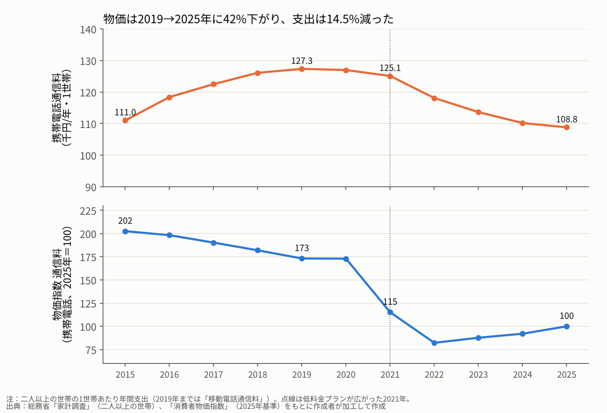
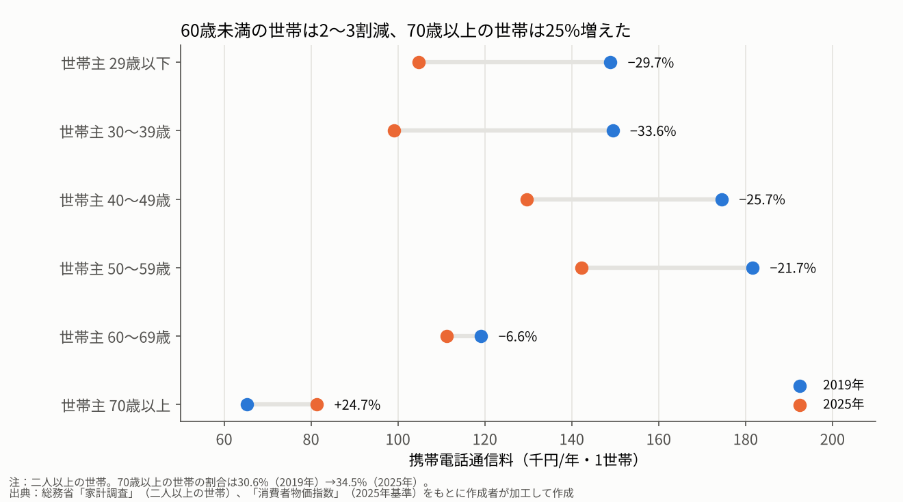
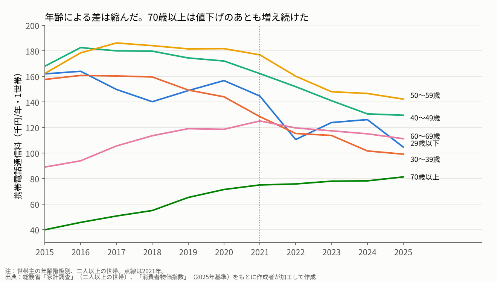
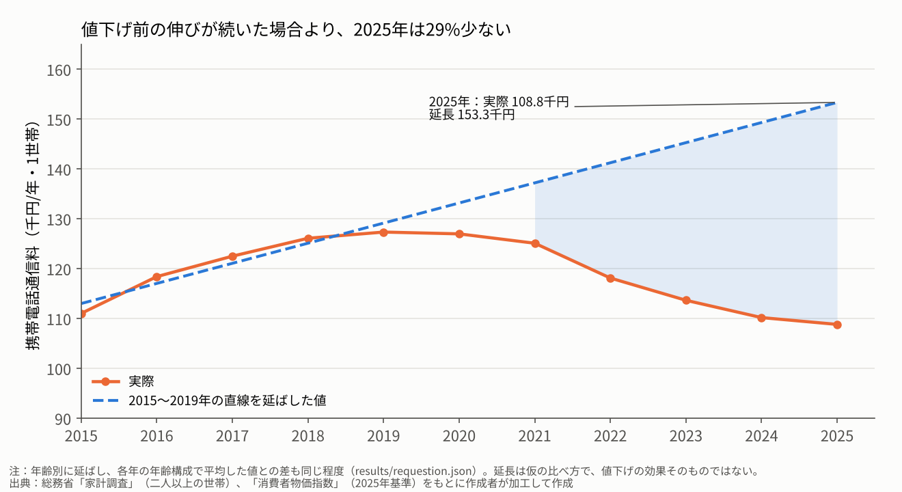

# F483 家計の携帯電話の通信料は、料金の値下げのあとどれだけ減ったのか？ 2019→2025年に1世帯12.7万円→10.9万円（−14.5%）。60歳未満は2〜3割減、70歳以上は25%増

## 結論（先に）
- 二人以上の世帯の携帯電話通信料（1世帯あたり年間）は、2019年の127,336円から2025年の108,814円へ、18,522円（14.5%）減りました。消費支出に占める割合は3.62%から2.89%になりました。
- 同じ期間に、消費者物価指数の「通信料（携帯電話）」は42.2%下がりました（暦年の年平均どうし）。物価ほどには支出は減っていません。物価で割った「実質」の値は47.9%増えています。
- 年齢で大きく違いました。世帯主が30〜39歳の世帯は −33.6%、29歳以下 −29.7%、40〜49歳 −25.7%、50〜59歳 −21.7% と大きく減った一方、60〜69歳は −6.6%、70歳以上は +24.7%（65,268円→81,366円）と増えました。
- 平均の減少（−18,522円）のうち91.3%は、各年齢の中での変化で説明できました。高齢の世帯が増えた（年齢構成の変化）分は −1,614円と小さいです。
- 結果を見てから足した問い直しでは、2015〜2019年の伸び（年4,034円）が続いていた場合と比べると、2025年の支出は約29%少ない値でした。

## 問い
2021年春に携帯電話の新しい低料金プランが広がり、消費者物価指数の「通信料（携帯電話）」は大きく下がりました。物価の側の効果は既存の F88 で扱っています。この記事では、家計が実際に払う額がどれだけ減ったのか、年齢によって違うのかを、家計調査で確かめます。家計の支出を分析する人、通信サービスにかかわる人のための記事です。

## データ（出典）
- 総務省「家計調査」年報 第4-6表（二人以上の世帯、世帯主の年齢階級別、品目分類）2015〜2025年：携帯電話通信料（2019年までの名前は「移動電話通信料」）、固定電話通信料、消費支出、世帯数分布。11ファイル。
- 総務省「家計調査」長期時系列 表1-2（二人以上の世帯）・表6（単身世帯）：中分類「通信」（2000〜2025年）。
- 総務省「消費者物価指数」2025年基準 品目別（暦年の年平均。家計調査と同じ1〜12月の平均）：通信料（携帯電話）、総合。
- 端末（「移動電話」の品目）は含めていません。合計7.0MB を data/raw に同梱しました。

## 事前の計画
[PLAN.md](PLAN.md)（2026-11-16 13:06）。この記事は予備の題材 R12 に替えたものです（元の問いは工業用水の回収率。REPLACED.md 参照）。表を読み込むスクリプトの確かめのときに、年齢別の支出額と物価の値を一度表示してしまったため、「いくら減ったか」「どの年齢で増えたか」は仮説にせず、まだ計算していない2つだけを仮説にしました。

| 仮説 | 外れの基準 | 結果 | 判定 |
|---|---|---|---|
| H1 平均の変化の80%以上は年齢の中での変化 | 80%未満 | 91.3% | 支持 |
| H2 支出を物価で説明する回帰の係数は0より大きく1より小さい | 1以上、または0以下 | 0.107（標準誤差0.116） | 支持（ただし0と区別できない） |

H2 は基準の上では支持ですが、係数は標準誤差より小さく0と区別できず、「物価が下がっても支出は物価ほど動かない」という弱い意味にとどまります。11年分しかなく、精度は低いです。

## やったこと
1. 11年分の第4-6表から、年齢別の携帯電話通信料・固定電話通信料・消費支出・世帯数分布を抜き出しました。見出しの「支出金額」の列で位置を決めています（02_build.py）。
2. 平均と年齢別の変化、消費支出に占める割合、物価で割った実質の値、年齢構成による分解、物価との回帰を出しました（03_analysis.py）。
3. 結果を見てから、値下げ前の伸びを延ばした値と比べました（03b_requestion.py）。

## 分かったこと

### 1. 物価は4割下がり、支出は1割半減った（図1）

支出は2019年がいちばん多く、2021年はまだ125,093円でした。2022年以降に減りが大きくなっています。物価（暦年の年平均）は、2020年172.9→2021年115.2→2022年82.2と、2021年と2022年の2年をかけて下がりました。2021年春からの値下げが、暦年の平均では2つの年にまたがって表れるためです。支出は、物価が33%下がった2021年もまだ125,093円で、その後にゆっくり減りました。安いプランへの乗り換えが少しずつ進んだためと考えられます（推測）。

### 2. 60歳未満は減り、70歳以上は増えた（図2）

2019年に最も多かった50〜59歳（181,605円）は142,277円に、30〜39歳は149,412円から99,187円になりました。70歳以上の世帯は65,268円から81,366円に増えています。物価で割った実質では、70歳以上は2倍を超えました（+115.8%）。

### 3. 年齢による差は縮んだ（図3）

2019年は最も多い年齢と最も少ない年齢の差が116,337円ありましたが、2025年は60,911円です。70歳以上の世帯は2015年から一貫して増え続けていて、値下げのあとも止まっていません。

## 問い直し（結果を見てから足した）

### 値下げ前の伸びが続いていたら、2025年はいくらだったか（図4）

支出が物価ほど減らなかったので、もともと伸びていた分を考えるため、2015〜2019年の直線を2025年まで延ばして比べました。

- 平均の直線を延ばすと、2025年は153,338円です。実際（108,814円）はその約29%下でした。年齢別に延ばし、各年の年齢構成で平均した値（153,142円）と比べても −28.9% で同じです。
- 年齢別に見ると、延ばした値より少ないのは30〜69歳で30〜34%、70歳以上で18%、29歳以下で7%でした。70歳以上も、増えてはいるものの、それまでの伸びほどではありません。
- この比べ方は、値下げがなければ伸びが続いたという仮の前提に立っています。値下げの効果の大きさそのものではありません。

## 頑健性

| 確かめ方 | 平均の変化 | 年齢の中での変化の割合 | 39歳以下 | 70歳以上 | 「通信」二人以上 | 「通信」単身 |
|---|---|---|---|---|---|---|
| 本線：2019→2025年 | −14.5% | 91.3% | −31.6% | +24.7% | −14.2% | −5.6% |
| 3年平均：2017〜19年→2023〜25年 | −11.5% | 88.0% | −26.3% | +38.9% | −11.5% | −4.4% |
| 起点を2020年に | −14.3% | 97.6% | −32.2% | +13.8% | −13.4% | −12.0% |

| 回帰のモデル | 物価の係数 | 標準誤差 |
|---|---|---|
| 本線：物価＋時間の傾き | 0.107 | 0.116 |
| 時間の傾きなし | 0.077 | 0.046 |
| 相対価格（携帯÷総合）＋傾き | 0.149 | 0.117 |

- 年齢の中での変化が大半を説明すること（H1）と、若い世帯で大きく減り70歳以上で増えたことは、比べ方を変えても同じでした。
- 物価の係数はどのモデルでも0.08〜0.15で、1よりずっと小さく、支出は物価の動きにあまり連動していません。
- 単身世帯は品目の細かい表がないため、中分類「通信」（固定電話・郵便なども含む）で比べました。2019→2025年では単身世帯の方が減り方が小さいですが、起点を2020年にすると差は小さくなります。

## 言えないこと
- 1世帯あたりの支出で、1人あたりや契約1件あたりではありません。高齢の世帯で増えたのが、契約数の増加なのかプランの違いなのかは分かりません。
- 値下げで浮いたお金がほかの何に使われたかは言えません。
- 物価との回帰は11年分しかなく、因果ではありません。
- 単身世帯の携帯電話通信料だけの値は、使った表にはありません。
- 家計調査は標本調査で、年齢階級別の値は年ごとの振れがあります（29歳以下は世帯数が少なく、振れが大きい）。

## 仕事で使うなら
- 携帯電話の料金の値下げの家計への影響を読むときは、平均の減少（−14.5%）の裏で、若い世帯は2〜3割減り、高齢の世帯は増えている、という年齢の違いを前提にすると読み違えにくいです。
- 年齢別の値は results/mobile_by_age.csv、実質の値は results/mobile_real_by_age.csv にあります。

## 計画からの変更
- 計画を書く前に年齢別の値を見てしまったため、仮説は2つ（分解と回帰）にしぼりました。計画どおりの記述として、年齢別の変化を示しています。
- 問い直しは計画の候補（値下げ前の伸びの延長）を選びました。

## 再現のしかた
```
sh src/run_all.sh        # オフライン。所要約6秒
python3 src/01_fetch.py  # 元データを取り直すときだけ（ネットを使う）
```

| ファイル | 中身 |
|---|---|
| src/02_build.py | 年齢別の表・長期時系列・物価から data/kakei_age.csv・kakei_long_comm.csv・cpi.csv を作る |
| src/03_analysis.py | 変化・割合・実質・分解・回帰・仮説・頑健性 → results/main.json ほか |
| src/03b_requestion.py | 問い直し（伸びの延長との比較） → results/requestion.json・requestion_trend.csv |
| src/04_figures.py | 図4枚 |

repro_check：/tmp/rep_F483 に写して流し、17ファイル（results 10、figures 4、data 3）がすべて cmp で一致、所要6秒（results/repro_check.txt）。乱数は使っていません。2026-11-18 の訂正のあとも、同じ手順で流し直して一致しました。

## 関連する記事
- F88「携帯料金の値下げは、物価をどれだけ下げたか？」：消費者物価指数で値下げの段差を測った記事。本記事は、家計が払う額と年齢による違いを見た点が違います。

## レビューで直したこと

独立レビュー（2026-11-17）で数字の照合・再実行・図を確かめ、直すところはなかった。

公開後の点検（2026-11-18）で、次を直しました。

| # | 指摘 | 直し方 |
|---|---|---|
| 1 | 消費者物価指数の表（statInfId=000040482959、品目別価格指数）は**年度平均**（4月〜翌3月）の表で（2025年の総合が100.4）、暦年の家計調査と並べるのに「年平均」として使っていた。そのため、2021年4月からの値下げが年度2021年にまとめて入り、「物価は2021年に一度に下がった（2020年174.0→2021年92.0）」と書いていた | 暦年の年平均の表（statInfId=000040482831、2025年の総合が100.0。行・列の並びは同じ）に取り直し、`01_fetch.py`・`SOURCES.md` を直して流し直した。携帯電話の通信料の物価 −40.1% → −42.2%、実質 +42.6% → +47.9%、70歳以上の実質 +108.0% → +115.8%、回帰の係数 0.034（標準誤差 0.111）→ 0.107（0.116）、ほかのモデル 0.062 → 0.077・0.067 → 0.149。図1の物価の節は、暦年では2020年172.9 → 2021年115.2 → 2022年82.2と2年かけて下がったことに書き直した。題名（家計調査だけの数字）、H1・H2 の判定と結論は変わらない |

## 出典
- 総務省統計局「家計調査（家計収支編）」：https://www.e-stat.go.jp/stat-search/files?toukei=00200561
- 総務省統計局「消費者物価指数」（品目別価格指数の暦年の年平均 statInfId=000040482831）：https://www.e-stat.go.jp/stat-search/files?toukei=00200573 （ファイルの URL は data/raw/SOURCES.md）

（いずれも 総務省「家計調査」「消費者物価指数」をもとに作成者が加工して作成）
