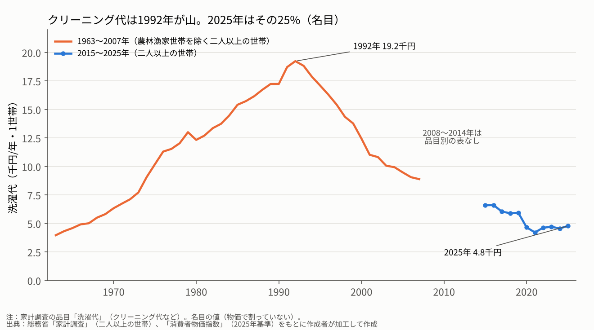
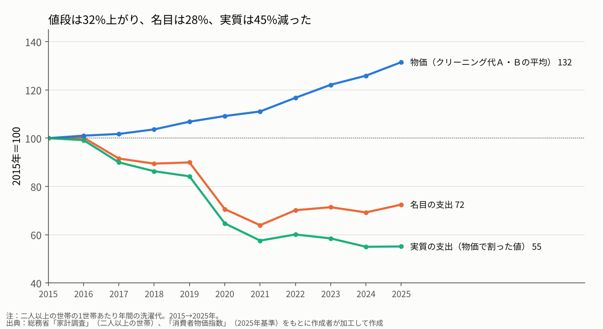
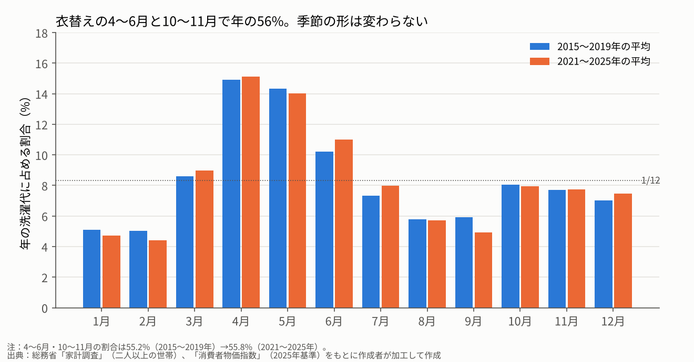
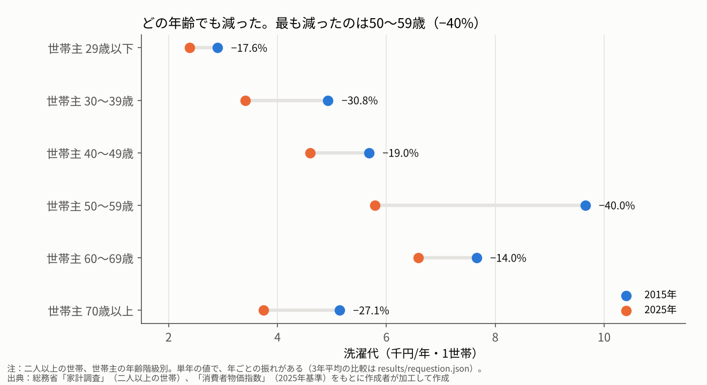

# F484 クリーニング代の支出は、どれだけ減ったのか？ 1世帯あたりは1992年の1.9万円が山で、2025年は4,784円（山の25%）。2015年からは値段が32%上がるなか、名目で28%、実質で45%減った

## 結論（先に）
- 家計調査の「洗濯代」（クリーニング代など）は、1963〜2007年の系列で1992年の19,243円（1世帯あたり年間）が最も多い年でした。2025年は4,784円で、その25%です。
- 2015年から2025年では、6,600円から4,784円へ27.5%減りました。同じ期間にクリーニング代の値段（消費者物価指数のクリーニング代Ａ・Ｂの平均）は31.5%上がっていて、値段で割った「実質」では44.9%減りました。
- 物価で割った実質の値（2025年の値段で表した値）は、1970年の29,415円から1992年の29,222円までほぼ横ばいで、その後に下がりました。2025年は4,737円で、1992年の16%です。
- 季節の形は変わっていません。衣替えの4〜6月と10〜11月の5か月で、年の55.2%（2015〜2019年）、55.8%（2021〜2025年）を占めます。いちばん多い月はどちらも4月です。
- 結果を見てから足した問い直しでは、どの年齢の世帯でも減っていて、2015→2025年で最も減ったのは世帯主が50〜59歳の世帯（−40.0%）、最も少なかったのは60〜69歳（−14.0%）でした。

## 問い
スーツを着る人が減った、家で洗える服が増えた、とよく言われます。では、家計がクリーニングに払う額は、いつがいちばん多く、いまはどれくらいなのか。値段の変化を除くとどうか。季節（衣替え）や年齢でどう違うのかを、家計調査で確かめます。家計の支出を分析する人、生活関連サービスにかかわる人のための記事です。

## データ（出典）
- 総務省「家計調査」長期時系列 表20-3-a：二人以上の世帯のうち農林漁家世帯を除く世帯、1963〜2007年の年間の品目別支出。品目「洗濯代」。
- 総務省「家計調査」月別の品目別支出（二人以上の世帯、2015〜2025年）：洗濯代、消費支出。年の値は月の和です（年報の値との差は最大1円）。
- 総務省「家計調査」年報 第4-6表（世帯主の年齢階級別、2015〜2025年）。
- 総務省「消費者物価指数」2025年基準 品目別（年平均、1970年から）：クリーニング代Ａ・Ｂ。
- 2008〜2014年は品目別の表を使っていないため空白です。1963〜2007年は農林漁家を除く世帯で、2015年以降とは対象が少し違います。合計8.2MB を data/raw に同梱しました。

## 事前の計画
[PLAN.md](PLAN.md)（2026-11-16 13:13、集計の前に作成）。この記事は予備の題材 R24 に替えたものです（元の問いは電気の CO2 排出係数。REPLACED.md 参照）。下見では、月別の表の洗濯代の先頭の数か月分が目に入っていました。

| 仮説 | 外れの基準 | 結果 | 判定 |
|---|---|---|---|
| H1 1963〜2007年で最も多い年は1990年代 | それ以外の年 | 1992年 | 支持 |
| H2 2015→2025年で名目20%以上の減少 | 20%未満の減少、または増加 | −27.5% | 支持 |
| H3 実質の減少は名目より大きい | 実質の減少が名目以下 | 名目 −27.5%、実質 −44.9% | 支持 |
| H4 4〜6月・10〜11月で50%以上、その割合は3ポイント以上は下がっていない | 50%未満、または3ポイント以上の低下 | 55.2%→55.8% | 支持 |

## やったこと
1. 月別の表・長期時系列・年齢別の表・物価から、洗濯代の表を作りました（02_build.py）。
2. 長期の山、2015→2025年の名目と実質の変化、月ごとの割合を出し、仮説を判定しました（03_analysis.py）。
3. 結果を見てから、年齢別の変化を見ました（03b_requestion.py）。

## 分かったこと

### 1. 1992年が山（図1）

名目の洗濯代は1963年の3,971円から1992年の19,243円まで増え、2007年は8,890円でした。2015年以降は4,000〜6,600円台です。消費支出に占める割合は、2015年0.191%、2025年0.127%でした。

### 2. 値段は上がり、利用は大きく減った（図2）

2015年を100とすると、2025年は値段が132、名目の支出が72、実質の支出が55です。2020年に名目で前年の5,937円から4,660円へ大きく減り、その後も2019年の水準には戻っていません。物価で割った長い系列では、1970〜1992年は2.9万円前後で横ばいで、名目の増加の多くは値段の上昇によるものでした。

### 3. 季節の形は変わらない（図3）

4月と5月がそれぞれ年の14〜15%、6月が10〜11%です。1〜2月や8〜9月は4〜6%です。支出の水準は下がっても、衣替えの時期に出す使い方は変わっていません。

## 問い直し（結果を見てから足した）

### どの年齢の世帯で減ったのか（図4）

全体で3割近く減ったので、どの年齢の世帯で減ったのかを確かめました。

| 世帯主の年齢 | 2015年 | 2025年 | 変化 | 3年平均での変化 |
|---|---|---|---|---|
| 29歳以下 | 2,897円 | 2,388円 | −17.6% | −20.4% |
| 30〜39歳 | 4,928円 | 3,412円 | −30.8% | −30.6% |
| 40〜49歳 | 5,679円 | 4,602円 | −19.0% | −21.6% |
| 50〜59歳 | 9,652円 | 5,790円 | −40.0% | −34.7% |
| 60〜69歳 | 7,657円 | 6,588円 | −14.0% | −17.0% |
| 70歳以上 | 5,138円 | 3,748円 | −27.1% | −27.9% |

- どの年齢でも減っていました。最も多く使っていた50〜59歳の世帯の減り方が最も大きく、2025年に最も多いのは60〜69歳の世帯になりました。
- 3年平均（2015〜17年→2023〜25年）で比べても、順番はほぼ同じです。
- 50代の減り方が大きい理由（働き方、服装の変化など）は、この表からは分かりません（推測しません）。

## 頑健性

| 確かめ方 | 名目の変化 | 実質の変化 | 4〜6月・10〜11月の割合（前→後） |
|---|---|---|---|
| 本線：月別の和、2015→2025年、物価はＡ・Ｂの平均 | −27.5% | −44.9% | 55.2%→55.8% |
| 年報（第4-6表の平均）で見る | −27.5% | −44.9% | — |
| 3年平均：2015〜17年→2023〜25年 | −27.0% | −41.7% | — |
| 物価はクリーニング代Ａだけ | −27.5% | −42.8% | — |
| 物価はクリーニング代Ｂだけ | −27.5% | −46.9% | — |
| 季節：後の期間に2020年を含める | — | — | 55.2%→55.7% |
| 季節：2016〜2019年→2022〜2025年 | — | — | 55.4%→56.0% |

どの確かめ方でも、名目で3割近く、実質で4〜5割の減少、季節の割合はほぼ同じでした。

## 言えないこと
- 減った理由（服の素材の変化、在宅勤務、家庭の洗濯機の性能、コインランドリーの利用）は、この表では分けられません。コインランドリーの代金がどの品目に入るかも、ここでは確かめていません。
- 1963〜2007年と2015年以降は対象の世帯が少し違い、2008〜2014年はつながっていません。
- 単身世帯は扱っていません。
- クリーニング店の売上や店の数は扱っていません（施設の数は既存の jodn 172 が扱っています）。
- 年齢階級別の値は標本調査で、年ごとの振れがあります。

## 仕事で使うなら
- クリーニングの需要を読むときは、名目の支出（−28%）と、値段の上昇を除いた実質（−45%）の差を分けて見ると読み違えにくいです。季節の割合はほぼ一定です。
- 年の値は results/annual_2015_2025.csv・annual_1963_2007.csv、月の割合は results/monthly_share.csv にあります。

## 計画からの変更
- 頑健性の「2020年を除く」は、前後の期間がもともと2020年を含んでいなかったため、「後の期間に2020年を含める」に替えました。
- 計画になかった「実質の長い系列（1970〜2007年）」を、物価のデータが1970年からあったので足しました。

## 再現のしかた
```
sh src/run_all.sh        # オフライン。所要約5秒
python3 src/01_fetch.py  # 元データを取り直すときだけ（ネットを使う）
```

| ファイル | 中身 |
|---|---|
| src/02_build.py | 月別・長期・年齢別・物価 → data/laundry_monthly.csv・laundry_1963_2007.csv・laundry_age.csv・cpi.csv |
| src/03_analysis.py | 山・名目と実質・季節・仮説・頑健性 → results/main.json ほか |
| src/03b_requestion.py | 問い直し（年齢別） → results/requestion.json・requestion_by_age.csv・laundry_by_age.csv |
| src/04_figures.py | 図4枚 |

repro_check：/tmp/rep_F484 に写して流し、16ファイル（results 8、figures 4、data 4）がすべて cmp で一致、所要5秒（results/repro_check.txt）。乱数は使っていません。

## レビューで直したこと

独立レビュー（2026-11-17）で数字の照合・再実行・図を確かめ、直すところはなかった。

## 出典
- 総務省統計局「家計調査（家計収支編）」：https://www.e-stat.go.jp/stat-search/files?toukei=00200561
- 総務省統計局「消費者物価指数」：https://www.e-stat.go.jp/stat-search/files?toukei=00200573 （ファイルの URL は data/raw/SOURCES.md）

（いずれも 総務省「家計調査」「消費者物価指数」をもとに作成者が加工して作成）
