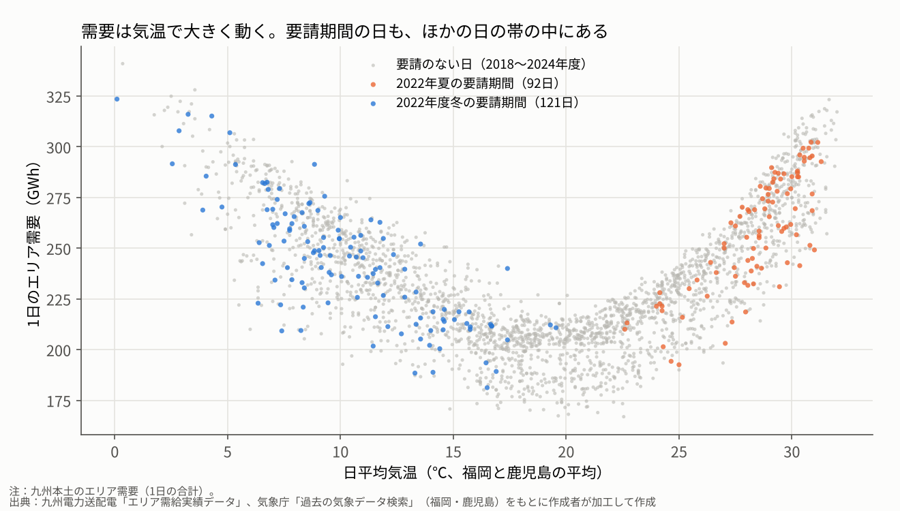
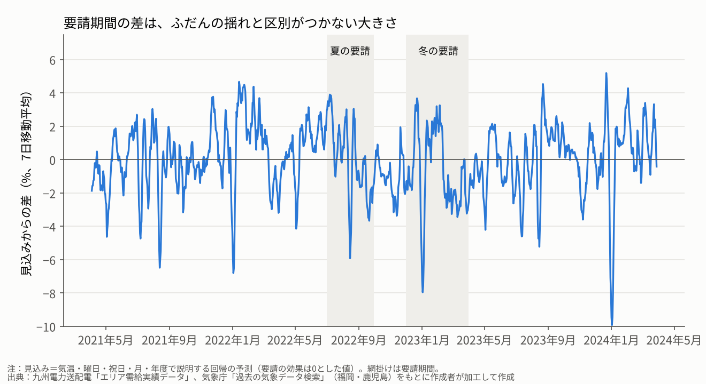
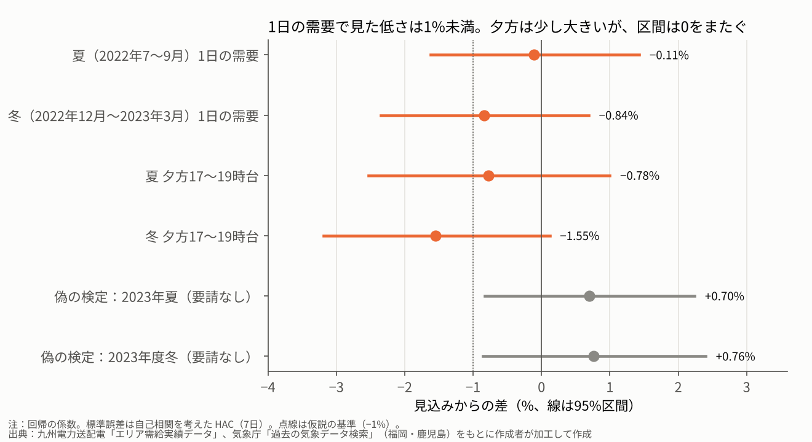
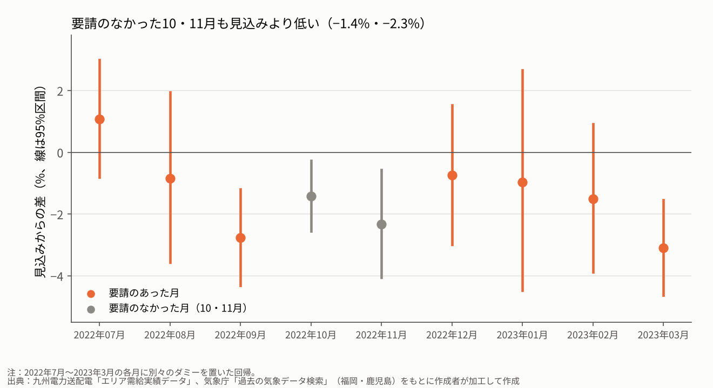

# F485 節電の要請で、電力の需要はどれだけ下がったのか？ 九州では、2022年夏は見込みより0.1%、冬は0.8%低いだけで、ふだんの揺れと区別できなかった。夕方の冬は−1.6%（区間は0をまたぐ）

## 結論（先に）
- 政府は2022年度に、数値目標を設けない節電の協力を、夏（2022年7月1日〜9月30日）と冬（2022年12月1日〜2023年3月31日）に呼びかけました。九州エリアの1日の需要を、気温・曜日・祝日・月・年度で見込んだ値と比べると、夏は −0.11%（95%区間 −1.62〜+1.43%）、冬は −0.84%（−2.35〜+0.69%）でした。どちらも「1%以上低い」という仮説には届かず、0と区別できません。
- 夕方（17〜19時台）の需要で見ると、夏 −0.78%、冬 −1.55% と、1日の合計より低さは大きくなりました。ただし区間はどちらも0をまたいでいます。
- 要請のなかった翌年の同じ月を「要請あり」とみなした偽の検定では、2023年夏 +0.70%、2023年度冬 +0.76% で、±1%の中に収まりました。
- 結果を見てから月ごとに分けると、要請のなかった2022年10月（−1.42%）と11月（−2.33%）も見込みより低く、要請のあった月だけが低いわけではありませんでした。この時期の低さは、要請だけでなく電気料金の上昇などとも重なっていると考えられます（推測）。

## 問い
電気が足りなくなりそうなとき、政府は節電を呼びかけます。2022年度は、夏と冬に数値目標を設けない「無理のない範囲での節電の協力」が呼びかけられました。数値目標のない呼びかけで、需要は実際にどれだけ下がったのか。電力の需給や省エネにかかわる人に向けて、九州エリアの実績と気温で確かめます。

## データ（出典）
- 九州電力送配電「エリア需給実績データ」（九州本土）の1時間ごとのエリア需要（地域全体の電気の使用量）。2018年4月〜2025年3月（2,557日）。2024年度は30分値を1時間に足しました。
- 気象庁「過去の気象データ検索」福岡・鹿児島の日平均気温（日ごとの値のページから抜き出し）。
- 内閣府「国民の祝日」CSV。
- 要請の期間と数値目標なしの点は、広島県の案内ページと、九州経済産業局が掲載した「2022年度冬季の電力需給対策」（電力需給に関する検討会合）で確かめました。
- 九州にしぼったのは、F479 と同じ形式の1時間値が長く取れるためです。合計4.9MB を data/raw に同梱しました。

## 事前の計画
[PLAN.md](PLAN.md)（2026-11-16 13:27、集計の前に作成）。下見では気象庁のページの形を確かめるため福岡の数日分を見ただけで、需要の値は見ていません。

| 仮説 | 外れの基準 | 結果 | 判定 |
|---|---|---|---|
| H1 夏の要請期間は見込みより1%以上低い | 1%未満の低さ、または高い | −0.11% | 外れ |
| H2 冬の要請期間も1%以上低い | 同上 | −0.84% | 外れ |
| H3 夕方の低さは1日の合計より大きい | 同じか小さい | 夏 −0.78%、冬 −1.55% | 支持 |
| H4 要請のない翌年の同じ月（偽の検定）は ±1% の中 | ±1% を超える | +0.70%、+0.76% | 支持 |

## やったこと
1. 1時間値を日ごとの合計と夕方（17〜19時台）の合計にし、気温と休日の印を付けました（02_build.py）。
2. 日ごとの需要の対数を、気温の1℃刻みの区分、曜日・祝日・年末年始、月、年度の固定効果と、要請期間の印で説明する回帰（OLS、自己相関を考えた HAC 標準誤差）をしました。要請期間の係数が「見込みからの差」です（03_analysis.py）。年度の固定効果があるので、2022年度の4〜6月・10〜11月との比較と、ほかの年の同じ月との比較で差が測られます。
3. 結果を見てから、月ごとに分けました（03b_requestion.py）。

## 分かったこと

### 1. 需要は気温で大きく動く（図1）

1日の需要は、日平均気温が18〜22℃あたりで最も小さく、暑い日・寒い日ほど大きくなります。要請期間の日（夏92日、冬121日）も、ほかの日の帯の中にあります。モデルの決定係数は0.934で、日ごとの需要の大部分は気温と暦で説明できます。

### 2. 要請期間の差は、ふだんの揺れの中（図2）

見込みからの差（7日移動平均）は、要請のない時期でも ±4% ほど揺れています。要請期間の差は、この揺れと見分けがつく大きさではありませんでした。

### 3. 推定値の比べ（図3）

1日の需要では夏 −0.11%、冬 −0.84%。夕方では夏 −0.78%、冬 −1.55% です。偽の検定（2023年）は +0.7% 前後でした。95%区間から言えるのは、「要請期間の1日の需要が見込みより2.4%以上低かった、ということはなさそうだ」という程度です。

## 問い直し（結果を見てから足した）

### 月ごとに見ると（図4）

期間全体の平均では差が小さかったので、要請の始めと終わりで違うかを、2022年7月〜2023年3月の各月に別々の印を置いて確かめました。

| 月 | 要請 | 見込みからの差 | 95%区間 |
|---|---|---|---|
| 2022年7月 | あり | +1.07% | −0.81〜+2.99 |
| 2022年8月 | あり | −0.85% | −3.57〜+1.95 |
| 2022年9月 | あり | −2.77% | −4.32〜−1.19 |
| 2022年10月 | なし | −1.42% | −2.56〜−0.27 |
| 2022年11月 | なし | −2.33% | −4.06〜−0.57 |
| 2022年12月 | あり | −0.75% | −2.99〜+1.53 |
| 2023年1月 | あり | −0.97% | −4.47〜+2.66 |
| 2023年2月 | あり | −1.51% | −3.88〜+0.91 |
| 2023年3月 | あり | −3.09% | −4.63〜−1.54 |

- 要請のあった7か月のうち、−1%以下は3か月、区間が0をまたがないのは9月と3月の2か月でした。
- 要請のなかった10・11月も見込みより低く、区間は0をまたぎません。「要請のある月だけ低い」という形ではなく、2022年の秋から全体に低めだったと読めます。
- この時期は電気料金が大きく上がった時期と重なります。料金と要請の影響を、このデータで分けることはできません。

## 頑健性

| 確かめ方 | 夏 | 区間 | 冬 | 区間 |
|---|---|---|---|---|
| 本線：気温は福岡・鹿児島の平均（1℃刻み）、年度の固定効果 | −0.11% | −1.62〜+1.43 | −0.84% | −2.35〜+0.69 |
| 気温は福岡だけ | +0.89% | −0.68〜+2.49 | −0.66% | −2.05〜+0.75 |
| 2020年度を除く | +0.12% | −1.40〜+1.68 | −0.49% | −2.02〜+1.06 |
| 平日だけ | +0.39% | −1.17〜+1.98 | −1.01% | −2.50〜+0.50 |
| 気温は3次の式 | +0.42% | −1.18〜+2.04 | −0.73% | −2.32〜+0.89 |
| 年度の固定効果の代わりに直線の傾き | −0.93% | −2.28〜+0.44 | −1.66% | −2.97〜−0.32 |

- 夏はどの確かめ方でも ±1% の中でした。
- 冬は −0.5〜−1.7% で、年度の固定効果を外して直線の傾きにしたときだけ区間が0をまたぎませんでした。年度ごとの水準の違いをどう扱うかで、冬の答えは少し動きます。

## 言えないこと
- 要請期間の低さ（あったとしても）が「要請のおかげ」かは言えません。2022年は電気料金が大きく上がった年で、値上がりによる節約と分けられません。
- 九州エリア以外のことは言えません。
- 屋根の太陽光の自家消費が増えると、エリア需要は見かけ上下がります。年度の固定効果で一部は吸収していますが、完全ではありません。
- 気温以外の天気（日照、湿度）は入れていません。
- 年度の固定効果があるため、要請期間の差は「同じ年度のほかの月」との比較を含みます。その年度のほかの月にも節約が広がっていれば、差は小さく出ます。

## 仕事で使うなら
- 数値目標のない節電の呼びかけの効果を見込むときは、九州の2022年度では1日の需要で見て1%前後かそれ以下の大きさだった、という目安になります。料金の変化と重なる時期は、分けて考える必要があります。
- 日ごとの見込みと実際は results/daily_fit.csv にあります。

## 計画からの変更
- 計画どおりに進めました。問い直しは計画の候補（月ごとの差）を選びました。

## 再現のしかた
```
sh src/run_all.sh        # オフライン。所要約5秒
python3 src/01_fetch.py  # 元データを取り直すときだけ（ネットを使う）
```

| ファイル | 中身 |
|---|---|
| src/02_build.py | 需要（1時間値）と気温から data/daily.csv を作る |
| src/03_analysis.py | 回帰・偽の検定・頑健性 → results/main.json・daily_fit.csv・robustness.csv |
| src/03b_requestion.py | 問い直し（月ごと） → results/requestion.json・requestion_by_month.csv |
| src/04_figures.py | 図4枚 |

repro_check：/tmp/rep_F485 に写して流し、10ファイル（results 5、figures 4、data 1）がすべて cmp で一致、所要5秒（results/repro_check.txt）。乱数は使っていません。

## 関連する記事
- F479「太陽光の発電を止める『出力制御』は、どの季節・時間に増えたのか？」：同じ九州のエリア需給実績データを使った記事。

## レビューで直したこと

独立レビュー（2026-11-17）で、数字の照合・再実行・図を確かめ、次を直しました。直したあとに /tmp の新しいフォルダで流し直し、results と figures がすべて一致することを確かめています。

| # | 指摘 | 直し方 |
|---|---|---|
| 1 | 題名の「夕方の冬は−1.6%」は95%区間が0をまたぐ（−3.2〜+0.1%）のに、題名ではそれが分からず、はっきり下がったように読めた | 題名に「（区間は0をまたぐ）」を足した（README・note・status） |

## 出典
- 九州電力送配電「エリア需給実績データ」：https://www.kyuden.co.jp/td_area_jukyu/jukyu.html
- 気象庁「過去の気象データ検索」：https://www.data.jma.go.jp/stats/etrn/index.php
- 内閣府「国民の祝日について」：https://www8.cao.go.jp/chosei/shukujitsu/syukujitsu.csv
- 広島県「夏季の電力需給対策（節電）について」：https://www.pref.hiroshima.lg.jp/soshiki/45/dennryokuzyukyuu.html 、「冬季の節電」：https://www.pref.hiroshima.lg.jp/soshiki/45/fuyusetudenn.html
- 電力需給に関する検討会合「2022年度冬季の電力需給対策」（九州経済産業局掲載）：https://www.kyushu.meti.go.jp/seisaku/energy/oshirase/221222_1_9.pdf

（いずれも 九州電力送配電「エリア需給実績データ」、気象庁「過去の気象データ検索」をもとに作成者が加工して作成）
