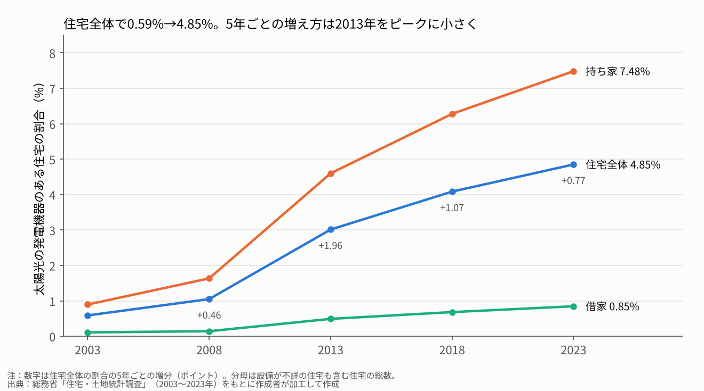
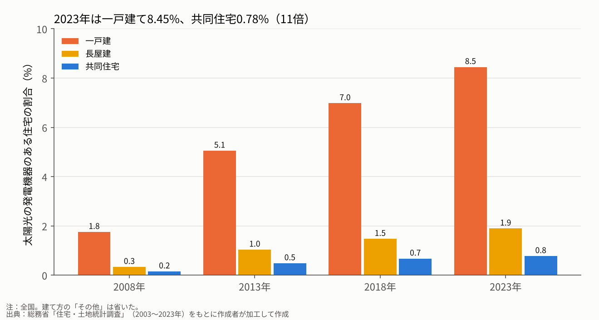
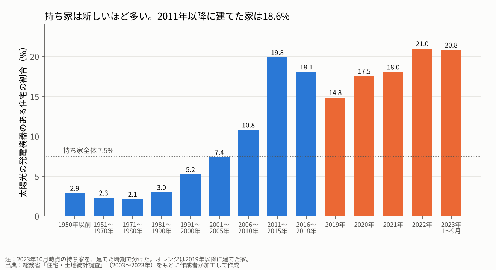
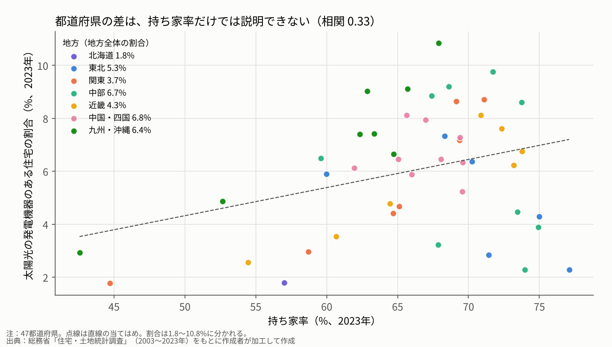

# F486 太陽光パネルのある家は、どこまで増えたのか？ 住宅全体で2003年0.59%→2023年4.85%（270万戸）。増え方は鈍り、2018→2023年の増加の98%は2019年以降に建った家

## 結論（先に）
- 住宅・土地統計調査で「太陽光を利用した発電機器」がある住宅は、2003年の27.6万戸（住宅全体の0.59%）から、2023年の270.0万戸（4.85%）に増えました。持ち家では7.48%、借家では0.85%です。
- 5年ごとの増え方（割合のポイント）は、+0.46（2003→2008年）、+1.96（→2013年）、+1.07（→2018年）、+0.77（→2023年）で、2008→2013年が最も大きく、その後は小さくなりました。
- 建て方で大きく違います。2023年は一戸建ての8.45%に対し、共同住宅は0.78%で、10.9倍の差です。
- 新しい家ほど多く、2023年の持ち家のうち2011年以降に建てた家では18.62%（持ち家全体の2.49倍）でした。
- 結果を見てから足した問い直しでは、2018→2023年に増えた51.0万戸のうち、2019年以降に建った住宅にある分が49.9万戸（97.8%）でした。既存の住宅で差し引き増えた分は1.1万戸にとどまり、増加はほぼ新築によるものでした。

## 問い
屋根の太陽光は、余った電気を決まった価格で買い取る制度（固定価格買取制度）のもとで広がり、その後は買い取りの価格が下がってきました。住宅のうち太陽光の発電機器がある家はどれだけ増えたのか、増え方は鈍ったのか、どんな家（一戸建て・新しい家・持ち家）に多いのか、地域でどう違うのかを確かめます。住宅や再生可能エネルギーにかかわる人のための記事です。

## データ（出典）
- 総務省「住宅・土地統計調査」令和5年 時系列統計表 第19表：所有の関係（総数・持ち家・借家）×省エネルギー設備等別の住宅数（2003〜2023年の5回、全国・都道府県）。
- 同 各回の全国の表：建て方×省エネルギー設備等（2008・2013・2018・2023年）。
- 同 令和5年 基本集計：所有の関係×建築の時期×省エネルギー設備等（全国）。
- 割合＝「あり」÷住宅の総数（設備が不詳の住宅も分母に含む。公表の割合と同じ）。合計1.8MB を data/raw に同梱しました。

## 事前の計画
[PLAN.md](PLAN.md)（2026-11-16 13:33、集計の前に作成）。既存の jodn 304 の README にあった全国の始まりと終わりの割合（0.6%→4.9%）は知っていたので、仮説はそれ以外に置きました。計画を書いたあと、列の位置を確かめるときに2023年の建て方別の値が目に入りました（仮説は先に決めていた）。

| 仮説 | 外れの基準 | 結果 | 判定 |
|---|---|---|---|
| H1 2018→2023年の増え方は2013→2018年より小さい | 同じか大きい | +0.77 と +1.07 ポイント | 支持 |
| H2 2023年の一戸建ての割合は共同住宅の10倍以上 | 10倍未満 | 10.9倍 | 支持 |
| H3 2011年以降に建てた持ち家の割合は持ち家全体の2倍以上 | 2倍未満 | 2.49倍（18.62%と7.48%） | 支持 |
| H4 都道府県の割合と持ち家率の相関は0.5以上 | 0.5未満 | 0.327 | 外れ |

## やったこと
1. 3種類の表から、年・地域・所有の関係、建て方、建築の時期ごとの「あり」と総数を抜き出しました（02_build.py）。
2. 割合と5年ごとの増分、建て方別・建築の時期別の割合、都道府県の割合と持ち家率の相関を出しました（03_analysis.py）。
3. 結果を見てから、2018→2023年の増加のうち新築の分を確かめました（03b_requestion.py）。

## 分かったこと

### 1. 増え方は2013年をピークに小さく（図1）

持ち家の割合は0.90%（2003年）→7.48%（2023年）、借家は0.11%→0.85%でした。戸数は2008年52.1万戸、2013年157.0万戸、2018年219.0万戸、2023年270.0万戸です。2008→2013年の5年で約105万戸増えたのに対し、2018→2023年は約51万戸でした。

### 2. 一戸建てに集中（図2）

一戸建ては1.76%（2008年）→8.45%（2023年）、長屋建ては0.34%→1.90%、共同住宅は0.16%→0.78%でした。共同住宅でも増えてはいますが、水準は一戸建ての1割ほどです。

### 3. 新しい家ほど多い（図3）

持ち家を建てた時期で分けると、1990年以前に建てた家は2〜3%、2006〜2010年は10.77%、2011〜2015年は19.84%でした。2019年に建てた家は14.82%といったん下がり、2022年・2023年（1〜9月）に建てた家は約21%です。

### 4. 都道府県の差は持ち家率だけでは説明できない（図4）

2023年の都道府県の割合は1.78〜10.84%に分かれます。持ち家率との相関は0.327（順位相関0.177）と弱く、持ち家率が高くても割合の低い県があります。地方全体の割合は、北から北海道1.8%、東北5.3%、関東3.7%、中部6.7%、近畿4.3%、中国・四国6.8%、九州・沖縄6.4%でした。北海道と、雪の多い県で低い傾向が見えますが、この記事では気候のデータと合わせていないので、理由は推測にとどまります。

## 問い直し（結果を見てから足した）

### 増えた分は、新しく建った家か（建築の時期で分ける）
H1 で増え方が鈍ったこと、H3 で新しい家ほど多いことが分かったので、2018→2023年の増加のうち、2019年以降に建った家の分を確かめました。2023年の調査で「2019年〜2023年9月に建った住宅のうち太陽光のある住宅」を、2018→2023年の増加数で割りました。

| | 2019年以降に建った家のうち太陽光あり | 2018→2023年の増加 | 増加に占める割合 | 既存の家の差し引き |
|---|---|---|---|---|
| 住宅全体 | 49.9万戸（新築の11.18%） | 51.0万戸 | 97.8% | +1.1万戸 |
| 持ち家 | 46.2万戸（17.68%） | 47.6万戸 | 97.0% | +1.4万戸 |
| 借家 | 3.8万戸（2.03%） | 3.5万戸 | 109.0% | −0.3万戸 |

- 増加のほぼすべてが新しく建った家の分でした。既存の家に後から付けた分と、取り壊し・取り外しで減った分が、ほぼ打ち消し合っています。
- 新築の数が減ると、太陽光のある家の増え方も小さくなる、という関係が読めます（新築の数の推移はこの記事では見ていないため、推測を含みます）。

## 頑健性

| 確かめ方 | 2008→13年 | 2013→18年 | 2018→23年 |
|---|---|---|---|
| 本線：住宅全体、分母に不詳を含む | +1.96 | +1.07 | +0.77 |
| 分母から設備の不詳を除く | +2.01 | +1.12 | +0.84 |
| 持ち家だけ | +2.96 | +1.68 | +1.21 |

| 都道府県の相関（H4） | 値 |
|---|---|
| 本線：2023年 ピアソン | 0.327 |
| 2023年 スピアマン | 0.177 |
| 2018年 ピアソン | 0.264 |

増え方が鈍ったこと（H1）は、分母や対象を変えても同じでした。持ち家率との相関はどの見方でも0.5に届きませんでした。

## 言えないこと
- 発電の容量や発電量は分かりません。「機器がある」かどうかだけです。
- 標本調査なので、都道府県の値には誤差があります。
- 増え方が鈍った理由（買い取り価格の低下、補助の変化、新築の減少）は分けられません。
- 既存の家に後から付けた数と、取り外した数は、それぞれは分かりません（差し引きだけ）。
- 都道府県の差の理由（日照、雪、住宅の形）は確かめていません。

## 仕事で使うなら
- 屋根の太陽光の広がりを見込むときは、新築にほぼ限られていて、既存の住宅への後付けは差し引きでわずかだった、という形を前提にすると読み違えにくいです。
- 都道府県・地方の値は results/prefectures.csv・regions.csv、建築の時期別は results/jiki_share.csv にあります。

## 計画からの変更
- 頑健性に「地方ごとの割合」を足しました（都道府県の差の形を見るため。順位は作らず北から南の順）。
- 問い直しは計画の候補のうち「増えた戸数」を、所有の関係でなく建築の時期で分ける形にしました。

## 再現のしかた
```
sh src/run_all.sh        # オフライン。所要約4秒
python3 src/01_fetch.py  # 元データを取り直すときだけ（ネットを使う）
```

| ファイル | 中身 |
|---|---|
| src/02_build.py | 3種類の表 → data/timeseries.csv・tatekata.csv・jiki.csv |
| src/03_analysis.py | 割合・増分・建て方・建築の時期・都道府県・仮説・頑健性 → results/main.json ほか |
| src/03b_requestion.py | 問い直し（新築の分） → results/requestion.json・requestion_new_builds.csv |
| src/04_figures.py | 図4枚 |

repro_check：/tmp/rep_F486 に写して流し、17ファイル（results 10、figures 4、data 3）がすべて cmp で一致、所要4秒（results/repro_check.txt）。乱数は使っていません。

## 関連する記事
- jodn 304「省エネの窓は、どれだけ広まったのか」：同じ第19表で二重窓の普及を見た記事。太陽光は一行の言及だけで、建て方・建築の時期・新築の分は扱っていません。

## レビューで直したこと

独立レビュー（2026-11-17）で数字の照合・再実行・図を確かめ、直すところはなかった。

## 出典
- 総務省統計局「住宅・土地統計調査」：https://www.e-stat.go.jp/stat-search/files?toukei=00200522 （ファイルの URL は data/raw/SOURCES.md）

（いずれも 総務省「住宅・土地統計調査」をもとに作成者が加工して作成）
