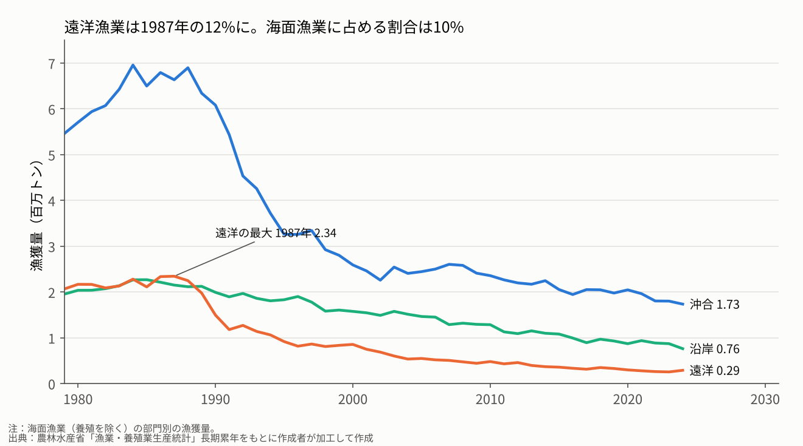
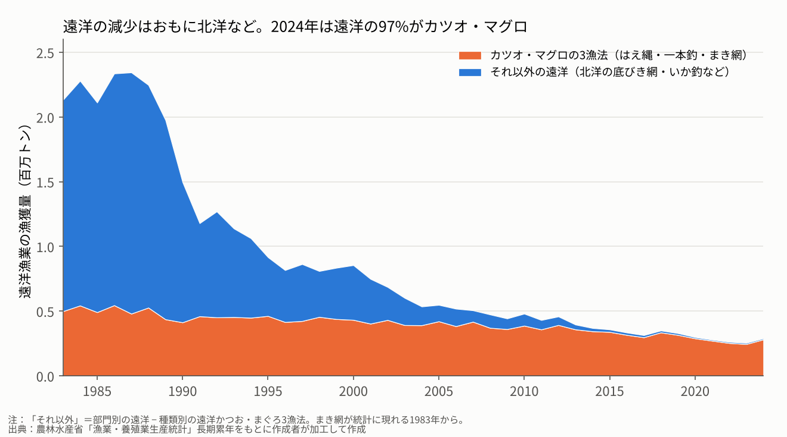
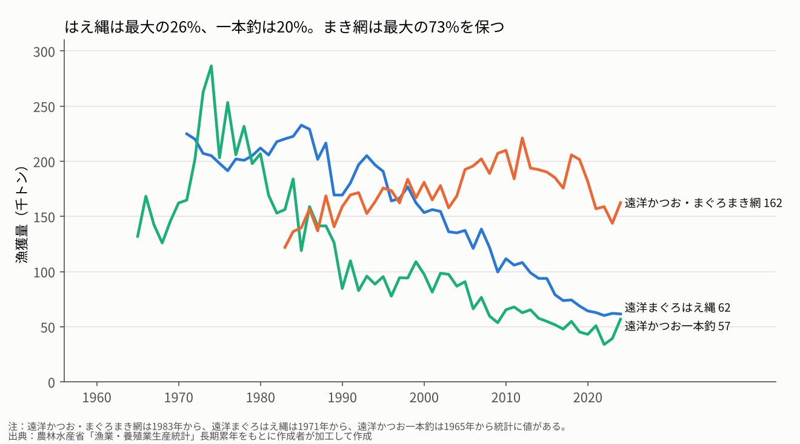
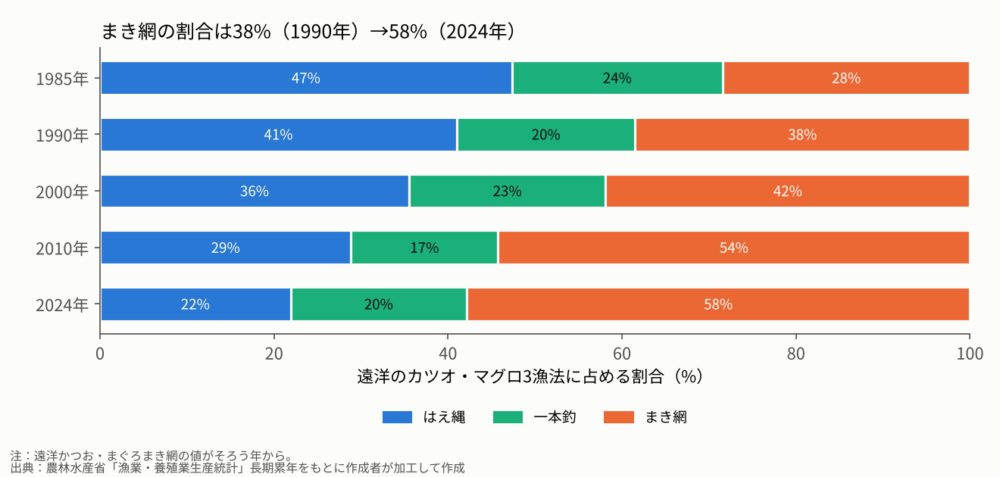

# F487 遠洋のカツオ・マグロ漁は、どこまで縮んだのか？ 遠洋漁業は1987年の12%に。ただしカツオ・マグロの3漁法は最大の52%で踏みとどまり、2024年は遠洋の97%を占めた

## 結論（先に）
- 遠洋漁業（遠い海で操業する漁業）の漁獲量は、1987年の234.4万トンが最大で、2024年は28.9万トン（最大の12.3%）でした。海面漁業（養殖を除く）に占める割合は、1979年の21.8%から2024年の10.4%に下がりました。
- 遠洋のカツオ・マグロの3漁法（まぐろはえ縄・かつお一本釣・かつお・まぐろまき網）の合計は、1986年の54.5万トンが最大で、2024年は28.1万トン（51.5%）でした。遠洋全体よりずっと小さな減り方です。
- 漁法では大きく違います。遠洋まぐろはえ縄は最大（1985年）の26.5%、遠洋かつお一本釣は最大（1974年）の19.8%まで減った一方、遠洋かつお・まぐろまき網は最大（2012年）の73.5%を保っています。3漁法に占めるまき網の割合は、1990年の38.5%から2024年の57.9%になりました。
- 結果を見てから足した問い直しでは、1987→2024年の遠洋の減少（−205.5万トン）のうち、カツオ・マグロの3漁法の分は9.7%だけで、残りは北洋の底びき網やいか釣などのそれ以外の遠洋でした。それ以外の遠洋は186.4万トンから0.85万トンになり、2024年の遠洋は97.1%がカツオ・マグロです。

## 問い
日本の漁獲量の減少は、さんまやいかの不漁として報じられることが多いですが、遠い海で操業する遠洋漁業は、各国が自国の沿岸から200海里の水域を設けた1970年代後半から縮んできたと言われます。遠洋漁業はどこまで縮み、その中でカツオ・マグロを取る漁はどうなったのか。どの漁法が残っているのかを確かめます。水産業や食品の流通にかかわる人のための記事です。

## データ（出典）
- 農林水産省「漁業・養殖業生産統計」長期累年（e-Stat）：
  - 総括表 漁業・養殖業部門別累年統計（1979〜2024年）：遠洋・沖合・沿岸の漁獲量。見出しは千トンですが、2003年以降の行はトンで載っているため、千トンにそろえました（総生産量が5万を超える行を1000で割る）。
  - 海面漁業種類別漁獲量累年統計（1956〜2024年）：遠洋・近海・沿岸のまぐろはえ縄、かつお一本釣、遠洋・近海のかつお・まぐろまき網。漁業種類ができる前の年の「-」は空欄としました。近海のまき網は2019年以降が空欄です。
  - 海面漁業魚種別漁獲量累年統計：まぐろ類・かつお（照合用）。
- 3つの Excel を data/raw に同梱しました（合計約150KB）。

## 事前の計画
[PLAN.md](PLAN.md)（2026-11-16 13:38、集計の前に作成）。この記事は予備の題材 R22 に替えたものです（元の問いは家庭の都市ガス。REPLACED.md 参照）。下見では表の見出しだけを見ました。

| 仮説 | 外れの基準 | 結果 | 判定 |
|---|---|---|---|
| H1 遠洋漁業は最大の年の15%以下 | 15%を超える | 12.3%（最大は1987年） | 支持 |
| H2 2024年、まき網が はえ縄＋一本釣 より多い | 合計以下 | 16.2万トン と 11.8万トン | 支持 |
| H3 遠洋まぐろはえ縄は最大の30%以下 | 30%を超える | 26.5% | 支持 |
| H4 海面漁業に占める遠洋は15%未満 | 15%以上 | 10.4% | 支持 |

## やったこと
1. 3つの表から年ごとの値を取り出し、単位をそろえました（02_build.py）。
2. 最大の年と2024年の比、漁法の構成比、遠洋と近海の比べを出し、仮説を判定しました（03_analysis.py）。
3. 結果を見てから、遠洋の減少をカツオ・マグロとそれ以外に分けました（03b_requestion.py）。

## 分かったこと

### 1. 遠洋は1987年の12%に（図1）

2024年の海面漁業は278.6万トンで、沖合173.5万トン、沿岸76.2万トン、遠洋28.9万トンです。遠洋は1987年から1990年代前半に急に減り、2000年は85.5万トンでした。

### 2. 遠洋の減少の大半は北洋など（図2）

カツオ・マグロの3漁法は1980年代から40〜50万トン台で推移し、2010年代には30万トン台に下がりました。それに対し、それ以外の遠洋は1990年代にかけて大きく減り、2010年代にほぼなくなりました。

### 3. はえ縄と一本釣は大きく減り、まき網は保つ（図3・図4）


2000→2024年では、遠洋まぐろはえ縄 −59.9%、遠洋かつお一本釣 −41.8%、まき網 −10.2% でした。まき網は1983年に統計に現れ、2012年に22.1万トンの最大をつけています。

## 問い直し（結果を見てから足した）

### 遠洋の減少のうち、カツオ・マグロの分はどれくらいか
H1 で遠洋が最大の12%まで減った一方、3漁法の合計は51.5%を保っていたので、遠洋の減少を「カツオ・マグロの3漁法」と「それ以外の遠洋」（部門別の遠洋から3漁法を引いた値）に分けました。

| 期間 | 遠洋の増減 | うちカツオ・マグロ3漁法 | うちそれ以外 | 3漁法の割合 |
|---|---|---|---|---|
| 1987→2000年 | −148.95万トン | −4.80 | −144.15 | 3.2% |
| 2000→2024年 | −56.55万トン | −15.12 | −41.43 | 26.7% |
| 1987→2024年 | −205.50万トン | −19.92 | −185.58 | 9.7% |

- 遠洋に占めるカツオ・マグロの割合は、1987年20.5%、2000年50.5%、2024年97.1%でした。
- 2000年以降は、カツオ・マグロの減少の比重も大きくなっています（減少の27%）。

## 頑健性

| 確かめ方 | 遠洋（最大比） | 遠洋まぐろはえ縄（最大比） | まき網 ÷（はえ縄＋一本釣） | 海面漁業に占める遠洋 |
|---|---|---|---|---|
| 本線：単年2024年 | 12.3% | 26.5% | 1.37倍 | 10.4% |
| 3年平均（2022〜2024年） | 11.5% | 26.3% | 1.48倍 | 9.3% |
| 比べる年を2018年に | 14.9% | 31.9% | 1.59倍 | 10.4% |

| 漁法 | 遠洋（最大比） | 近海（最大比） |
|---|---|---|
| まぐろはえ縄 | 26.5%（2024年） | 30.3%（2024年） |
| かつお一本釣 | 19.8%（2024年） | 13.9%（2024年） |
| かつお・まぐろまき網 | 73.5%（2024年） | 18.1%（2018年） |

- 2018年を比べる年にすると、はえ縄は31.9%で H3 の基準（30%）をわずかに上回ります。H3 は比べる年に少し左右されます。
- はえ縄と一本釣は、近海でも同じくらい大きく減っていて、遠洋だけの縮みではありません。まき網は遠洋で保たれ、近海では減りました。
- 魚種別の表のまぐろ類＋かつおと、種類別の6漁法の合計は、1975〜2018年の対数で相関0.99と同じ動きでした。

## 言えないこと
- 縮んだ理由（200海里の規制、国際的な漁獲の枠、燃料費、船員の不足、魚の資源の状態）は、この表では分けられません。
- 漁獲量だけで、金額、船の数、働く人の数は扱っていません。
- 「それ以外の遠洋」は部門別と種類別の表の差で、細かい漁業種類までは分けていません。
- 近海のまき網は2019年以降の値が空欄で、近海の3漁法の合計は2018年までしか比べられません。

## 仕事で使うなら
- 「遠洋漁業は大きく縮んだ」という話を読むときは、縮んだのはおもに北洋などの漁で、いまの遠洋はほぼカツオ・マグロ、その6割近くがまき網、という中身を前提にすると読み違えにくいです。
- 漁法ごとの値は results/shurui_series.csv、部門別は results/bumon_series.csv にあります。

## 計画からの変更
- 部門別の表の単位が2003年から変わっていたため、千トンにそろえる処理を足しました。
- 頑健性の「最大の年を1956年から／1979年から」は同じ年になったため、「比べる年を2018年に」に替えました。

## 再現のしかた
```
sh src/run_all.sh        # オフライン。所要約3秒
python3 src/01_fetch.py  # 元データを取り直すときだけ（ネットを使う）
```

| ファイル | 中身 |
|---|---|
| src/02_build.py | 3つの表 → data/bumon.csv・shurui.csv・gyoshu.csv |
| src/03_analysis.py | 最大比・構成比・遠洋と近海・仮説・頑健性 → results/main.json ほか |
| src/03b_requestion.py | 問い直し（遠洋の内訳） → results/requestion.json・requestion_split.csv |
| src/04_figures.py | 図4枚 |

repro_check：/tmp/rep_F487 に写して流し、16ファイル（results 9、figures 4、data 3）がすべて cmp で一致、所要3秒（results/repro_check.txt）。乱数は使っていません。

## 関連する記事
- jodn F143「漁獲量の減り方は、魚の種類でどう違うのか？」：魚種別の減り方の型を見た記事。本記事は遠洋漁業とカツオ・マグロの漁法に絞りました。

## レビューで直したこと

独立レビューで数字の照合・再実行・図を確かめ、直すところはなかった。

## 出典
- 農林水産省「漁業・養殖業生産統計」：https://www.e-stat.go.jp/stat-search/files?toukei=00500216 （ファイルの URL は data/raw/SOURCES.md）

（いずれも 農林水産省「漁業・養殖業生産統計」をもとに作成者が加工して作成）
