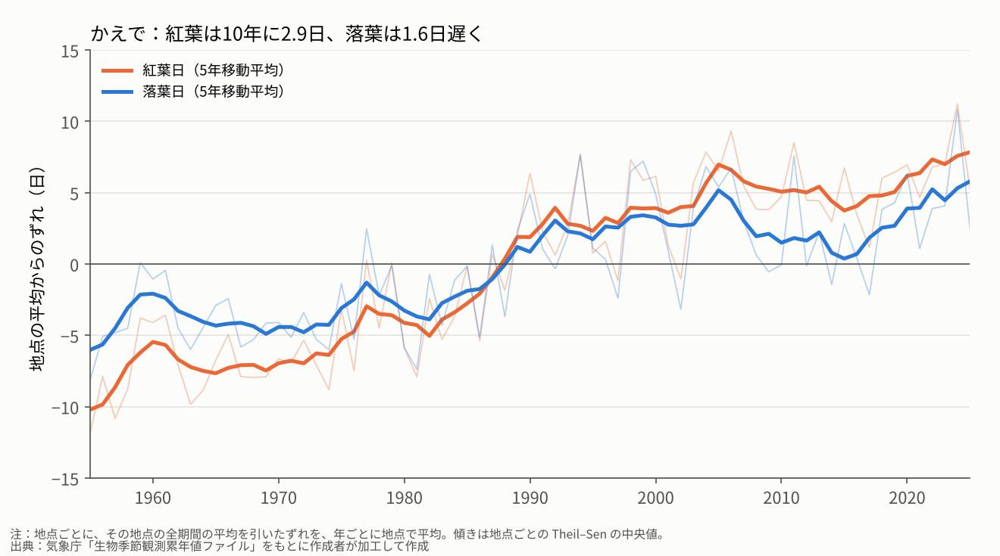
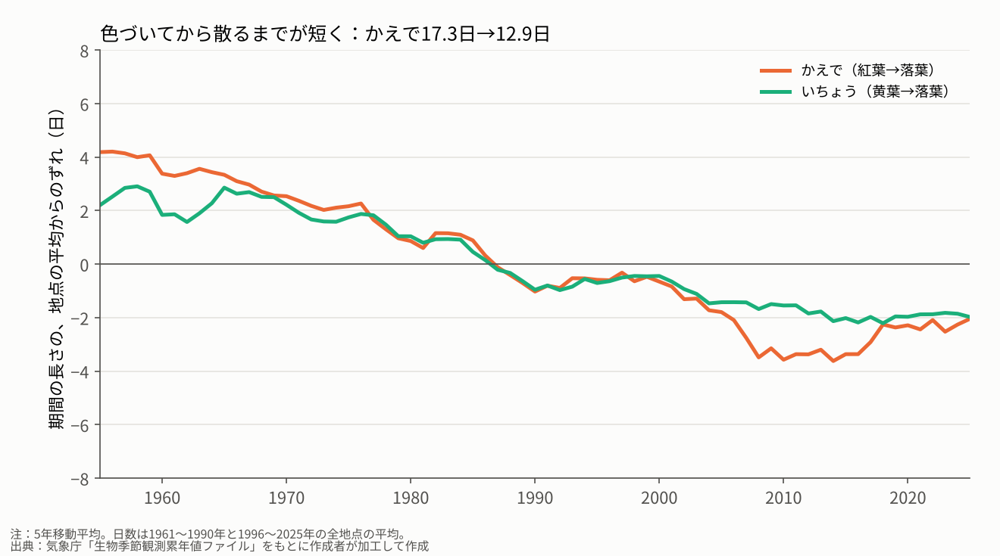
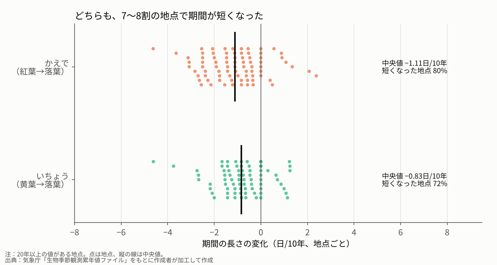
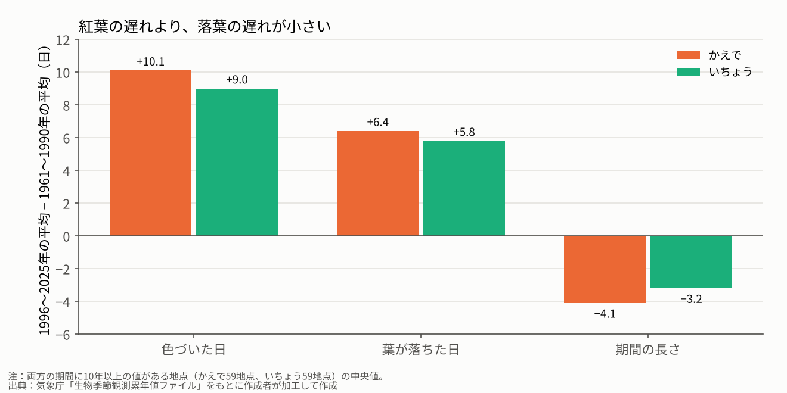

# F488 紅葉から落葉までの期間は、短くなったのか？ かえでは平均17.3日→12.9日。紅葉は10年に2.9日遅れたが、落葉の遅れは1.6日で、8割の地点で期間が短くなった

## 結論（先に）
- 気象庁の生物季節観測で、かえでが紅葉した日から落葉した日までの日数は、全地点の平均で1961〜1990年の17.3日から、1996〜2025年の12.9日になりました。地点ごとに比べた中央値でも −4.1日です。
- 地点ごとの傾き（10年あたり、中央値）は、紅葉 +2.86日、落葉 +1.63日で、期間は −1.11日でした。紅葉の遅れに、落葉の遅れが追いついていません。20年以上の値がある79地点のうち、80%の地点で期間が短くなっていました。
- いちょうも同じ向きで、黄葉 +2.50日、落葉 +1.50日、期間 −0.83日/10年（72%の地点で短く）でした。平均の期間は14.3日→11.3日です。
- 結果を見てから足した問い直しでは、かえでは紅葉の早い（寒い）地点ほど期間の短くなり方が大きい傾向（−1.38日 と −0.83日/10年）がありましたが、地点の平均の紅葉日との順位相関は0.16で、はっきりした差とは言えませんでした。

## 問い
「紅葉が遅くなった」とはよく言われ、既存の jodn 076 も、同じ気象庁のデータで「かえでの紅葉は10年あたり約3日遅くなった」と示しています。この記事では、たたき台の問い（紅葉はどれだけ遅くなったか）をそのまま繰り返さず、**色づいてから葉が落ちるまでの期間**がどう変わったかを確かめます。紅葉が遅れた分、落葉も同じだけ遅れたのか。紅葉の名所や観光にかかわる人、季節の変化に関心のある人のための記事です。

## データ（出典）
- 気象庁「生物季節観測累年値ファイル（CSV）」：かえで紅葉・かえで落葉・いちょう黄葉・いちょう落葉（地点別、1953〜2025年）。値は月日で、0 は観測なし。
- 落葉が年をまたいで1〜6月になった値は、前の年の秋に続く日として365を足しました。落葉が紅葉より前になっている記録は除きました。
- 注記の6・7（代わりの種目で観測した値）は、頑健性で除きました。
- 4つの CSV を data/raw に同梱しました（合計約220KB）。

## 事前の計画
[PLAN.md](PLAN.md)（2026-11-16 13:44、集計の前に作成）。下見では jodn 076 の結果と、CSV の先頭の数行を見ました。

| 仮説 | 外れの基準 | 結果 | 判定 |
|---|---|---|---|
| H1 かえでの期間の傾きの中央値が −0.5日/10年以下 | −0.5日より大きい | −1.11日 | 支持 |
| H2 いちょうも −0.5日/10年以下 | 同上 | −0.83日 | 支持 |
| H3 かえでの30年平均の差が −3日以下 | −3日より大きい | −4.1日（59地点） | 支持 |
| H4 かえでの落葉も +1.5日/10年以上遅れている | +1.5日未満 | +1.63日 | 支持 |

## やったこと
1. 4つの CSV から、地点×年の紅葉（黄葉）日・落葉日の表を作りました（02_build.py）。
2. 地点ごと・年ごとに期間＝落葉日−紅葉日を出し、20年以上の値がある地点の Theil–Sen の傾き（外れ値に強い傾きの求め方）、1961〜1990年と1996〜2025年の平均の差、地点の固定効果つきの回帰を出しました（03_analysis.py）。
3. 結果を見てから、紅葉の早い地点と遅い地点で比べました（03b_requestion.py）。

## 分かったこと

### 1. 紅葉も落葉も遅くなったが、遅れ方が違う（図1）

かえでの紅葉日と落葉日を、地点ごとの平均からのずれで見ると、どちらも1980年代後半から遅くなっています。紅葉は落葉より大きく遅れ、2つの線の間が狭くなりました。

### 2. 期間は短くなった（図2）

期間の長さのずれは、1960年代のプラス（長め）から、2000年代以降のマイナス（短め）に移りました。かえでは2010年前後に特に短く、その後は少し戻っています。

### 3. 多くの地点で短くなった（図3）

かえでは79地点の80%、いちょうは75地点の72%で、期間の傾きがマイナスでした。

### 4. 30年の平均で比べると（図4）

1961〜1990年から1996〜2025年にかけて、かえでは紅葉 +10.1日、落葉 +6.4日、期間 −4.1日、いちょうは黄葉 +9.0日、落葉 +5.8日、期間 −3.2日（いずれも地点の中央値）でした。

## 問い直し（結果を見てから足した）

### 紅葉の早い地点と遅い地点で違うか
期間が短くなったことが分かったので、寒い地点（紅葉が早い）と暖かい地点（紅葉が遅い）で違うかを確かめました。地点の平均の紅葉日の中央値（かえで：1月1日から325日目ごろ＝11月21日ごろ、いちょう：319日目ごろ）で2つに分けました。

| 種目 | 地点 | 紅葉（黄葉） | 落葉 | 期間（日/10年） |
|---|---|---|---|---|
| かえで | 紅葉の早い地点 | +3.08 | +1.53 | −1.38 |
| かえで | 紅葉の遅い地点 | +2.58 | +2.00 | −0.83 |
| いちょう | 黄葉の早い地点 | +2.18 | +1.25 | −0.80 |
| いちょう | 黄葉の遅い地点 | +2.67 | +2.06 | −0.83 |

- かえでは、紅葉の早い地点ほど紅葉の遅れが大きく、落葉の遅れが小さいため、期間が大きく短くなっていました。ただし、地点の平均の紅葉日と期間の傾きの順位相関は0.16（p=0.16）で、はっきりした差とは言えません。
- いちょうでは、早い地点と遅い地点の差はほとんどありませんでした。

## 頑健性

| 種目 | 確かめ方 | 地点数 | 期間の傾き（中央値） | 短くなった地点 | 固定効果の回帰（標準誤差） |
|---|---|---|---|---|---|
| かえで | 本線：全地点（20年以上） | 79 | −1.11 | 79.7% | −1.31（0.08） |
| かえで | 代わりの種目の値を除く | 71 | −1.08 | 78.9% | −1.26（0.08） |
| かえで | 1981年以降 | 73 | −1.03 | 68.5% | −1.15（0.16） |
| かえで | 30年以上の地点だけ | 75 | −1.11 | 80.0% | −1.31（0.08） |
| いちょう | 本線：全地点（20年以上） | 75 | −0.83 | 72.0% | −0.93（0.06） |
| いちょう | 代わりの種目の値を除く | 75 | −0.83 | 72.0% | −0.93（0.06） |
| いちょう | 1981年以降 | 71 | −0.77 | 64.8% | −0.79（0.12） |
| いちょう | 30年以上の地点だけ | 70 | −0.81 | 72.9% | −0.93（0.06） |

どの確かめ方でも、期間は10年あたり0.8〜1.3日短くなっていました。1981年以降に限ると、短くなった地点の割合は65〜69%に下がります。

## 言えないこと
- 観測は地点ごとに決めた1本の標本木で、木の植え替えや周りの環境の変化の影響を受けます。
- 2020年末で多くの地点が観測をやめ、近年の値は地点が減っています（年ごとの図は、その年に観測のあった地点の平均です）。
- 期間が短くなった理由（秋の気温の上がり方、霜や強い風の時期）は、この記事では確かめていません。気温との関係は jodn 076 が扱っています。
- 紅葉の「見ごろ」は山の観光地の様子と同じではありません。気象庁の観測は主に市街地の木です。

## 仕事で使うなら
- 紅葉の時期を見込むときは、「色づきが遅くなった」だけでなく、「色づいてから落ちるまでが短くなった」（かえでで30年に4日ほど）ことも前提にすると、見ごろの期間を読み違えにくいです。
- 地点ごとの傾きは results/station_span_slopes_kaede.csv・…_ichou.csv、年ごとの値は results/yearly_dev_*.csv にあります。

## 計画からの変更
- 問いを、たたき台の「紅葉はどれだけ遅くなったか」から「紅葉から落葉までの期間」に直しました（jodn 076 と重ならないため）。
- 計画どおりに進めました。問い直しは計画の候補（早い地点と遅い地点）を選びました。

## 再現のしかた
```
sh src/run_all.sh        # オフライン。所要約10秒
python3 src/01_fetch.py  # 元データを取り直すときだけ（ネットを使う）
```

| ファイル | 中身 |
|---|---|
| src/02_build.py | 4つの CSV → data/phenology.csv（地点×年×種目） |
| src/03_analysis.py | 期間・傾き・30年平均の差・回帰・仮説・頑健性 → results/main.json ほか |
| src/03b_requestion.py | 問い直し（早い地点と遅い地点） → results/requestion.json・requestion_groups.csv |
| src/04_figures.py | 図4枚 |

repro_check：/tmp/rep_F488 に写して流し、15ファイル（results 10、figures 4、data 1）がすべて cmp で一致、所要10秒（results/repro_check.txt）。乱数は使っていません。

## 関連する記事
- jodn 076（S1）：同じ生物季節観測で、さくら・うめの開花やかえでの紅葉が何日早く・遅くなったか、気温1℃あたりの反応を見た記事。本記事は紅葉と落葉の間の期間を見ました。

## レビューで直したこと

独立レビューで数字の照合・再実行・図を確かめ、直すところはなかった。

## 出典
- 気象庁「生物季節観測の情報」生物季節観測累年値ファイル：https://www.data.jma.go.jp/sakura/data/download_ruinenchi.html （ファイルの URL は data/raw/SOURCES.md）

（いずれも 気象庁「生物季節観測累年値ファイル」をもとに作成者が加工して作成）
