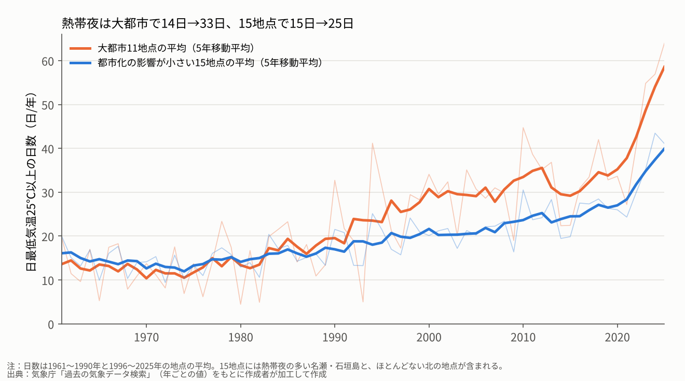
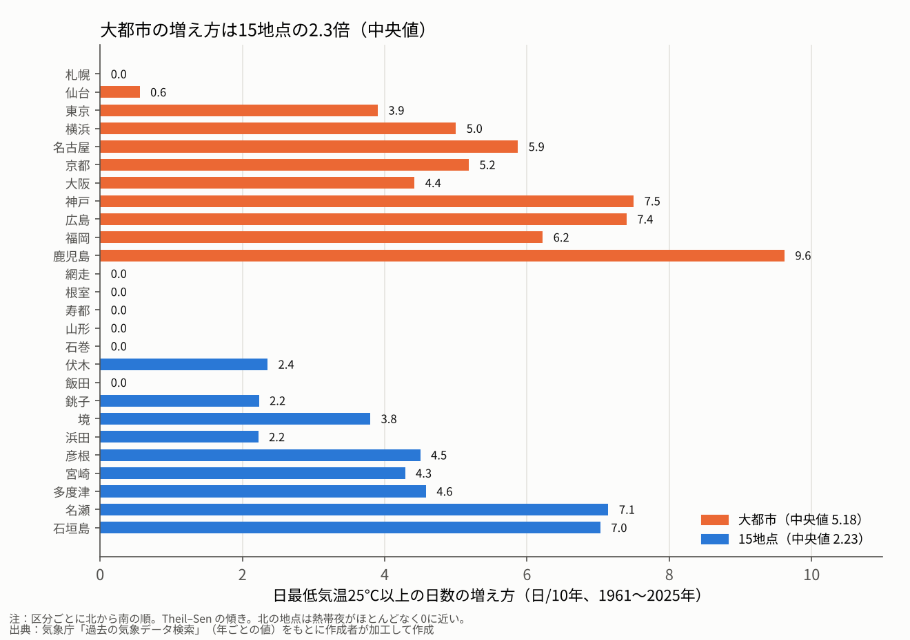
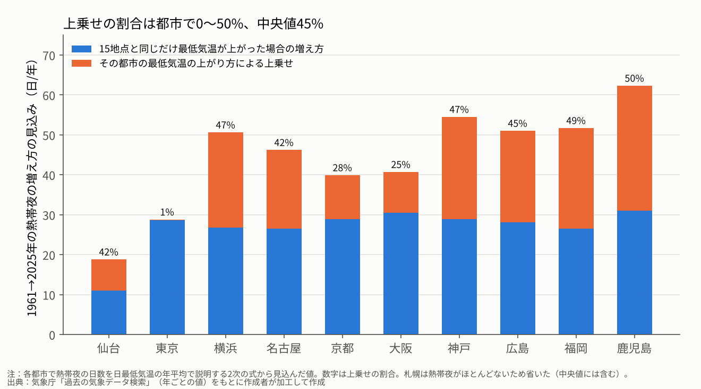
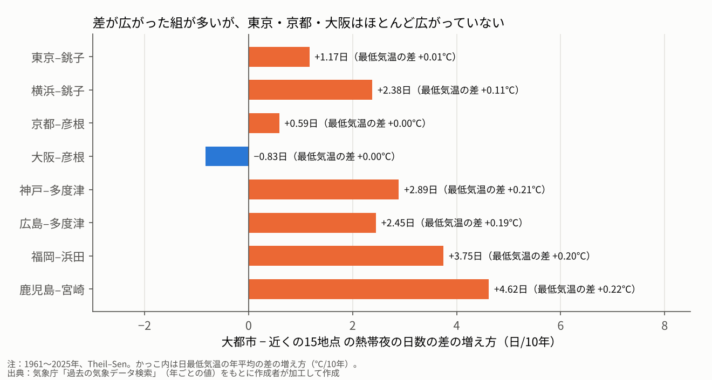

# F489 熱帯夜の増え方は、都市化でどこまで説明できるか？ 大都市は10年に5.2日、都市化の影響が小さい15地点は2.2日。最低気温の上がり方の差から見込む都市の上乗せは中央値45%

## 結論（先に）
- 日最低気温25℃以上の日数（熱帯夜の目安）の増え方（1961〜2025年、10年あたり、地点の中央値）は、大都市11地点で5.18日、気象庁が都市化の影響が比較的小さいとする15地点で2.23日でした。大都市は2.3倍です。
- 15地点でも増えていて、熱帯夜の増加の一部は都市化と関係なく起きています。15地点の平均は1961〜1990年の14.8日から1996〜2025年の24.7日に、大都市の平均は14.3日から33.4日になりました。
- 日最低気温の年平均の上がり方は、大都市0.458℃、15地点0.308℃（10年あたり、中央値）で、差は0.151℃でした。
- 大都市ごとに「15地点と同じだけ最低気温が上がっていたら熱帯夜はどれだけ増えたか」を見込むと、実際の増え方のうち都市の上乗せの割合は0〜50%（中央値44.8%）でした。「半分以上が都市の上乗せ」という仮説は外れました。
- 結果を見てから足した問い直しでは、近くの15地点との差が1961年以降に広がったのは8組のうち7組でしたが、東京・京都・大阪の組では日最低気温の差がほとんど広がっていませんでした。これらの都市の上乗せは1961年より前にできていたと考えられます（推測）。

## 問い
夜の最低気温が25℃以上の「熱帯夜」は、大都市で増えたと言われます。気象庁は、都市化の影響が比較的小さい15地点の平均で日本の気温の変化を求めていて、大都市ではそれより気温の上がり方が大きいことを示しています。熱帯夜の増え方のうち、どれだけが「どこでも起きている温暖化」で、どれだけが「大都市だけの上乗せ」なのか。都市の暑さ対策や暮らし・電力需要を考える人のための記事です。

## データ（出典）
- 気象庁「過去の気象データ検索」年ごとの値（詳細：気温）：大都市11地点（札幌・仙台・東京・横浜・名古屋・京都・大阪・神戸・広島・福岡・鹿児島）と、15地点（網走・根室・寿都・山形・石巻・伏木・飯田・銚子・境・浜田・彦根・宮崎・多度津・名瀬・石垣島）。ページの HTML を地点ごとに data/raw に保存しました（合計3.3MB）。
- 使った値：日最低気温25℃以上の日数、日最低気温の年平均（1961〜2025年）。「]」（資料不足値）の年は除きました。
- 気象庁の熱帯夜は「夜間の最低気温が25℃以上」ですが、ここでは年の表にある「日最低気温25℃以上の日数」で数えています。
- 15地点は、気象庁の「大都市及び都市化の影響が比較的小さいとみられる15地点平均の年平均気温偏差」のページにある地点です。

## 事前の計画
[PLAN.md](PLAN.md)（2026-11-16 13:49、集計の前に作成）。下見では、表の形を確かめるため東京の数年分を見ました。

| 仮説 | 外れの基準 | 結果 | 判定 |
|---|---|---|---|
| H1 大都市の増え方は15地点の2倍以上 | 2倍未満 | 5.18日 と 2.23日（2.32倍） | 支持 |
| H2 15地点でも増えている | 0以下 | +2.23日/10年 | 支持 |
| H3 最低気温の上がり方の差は0.1℃/10年以上 | 0.1℃未満 | 0.151℃ | 支持 |
| H4 大都市の増え方の半分以上が都市の上乗せ | 半分未満 | 中央値44.8% | 外れ |

## やったこと
1. 26地点のページから、年ごとの値を抜き出しました（02_build.py）。
2. 地点ごとの Theil–Sen の傾き（外れ値に強い傾きの求め方）を出し、区分ごとの中央値を比べました。大都市ごとに、熱帯夜の日数を日最低気温の年平均で説明する2次の式を作り、最低気温の上がり方を15地点の中央値に置き換えた見込みと比べました（03_analysis.py）。
3. 結果を見てから、近くの大都市と15地点の組で差の推移を見ました（03b_requestion.py）。

## 分かったこと

### 1. どちらも増えたが、大都市の方が速い（図1）

1990年ごろまでは2つの区分の平均はほぼ同じでしたが、1990年代から大都市の方が多くなりました。2020年代は両方とも大きく増えています。

### 2. 地点ごとの増え方（図2）

大都市では鹿児島9.6日、神戸7.5日、広島7.4日、福岡6.2日など（10年あたり）。15地点では名瀬7.1日、石垣島7.0日と南の島で大きく、北の地点（網走・根室・寿都・山形・石巻・飯田）はもともと熱帯夜がほとんどなく、傾きは0です。札幌・仙台も0〜0.6日でした。

### 3. 都市の上乗せは半分弱（図3）

最低気温が15地点と同じだけ（64年で約2.0℃）上がった場合でも、仙台を除く大都市で熱帯夜は年に26〜31日増える見込みでした。その都市自身の上がり方（1.98〜3.68℃）との差による上乗せは、横浜・神戸・福岡・鹿児島で47〜50%、京都・大阪で25〜28%、東京で1%でした。東京の最低気温の上がり方が小さいのは、2014年に観測場所が移ったことの影響を含むと考えられます（推測）。

## 問い直し（結果を見てから足した）

### 近くの大都市と15地点の差は広がったか（図4）

都市によって上乗せの割合が大きく違ったので、近くの15地点と組にして、差の推移を見ました。

| 組 | 熱帯夜の差の増え方（日/10年） | 最低気温の差の増え方（℃/10年） | 熱帯夜の差 1961〜90年 → 1996〜2025年 |
|---|---|---|---|
| 東京–銚子 | +1.17 | +0.008 | 15.8 → 20.1 |
| 横浜–銚子 | +2.38 | +0.111 | 7.8 → 17.3 |
| 京都–彦根 | +0.59 | +0.000 | 7.2 → 9.7 |
| 大阪–彦根 | −0.83 | −0.000 | 24.1 → 22.9 |
| 神戸–多度津 | +2.89 | +0.213 | 2.4 → 14.3 |
| 広島–多度津 | +2.45 | +0.192 | −6.6 → 2.2 |
| 福岡–浜田 | +3.75 | +0.200 | 16.7 → 28.8 |
| 鹿児島–宮崎 | +4.62 | +0.222 | 13.2 → 31.2 |

- 8組のうち7組で熱帯夜の差が広がりました（中央値 +2.42日/10年）。
- 東京・京都・大阪の組では、日最低気温の差がほぼ一定でした。大阪と彦根の最低気温の差は、1961〜1990年も1996〜2025年も約2.0℃です。気象庁のページも、多くの大都市で15地点との差が広がったのは1950年代後半から1970年ごろとしています。これらの都市では、上乗せはこの記事の期間より前にできあがっていた、と読めます（推測）。

## 頑健性

| 確かめ方 | 大都市 | 15地点 | 倍率 | 最低気温 大都市 | 最低気温 15地点 |
|---|---|---|---|---|---|
| 本線：1961〜2025年、Theil–Sen | 5.18 | 2.23 | 2.32 | 0.458 | 0.308 |
| 1981〜2025年 | 7.50 | 4.44 | 1.69 | 0.500 | 0.421 |
| 南の4地点を除く | 5.09 | 1.11 | 4.58 | 0.456 | 0.321 |
| 普通の最小二乗法 | 5.93 | 3.00 | 1.98 | 0.456 | 0.303 |
| 「]」の年も含める | 5.18 | 2.23 | 2.32 | 0.458 | 0.308 |

- 大都市の方が速く増えたことはどの確かめ方でも同じですが、倍率は1.7〜4.6倍と、期間や地点の選び方で大きく動きます。1981年以降に限ると、15地点の増え方も大きく、倍率は1.69倍に下がります。
- 15地点は北の地点（熱帯夜がない）と南の島（熱帯夜が多い）が混ざっていて、中央値がその混ざり方に左右されます。

## 言えないこと
- 都市化の効果と、観測場所の移転・周りの環境の変化を分けられません（東京は2014年に移転）。
- 15地点も、都市化の影響がまったくないわけではありません。
- 上乗せの見込みは「最低気温の年平均」と熱帯夜の関係を使った近似で、夏の夜だけの気温の変化を直接見たものではありません。
- 熱帯夜が暮らしや電力に与える影響は扱っていません。

## 仕事で使うなら
- 大都市の熱帯夜の増加を読むときは、15地点でも増えている分（10年に2日ほど）があり、都市の上乗せはその上に乗っている、と分けて見ると読み違えにくいです。上乗せの大きさは都市で大きく違います。
- 地点ごとの値は results/station_slopes.csv、見込みは results/urban_share.csv にあります。

## 計画からの変更
- 計画どおりに進めました。問い直しは計画の候補（近くの組）を選び、組を8つ決めました。

## 再現のしかた
```
sh src/run_all.sh        # オフライン。所要約5秒
python3 src/01_fetch.py  # 元データを取り直すときだけ（ネットを使う）
```

| ファイル | 中身 |
|---|---|
| src/02_build.py | 26地点の HTML → data/annual.csv |
| src/03_analysis.py | 傾き・上乗せの見込み・仮説・頑健性 → results/main.json ほか |
| src/03b_requestion.py | 問い直し（近くの組） → results/requestion.json・requestion_pairs.csv・requestion_pair_series.csv |
| src/04_figures.py | 図4枚 |

repro_check：/tmp/rep_F489 に写して流し、13ファイル（results 8、figures 4、data 1）がすべて cmp で一致、所要5秒（results/repro_check.txt）。乱数は使っていません。

## レビューで直したこと

独立レビューで数字の照合・再実行・図を確かめ、直すところはなかった。

## 出典
- 気象庁「過去の気象データ検索」：https://www.data.jma.go.jp/stats/etrn/index.php （各地点のページの URL は data/raw/SOURCES.md）
- 気象庁「大都市及び都市化の影響が比較的小さいとみられる15地点平均の年平均気温偏差の経年変化」：https://www.data.jma.go.jp/cpdinfo/himr/himr_temp_diff.html

（いずれも 気象庁「過去の気象データ検索」をもとに作成者が加工して作成）
