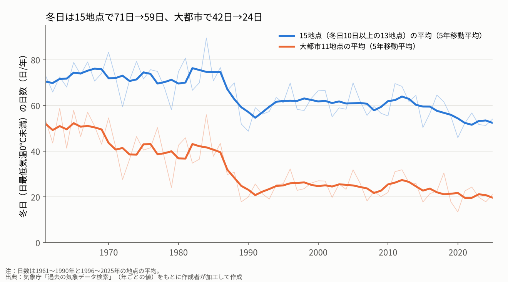
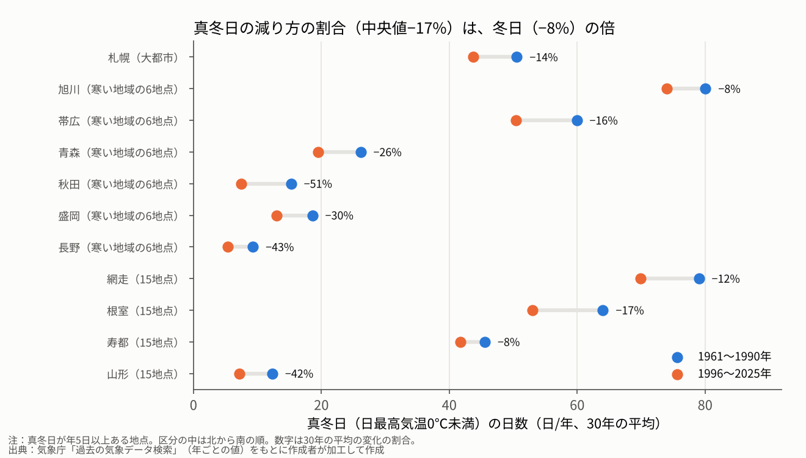
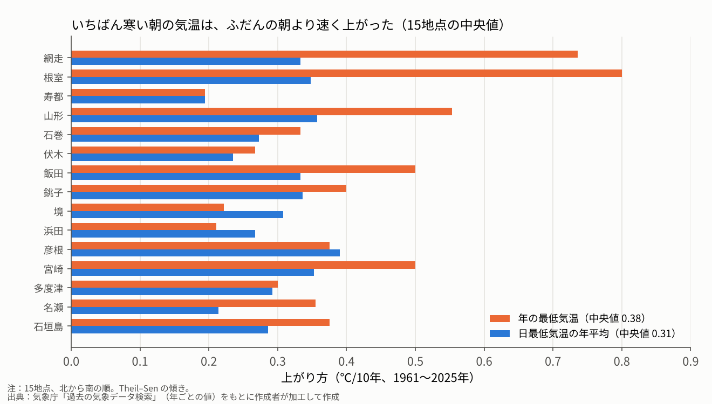
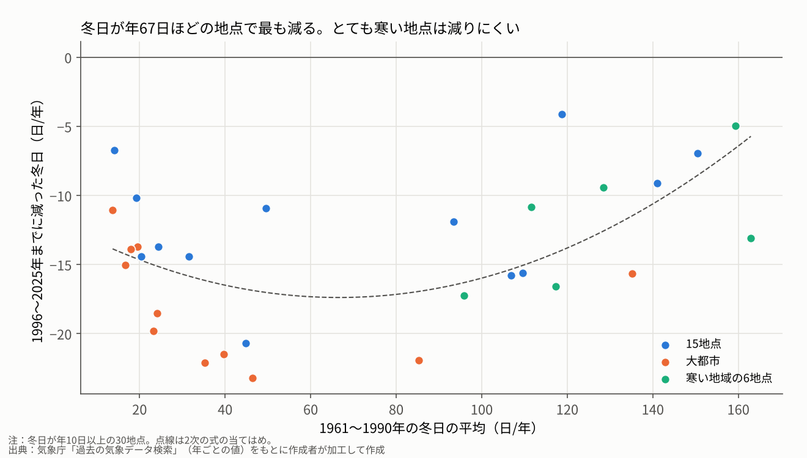

# F490 冬の寒さは、どれだけ緩んだのか？ 都市化の影響が小さい地点で冬日は10年に3.4日減り、71日→59日。真冬日の減り方の割合（−17%）は冬日（−8%）の倍

## 結論（先に）
- 気象庁が都市化の影響が比較的小さいとする15地点のうち、冬日（日最低気温0℃未満の日）が年10日以上ある13地点で、冬日は10年あたり3.42日（中央値）減りました。13地点の平均は1961〜1990年の71.1日から1996〜2025年の59.2日です。
- 大都市11地点では10年あたり4.58日減り、平均は41.6日から23.7日になりました。日数の減り方の差は1.16日で、「大都市は1.5日以上速い」という仮説は外れましたが、割合では大都市 −70%、15地点 −22%（中央値）と大きく違います。
- 真冬日（日最高気温0℃未満の日）が年5日以上ある11地点では、真冬日の減り方の割合は中央値 −17%で、同じ地点の冬日（−8%）の倍でした。
- 15地点で、年の最低気温（その年でいちばん寒い朝）の上がり方は10年あたり0.375℃と、日最低気温の年平均（0.308℃）より速くなりました。ただし1981年以降に限ると逆になります。
- 結果を見てから足した問い直しでは、冬日の減った日数は、もともと冬日が年67日ほどの地点で最も大きく、とても寒い地点ほど減りにくい形でした。大都市の減り方の大きさの一部は、この「もともとの冬日の多さ」で説明できました。

## 問い
「冬が暖かくなった」とよく言われます。最低気温が0℃を下回る「冬日」、最高気温も0℃に届かない「真冬日」、年でいちばん寒い朝の気温は、都市化の影響の小さい地点でどれだけ変わったのか。暖房・除雪・冬の農作業など、冬の寒さにかかわる計画を立てる人のための記事です。

## データ（出典）
- 気象庁「過去の気象データ検索」年ごとの値（詳細：気温）。ページの HTML を地点ごとに data/raw に保存しました（32地点、合計約4MB）。
  - 本線：都市化の影響が比較的小さい15地点（網走・根室・寿都・山形・石巻・伏木・飯田・銚子・境・浜田・彦根・宮崎・多度津・名瀬・石垣島）。名瀬・石垣島は冬日がないので、冬日の傾きは年10日以上の13地点で見ました。
  - 比べ用：大都市11地点（札幌・仙台・東京・横浜・名古屋・京都・大阪・神戸・広島・福岡・鹿児島）。
  - 真冬日を見るための寒い地域の6地点：旭川・帯広・青森・秋田・盛岡・長野（都市化の影響は区別していません）。
- 1961〜2025年。「]」（資料不足値）の年は除きました。暦年で数えているので、1つの冬が2つの年にまたがります。

## 事前の計画
[PLAN.md](PLAN.md)（2026-11-16 13:54、集計の前に作成）。下見では、F489 の作業で東京の数年分の行を見ていました。

| 仮説 | 外れの基準 | 結果 | 判定 |
|---|---|---|---|
| H1 15地点の冬日の傾きの中央値は −2日/10年以下 | −2日より大きい | −3.42日 | 支持 |
| H2 大都市は15地点より1.5日/10年以上速く減った | 差が1.5日未満 | −4.58日 と −3.42日（差1.16日） | 外れ |
| H3 真冬日の減り方の割合は冬日より大きい | 同じか小さい | −17.2% と −8.0% | 支持 |
| H4 年の最低気温は日最低気温の年平均より速く上がった | 同じか小さい | 0.375℃ と 0.308℃ | 支持 |

## やったこと
1. 32地点のページから、年ごとの値を抜き出しました（02_build.py）。
2. 地点ごとの Theil–Sen の傾き（外れ値に強い傾きの求め方）と、1961〜1990年・1996〜2025年の平均の差・割合を出し、区分ごとの中央値で仮説を判定しました（03_analysis.py）。
3. 結果を見てから、もともとの冬日の多さと減った日数の関係を見ました（03b_requestion.py）。

## 分かったこと

### 1. 冬日はどちらも減ったが、大都市の方が大きく（図1）

15地点（13地点）の平均は1980年代後半に大きく下がり、その後も少しずつ減っています。大都市の平均も同じ時期に下がり、1990年代以降は20日台です。

### 2. 真冬日の減り方の割合は大きい（図2）

真冬日は、秋田 −51%、長野 −43%、山形 −42%、盛岡 −30%、青森 −26% と、真冬日がもともと年10〜30日ほどの地点で大きく減りました。旭川（−8%）、寿都（−8%）、網走（−12%）のように真冬日の多い地点では、減り方の割合は小さめです。

### 3. 1961年からで見ると、いちばん寒い朝の気温はふだんの朝より速く上がった（1981年以降は逆。図4）

15地点の中央値で、年の最低気温は10年あたり0.375℃、日最低気温の年平均は0.308℃上がりました。網走（0.74℃）・根室（0.80℃）・山形（0.55℃）など北の地点で年の最低気温の上がり方が大きく、境・浜田などでは逆に年平均の方が速い地点もあります。

## 問い直し（結果を見てから足した）

### もともとの冬日の多さで、減り方はどう違うか（図3）

H2 で大都市の減り方が日数では15地点とあまり変わらず、割合では大きく違ったので、もともとの冬日の多さ（1961〜1990年の平均）と、1996〜2025年までに減った日数の関係を、冬日が年10日以上の30地点で見ました。

- 2次の式を当てはめると、減った日数が最も大きいのは、もともとの冬日が年67日ほどの地点で、約17日の減少でした（決定係数0.32）。
- 冬日が年140日を超えるとても寒い地点（旭川・帯広・網走・根室）では、冬の多くの日が0℃を大きく下回るため、少し暖かくなっても0℃を上回りにくく、減り方は5〜13日でした。
- 区分の平均で、減った日数は大都市 −17.9日、15地点 −11.9日、寒い地域 −12.0日でした。2次の式から見込まれる値（大都市 −15.0日、15地点 −14.4日）との差（残り）は、大都市 −2.8日、15地点 +2.6日で、大都市の方が5日ほど多く減っています。

## 頑健性

| 確かめ方 | 15地点の地点数 | 15地点の冬日（日/10年） | 大都市の地点数 | 大都市の冬日 | 年の最低気温（15地点、℃/10年） | 最低気温の年平均（15地点） |
|---|---|---|---|---|---|---|
| 本線：1961〜2025年、Theil–Sen、冬日10日以上 | 13 | −3.42 | 11 | −4.58 | 0.375 | 0.308 |
| 1981〜2025年 | 13 | −3.60 | 9 | −3.33 | 0.375 | 0.421 |
| 普通の最小二乗法 | 13 | −3.48 | 11 | −4.75 | 0.356 | 0.303 |
| 冬日30日以上の地点 | 9 | −3.42 | 5 | −6.09 | 0.375 | 0.308 |
| 「]」の年も含める | 13 | −3.42 | 11 | −4.58 | 0.375 | 0.308 |

- 15地点の冬日の減り方（10年に3.4〜3.6日）は、どの確かめ方でも同じでした。
- 1981年以降に限ると、大都市の減り方（−3.33日）は15地点（−3.60日）より小さくなり、年の最低気温と年平均の上がり方の大小も逆になります（0.375℃ と 0.421℃）。大都市の冬日の大きな減少と、いちばん寒い朝の速い上昇は、1980年代までの変化の影響が大きいと言えます。

## 言えないこと
- 観測場所の移転や周りの環境の変化の影響は分けられません。寒い地域の6地点と大都市は、都市化の影響を含みます。
- 雪の量や、雪の日の数は扱っていません。
- 暦年で数えているので、1つの冬の寒さとは少しずれます。
- 寒さが暮らしや産業に与える影響は扱っていません。

## 仕事で使うなら
- 冬日の減り方は、もともとの寒さで大きく違います。寒さの指標を使った計画では、「冬日が年60〜100日ほどの地域で特に大きく減った」「とても寒い地域ではあまり減っていない」という形を前提にすると読み違えにくいです。
- 地点ごとの値は results/station_table.csv にあります。

## 計画からの変更
- 問い直しは、計画の候補（月別・記録の更新）ではなく、結果を見てから「もともとの冬日の多さと減り方の関係」に替えました。月別の値は、この記事で集めたページにないためです。

## 再現のしかた
```
sh src/run_all.sh        # オフライン。所要約6秒
python3 src/01_fetch.py  # 元データを取り直すときだけ（ネットを使う）
```

| ファイル | 中身 |
|---|---|
| src/02_build.py | 32地点の HTML → data/annual.csv |
| src/03_analysis.py | 傾き・30年平均の差・仮説・頑健性 → results/main.json ほか |
| src/03b_requestion.py | 問い直し（もともとの冬日と減り方） → results/requestion.json・requestion_baseline.csv |
| src/04_figures.py | 図4枚 |

repro_check：/tmp/rep_F490 に写して流し、11ファイル（results 6、figures 4、data 1）がすべて cmp で一致、所要6秒（results/repro_check.txt）。乱数は使っていません。

## 関連する記事
- F489「熱帯夜の増え方は、都市化でどこまで説明できるか？」：同じ地点の年ごとの値で、夏の夜を見た記事。

## レビューで直したこと

| # | 指摘 | 直し方 |
|---|---|---|
| 1 | 題名の「年でいちばん寒い朝は平均より速く暖かく」は、1981年以降に限ると逆になり（頑健性の表）、言い切れない | 題名からこの部分を外し、真冬日と冬日の割合（−17%と−8%）に置き換えた。status・note の1行目もそろえた |
| 2 | README の見出し3と note の見出しが「寒い朝は速く暖かく」と断定していた | 「1961年からで見ると」「1981年以降は逆」を見出しに足した |

直したあと、/tmp で流し直して results・figures が元と一致することを確かめました。

## 出典
- 気象庁「過去の気象データ検索」：https://www.data.jma.go.jp/stats/etrn/index.php （各地点のページの URL は data/raw/SOURCES.md）
- 気象庁「大都市及び都市化の影響が比較的小さいとみられる15地点平均の年平均気温偏差の経年変化」：https://www.data.jma.go.jp/cpdinfo/himr/himr_temp_diff.html

（いずれも 気象庁「過去の気象データ検索」をもとに作成者が加工して作成）
