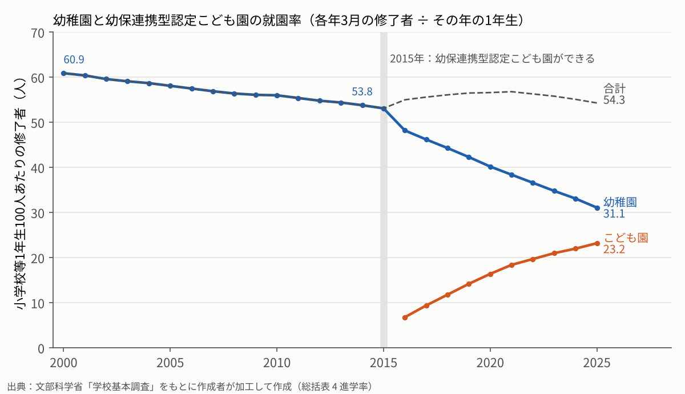
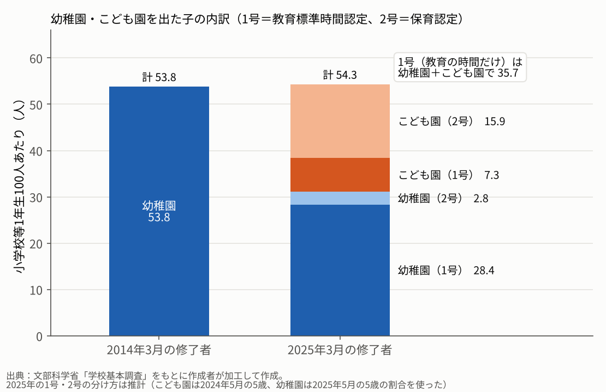
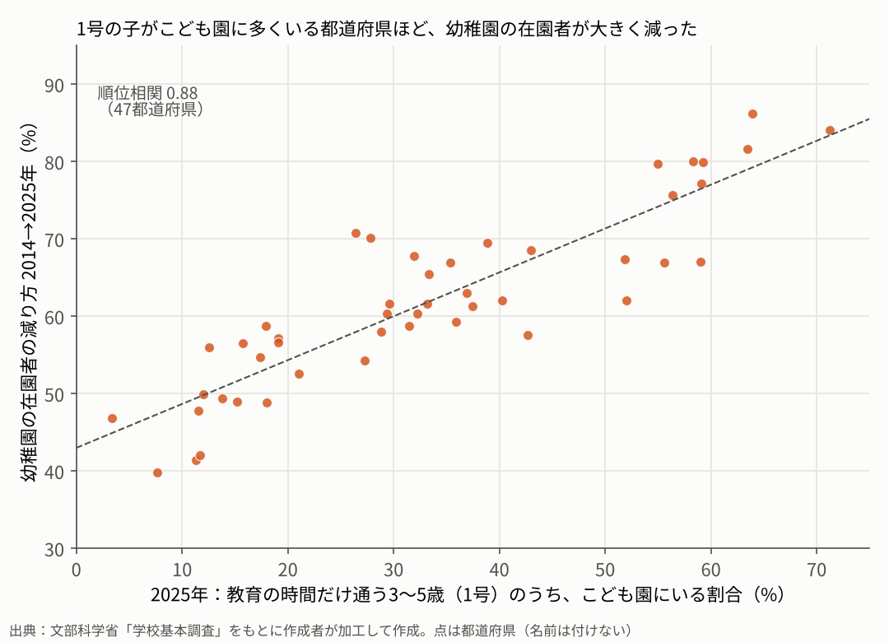
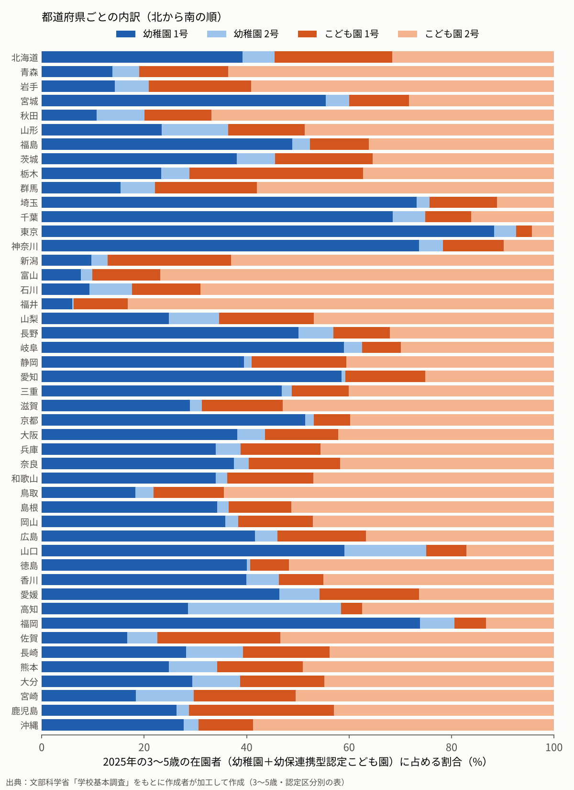

# F491 幼稚園は、認定こども園へどれだけ移ったのか？ 幼稚園を出る子は1年生100人あたり53.8人→31.1人。こども園の23.2人を足すと54.3人で横ばいだが、教育の時間だけ通う「1号」の子は35.7人に減った

## 結論（先に）
- 幼稚園の修了者は、小学校等1年生100人あたりで2014年3月の53.8人から2025年3月の31.1人に減りました。同じ年の幼保連携型認定こども園の修了者は23.2人で、合わせると54.3人です。「幼稚園かこども園を出てから小学校に入る子」の割合は、こども園ができる前とほとんど変わっていません。
- ただし、こども園の3〜5歳のうち、教育の時間だけ通う「1号」（教育標準時間認定）の子は29.6%（2025年）で、残りの7割は保育が必要と認められた「2号」（保育認定）の子でした。幼稚園の2号の子（9.2%）も除くと、1号として幼稚園かこども園を出た子は100人あたり35.7人で、2014年の幼稚園（53.8人）より18.1人少なくなりました。
- 幼稚園の修了者の減り（30.6万人）を分けると、子どもの数の減りで9.8万人、こども園の1号に移った分が多くて6.7万人、残りの14.1万人はそのほかでした。こども園の2号の修了者は推計14.6万人です。
- 都道府県で見ると、教育の時間だけ通う3〜5歳のうちこども園にいる割合が高いところほど、幼稚園の在園者が大きく減っていました（順位相関0.88、47都道府県）。こども園の割合は、3〜5歳（幼稚園＋こども園）の7.4%から93.8%まで、地域で大きく違います。
- 幼稚園の園数は2014→2025年に36.3%減り、在園者数（−55.7%）ほどは減っていません。1園あたりの在園者は120.7人から83.8人になりました。

## 問い
2015年に幼保連携型認定こども園（以下「こども園」）ができてから、幼稚園の在園者は大きく減りました。それは子どもが減ったからなのか、幼稚園がこども園に変わったからなのか。こども園に移った分のうち、もともとの幼稚園と同じ「教育の時間だけ通う子」はどれだけなのか。幼稚園・こども園の運営や、子どもの通い先の見通しを立てる人のための記事です。

## データ（出典）
文部科学省「学校基本調査」（e-Stat からダウンロードした Excel、合計約0.8MB を data/raw に同梱）。
- 総括表：幼稚園とこども園の園数・在園者数（国公私立別）、修了者数、就園率（小学校・義務教育学校・特別支援学校小学部の1年生の数に対する修了者の割合）。
- 都道府県別の在園者数：幼稚園は2014・2015・2025年、こども園は2025年（年齢別）。
- 3〜5歳の認定区分別の在園者数：こども園は2023〜2025年、幼稚園は2025年。こども園の在園者は0〜2歳も含むので、幼稚園と比べるときは3〜5歳だけを使いました。

学校基本調査には、保育所・幼稚園型認定こども園・保育所型認定こども園・地方裁量型認定こども園は入っていません。この記事の「こども園」は幼保連携型だけです。

## 事前の計画
[PLAN.md](PLAN.md)（2026-11-16 14:02、集計の前に作成）。下見で、全国の在園者数・就園率の表と都道府県別の表の先頭の数行を見たので、全国の増減と就園率の合計は記述として扱い、仮説はまだ計算していない値に限りました。

| 仮説 | 外れの基準 | 結果 | 判定 |
|---|---|---|---|
| H1 こども園の3〜5歳の1号の割合は40%未満 | 40%以上 | 29.6%（2023年32.6%、2024年31.0%） | 支持 |
| H2 「幼稚園型」の割合は2014年の幼稚園の就園率より10ポイント以上低い | 差が10ポイント未満 | 38.4人（差15.4ポイント） | 支持 |
| H3 幼稚園の減り方とこども園1号の割合の順位相関が0.5以上 | 0.5未満 | 0.88 | 支持 |
| H4 幼稚園の3〜5歳の2号の割合は10%以上 | 10%未満 | 9.2% | 外れ |
| H5 園数の減り方は在園者数の減り方より小さい | 同じか大きい | −36.3% と −55.7% | 支持 |

H2 の「幼稚園型」は、幼稚園の就園率（2号も含む）に、こども園の就園率×こども園の5歳の1号の割合を足したものです。2025年3月の修了者は2024年5月に5歳だったので、2024年の5歳の割合（31.5%）を使いました。

## やったこと
1. Excel から、全国の年ごとの表と都道府県の表を作りました（02_build.py）。同じ数を別の表から取って一致することを確かめています。
2. 就園率を1号・2号に分け、修了者数を「子どもの数の減り」「こども園1号」「そのほか」に分けました。1年生の数は「修了者÷就園率」で逆算しました（幼稚園からの逆算で91.66万人、こども園からの逆算で91.75万人で、ほぼ一致）。都道府県の順位相関も計算しました（03_analysis.py）。
3. 結果を見てから、公立と私立の違いを見ました（03b_requestion.py）。

## 分かったこと

### 1. 合計は横ばい、中身が入れ替わった（図1）

幼稚園の就園率は2000年の60.9から2014年の53.8へ、年に0.5ほどずつ下がっていました。こども園ができた後は年に2ほどずつ下がり、2025年は31.1です。こども園の就園率は2016年の6.8から2025年の23.2に上がり、合計は54〜57の間で動いています（2021年の56.8が最も高く、その後は少しずつ下がっています）。

### 2. こども園の子の7割は保育の子（図2）

2025年3月に幼稚園かこども園を出た子（1年生100人あたり54.3人）の内訳は、推計で幼稚園の1号28.4人・2号2.8人、こども園の1号7.3人・2号15.9人です。教育の時間だけ通った子（1号）は合わせて35.7人で、2014年の幼稚園の53.8人より18.1人少なくなりました。増えたのは、保育の必要を認められて幼稚園・こども園に通う2号の子です。

修了者の数で見ると、幼稚園の修了者は59.1万人から28.5万人に30.6万人減りました。1年生の数は11年で0.835倍になったので、子どもの数の減りの分は9.8万人です。こども園の1号の修了者（推計6.7万人）が全部もともと幼稚園に行くはずだった子だとしても、残りの14.1万人は説明できません。ほぼ同じ数のこども園の2号の修了者（推計14.6万人）がいますが、幼稚園から移った子かどうかは、この統計からはわかりません。

### 3. こども園への移り方は地域で大きく違う（図3・図4）

教育の時間だけ通う3〜5歳（幼稚園1号＋こども園1号）のうちこども園にいる割合は、都道府県で3.4%から71.2%まで違い、この割合が高いところほど幼稚園の在園者の減り方（2014→2025年、39.8%〜86.2%）が大きくなっていました（順位相関0.88、ピアソンの相関0.89）。直線を当てはめると、こども園1号の割合が10ポイント高いと、幼稚園の減り方は5.7ポイント大きくなります。


北から南に並べると、北陸（新潟・富山・石川・福井）や東北の一部（青森・岩手・秋田）では3〜5歳の8割前後から9割がこども園にいて、その多くが2号の子です。首都圏（埼玉・千葉・東京・神奈川）と福岡では、幼稚園の1号の子が7割前後から9割を占め、こども園は1割未満から2割台です。地域の数は results/region_metrics.csv にあります。

## 問い直し（結果を見てから足した）

### 公立と私立で、移り方は違うのか
H5 で園数より在園者の方が大きく減ったので、公立と私立に分けて見ました。

| 区分 | 幼稚園の在園者 2014→2025年 | 幼稚園の園数 | 2025年のこども園（3〜5歳） | こども園の1号の割合 | 1号の子（2014年の幼稚園＝100） | 子どもの数の減りを割り戻すと |
|---|---|---|---|---|---|---|
| 公立 | 26.5万→7.6万人（−71.5%） | 4,714→2,354園（−50.1%） | 7.7万人（1,067園） | 21.2% | 33.2 | 39.8 |
| 私立 | 128.7万→61.0万人（−52.6%） | 8,142→5,824園（−28.5%） | 54.1万人（6,605園） | 30.8% | 55.7 | 66.8 |

- 公立の幼稚園の在園者は7割減り、公立のこども園の1号の子を足しても、2014年の3分の1でした。公立では、教育の時間だけ通う子の受け皿がこども園に移るより、全体として小さくなった形です。
- 私立は、幼稚園の1号とこども園の1号を合わせると2014年の幼稚園の56%（子どもの数の減りを割り戻すと67%）でした。
- こども園の1号の割合は、2023年32.6%→2024年31.0%→2025年29.6%と下がり、47都道府県のうち43で下がっていました。

## 頑健性

| 確かめ方 | 値 |
|---|---|
| H1 を2023・2024年で | 32.6%・31.0%（どちらも40%未満） |
| H2 で、こども園の1号の割合に2025年5月の5歳を使う | 38.1人（差15.7ポイント） |
| H2 で、幼稚園の2号の子も除く | 35.7人（差18.1ポイント） |
| H3 の基準年を2015年に | 順位相関0.71 |
| H3 を5歳だけで | 順位相関0.85 |
| H3 をピアソンの相関で | 0.89 |
| H4 を5歳だけで | 8.9%（10%未満のまま） |

H1・H2・H3 は、どの確かめ方でも判定が変わりませんでした。H4 は、5歳だけでも10%に届きません。

## 言えないこと
- 個々の園が幼稚園からこども園に変わった件数はわかりません。在園者の数の付け替えとして見ているだけです。
- 「そのほか」の行き先（保育所、ほかの型の認定こども園など）は、学校基本調査では分けられません。
- 就園率は修了者と1年生の数の比で、子どもの数そのものではありません。2025年の1号・2号の分け方は、5月の5歳の割合を使った推計です。
- 都道府県の比べ方は、子どもの数の減り方の地域差を割り戻していません。順位相関は、こども園が幼稚園の子を減らしたという因果を示すものではありません。
- 地域の良し悪しの評価や、制度への提言はしません。

## 仕事で使うなら
- 「幼稚園の在園者が半分になった」という数字は、子どもの減りだけでなく、こども園への移りと、保育が必要な子の増加が重なった結果です。幼稚園・こども園の見通しには、1号と2号を分けた数を使うと読み違えにくくなります。
- 都道府県ごとの値は results/prefecture_metrics.csv、全国の年ごとの値は results/national_series.csv にあります。

## 計画からの変更
- 手法の「幼稚園の在園者の減りを分ける」は、3〜5歳の在園者ではなく修了者で行いました。3〜5歳の在園者は1年生より後に生まれた子なので、1年生の数で子どもの数を近似するとずれるためです。修了者は1年生と同じ学年の子です。
- 修了者数の表（総括表13）を、計画の後に追加で取得しました。

## 再現のしかた
```
sh src/run_all.sh        # オフライン。所要約4秒
python3 src/01_fetch.py  # 元データを取り直すときだけ（ネットを使う）
```

| ファイル | 中身 |
|---|---|
| src/02_build.py | Excel → data/national.csv・prefecture.csv |
| src/03_analysis.py | 仮説・分け方・頑健性 → results/main.json ほか |
| src/03b_requestion.py | 問い直し（公立と私立） → results/requestion.json ほか |
| src/04_figures.py | 図4枚 |

repro_check：/tmp/rep_F491 に写して流し、14ファイル（results 8、figures 4、data 2）がすべて cmp で一致、所要4秒（results/repro_check.txt）。乱数は使っていません。

## 関連する記事
- 幼稚園・こども園の在園者の内訳を正面から扱った既存の看板記事はありません。

## レビューで直したこと

独立レビューで数字の照合・再実行・図を確かめ、直すところはなかった。

## 出典
- 文部科学省「学校基本調査」：https://www.e-stat.go.jp/ （各表の URL は data/raw/SOURCES.md）

（文部科学省「学校基本調査」をもとに作成者が加工して作成）
