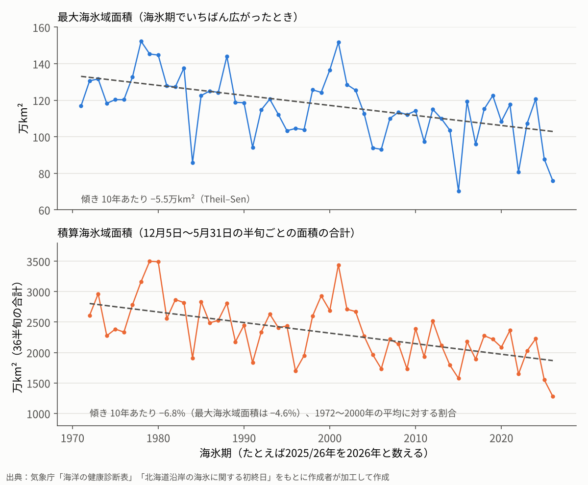
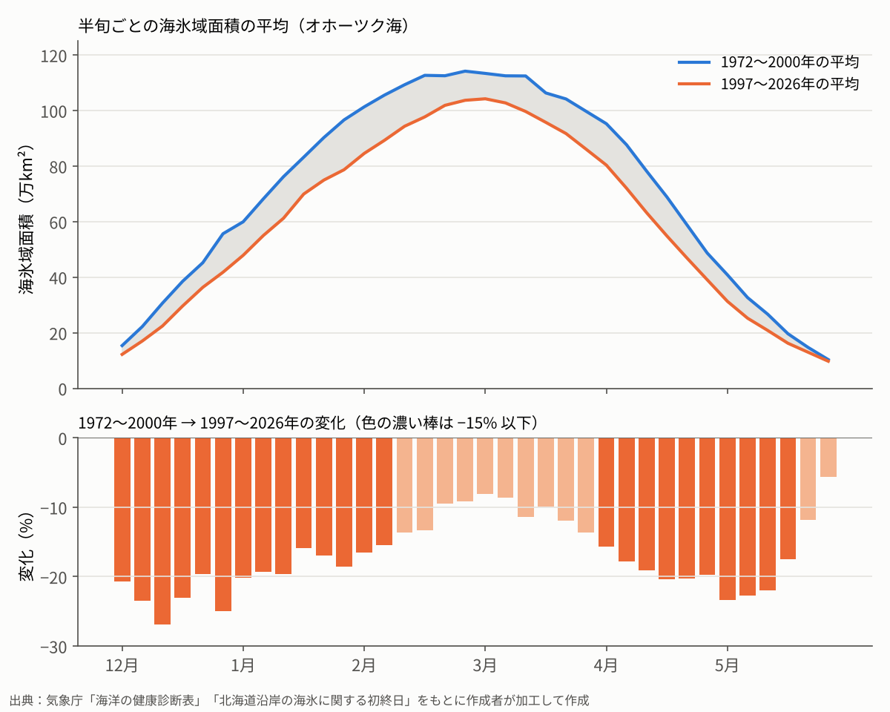
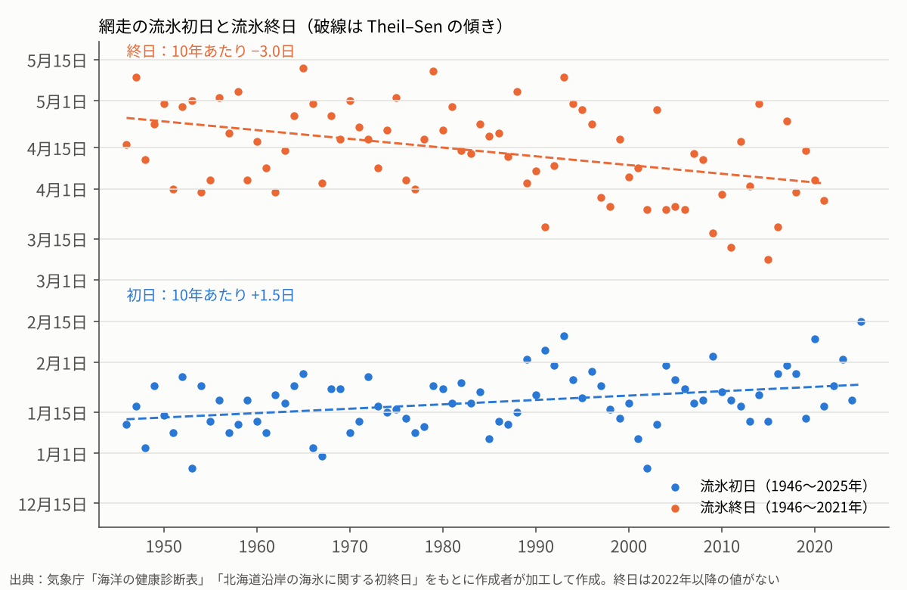
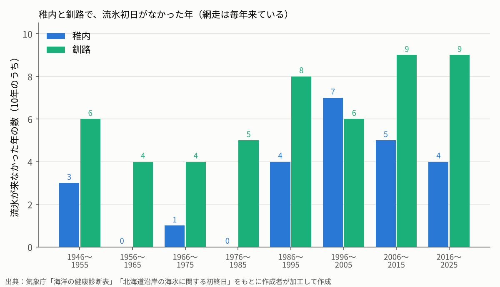

# F492 オホーツク海の流氷は、どれだけ減ったのか？ 氷の広さを冬じゅう足した「積算」は10年に6.8%減り、最大面積（4.6%）より速い。網走の流氷期間は96日→76日、稚内で流氷が来ない年は30年に4回→16回

## 結論（先に）
- オホーツク海の海氷域面積を、12月5日〜5月31日の半旬ごとに足した「積算海氷域面積」は、10年あたり6.8%（1972〜2000年の平均に対する割合、Theil–Sen）減りました。海氷期でいちばん広がったときの「最大海氷域面積」の減り方（4.6%）より速く、氷の広さだけでなく、氷のある期間が短くなっています。
- 減り方は季節の始めと終わりで大きく、12〜1月は10年あたり9.1%、4〜5月は8.8%、いちばん広がる2〜3月は5.1%でした。半旬ごとに見ると、12月15日の面積が1972〜2000年の平均より27%小さく、2月末〜3月上旬は8〜9%小さいだけです。
- 網走の流氷初日は10年あたり1.5日遅くなり（1946〜2025年）、30年の平均で1月15日ごろから1月21日ごろになりました。流氷終日は10年あたり3.0日早まり（1946〜2021年）、4月19日ごろから4月6日ごろに。流氷期間は96日から76日になりました。
- 網走の1〜3月の平均気温と積算海氷域面積は、長期の傾きを除いた残りどうしで相関 −0.42 でした。「−0.5以下」という仮説は外れで、年ごとのばらつきの多くは気温以外（風など）によると考えられます。
- 結果を見てから足した問い直しでは、流氷が来なかった年が、稚内で30年に4回（1946〜1975年）から16回（1996〜2025年）、釧路で14回から24回に増えていました。釧路では2017年を最後に、2025年まで8年続けて流氷が来ていません。

## 問い
「流氷が減った」とよく言われます。オホーツク海全体の氷の広さ、氷のある期間、北海道の沿岸に流氷が来る日は、どれだけ変わったのか。年ごとの大きなばらつきは、冬の気温でどこまで説明できるのか。流氷の観光や沿岸の漁業、冬の海の仕事の計画を立てる人のための記事です。

## データ（出典）
- 気象庁「海洋の健康診断表」：オホーツク海の半旬ごと（毎月5日・10日・15日・20日・25日・月末）の海氷域面積（1970/71〜2025/26年）と、最大海氷域面積。1997年までは解析期間が12月〜5月だったので、長い比較は12月5日〜5月31日の36半旬にそろえました。
- 気象庁「北海道沿岸の海氷に関する初終日」：稚内・雄武・紋別・網走・根室・釧路。稚内・網走・釧路は1946〜2025年。流氷終日・流氷期間・海明けは2021年までで、初終日の観測は2025年で終わりました。
- 気象庁「過去の気象データ検索」：網走の日平均気温の月平均値。
- 海氷期は、たとえば2025/26年を2026年と数えます。

## 事前の計画
[PLAN.md](PLAN.md)（2026-11-16 14:10、集計の前に作成）。下見で最大海氷域面積の表と気象庁の傾き（10年あたり5.9万km²の減少）を見ていたので、最大海氷域面積の傾きは仮説にせず、確かめとして計算しました（最小二乗法で −5.87万km²/10年、気象庁の値と一致）。なお、作った表の点検のときに、網走の初日・終日の全期間の平均（傾きではない）を見ています。

| 仮説 | 外れの基準 | 結果 | 判定 |
|---|---|---|---|
| H1 積算の減り方（%/10年）は最大面積より大きい | 同じか小さい | −6.76% と −4.63% | 支持 |
| H2 4〜5月の減り方は2〜3月より大きい | 同じか小さい | −8.81% と −5.10% | 支持 |
| H3 網走の流氷初日は10年あたり +1.0日以上遅く | +1.0日未満 | +1.49日（95%区間 0.59〜2.46） | 支持 |
| H4 網走の流氷終日は10年あたり −1.0日以下 | −1.0日より大きい | −2.97日（−4.57〜−1.32） | 支持 |
| H5 傾きを除いた積算と1〜3月の気温の相関は −0.5 以下 | −0.5 より大きい | −0.42 | 外れ |

## やったこと
1. 半旬ごとの表から、海氷期ごとの最大・積算・季節ごとの平均を作り、網走の気温の表と、6地点の初終日の表を読み込みました（02_build.py）。最大海氷域面積は、気象庁の最大の表と全年で一致しました。
2. Theil–Sen の傾き（外れ値に強い傾きの求め方）と Mann–Kendall の検定で傾向を見て、相関は両方の直線の傾きを除いた残りで計算しました（03_analysis.py）。
3. 結果を見てから、流氷が来ない年の数と、年ごとのばらつきの大きさを見ました（03b_requestion.py）。

## 分かったこと

### 1. 最大より積算の方が速く減った（図1）

最大海氷域面積の30年の平均は、1971〜2000年の122.8万km²から1997〜2026年の109.8万km²になりました。積算海氷域面積は10年あたり173.5万km²（1972〜2000年の平均2,568万km²の6.8%）減っています。2025/26年の積算は1,279万km²で、1972年以降でいちばん小さい値でした。

### 2. 氷の季節の始めと終わりが削られた（図2）

1972〜2000年と1997〜2026年の半旬ごとの平均を比べると、12月〜2月上旬と4月〜5月中旬は15〜27%小さく、いちばん広がる2月下旬〜3月上旬は8〜9%小さいだけでした。氷ができ始めるのが遅れ、とけるのが早まって、山の両側が削られた形です。

### 3. 網走では、来るのが遅く、去るのが早く（図3）

網走の流氷初日は1月15日ごろ（1946〜1975年の平均）から1月21日ごろ（1996〜2025年の平均）へ、流氷終日は4月19日ごろ（1946〜1975年）から4月6日ごろ（1992〜2021年）へ動きました。去る方が倍ほど速く変わっています。2025年の流氷初日は2月15日で、1946年以降でいちばん遅い日でした。流氷接岸初日も10年あたり1.85日遅くなっています。

### 4. 気温で説明できるのは一部
網走の1〜3月の平均気温は、1972〜2000年の −5.0℃ から1997〜2026年の −3.8℃ に上がりました（10年あたり0.50℃）。傾きを除いた残りどうしでは、1℃暖かい年は積算が155万km²小さいという関係でしたが、相関は −0.42 で、年ごとのばらつきの2割ほどしか説明しません。この関係と気温の上がり方をかけると、積算の減り（10年あたり174万km²）のうち78万km²ほどに当たります。ただしこれは網走1地点の気温を使った目安（推測）で、減った理由を分けたものではありません。

## 問い直し（結果を見てから足した）

### 流氷が来ない年は増えたのか（図4）
H2 で、氷の季節の始めの方が大きく減っていたので、沿岸に流氷が「来るかどうか」で見直しました。


| 地点 | 1946〜1975年に流氷が来なかった年 | 1996〜2025年 | 来た年の初日の平均の動き |
|---|---|---|---|
| 稚内 | 4回（30年のうち） | 16回 | 2月8日ごろ → 2月19日ごろ |
| 網走 | 0回 | 0回 | 1月15日ごろ → 1月21日ごろ |
| 釧路 | 14回 | 24回 | 2月22日ごろ → 3月2日ごろ |

- オホーツク海の南の端に近い稚内・釧路では、流氷が来ない年がはっきり増えました。釧路は2017年が最後で、2018〜2025年は8年続けて来ていません。
- 年ごとのばらつき（積算の、傾きを除いた残りの標準偏差を、その期間の傾きの値で割ったもの）は、1972〜1990年15.2%、1991〜2008年19.6%、2009〜2026年15.9%で、大きくなってはいませんでした。

## 頑健性

| 確かめ方 | 積算（%/10年） | 最大 | 4〜5月 | 2〜3月 |
|---|---|---|---|---|
| 本線（Theil–Sen） | −6.76 | −4.63 | −8.81 | −5.10 |
| 最小二乗法 | −7.07 | −5.02 | −8.84 | −5.26 |
| 1981年以降（Theil–Sen） | −6.93 | −4.44 | −10.43 | −5.64 |
| 積算を1〜4月に | −6.24 | | | |

| 網走（日/10年） | 全期間 | 1981年以降 |
|---|---|---|
| 流氷初日 | +1.49（MK p=0.001） | +1.25（p=0.28） |
| 流氷接岸初日 | +1.85（p=0.017） | +1.46（p=0.25） |
| 流氷終日 | −2.97（p<0.001） | −5.80（p=0.009） |
| 流氷期間 | −4.10（p<0.001） | −6.08（p=0.019） |
| 海明け | −2.63（p=0.020） | −6.14（p=0.007） |

| H5 の確かめ方 | 傾きを除いた相関 |
|---|---|
| 1〜3月の気温（本線） | −0.42 |
| 12〜2月の気温 | −0.43 |
| 2〜3月の気温 | −0.38 |
| 最大面積と1〜3月の気温 | −0.43 |

- H1・H2 は、どの確かめ方でも同じ判定でした。
- 網走の初日の遅れは、1981年以降に限ると傾きは同じ向きでも、はっきりとは言えません（p=0.28）。終日・期間・海明けは、1981年以降の方が速く動いています。
- H5 は、どの月の気温を使っても −0.5 に届きませんでした。

## 言えないこと
- 海氷の厚さ（体積）は扱っていません。面積だけです。
- 減った理由（地球温暖化・風・海水温）は分けられません。気温との相関は因果を示すものではありません。
- 1997年以前と以後で、解析の期間・範囲や使う衛星の資料が変わっている部分があります。12月5日〜5月31日にそろえても、細かな差は比べにくいところがあります。
- 流氷終日・海明けは2022年以降の値がなく、初終日の観測は2025年で終わりました。この先は同じ方法で続けて比べられません。
- 観光や漁業への影響は扱っていません。

## 仕事で使うなら
- 「流氷が減った」は、いちばん広がる時期の広さより、氷の季節の始め（12〜1月）と終わり（4〜5月）で強く表れています。時期を決める計画では、最大面積より、半旬ごとの面積や初日・終日を見ると読み違えにくいです。
- 海氷期ごとの値は results/season_table.csv、半旬ごとの平均は results/pentad_climatology.csv にあります。

## 計画からの変更
- 積算の基準期間は、1971年に12月の値がないため、1972〜2000年にしました。
- 問い直しは、計画の候補の2つ（ばらつき・流氷が来ない年）を両方計算しました。

## 再現のしかた
```
sh src/run_all.sh        # オフライン。所要約5秒
python3 src/01_fetch.py  # 元データを取り直すときだけ（ネットを使う）
```

| ファイル | 中身 |
|---|---|
| src/02_build.py | 元データ → data/season.csv・stations.csv・abashiri_monthly_temp.csv |
| src/03_analysis.py | 傾き・仮説・頑健性 → results/main.json ほか |
| src/03b_requestion.py | 問い直し（流氷が来ない年・ばらつき） → results/requestion.json ほか |
| src/04_figures.py | 図4枚 |

repro_check：/tmp/rep_F492 に写して流し、16ファイル（results 9、figures 4、data 3）がすべて cmp で一致、所要5秒（results/repro_check.txt）。乱数は使っていません。

## 関連する記事
- F490「冬の寒さは、どれだけ緩んだのか？」：網走を含む地点の冬日・真冬日を見た記事。

## レビューで直したこと

独立レビューで数字の照合・再実行・図を確かめ、直すところはなかった。

## 出典
- 気象庁「海氷域面積の長期変化傾向（オホーツク海）」：https://www.data.jma.go.jp/kaiyou/shindan/a_1/series_okhotsk/series_okhotsk.html
- 気象庁「海氷に関する初終日」：https://www.data.jma.go.jp/kaiyou/db/seaice/hokkaido/hokkaido_static.html
- 気象庁「過去の気象データ検索」：https://www.data.jma.go.jp/stats/etrn/index.php
（各ファイルの URL は data/raw/SOURCES.md）

（いずれも 気象庁の資料をもとに作成者が加工して作成）
