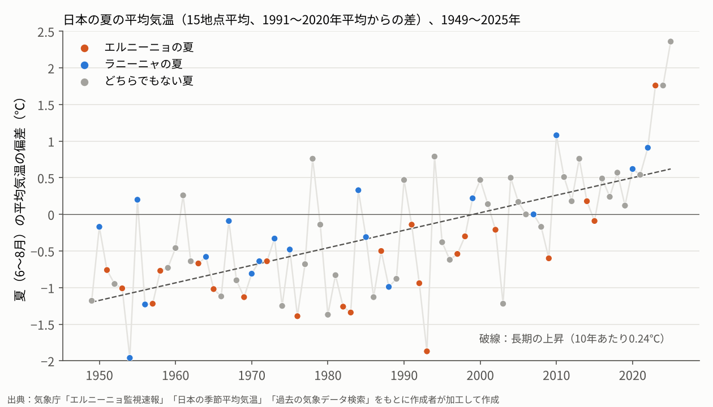
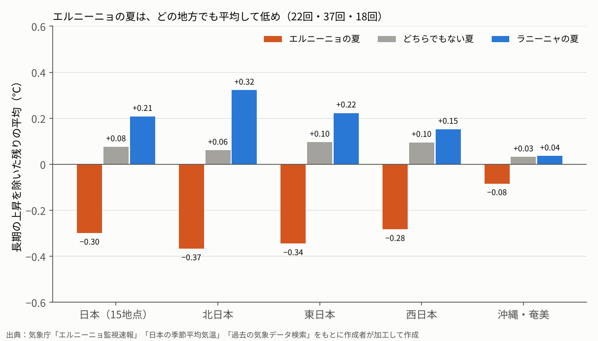
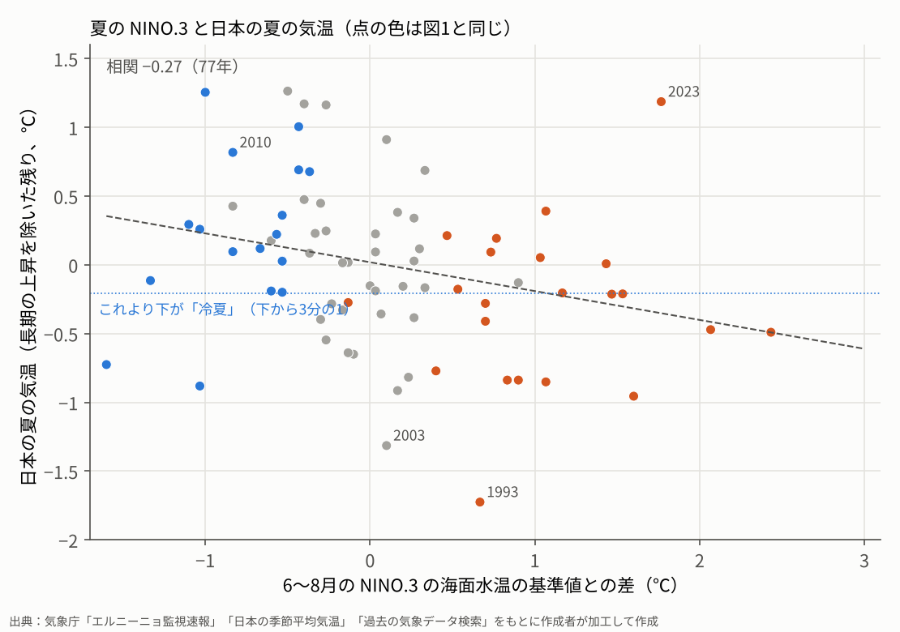
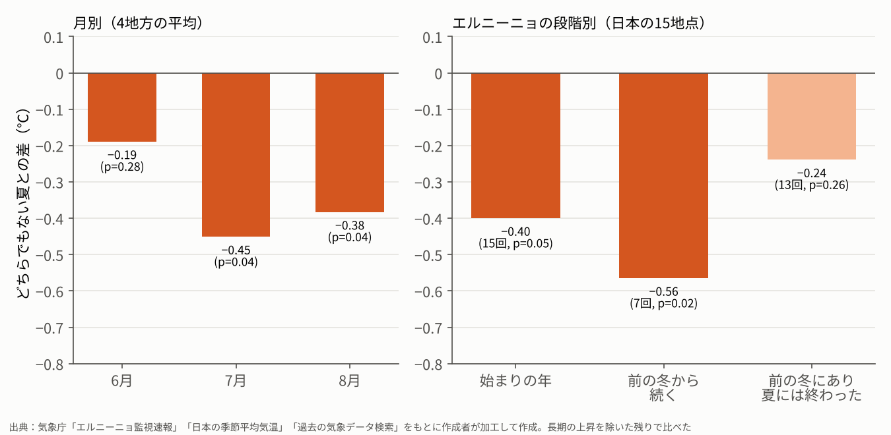

# F493 「エルニーニョの年は冷夏になる」は、日本の夏の気温でどこまで見えるか？ 長期の上昇を除くと、エルニーニョの夏は平均0.38℃低く、22回のうち13回（59%）が冷夏。ただし2023年のように猛暑の年もある

## 結論（先に）
- 1949〜2025年の77回の夏を、気象庁の発生期間の表で「エルニーニョの夏」（22回）・「ラニーニャの夏」（18回）・「どちらでもない夏」（37回）に分けました。長期の上昇（10年あたり0.24℃）を除いて比べると、エルニーニョの夏は、どちらでもない夏より平均0.38℃低くなっていました（並べ替え検定 p=0.03）。
- エルニーニョの夏の22回のうち13回（59%）が「冷夏」（77回の下から3分の1）でした。どちらでもない夏では30%、ラニーニャの夏では11%です。「エルニーニョの年は冷夏になりやすい」は、日本の夏の気温で確かめられました。
- ただし、エルニーニョの夏の3回（1951・1958・2023年）は上から3分の1の暑い夏でした。2023年は、長期の上昇を除いても77回で4番目に暑い夏です。エルニーニョは「冷夏の確率を上げる」もので、「必ず冷夏になる」ものではありません。
- 地方別の差は、東日本 −0.44℃、北日本 −0.43℃、西日本 −0.38℃、沖縄・奄美 −0.12℃。「北日本で最も大きい」という仮説は、東日本とほぼ同じで外れました。北日本は年ごとのばらつきが大きく、差ははっきりしません（p=0.10）。
- 結果を見てから足した問い直しでは、差は7月（−0.45℃）と8月（−0.38℃）に出ていて、6月（−0.19℃）は小さめでした。前の冬から続くエルニーニョの夏（7回）は −0.56℃ と、始まりの年の夏（15回、−0.40℃）より低めでした。

## 問い
「エルニーニョ現象が起きると、日本は冷夏になりやすい」とよく言われます。実際の夏の気温で、どのくらいの差があるのか、どの地方・どの月で見えやすいのか、どのくらいの確からしさで言えるのか。夏物の仕入れや農作業、夏の需要の見通しを立てる人のための記事です。

## データ（出典）
- 気象庁「エルニーニョ監視速報」：NINO.3（太平洋の赤道域東部）の月平均海面水温の、基準値との差（1949年〜）と、過去のエルニーニョ現象・ラニーニャ現象の発生期間の表（季節ごと）。
- 気象庁「日本の季節平均気温偏差」：都市化の影響が比較的小さい15地点の平均（1991〜2020年平均からの差）。夏は6〜8月。
- 気象庁「過去の気象データ検索」：同じ15地点の月平均気温。北日本（網走・根室・寿都・山形・石巻）、東日本（伏木・飯田・銚子）、西日本（境・浜田・彦根・宮崎・多度津）、沖縄・奄美（名瀬・石垣島）に分け、地点ごとに1991〜2020年平均からの差を地方で平均しました。
- 「エルニーニョの夏」は、その年の夏が気象庁の発生期間の表に入っている年です（たとえば1997年春〜1998年夏の現象では、1997年と1998年の夏）。

## 事前の計画
[PLAN.md](PLAN.md)（2026-11-16 14:18、集計の前に作成）。下見では、表の数行（NINO.3 の1988〜1992年、発生期間の表、季節平均気温の1898〜1904年）だけを見ました。

| 仮説 | 外れの基準 | 結果 | 判定 |
|---|---|---|---|
| H1 エルニーニョの夏は平常の夏より0.2℃以上低い | 差が0.2℃未満 | −0.38℃（p=0.03） | 支持 |
| H2 差がいちばん大きいのは北日本 | ほかの地方 | 東日本 −0.44、北日本 −0.43 | 外れ |
| H3 夏の NINO.3 と夏の気温の相関は −0.2 以下 | −0.2 より大きい | −0.27（p=0.02） | 支持 |
| H4 エルニーニョの夏の50%以上が冷夏 | 50%未満 | 59%（13/22） | 支持 |
| H5 ラニーニャの夏は平常より0.1℃以上高い | 0.1℃未満 | +0.13℃（p=0.46） | 支持（ただし偶然の範囲） |

## やったこと
1. 表から、夏ごとの気温、NINO.3、エルニーニョ・ラニーニャの夏かどうかの表を作りました（02_build.py）。
2. 夏の気温から、年に対する直線（長期の上昇）を引いた残りで比べました。群の差は並べ替え検定（年のラベルを10,000回入れ替える。乱数のたねは固定）で確かめました（03_analysis.py）。
3. 結果を見てから、月別と、エルニーニョの段階別に見直しました（03b_requestion.py）。

## 分かったこと

### 1. 長い目で見ると、夏は上がり続けている（図1）

日本の夏の気温は10年あたり0.24℃上がっていて、エルニーニョかどうかより大きな動きです。そのため、そのまま比べると「エルニーニョの多かった時代」の影響が混ざります。この記事では、長期の上昇を除いた残りで比べました。

### 2. エルニーニョの夏は低め、ラニーニャの夏は高め（図2）

残りの平均は、エルニーニョの夏 −0.30℃、どちらでもない夏 +0.08℃、ラニーニャの夏 +0.21℃でした。地方で見ると、北日本・東日本・西日本は −0.38〜−0.44℃の差で、沖縄・奄美（−0.12℃）では小さめでした。ラニーニャの夏の差（+0.13℃）は、偶然でも起こりうる大きさです（p=0.46）。

### 3. 確率で見ると「冷夏が倍に」（図3）

冷夏（下から3分の1）だった割合は、エルニーニョの夏59%（13/22）、どちらでもない夏30%（11/37）、ラニーニャの夏11%（2/18）でした（エルニーニョかどうかと冷夏かどうかの正確検定 p=0.007）。夏の NINO.3 が1℃高いと、日本の夏は平均で0.21℃低いという関係で、相関は −0.27 です。相関の2乗は0.07で、夏の気温の年ごとのばらつきのうち NINO.3 で説明できるのは1割にも届きません。

77回でいちばん低かった1993年はエルニーニョの夏でしたが、2番目の2003年はどちらでもない夏です。逆に2023年はエルニーニョの夏でありながら、長期の上昇を除いても77回で4番目に暑い夏でした。

## 問い直し（結果を見てから足した）

### どの月で、どの段階のエルニーニョで差が出るのか（図4）
H2 で北日本と東日本・西日本の差がほとんど同じだったので、地方ではなく、月とエルニーニョの段階で見直しました。


| 区分 | どちらでもない夏との差 | p |
|---|---|---|
| 6月（4地方の平均） | −0.19℃ | 0.28 |
| 7月 | −0.45℃ | 0.04 |
| 8月 | −0.38℃ | 0.04 |
| 始まりの年の夏（15回） | −0.40℃ | 0.05 |
| 前の冬から続く夏（7回） | −0.56℃ | 0.02 |
| 前の冬にあり、夏には終わった（13回） | −0.24℃ | 0.26 |

- 差は盛夏の7〜8月に出ていて、6月は小さめでした。
- 前の冬から続くエルニーニョの夏（1958・1969・1983・1987・1992・1998・2015年）は、7回と少ないものの、差がいちばん大きくなりました。
- 前の冬にエルニーニョがあって夏までに終わった年（13回、うち5回はその夏にラニーニャ）は、差がはっきりしません。段階別の比べ方では、「どちらでもない夏」から、この13回を除いています。

## 頑健性

| 確かめ方 | エルニーニョの夏の数 | 差（℃） | p | ラニーニャとの差 | 冷夏の割合 |
|---|---|---|---|---|---|
| 本線（発生期間の表、直線を除く、1949〜2025年） | 22 | −0.38 | 0.03 | +0.13 | 59% |
| 6〜8月の NINO.3 が ±0.5℃ 以上で決める | 20 | −0.36 | 0.04 | +0.11 | 55% |
| 1979年以降 | 13 | −0.37 | 0.08 | +0.18 | 62% |
| 前後15年の移動平均を除く | 22 | −0.40 | 0.01 | +0.07 | 59% |
| 15地点平均ではなく4地方の平均 | 22 | −0.34 | 0.02 | +0.11 | 55% |

- エルニーニョの夏の差は、どの確かめ方でも −0.34〜−0.40℃ で、冷夏の割合は55〜62%でした。1979年以降に限ると数が13回に減り、p は0.08になります。
- ラニーニャの夏の差は、どの確かめ方でも小さく、はっきりしません。

## 言えないこと
- 天気の予報ではありません。過去の平均の差で、次の夏を言い当てるものではありません。
- エルニーニョ以外の要因（インド洋の海面水温、偏西風の蛇行、梅雨の長さなど）は分けていません。
- 夏の雨や日照時間は扱っていません。
- 77年でエルニーニョの夏は22回、前の冬から続く夏は7回しかなく、段階別の差は特に数が少ない中での値です。
- 長期の上昇を直線で除いていますが、近年の上昇が直線より速い場合、近年の夏は残りが大きく出ます（移動平均で除いても結果はほぼ同じでした）。

## 仕事で使うなら
- 「エルニーニョ＝冷夏」ではなく、「エルニーニョの夏は、冷夏になる割合がほぼ倍（30%→59%）」と考えると実際に近いです。暑い夏になった例（2023年）もあります。
- 長期の上昇（10年あたり0.24℃）の方が、エルニーニョの平均の差（0.38℃）を十数年で上回る大きさです。気温の見通しでは、まず長期の上昇を考えに入れる必要があります。
- 夏ごとの値は results/summer_table.csv にあります。

## 計画からの変更
- 問い直しは、計画の候補（前の冬にエルニーニョがあった年・月別）の両方を計算しました。
- 段階別の比べ方では、比べる相手の「どちらでもない夏」から、前の冬にエルニーニョがあった13回を除きました（計画にはなかった細かな決め方です）。

## 再現のしかた
```
sh src/run_all.sh        # オフライン。所要約6秒
python3 src/01_fetch.py  # 元データを取り直すときだけ（ネットを使う）
```

| ファイル | 中身 |
|---|---|
| src/02_build.py | 元データ → data/summer.csv・events.csv・nino3_monthly.csv・station_summer.csv |
| src/03_analysis.py | 群の差・相関・冷夏の割合・頑健性 → results/main.json ほか |
| src/03b_requestion.py | 問い直し（月別・段階別） → results/requestion.json ほか |
| src/04_figures.py | 図4枚 |

repro_check：/tmp/rep_F493 に写して流し、15ファイル（results 7、figures 4、data 4）がすべて cmp で一致、所要6秒（results/repro_check.txt）。乱数は並べ替え検定だけに使い、たねを固定しています。

## 関連する記事
- F490「冬の寒さは、どれだけ緩んだのか？」：同じ15地点を使った記事。
- F492「オホーツク海の流氷は、どれだけ減ったのか？」

## レビューで直したこと

| # | 指摘 | 直し方 |
|---|---|---|
| 1 | note のファイル名が BRIEF の決まり（題名の問いから記号を除く）と違い、「日本の夏の気温で」が抜けていた | md を F493_エルニーニョの年は冷夏になるは日本の夏の気温でどこまで見えるか.md に改名し、status の md をそろえた |

直したあと、/tmp で流し直して results・figures が元と一致することを確かめました。

## 出典
- 気象庁「エルニーニョ監視速報」監視指数：https://www.data.jma.go.jp/cpd/db/elnino/index/dattab.html
- 気象庁「過去のエルニーニョ現象及びラニーニャ現象の発生期間」：https://www.data.jma.go.jp/cpd/db/elnino/learning/faq/elnino_table.html
- 気象庁「日本の季節平均気温」：https://www.data.jma.go.jp/cpdinfo/temp/list/ssn_jpn.html
- 気象庁「過去の気象データ検索」：https://www.data.jma.go.jp/stats/etrn/index.php
（各ファイルの URL は data/raw/SOURCES.md）

（いずれも 気象庁の資料をもとに作成者が加工して作成）
