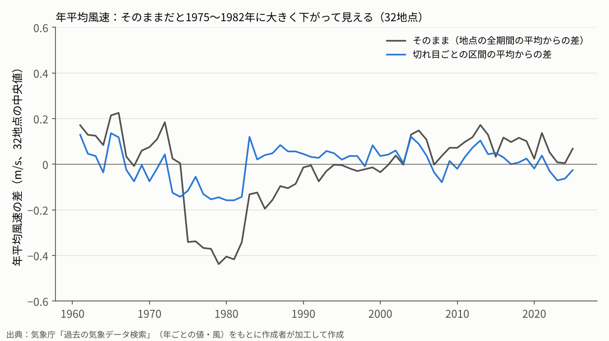
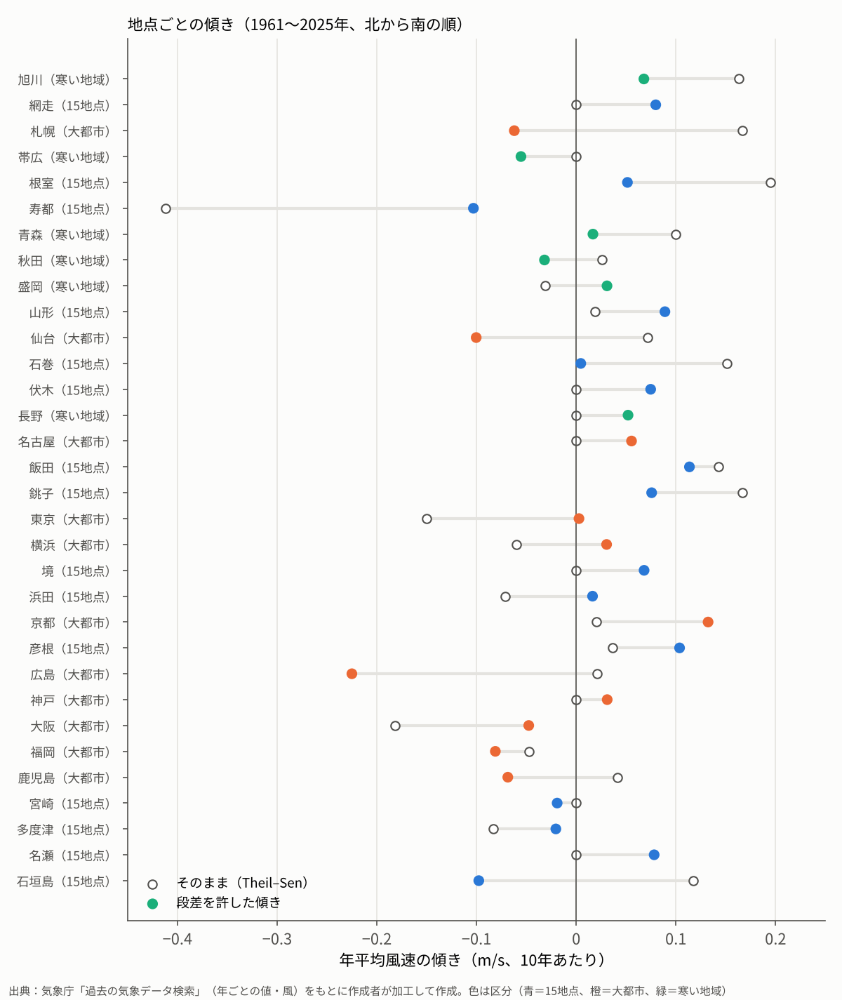
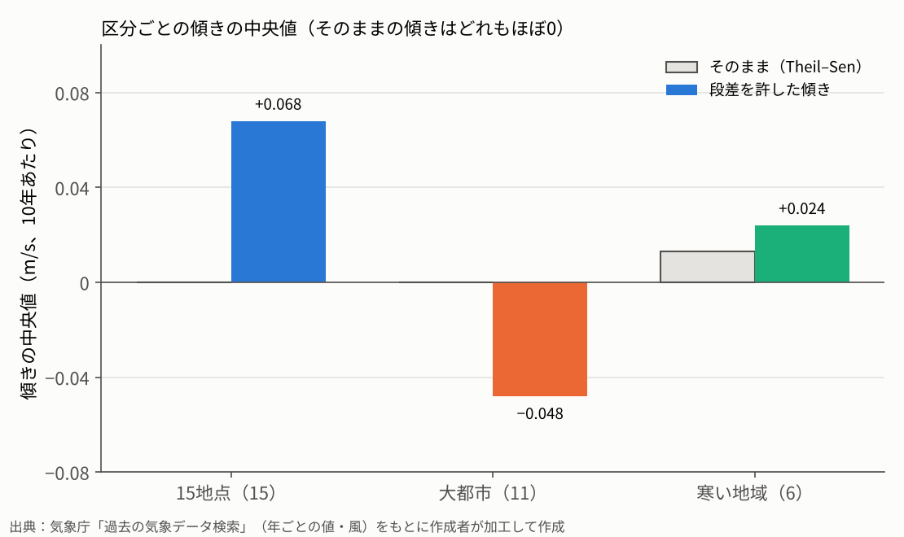
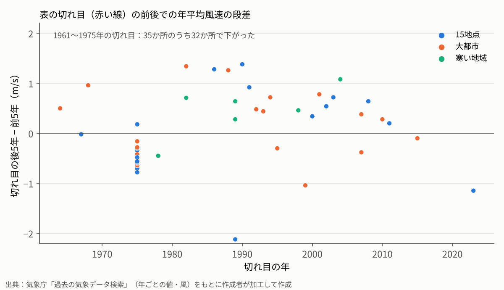

# F494 地上の風は、弱くなったのか？ 32地点の年平均風速は、観測の切れ目を除くと全体では弱まっていない。見かけの落ち込み（1975〜82年）は切れ目の段差が重なったもので、大都市だけは弱まる向き（10年に0.05m/s）

## 結論（先に）
- 気象庁の32地点（都市化の影響が比較的小さい15地点・大都市11地点・寒い地域6地点）の年平均風速を1961〜2025年で見ると、そのまま求めた傾き（Theil–Sen）の中央値は10年あたり0.00m/sで、「地上の風は弱くなった」とは言えませんでした（仮説 H1 は外れ）。
- そのまま並べると、32地点の中央値は1975〜1982年に0.4m/sほど下がって見えます。しかしこの時期には、気象庁の表に「この前後は比べられない」という切れ目（赤い線）が集中していて、1961〜1975年の切れ目35か所のうち32か所で風速が段差状に下がっていました。切れ目ごとの区間で見ると、落ち込みはずっと小さくなります。
- 切れ目ごとに段差を許して求めた傾きの中央値は +0.024m/s（10年あたり）で、32地点のうち弱まったのは12地点、強まったのは20地点でした（符号検定 p=0.22）。
- 区分で分けると、段差を許した傾きの中央値は、大都市 −0.048m/s、15地点 +0.068m/s、寒い地域 +0.024m/s でした。大都市だけが弱まる向きで、15地点との差は −0.12m/s です（ただし地点数が少なく、順位の検定では p=0.07）。周りの建物の影響と合う形ですが、理由は分けられません（推測）。
- 日最大風速が10m/s以上の日数は、そのままだと中央値で年46日（1961〜1970年）から29日（2016〜2025年）に減っていますが、段差を許すと傾きは +0.8日/10年で、はっきりした減少は見えませんでした（H5 外れ）。

## 問い
「地上の風が弱くなった」という話があります。それが本当の風の変化なのか、風速計の取り替えや観測場所の移転、周りの建物の影響なのかを分けて見たい。風力発電や、洗濯物・農薬散布・屋外作業など、地上の風にかかわる計画を立てる人のための記事です。

## データ（出典）
- 気象庁「過去の気象データ検索」年ごとの値（詳細：風）。年平均風速と、日最大風速10m/s以上の日数。1961〜2025年。「]」（資料不足値）の年は除き、「)」（準正常値）は使いました。
- 地点は F490 と同じ32地点です。
- 気象庁の表には、観測場所の移転や測器の変更などで「その前後のデータを比べられない」ところに赤い線が引かれています。HTML の値の欄の印から、年平均風速と10m/s以上の日数のそれぞれについて読み取りました。32地点で合わせて64か所、1地点あたり中央値2か所ありました。

## 事前の計画
[PLAN.md](PLAN.md)（2026-11-16 14:24、集計の前に作成）。下見では、東京の数年分の値と赤い線の位置だけを見ました。

| 仮説 | 外れの基準 | 結果 | 判定 |
|---|---|---|---|
| H1 そのままの傾きの中央値は −0.05m/s/10年以下 | −0.05 より大きい | 0.00 | 外れ |
| H2 段差を許した傾きは、そのままより0に近い | 同じか大きい | +0.024（そのまま 0.00） | 外れ |
| H3 段差を許しても、弱まった地点が多い（符号検定 p<0.05） | p≥0.05 | 弱まり12・強まり20、p=0.22 | 外れ |
| H4 大都市は15地点より0.03m/s/10年以上マイナスに大きい | 差が0.03未満 | −0.048 と +0.068（差 −0.12） | 支持 |
| H5 10m/s以上の日数も、段差を許した傾きがマイナス | 0かプラス | +0.82日/10年 | 外れ |

## やったこと
1. 32地点の表から、年平均風速・10m/s以上の日数と、赤い線の位置を読み取りました（02_build.py）。
2. 地点ごとに、そのままの傾き（Theil–Sen）と、「赤い線で区切った区間ごとに高さが違ってよい、傾きは共通」という当てはめ（区間の固定効果つきの最小二乗法、5年未満の区間は除く）の傾きを求め、区分ごとの中央値と符号検定で比べました（03_analysis.py）。
3. 結果を見てから、切れ目での段差の向きと時期を見ました（03b_requestion.py）。

## 分かったこと

### 1. 見かけの落ち込みは1975〜1982年（図1）

地点の全期間の平均からの差の中央値（黒）は、1975年に急に下がり、1983年ごろに戻っています。切れ目ごとの区間の平均からの差（青）では、この落ち込みはずっと小さく、1990年代以降はどちらもほぼ横ばいです。10年ごとの中央値は、1961〜1970年 +0.12m/s、1971〜1980年 −0.23m/s、1981〜1990年 −0.18m/s、2011〜2020年 +0.11m/s でした。

### 2. 地点ごとの傾きは、上にも下にもばらつく（図2）

北から南に並べると、段差を許した傾きは −0.23m/s（広島）から +0.13m/s（京都）まで、地点によってばらばらです。弱まる向きの地点は大都市（札幌・仙台・広島・大阪・福岡・鹿児島）に多く、15地点では寿都・宮崎・多度津・石垣島の4地点だけでした。

### 3. 区分の差（図4）

そのままの傾きの中央値は、どの区分でもほぼ0でした。段差を許すと、15地点は +0.068m/s、大都市は −0.048m/s と分かれます。年平均風速に対する割合では、15地点 +1.4%、大都市 −1.6%（10年あたり）です。

## 問い直し（結果を見てから足した）

### 切れ目での段差は、どちら向きだったのか（図3）
H2 で、段差を許すと傾きがむしろプラスに寄ったので、切れ目の前5年と後5年の平均の差（同じ区間の中だけ）を63か所で見ました。


| 切れ目の時期 | か所 | 段差の中央値 | 下がった | 上がった |
|---|---|---|---|---|
| 1961〜1975年 | 35 | −0.48m/s | 32 | 3 |
| 1976〜1990年 | 9 | +0.71m/s | 2 | 7 |
| 1991〜2005年 | 12 | +0.51m/s | 2 | 10 |
| 2006〜2025年 | 7 | +0.20m/s | 3 | 4 |

- 1975年に多くの地点で同時に切れ目があり、ほとんどで風速が下がっていました。気象庁の表からは理由はわかりませんが、同じ年に多くの地点でそろって起きていることから、観測の方法がそろって変わった可能性があります（推測）。
- 1976年以降の切れ目では、逆に上がる向きが多くなっていました。切れ目を無視すると、1975年の下がりと、その後の上がりが傾きに混ざります。

## 頑健性

| 確かめ方 | 地点 | 傾きの中央値（m/s/10年） | 弱まり | 強まり | 符号検定 p |
|---|---|---|---|---|---|
| そのまま（Theil–Sen） | 32 | 0.000 | 8 | 15 | 0.21 |
| そのまま（最小二乗法） | 32 | +0.017 | 13 | 19 | 0.38 |
| 段差を許す（本線） | 32 | +0.024 | 12 | 20 | 0.22 |
| 1981〜2025年：そのまま | 32 | +0.045 | 6 | 18 | 0.02 |
| 1981〜2025年：段差を許す | 32 | +0.008 | 15 | 17 | 0.86 |
| いちばん長い区間だけ（Theil–Sen） | 32 | 0.000 | 8 | 13 | 0.38 |
| 切れ目が3つ以下の地点だけ：段差を許す | 30 | +0.031 | 10 | 20 | 0.10 |

- 風速は0.1m/s刻みのため、Theil–Sen の傾きはちょうど0になる地点が多く出ます（32地点のうち9地点）。最小二乗法でも結論は同じでした。
- どの確かめ方でも、全体として弱まったとは言えませんでした。1981年以降をそのまま見ると強まる地点が多く（p=0.02）、これは1980年代以降の切れ目で上がる段差が多かったことと合います。

## 言えないこと
- 上空の風や海上の風は扱っていません。地上の観測点の風だけです。
- 切れ目の理由（風速計の取り替え・高さの変更・移転）は、この表からは分けられません。赤い線のない変化（周りに建物が建つ、木が育つなど）は区間の中に残ります。
- 区間ごとに高さを自由にしているので、切れ目と同時に本当の風の変化があった場合、その分は消えてしまいます。
- 風力発電の発電量への影響は扱っていません。
- 地域の順位は作っていません。

## 仕事で使うなら
- 地点の長い風速の記録を使うときは、気象庁の表の赤い線（切れ目）を確かめ、切れ目をまたいだ比べ方をしないと、見かけの変化を読み違えます。
- 地点ごとの傾きと切れ目の数は results/station_table.csv、切れ目での段差は results/steps.csv にあります。

## 計画からの変更
- そのままの傾きの確かめとして、最小二乗法の傾きを頑健性の表に足しました（Theil–Sen が0になる地点が多かったため）。
- %で表した傾きは、ほぼ同じ結論のため本文の区分の比較にだけ使いました（results/robustness.csv にあります）。

## 再現のしかた
```
sh src/run_all.sh        # オフライン。所要約5秒
python3 src/01_fetch.py  # 元データを取り直すときだけ（ネットを使う）
```

| ファイル | 中身 |
|---|---|
| src/02_build.py | 32地点の HTML → data/annual_wind.csv（切れ目の印・区間番号つき） |
| src/03_analysis.py | 傾き・仮説・頑健性 → results/main.json ほか |
| src/03b_requestion.py | 問い直し（切れ目の段差） → results/requestion.json ほか |
| src/04_figures.py | 図4枚 |

repro_check：/tmp/rep_F494 に写して流し、12ファイル（results 7、figures 4、data 1）がすべて cmp で一致、所要5秒（results/repro_check.txt）。乱数は使っていません。

## 関連する記事
- F490「冬の寒さは、どれだけ緩んだのか？」・F489「熱帯夜の増え方は、都市化でどこまで説明できるか？」：同じ地点を使った記事。

## レビューで直したこと

| # | 指摘 | 直し方 |
|---|---|---|
| 1 | 題名の「大都市だけは10年に0.05m/s弱まった」は、15地点との差の検定が p=0.07 ではっきりしないのに言い切っていた | 「大都市だけは弱まる向き（10年に0.05m/s）」に弱め、「切れ目の段差が重なったもので」とした。status・note の1行目もそろえた |

直したあと、/tmp で流し直して results・figures が元と一致することを確かめました。

## 出典
- 気象庁「過去の気象データ検索」：https://www.data.jma.go.jp/stats/etrn/index.php （各地点のページの URL は data/raw/SOURCES.md）

（気象庁「過去の気象データ検索」をもとに作成者が加工して作成）
