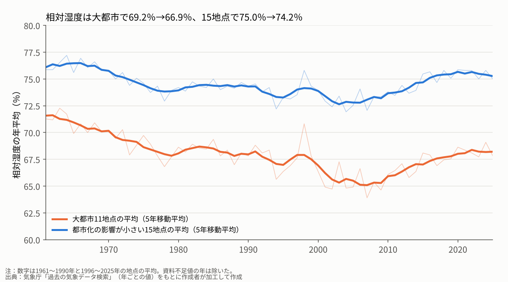
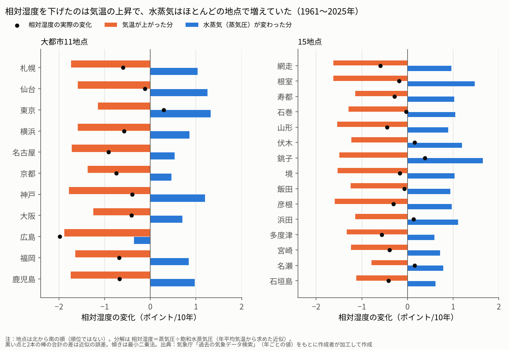
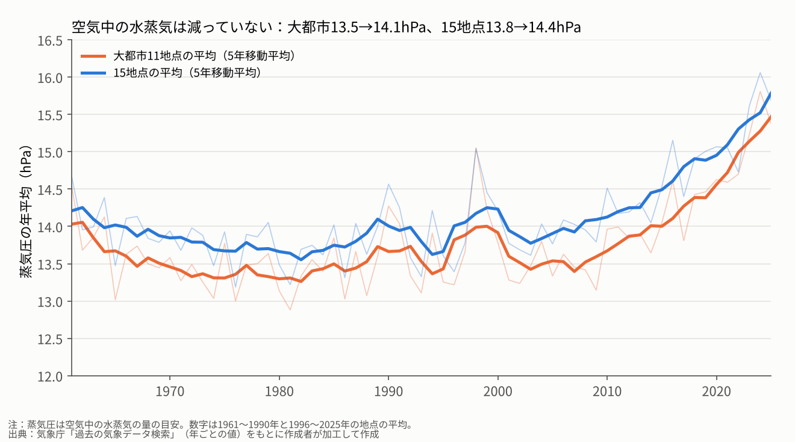
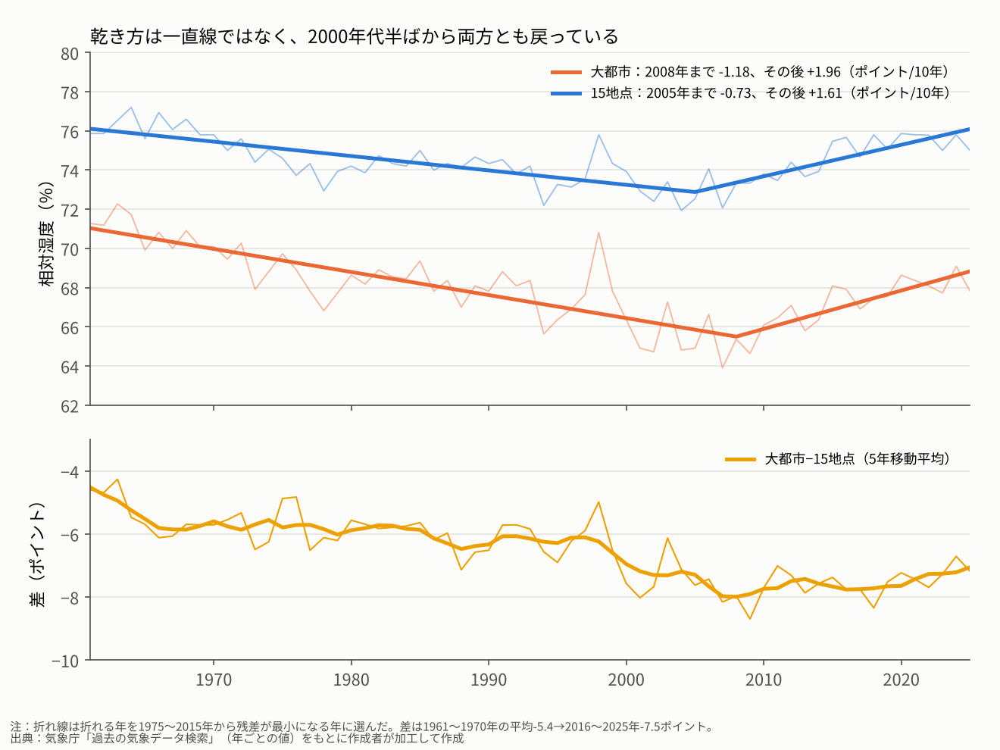

# F495 都市の空気は、乾いてきたのか？ 1961〜2025年に大都市の相対湿度は10年に0.60ポイント下がり、15地点（0.19）より速い。ただ水蒸気の量は11都市のうち10都市で増えていて、下げたのは気温の上昇

## 結論（先に）
- 相対湿度（その気温で含める水蒸気の量に対する、実際の水蒸気の割合）の年平均は、大都市11地点の平均で1961〜1990年の69.2％から1996〜2025年の66.9％に下がりました。気象庁が都市化の影響が比較的小さいとする15地点では75.0％から74.2％です。
- 下がり方（1961〜2025年、10年あたり、地点の中央値）は、大都市0.60ポイント、15地点0.19ポイントでした。大都市の方が0.41ポイント速く下がっています。地点ごとの傾きの違いは偶然では説明しにくい大きさです（Mann–Whitney 検定 p=0.012）。ただし15地点の平均の系列の傾きは、90%区間が−0.43〜+0.06ポイントで、0と区別できません。
- ただし、空気の中の水蒸気の量（蒸気圧）は、大都市11地点のうち10地点、15地点のすべてで増えていました。相対湿度を下げたのは「水蒸気が減ったこと」ではなく、「気温が上がって、含める水蒸気の上限が上がったこと」です。大都市の中央値で、気温の分は−1.64ポイント、水蒸気の分は+0.85ポイント（10年あたり）でした。
- 大都市と15地点の差（0.41ポイント）は、主に大都市の気温の上がり方が大きいことから来ていて（気温の分の差 −0.35）、水蒸気の増え方が小さいこと（−0.12）は小さな部分でした。
- 結果を見てから足した問い直しでは、相対湿度は一直線に下がったのではなく、2000年代半ばまで下がり、その後は大都市・15地点とも戻っていました。また、大都市と15地点の差の広がり（1961〜1997年の平均−5.83ポイント→2003〜2025年−7.52ポイント）のうち、約1.1ポイントは2000年前後の段差で、理由は確かめていません。

## 問い
冬の乾燥、洗濯物の乾き方、建物や倉庫の湿度の管理など、湿度は暮らしや仕事の多くの場面で気にされます。気象庁は、都市では相対湿度が長期的に下がっていて、その理由として、地面が建物や舗装に覆われて水分が減ったことと、気温の上昇を挙げています（ヒートアイランド監視報告 2012 の報道発表資料）。

相対湿度は、空気の中の水蒸気が同じでも、気温が上がるだけで下がります。「都市が乾いた」という話のうち、どれだけが気温のせいで、どれだけが水蒸気そのものの減少なのか。気象庁の地点別の年ごとの値で分けて確かめます。

## データ（出典）
- 気象庁「過去の気象データ検索」年ごとの値（詳細：気温・蒸気圧・湿度）：大都市11地点（札幌・仙台・東京・横浜・名古屋・京都・大阪・神戸・広島・福岡・鹿児島）と、15地点（網走・根室・寿都・山形・石巻・伏木・飯田・銚子・境・浜田・彦根・宮崎・多度津・名瀬・石垣島）。ページの HTML を地点ごとに data/raw に保存しました（合計3.3MB）。
- 使った値：相対湿度の年平均（％、整数）、蒸気圧の年平均（hPa、空気中の水蒸気の量の目安）、日平均気温の年平均（℃）。期間は1961〜2025年。「]」（資料不足値）の年は除きました。
- 15地点は、気象庁が日本の平均気温の変化を求めるのに使っている、都市化の影響が比較的小さい地点です。

## 事前の計画
[PLAN.md](PLAN.md)（2026-11-18、取得後・集計の前に作成）。下見では、表の列の並びだけを確かめました。

| 仮説 | 外れの基準 | 結果 | 判定 |
|---|---|---|---|
| H1 大都市の下がり方は15地点より0.3ポイント/10年以上大きい | 差が0.3未満 | 差0.41ポイント | 支持 |
| H2 15地点でも下がっている | 中央値が0以上 | −0.19ポイント/10年 | 支持（基準の上では。ただし平均の系列の傾きの90%区間は−0.43〜+0.06で0をまたぐ） |
| H3 大都市の下がり方のうち、気温の分は半分未満 | 半分以上 | 気温の分は下がり方の2.75倍（水蒸気は逆に増えた） | 外れ |
| H4 15地点の蒸気圧は増えている | 中央値が0以下 | +0.18hPa/10年 | 支持 |

## やったこと
1. 26地点のページから、年ごとの値を抜き出しました（02_build.py）。
2. 地点ごとに相対湿度・蒸気圧・気温の傾き（10年あたり）を求めました。相対湿度は「蒸気圧 ÷ その気温での飽和水蒸気圧（Magnus の式）」なので、対数をとった傾きを使い、相対湿度の変化を「気温の分」と「水蒸気の分」に分けました（03_analysis.py）。年平均の気温から飽和水蒸気圧を求めるのは近似で、2つの分の合計と実際の変化の差（近似の誤差）は中央値0.17ポイントでした。
3. 結果を見てから、区分の平均の系列に折れ線を当て、乾き方が一直線かを見ました（03b_requestion.py）。

## 分かったこと

### 1. 大都市の方が速く下がった（図1）

大都市の平均は、15地点より5〜8ポイント低い水準で推移し、差は1961〜1970年の−5.4ポイントから2016〜2025年の−7.5ポイントに広がりました。1998年は両方とも湿った年でした。

### 2. 下げたのは気温で、水蒸気は増えていた（図2）

- どの地点でも、気温の分（気温の上昇で飽和水蒸気圧が上がった分）は−0.8〜−1.9ポイント/10年でした。
- 水蒸気の分は、広島（−0.36）を除く25地点でプラスでした。水蒸気が減って乾いた、と言える地点は広島だけです。広島は観測場所の移転に伴って相対湿度の平年値が補正された地点の一つで、移転の影響を含む可能性があります（推測）。
- 東京は相対湿度が上がる向き（+0.29）でした。2014年に観測場所が移った影響を含むと考えられます（推測）。
- 名古屋（+0.53）・京都（+0.46）は水蒸気の増え方が小さく、相対湿度の下がり方が大きい側でした。

### 3. 空気の中の水蒸気は減っていない（図3）

蒸気圧の平均は、大都市で13.5hPaから14.1hPa、15地点で13.8hPaから14.4hPaに増えました（1961〜1990年と1996〜2025年）。大都市は15地点より0.3〜0.4hPaほど低い水準で、増え方はほぼ同じ（10年あたり0.19と0.18hPa）です。2010年代からの増え方が大きく見えます。

## 問い直し（結果を見てから足した）

### 乾き方は一直線か（図4）

図1で、2000年代半ばに底があるように見えたので、区分の平均に折れ線（ある年で傾きが変わる直線）を当てました。折れる年は1975〜2015年から残差が最小になる年を選び、直線とは BIC（当てはまりと複雑さのつり合いの目安）で比べました。

| 系列 | 折れる年 | その前（ポイント/10年） | その後 | 直線より良いか |
|---|---|---|---|---|
| 大都市の平均 | 2008年 | −1.18 | +1.96 | 良い |
| 15地点の平均 | 2005年 | −0.73 | +1.61 | 良い |
| 大都市−15地点 | 2015年 | −0.51 | +0.55 | 良くならない（直線で −0.44） |

- 相対湿度は2000年代半ばまで下がり、その後は両方とも戻っていました。大都市は2001〜2010年の平均65.3％から2016〜2025年の68.0％に、15地点は73.0％から75.5％になりました。
- 戻りは大都市と15地点で同じ時期に起きていて、都市化とは別の、全国に共通する要因（気候の変化や、観測の方法の変化）によると考えられます（推測。この記事のデータでは分けられません）。
- 大都市と15地点の差は、折れ線にしても直線より良くなりませんでした。ただ、レビューで「直線＋ある年の段差」を当てると、2000年に約1.09ポイントの段差を入れた形の方が直線より良く（BIC −61.6 と −54.5）、段差を除いた広がりは10年に0.19ポイントでした（results/review_checks.json）。差の広がりの半分ほどは、2000年前後に一度に開いた形です。段差の理由（観測場所のまわりの変化、測器の変更など）は、この記事のデータでは分けられません（推測）。

## 頑健性

| 確かめ方 | 大都市の相対湿度 | 15地点 | 差 | 大都市の気温の分 | 大都市の水蒸気の分 |
|---|---|---|---|---|---|
| 本線：1961〜2025年、最小二乗法 | −0.60 | −0.19 | −0.41 | −1.64 | +0.85 |
| 1981〜2025年 | −0.08 | +0.27 | −0.34 | −1.91 | +1.94 |
| 1961〜2005年（戻りの前まで） | −1.30 | −0.70 | −0.60 | −1.44 | +0.02 |
| Theil–Sen（計画の手法） | −0.62 | 0.00 | −0.62 | −1.65 | +0.78 |
| 東京を除く | −0.63 | −0.19 | −0.45 | −1.68 | +0.85 |
| 「]」の年も含める | −0.60 | −0.19 | −0.41 | −1.64 | +0.84 |

（単位はポイント/10年。results/robustness.csv）
- 大都市の方が速く下がる（差がマイナス）ことと、大都市の水蒸気の分がマイナスにならないことは、どの確かめ方でも同じでした。
- 下がり方の大きさは期間で大きく変わります。1981年以降に限ると、大都市はほぼ横ばい（−0.08）、15地点は上がる向き（+0.27）です。「乾いてきた」と言えるかは、どこから数えるかに左右されます。
- 1961〜2005年に限ると、水蒸気の分はほぼ0で、下がり方はほぼ気温の分で説明できます。

## 言えないこと
- 都市化の効果と、観測場所の移転・周りの環境の変化・測器の変更を分けられません（東京は2014年に移転）。
- 年平均の値なので、冬の乾燥など季節ごとの変化や、時刻による違いは見えません。
- 分解は、年平均の気温から飽和水蒸気圧を求める近似です。時刻ごとの値を使えば、分け方の数字は変わります。
- 2000年代半ばからの戻りの理由と、大都市と15地点の差に見える2000年前後の段差の理由は、この記事のデータでは確かめていません。
- 15地点も、都市化の影響がまったくないわけではありません。
- 湿度が暮らしに与える影響は扱っていません。

## 仕事で使うなら
- 「都市が乾いた」という話を読むときは、相対湿度（割合）と蒸気圧（水蒸気の量）を分けて見ると読み違えにくいです。この期間、水蒸気の量はほとんどの地点で増えていました。
- 相対湿度の傾きは、始める年で大きく変わります（2000年代半ばに底）。地点ごとの値は results/station_slopes.csv にあります。

## 計画からの変更
- 傾きの本線を Theil–Sen から最小二乗法に変えました。相対湿度の年平均は整数（％）で出ていて、Theil–Sen（2年ずつの組の傾きの中央値）だと多くの地点で傾きがちょうど0になり、地点の違いが見えなくなったためです。Theil–Sen の結果は頑健性の表に残しました（大都市が速く下がる点は同じ）。
- H3 の割合は、地点ごとの比の中央値ではなく、中央値どうしの比で判定しました。相対湿度の傾きが0に近い地点（仙台・東京）で比が大きく振れるためです。どちらの比でも「外れ」は同じでした（地点ごとの比の中央値は2.59）。
- 頑健性に「1961〜2005年」を足しました（問い直しで見つけた底の前まで）。

## 再現のしかた
```
sh src/run_all.sh        # オフライン。所要約4秒
python3 src/01_fetch.py  # 元データを取り直すときだけ（ネットを使う）
```

| ファイル | 中身 |
|---|---|
| src/01_fetch.py | 26地点のページを data/raw に保存（run_all.sh からは呼ばない） |
| src/02_build.py | 26地点の HTML → data/annual.csv |
| src/03_analysis.py | 傾き・分解・仮説・頑健性 → results/main.json・station_slopes.csv・yearly_group_mean.csv・robustness.csv |
| src/03b_requestion.py | 問い直し（折れ線） → results/requestion.json・requestion_fit.csv |
| src/03c_review.py | 独立レビューで足した確かめ（検定・区間・段差） → results/review_checks.json |
| src/04_figures.py | 図4枚 |

repro_check：/tmp/rv_F495 に写し、作られるファイルを消して流し、12ファイル（results 7、figures 4、data 1）がすべて cmp で一致、所要5秒（results/repro_check.txt）。乱数は使っていません。

## 関連する記事
- F489「熱帯夜の増え方は、都市化でどこまで説明できるか？」：同じ大都市11地点と15地点の比べ方で、熱帯夜（最低気温）を扱っています。この記事は湿度と水蒸気を扱います。

## レビューで直したこと

| # | 指摘 | 直し方 |
|---|---|---|
| 1 | 題名の「10年に0.60ポイント」は1981年以降ではほぼ横ばい（−0.08）で、始める年に強く左右されるのに、題名に期間がなかった | 題名に「1961〜2025年に」を足した（status・note の1行目も同じ） |
| 2 | 大都市と15地点の違い、15地点の下がり方に不確かさの幅がなかった | src/03c_review.py を足し、地点の傾きの Mann–Whitney 検定（p=0.012）と、平均の系列の傾きの90%区間（15地点は−0.43〜+0.06で0をまたぐ）を結論と H2 に書いた |
| 3 | 「差は期間全体で少しずつ広がった」は図4の下の段と合わない（2000年前後に段差がある） | 直線＋段差の式を当て、2000年に約1.09ポイントの段差がある方が直線より良いこと、段差を除くと広がりは10年に0.19ポイントであることを書き、理由は分けられないと言えないことに足した |
| 4 | 同じ地点の分け方の既存記事（F489）への言及がなかった | 「関連する記事」を足した |

## 出典
- 気象庁「過去の気象データ検索」：https://www.data.jma.go.jp/stats/etrn/index.php （各地点のページの URL は data/raw/SOURCES.md）
- 気象庁「大都市及び都市化の影響が比較的小さいとみられる15地点平均の年平均気温偏差の経年変化」：https://www.data.jma.go.jp/cpdinfo/himr/himr_temp_diff.html
- 気象庁 報道発表資料「ヒートアイランド監視報告（平成23年）」（2012年7月）：https://www.jma.go.jp/jma/press/1207/09b/heatisland2012.pdf
- 気象庁「測候時報」第78巻（平年値の統計と移転に伴う補正）：https://www.jma.go.jp/jma/kishou/books/sokkou/78/vol78p043.pdf

（いずれも 気象庁「過去の気象データ検索」をもとに作成者が加工して作成）
