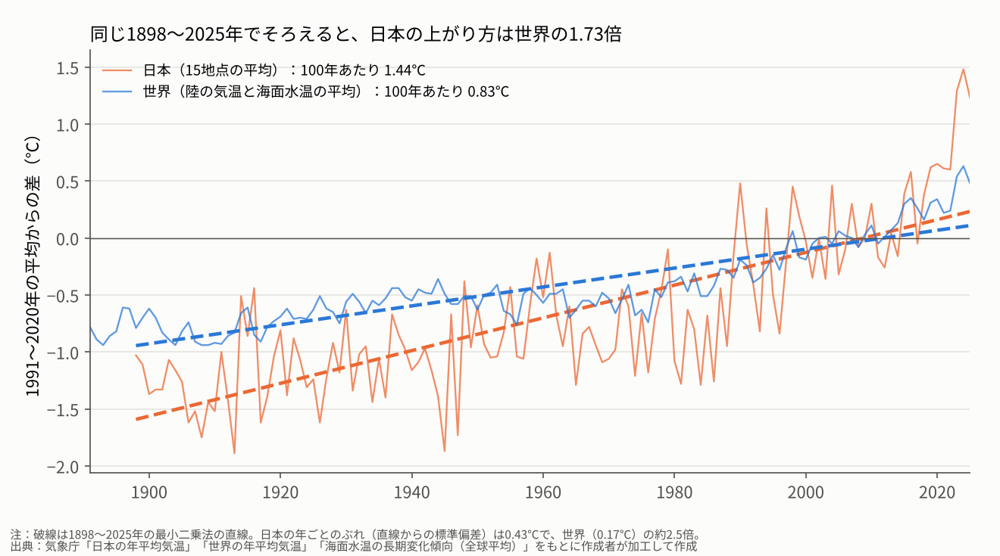
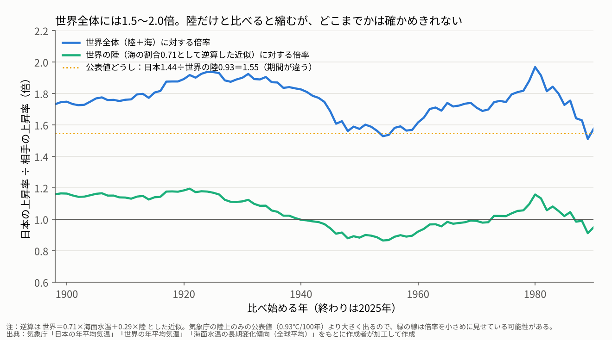
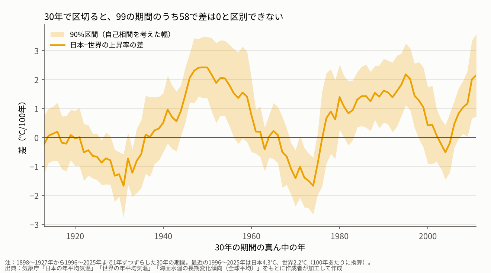
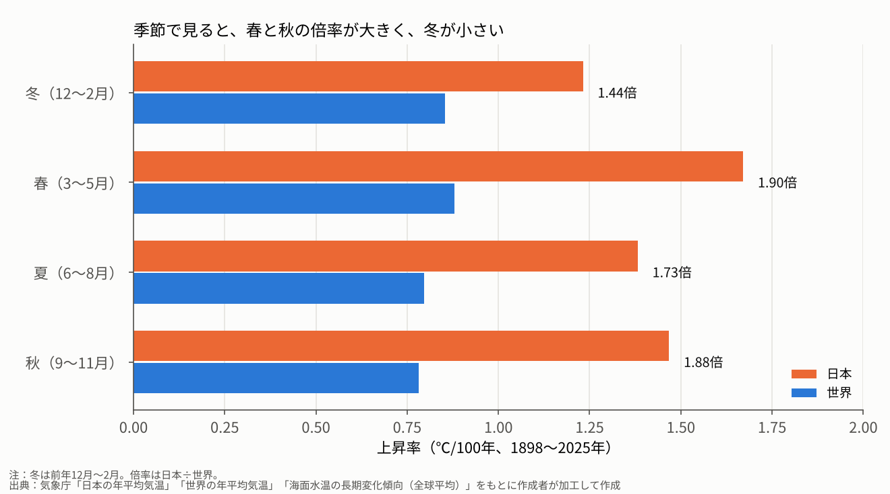

# F496 「日本の気温は世界より速く上がっている」は本当か？ 同じ1898〜2025年でそろえると世界の1.73倍で、比べ始める年を変えても1.5〜2.0倍。ただ海を除いた陸だけの世界と比べると、近似で1.1〜1.5倍に縮む

## 結論（先に）
- 気象庁の公表値（日本は100年あたり1.44℃、世界は0.79℃）は、CSV から最小二乗法で再現できました（1.436℃と0.788℃）。ただし日本は1898年から、世界は1891年からで、期間が違います。
- 同じ1898〜2025年にそろえると、世界は0.83℃で、日本は世界の1.73倍でした。比べ始める年を1898〜1990年のどこにしても、日本は世界の1.51〜1.97倍で、世界より遅くなる期間はありませんでした。
- ただし日本の年ごとのぶれは世界の約2.5倍あります。30年ずつ区切ると、99の期間のうち58（59%）で、日本と世界の上がり方の差は0と区別できませんでした。「日本は速い」は100年以上の長い期間で言えることです。
- 世界の値は海面水温を約7割含みます。陸は海より暖まりやすいので、陸だけと比べると倍率は縮みます。ただ、どこまで縮むかは確かめきれませんでした（逆算した近似では1.16倍、海の割合の置き方で1.08〜1.26倍、期間の違う公表値どうしでは1.55倍。幅で言えば1.1〜1.5倍）。
- 結果を見てから足した問い直しでは、季節ごとの倍率は春1.90倍・秋1.88倍・夏1.73倍・冬1.44倍でした。

## 問い
気候のニュースや白書、会社の気候の情報開示などで、「日本は世界の約2倍の速さで暖まっている」という説明を見かけます。気象庁は、日本の年平均気温は100年あたり1.44℃、世界は0.79℃の割合で上がっていると公表しています。

ただ、日本の値は1898年から、世界は1891年からで、期間が違います。また世界の値は陸の気温と海面水温の平均で、地球の表面の7割は海です。陸は海より暖まりやすいので、「陸の日本」と「海を多く含む世界」を比べると、日本が特別に速いように見えるだけかもしれません。この記事は、期間のそろえ方と比べる相手で、倍率がどれだけ変わるかを確かめます。

既存の記事「日本近海の海水温は世界平均の約2倍の速さで上がっていた」（看板記事100）は海面水温どうしの比較でした。この記事は陸の気温（15地点）を扱います。

## データ（出典）
- 気象庁「日本の年平均気温偏差」（1898〜2025年、CSV）：都市化の影響が比較的小さい15地点の平均。
- 気象庁「世界の年平均気温偏差」（1891〜2025年、CSV）：世界全体・北半球・南半球。
- 気象庁「日本・世界の季節平均気温偏差」（CSV）。
- 気象庁「海面水温の長期変化傾向（全球平均）」（1891〜2025年、テキスト）。
- 気象庁の解説ページ（日本・世界・世界の陸上のみ）：公表の上昇率を照合するために保存しました。世界の陸上のみの気温は、上昇率（100年あたり0.93℃、1880年〜）の文章と図はありますが、数値の表は見つかりませんでした。
- 偏差はいずれも1991〜2020年の平均からの差です。data/raw は合計52KB です。

## 事前の計画
[PLAN.md](PLAN.md)（2026-11-18、取得後・上昇率の計算の前に作成）。下見では、解説ページの公表値と CSV の列の形だけを見ました。

| 仮説 | 外れの基準 | 結果 | 判定 |
|---|---|---|---|
| H1 1898〜2025年でそろえても世界の1.5倍以上 | 1.5倍未満 | 1.73倍 | 支持 |
| H2 世界の陸（逆算）と比べると1.3倍未満 | 1.3倍以上 | 1.16倍。ただし逆算の確かめに失敗 | 判定できず |
| H3 始まりの年をどこにしても日本＞世界 | 世界以下になる年がある | 1898〜1990年のすべてで日本が大きい（1.51〜1.97倍） | 支持 |
| H4 30年の期間の半分以上で差の区間が0をまたぐ | 半分未満 | 99のうち58（59%） | 支持 |

H2 は、計画で「逆算した陸を気象庁の公表値と比べて近似の確からしさを確かめる」としていました。逆算した陸（1891〜2025年）は100年あたり1.18℃で、公表値0.93℃（1880〜2025年）と0.25℃ずれたため、判定しないことにしました。

## やったこと
1. CSV とテキストから年ごとの表を作り、解説ページから公表の上昇率を読み取りました（02_build.py）。
2. 公表値を再現したうえで、期間をそろえた上昇率、始まりの年ごとの倍率、30年ずつの差（Newey–West の90%区間。年どうしの似かよりを考えた幅）、陸の逆算（世界＝0.71×海＋0.29×陸）を計算しました（03_analysis.py）。
3. 結果を見てから、季節ごとの倍率を計算しました（03b_requestion.py）。

## 分かったこと

### 1. 期間をそろえると1.73倍（図1）

1898〜2025年の上昇率は、日本1.44℃、世界0.83℃（100年あたり）でした。公表の0.79℃より世界が少し大きいのは、1891〜1897年を除いたためです。日本の偏差を世界の偏差で回帰した傾き（世界が1℃上がった年に日本は平均で何℃上がっているか）は1.64（標準誤差0.10）でした。

### 2. 比べ始める年で1.5〜2.0倍（図2）

- 世界全体に対する倍率は、比べ始める年を1898〜1990年のどこにしても1.51〜1.97倍でした。
- 海面水温から逆算した世界の陸に対しては0.87〜1.20倍で、93の始まりの年のうち37で日本が陸以下になりました。ただし、この逆算は気象庁の陸上のみの公表値より大きく出ていて、倍率を小さめに見せている可能性があります（推測）。
- 公表値どうし（日本1.44÷世界の陸0.93）は1.55倍ですが、期間が違います。

### 3. 30年では区別できないことが多い（図3）

日本の年ごとのぶれ（直線からの標準偏差）は0.43℃で、世界の0.17℃の約2.5倍です。30年ずつ区切ると、日本の方が遅い期間も32ありました（例：1960〜1989年は日本−0.13℃、世界+0.80℃）。最近の1996〜2025年は日本4.32℃、世界2.17℃（100年あたりに換算）で、差の90%区間は0.72〜3.58℃と0をまたぎません。

## 問い直し（結果を見てから足した）

### 季節で倍率は違うか（図4）

年の倍率が1.73倍と分かったので、季節で違うかを見ました（1898〜2025年）。

| 季節 | 日本（℃/100年） | 世界 | 倍率 | 差の90%区間 |
|---|---|---|---|---|
| 冬（12〜2月） | 1.23 | 0.85 | 1.44 | 0.13〜0.63 |
| 春（3〜5月） | 1.67 | 0.88 | 1.90 | 0.51〜1.08 |
| 夏（6〜8月） | 1.38 | 0.80 | 1.73 | 0.31〜0.86 |
| 秋（9〜11月） | 1.47 | 0.78 | 1.88 | 0.44〜0.93 |

- どの季節でも日本の方が速く、差の90%区間は0をまたぎませんでした。
- 冬の倍率がいちばん小さく、日本の冬は年ごとのぶれも大きい（直線からの標準偏差0.77℃）季節でした。

## 頑健性

| 確かめ方 | 日本 | 世界 | 倍率（世界） | 逆算した陸 | 倍率（陸） |
|---|---|---|---|---|---|
| 本線：1898〜2025年、最小二乗法 | 1.44 | 0.83 | 1.73 | 1.24 | 1.16 |
| Theil–Sen（外れ値に強い傾き） | 1.38 | 0.80 | 1.72 | 1.18 | 1.17 |
| 終わりを2022年（2023〜25年を除く） | 1.30 | 0.78 | 1.68 | 1.14 | 1.15 |
| 相手を北半球（0.88） | 1.44 | 0.88 | 1.63 | — | — |
| 海の割合0.65で逆算 | 1.44 | 0.83 | 1.73 | 1.14 | 1.26 |
| 海の割合0.75で逆算 | 1.44 | 0.83 | 1.73 | 1.33 | 1.08 |
| 回帰の傾き（日本の偏差を世界で回帰） | — | — | 1.64 | — | — |

（単位は℃/100年。results/robustness.csv）
- 世界全体に対する倍率は1.6〜1.7倍で、どの確かめ方でも1.5倍を下回りませんでした。
- 陸に対する倍率は、海の割合の置き方で1.08〜1.26倍と動きます。気象庁の陸上のみの公表値に合うように海の重みを逆算すると0.47になり、「海が7割」という前提と合いません。陸と海の分け方は、この記事のデータでは確かめきれませんでした。

## 言えないこと
- 世界の陸上のみの気温の表は使えていません。陸どうしの倍率は近似か、期間の違う公表値どうしの比です。
- 日本の値は15地点の平均で、日本全体の面積の平均ではありません。
- なぜ日本が世界より速いのか（緯度、海流、大気の流れ、陸か海か）は確かめていません。
- 30年程度の短い期間の倍率は、年ごとのぶれで大きく動きます。最近の期間の倍率から先のことは言えません。
- 気温の上昇が暮らしや産業に与える影響は扱っていません。

## 仕事で使うなら
- 「日本は世界の約2倍」と書くときは、期間をそろえると1.73倍、比べ始める年で1.5〜2.0倍、と幅で示すと読み違えにくいです。
- 世界の値は海を含むので、「陸の日本」と比べた倍率であることを添えると誤解が減ります。年ごとの値は results/annual_with_land_est.csv にあります。

## 計画からの変更
- H2 は、計画に書いた確かめ（逆算と公表値の照合）で食い違いが出たため、「判定できず」にしました。
- 問い直しは、計画の候補から季節ごとの倍率を選びました。始まりの年ごとの倍率は本線（図2）に入れました。

## 再現のしかた
```
sh src/run_all.sh        # オフライン。所要約5秒
python3 src/01_fetch.py  # 元データを取り直すときだけ（ネットを使う）
```

| ファイル | 中身 |
|---|---|
| src/01_fetch.py | CSV・テキスト・解説ページを data/raw に保存（run_all.sh からは呼ばない） |
| src/02_build.py | → data/annual.csv・seasonal.csv・published.json |
| src/03_analysis.py | 上昇率・倍率・30年の期間・仮説・頑健性 → results/main.json・start_year_scan.csv・window30.csv・robustness.csv・annual_with_land_est.csv |
| src/03b_requestion.py | 問い直し（季節） → results/requestion.json・requestion_seasons.csv |
| src/04_figures.py | 図4枚 |

repro_check：/tmp/rv_F496 に写し、作られるファイルを消して流し、14ファイル（results 7、figures 4、data 3）がすべて cmp で一致、所要6秒（results/repro_check.txt）。乱数は使っていません。

## レビューで直したこと

| # | 指摘 | 直し方 |
|---|---|---|
| 1 | 題名に「30年で区切ると99の期間のうち58で差は区別できず」と「陸だけと比べると縮む」を並べていて長く、芯（期間をそろえた倍率と、その幅）が見えにくかった。30年の区別できなさは、日本の年ごとのぶれが大きいことによる検出力の話で、結論の芯ではない | 題名を「1.73倍で、比べ始める年を変えても1.5〜2.0倍。ただ陸だけの世界と比べると、近似で1.1〜1.5倍に縮む」に直した。30年の結果は本文に残した（status・note の1行目も同じ） |
| 2 | 「陸だけと比べると倍率は縮む」に数字がなかった | 逆算（1.08〜1.26倍）と期間の違う公表値どうし（1.55倍）を合わせた幅「1.1〜1.5倍」を題名と結論に書き、近似であることを題名にも入れた |

数字の照合（1.436・0.788・0.829・1.73・1.51〜1.97・58/99・季節の表）、CSV の読み取り（年・列の並び）、再実行（14ファイル一致）は、直すところはありませんでした。

## 出典
- 気象庁「日本の年平均気温」：https://www.data.jma.go.jp/cpdinfo/temp/an_jpn.html
- 気象庁「世界の年平均気温」：https://www.data.jma.go.jp/cpdinfo/temp/an_wld.html
- 気象庁「世界の年平均気温（陸上のみ）」：https://www.data.jma.go.jp/cpdinfo/temp/land/land_an_wld.html
- 気象庁「季節平均気温偏差」の表：https://www.data.jma.go.jp/cpdinfo/temp/list/ssn_jpn.html 、https://www.data.jma.go.jp/cpdinfo/temp/list/ssn_wld.html
- 気象庁「海面水温の長期変化傾向（全球平均）」：https://www.data.jma.go.jp/kaiyou/data/shindan/a_1/glb_warm/glb_warm.html
（各ファイルの URL は data/raw/SOURCES.md）

（いずれも 気象庁の各ページのデータをもとに作成者が加工して作成）
