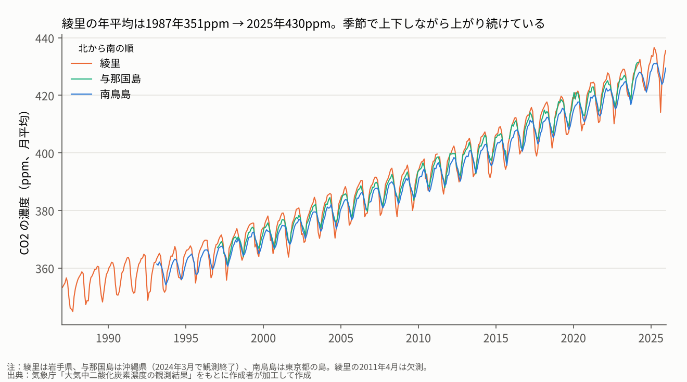
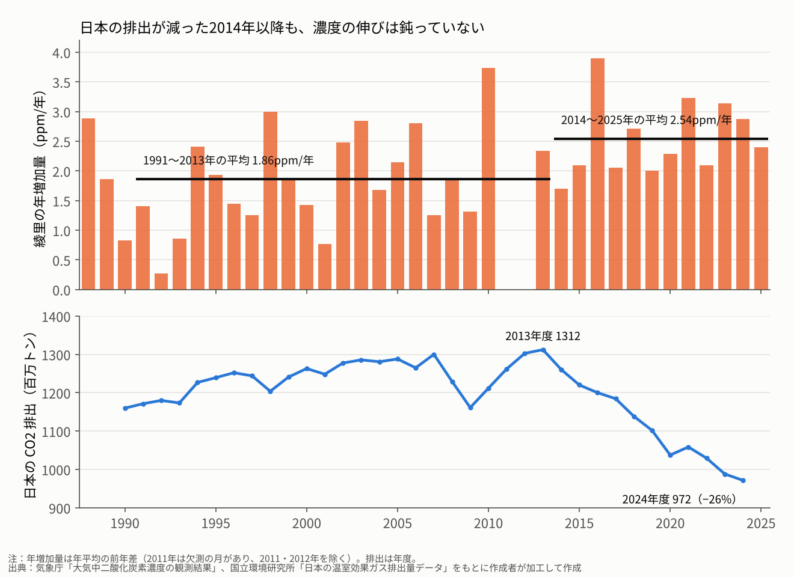
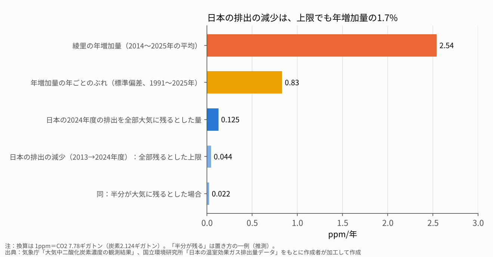
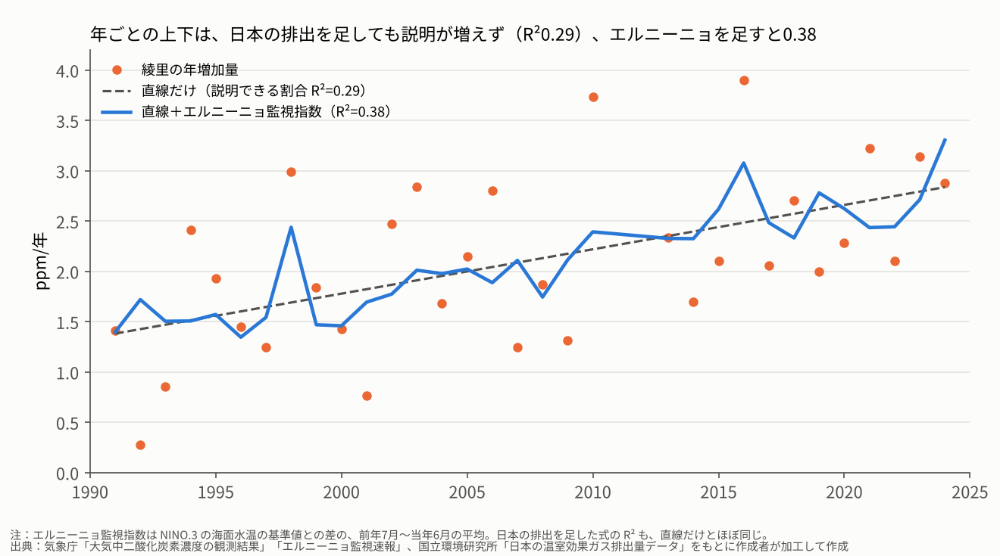

# F497 日本で測る CO2 の濃度は、排出が減っても上がり続けているのか？ 綾里の年増加量は2014〜2025年に平均2.54ppmで、それまで（1.86ppm）より大きい。日本の排出の26%減は、上限で換算しても年0.044ppmで、年増加量の1.7%

## 結論（先に）
- 気象庁が綾里（岩手県）で測る CO2 の濃度の年平均は、1987年の351ppm から2025年（速報値）の430ppm に上がりました。南鳥島・与那国島でも同じように上がり続けています。
- 1年に増える量（年増加量）の平均は、1991〜2013年の1.86ppm から2014〜2025年の2.54ppm に大きくなりました。日本の CO2 排出が2013年度から2024年度に26%減った期間に、濃度の伸びは鈍っていません。
- 日本の排出の減少（341百万トン）を、全部大気に残るとした上限で濃度に換算しても年0.044ppm で、2014〜2025年の年増加量の1.7%です。年増加量の年ごとのぶれ（標準偏差0.83ppm）の20分の1ほどで、濃度の観測から見分けられる大きさではありません。
- 日本の排出量と年増加量の年ごとの動きには、ほとんど相関がありませんでした（直線の傾向を除いた相関0.09）。
- 結果を見てから足した問い直しでは、年増加量の年ごとの上下は、日本の排出を足しても説明が増えず（R² 0.29→0.29）、前年7月〜当年6月のエルニーニョ監視指数を足すと0.38に上がりました。ただし指数の取り方を2通り試したうちの1つだけで、p=0.048 とぎりぎりなので、強い証拠ではありません。

## 問い
「日本の CO2 排出は2013年度から2割以上減った」というニュースと、「CO2 の濃度は過去最高」というニュースを、両方目にします。気象庁は、綾里・南鳥島・与那国島で大気中の CO2 の濃度を測っていて、いずれの地点でも増え続けていると説明しています。

濃度は、世界中の排出が大気にたまった結果です。日本の排出が減ったことは、日本で測る濃度にどれくらい表れるはずなのか。表れないなら、それはどれくらいの大きさの違いなのか。数字で確かめます。日本の排出が減った理由は、既存の看板記事 F329 で扱いました。この記事は濃度の側から見ます。

## データ（出典）
- 気象庁「大気中二酸化炭素濃度の観測結果」月平均（綾里1987年〜、南鳥島1993年〜、与那国島1997年〜2024年3月）。単位は ppm（空気の分子100万個のうちの数）。2025年以降は速報値です。綾里は2011年4月、南鳥島は2006年9〜10月、与那国島は2015年10月が欠測です。
- 気象庁「エルニーニョ監視速報」NINO.3（エルニーニョ監視海域の海面水温の基準値との差、月平均）。
- 国立環境研究所 温室効果ガスインベントリオフィス「日本の温室効果ガス排出量データ」（1990〜2024年度、確報値）の CO2 の総排出量。
- data/raw は合計1.5MB です。

## 事前の計画
[PLAN.md](PLAN.md)（2026-11-18、取得後・集計の前に作成）。下見では、CSV の最後の行（いつまで値があるか）と気象庁の解説ページの説明だけを見ました。

| 仮説 | 外れの基準 | 結果 | 判定 |
|---|---|---|---|
| H1 年増加量の平均は2014〜2025年の方が大きい | 小さい | 1.86 → 2.54ppm/年 | 支持 |
| H2 日本の排出の減少は、上限で換算しても0.1ppm/年未満 | 0.1以上 | 0.044ppm/年 | 支持 |
| H3 排出と年増加量の年ごとの動きの相関は弱い（\|r\|<0.3） | 0.3以上 | 0.09（32年） | 支持 |
| H4 綾里の季節変動の幅は南の2地点の2倍以上 | 2倍未満 | 南鳥島の1.75倍、与那国島の1.45倍 | 外れ |

## やったこと
1. CSV・Excel・ページから、月の濃度、NINO.3、年度の排出量の表を作りました（02_build.py）。
2. 12か月そろった年だけで年平均を作り、その前年差を年増加量としました。排出の減少は、1ppm＝CO2 7.78ギガトン（炭素2.124ギガトン）で濃度に換算しました。この換算値は、世界の炭素収支の年報（Global Carbon Budget）で使われている値で、この記事のデータでは確かめていません。季節変動は、月平均から前後12か月の中心移動平均を引いた差を、月ごとに平均しました（03_analysis.py）。
3. 結果を見てから、年増加量の上下をエルニーニョ監視指数で説明できるかを見ました（03b_requestion.py）。

## 分かったこと

### 1. 3地点とも上がり続けている（図1）

綾里は351ppm（1987年）から430ppm（2025年）、南鳥島は360ppm（1994年）から428ppm（2025年）に上がりました。どの地点も、春に高く夏の終わりに低い季節の上下を繰り返しながら上がっています。

### 2. 排出が減った期間も、伸びは鈍っていない（図2）

- 綾里の年増加量の10年ごとの平均は、1988〜1997年1.52ppm、1996〜2005年1.89ppm、2006〜2015年2.14ppm、2016〜2025年2.67ppm と、だんだん大きくなりました。
- 日本の CO2 排出は、2013年度の1,312百万トンから2024年度の972百万トンへ26%減りました。
- 日本の排出量と年増加量の年ごとの動き（どちらも直線の傾向を除いた残り）の相関は0.09、排出の前年差との相関は0.26でした（32年）。

### 3. 日本の減少は、濃度の伸びに比べて小さい（図3）

- 日本の2024年度の排出を全部大気に残るとしても、濃度にして年0.125ppm です。
- 2013→2024年度の減少は、全部残るとした上限で年0.044ppm、半分が残るとした場合（海や陸に吸われる分を半分と置いた一例、推測）で年0.022ppm でした。
- 年増加量の平均（2.54ppm）の1.7%、年ごとのぶれ（0.83ppm）の約5%で、観測からは見分けられない大きさです。

### 4. 季節変動の幅（H4）
季節の上下の幅（月ごとの平均の最大−最小）は、綾里13.8ppm、与那国島9.5ppm、南鳥島7.9ppm でした（北から南の順）。北ほど大きいのは、気象庁の説明（陸の植物の働きによる）と合いますが、2倍以上という仮説は外れました。

## 問い直し（結果を見てから足した）

### 年ごとの上下は何と合うか（図4）

年増加量は年ごとに0.3〜3.9ppm と大きく上下します。気象庁は、増加量が大きい時期はエルニーニョ現象の時期とおおむね対応すると説明しています。綾里の年増加量（1991〜2024年、32年）を、直線に何かを足した式で説明してみました。

| 式 | 説明できる割合（R²） | 足した項の係数（p 値） |
|---|---|---|
| 直線だけ | 0.29 | — |
| 直線＋NINO.3（同じ暦年の平均） | 0.29 | 0.03（0.87） |
| 直線＋NINO.3（前年7月〜当年6月の平均） | 0.38 | 0.32ppm/℃（0.048） |
| 直線＋日本の排出量 | 0.29 | 0.0008（0.65） |

- 半年ほど前のエルニーニョ監視指数を足すと、説明できる割合が0.29から0.38に上がりました。日本の排出を足しても、ほとんど上がりませんでした。
- 年増加量が最も大きかった2016年は、前年7月〜当年6月の NINO.3 が+2.0℃で、2014〜2016年のエルニーニョ現象の時期でした。
- ただし、エルニーニョの指数は2通りの平均の取り方を試していて、そのうち1つだけで p 値が0.05を下回りました。決め打ちで試したのではないので、強い証拠とは言えません。

## 頑健性

| 確かめ方 | 前の期間（ppm/年） | 後の期間 | 差 |
|---|---|---|---|
| 本線：綾里、1991〜2013年と2014〜2025年 | 1.86 | 2.54 | +0.68 |
| 南鳥島（1995〜2013年と2014〜2025年） | 1.99 | 2.55 | +0.57 |
| 綾里、各期間の年平均に当てた直線の傾き | 1.90 | 2.57 | +0.67 |
| 綾里、区切りを2008年にする | 1.75 | 2.48 | +0.73 |
| 綾里、速報値の2025年を除く | 1.86 | 2.55 | +0.69 |
| 与那国島（1998〜2013年と2014〜2023年） | 2.11 | 2.42 | +0.31 |

（results/robustness.csv）どの地点・どの区切り方でも、後の期間の方が年増加量は大きくなりました。

## 言えないこと
- 世界の排出量は使っていないので、濃度の伸びを国や部門に分けることはできません。
- 濃度の伸びは、海や陸の吸収の変化にも左右されます。「半分が大気に残る」は置き方の一例で、確かめていません。
- 排出は年度（4〜3月）、濃度は暦年で、1〜3か月ずれています。
- 2025年の濃度は速報値です。綾里の2025年8月の速報値（414.1ppm）は前後の月より10ppm以上低く、2025年の年平均と年増加量（2.4ppm）を小さめにしている可能性があります（2025年を除くと2014〜2024年の平均は2.55ppm で、結論は同じ）。綾里は2011年4月の欠測のため、2011・2012年の年増加量がありません。
- 日本の排出の減少の効果がないという意味ではありません。濃度は世界全体の排出で決まり、1か国の変化は観測のぶれに埋もれる、ということです。

## 仕事で使うなら
- 自分たちの排出の削減を、濃度の観測値の変化で確かめようとすると、ほぼ必ず見分けられません。削減の量と濃度の伸びの大きさの違い（この記事では年0.044ppm と2.54ppm）を、並べて示すと誤解が減ります。
- 年ごとの値は results/annual.csv、季節変動は results/seasonal_cycle.csv にあります。

## 計画からの変更
- 頑健性の「12か月前との差の年平均」は、年平均の前年差と数学的に同じ値になるため、「各期間の年平均に当てた直線の傾き」に替えました。
- 2025年が速報値だったため、頑健性に「2025年を除く」を足しました。
- 問い直しは、計画の候補からエルニーニョ監視指数を選びました。

## 再現のしかた
```
sh src/run_all.sh        # オフライン。所要約4秒
python3 src/01_fetch.py  # 元データを取り直すときだけ（ネットを使う）
```

| ファイル | 中身 |
|---|---|
| src/01_fetch.py | CSV・ページ・Excel を data/raw に保存（run_all.sh からは呼ばない） |
| src/02_build.py | → data/monthly.csv・nino3.csv・emissions.csv |
| src/03_analysis.py | 年平均・年増加量・換算・相関・季節変動・仮説・頑健性 → results/main.json・annual.csv・seasonal_cycle.csv・growth_vs_emissions.csv・robustness.csv |
| src/03b_requestion.py | 問い直し（エルニーニョ） → results/requestion.json・requestion_models.csv・requestion_series.csv |
| src/04_figures.py | 図4枚 |

repro_check：/tmp/rv_F497 に写し、作られるファイルを消して流し、15ファイル（results 8、figures 4、data 3）がすべて cmp で一致、所要5秒（results/repro_check.txt）。乱数は使っていません。

## レビューで直したこと

| # | 指摘 | 直し方 |
|---|---|---|
| 1 | 結論の「年ごとの上下は、日本の排出よりもエルニーニョ監視指数とよく合っていた」は、2通りのうち1つだけで p=0.048 という結果に比べて強い | R² の数字と「2通りのうち1つ、p=0.048、強い証拠ではない」を結論に書いた。note の見出しも弱めた |
| 2 | 題名の「年0.044ppm」だけでは大きさが伝わりにくい | 題名の末尾に「で、年増加量の1.7%」を足した（results/main.json の em_drop_share_of_growth_2014_2025。status・note の1行目も同じ） |
| 3 | 換算値（1ppm＝炭素2.124ギガトン）の出典がなかった | Global Carbon Budget 2024 を出典に足し、この記事のデータでは確かめていないと書いた |
| 4 | 元の CSV で、綾里の2025年8月の速報値（414.1ppm）が前後の月より10ppm以上低い | 言えないことに書き、2025年を除いても結論が同じ（2.55ppm）ことを添えた |

数字の照合（351.47・430.29・1.86・2.541・340.9・0.0438・0.086・季節の幅）、CSV と Excel の読み取り（年・月の列、Excel の「二酸化炭素（CO2）」の行と1990〜2024年度の列）、再実行（15ファイル一致）は、直すところはありませんでした。

## 出典
- 気象庁「大気中二酸化炭素濃度の観測結果」：https://www.data.jma.go.jp/ghg/kanshi/ghgp/co2_trend.html （各 CSV の URL は data/raw/SOURCES.md）
- 気象庁「エルニーニョ監視速報」監視指数（NINO.3）：https://www.data.jma.go.jp/cpd/db/elnino/index/nino3idx.html
- 国立環境研究所 温室効果ガスインベントリオフィス「日本の温室効果ガス排出量データ」：https://www.nies.go.jp/gio/archive/ghgdata/index.html

- 濃度の換算値（1ppm＝炭素2.124ギガトン）：Friedlingstein ほか「Global Carbon Budget 2024」Earth System Science Data 17, 965–1039（2025）：https://essd.copernicus.org/articles/17/965/2025/essd-17-965-2025.html

（いずれも 気象庁「大気中二酸化炭素濃度の観測結果」「エルニーニョ監視速報」、国立環境研究所「日本の温室効果ガス排出量データ」をもとに作成者が加工して作成）
