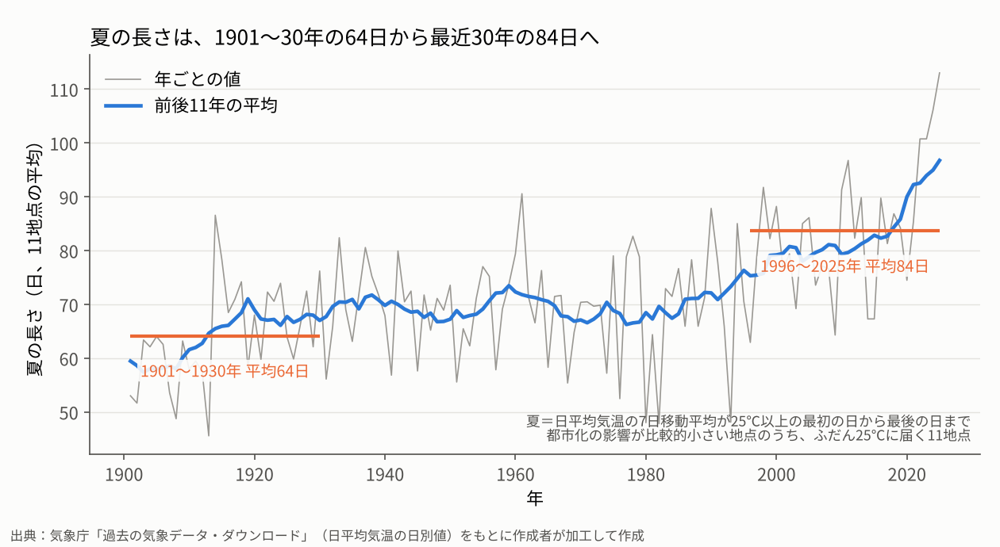
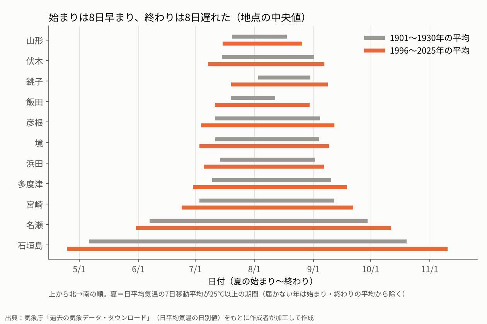
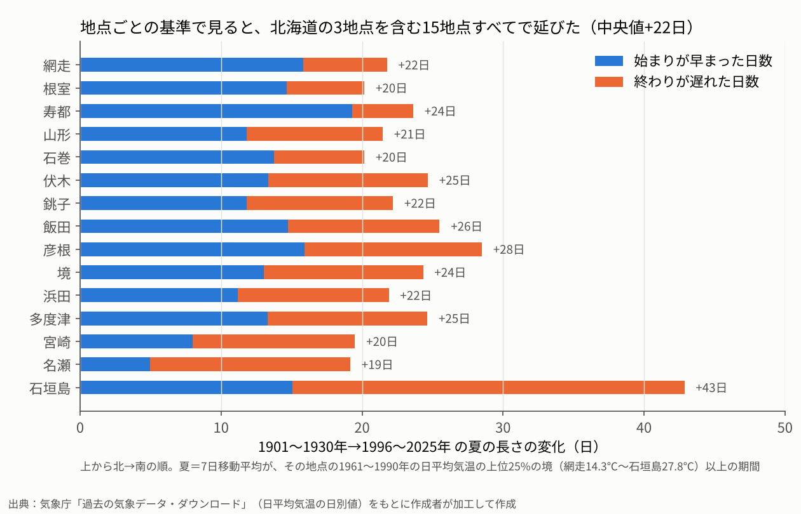
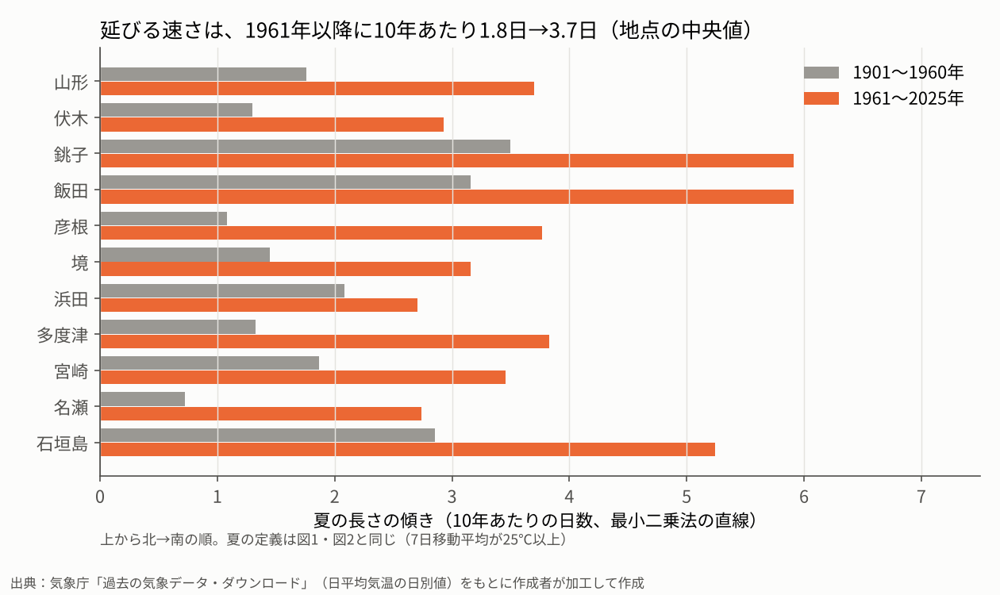

# F498 夏は、長くなったのか？ 日平均気温25℃の夏は1901〜30年と比べ最近30年で18日長く、始まりが8日早まり終わりが8日遅れた。1961年以降は延びる速さが2倍に

## 結論（先に）
- 都市化の影響が比較的小さい地点のうち、ふだん日平均気温25℃に届く11地点で、夏（7日移動平均が25℃以上の最初の日〜最後の日）の長さは、1901〜1930年→1996〜2025年 で地点の中央値 **+18.5日**。11地点すべてで延び、平均では64日→84日です。
- 延びた分は、**始まりの早まり（中央値 −8.3日）と終わりの遅れ（+8.2日）がほぼ半分ずつ**でした（中央値の日付で、始まり7月11日→7月4日、終わり9月4日→9月9日）。
- 延びる速さは、10年あたり1.8日（1901〜1960年）から **3.7日**（1961〜2025年）と2倍になりました（地点の中央値）。2025年の113日は1901年以降で最長です。
- 地点ごとの基準（その地点のふだんの気温の上位25%）で見ると、25℃に届かない網走・根室・寿都を含む15地点すべてで夏が延びました（中央値 +22.2日）。
- 問い直し：延びた日数は、6〜9月の気温の上がり（1.46℃）と「暑い年ほど夏が長い」関係（1℃あたり約16日）からの見込みの0.86倍（中央値）で、気温の上がり方以上に延びた形は見えません。

## 問い
「夏が長くなった」とよく言われます。季節の切り替わりで売り物や段取りが変わる仕事（衣料・飲料・冷房の機器など）、行事や屋外の作業の時期を決める人が知りたいのは、暑い日の数だけでなく、**夏がいつ始まり、いつ終わるようになったか**です。

猛暑日（F168）・熱帯夜（F489）・冬日（F490）の「数」は別の記事で扱いました。この記事では夏の「期間」を、始まり・終わり・長さに分けて見て、延びたのはどちらの側か、延びる速さは変わったかを確かめます。

## データ（出典）
- 気象庁「過去の気象データ・ダウンロード」の日平均気温（日別値）、1901〜2025年。
  - 本線：気象庁が日本の平均気温の変化を求めるのに使う、都市化の影響が比較的小さい15地点（網走・根室・寿都・山形・石巻・伏木・飯田・銚子・境・浜田・彦根・多度津・宮崎・名瀬・石垣島）。
  - 比べ用：大都市11地点（札幌・仙台・東京・横浜・名古屋・京都・大阪・神戸・広島・福岡・鹿児島）。
- 照合用：同じ15地点の「過去の気象データ検索」年ごとの値（日平均気温25℃以上の日数）。
- 品質が正常値・準正常値の日だけを使い、4〜11月に欠けが6日以上ある年は除きました（29地点年。うち26は仙台）。
- 取得日：2026-11-18。data/raw に gzip で同梱しています（4.7MB、一覧は SOURCES.md）。

**夏の決め方（本線）**：日平均気温の7日移動平均（その日を中心にした7日の平均。1日だけの暑さで決めないため）が25℃以上の、その年の最初の日を始まり、最後の日を終わりとし、その間の日数を長さとしました。1961〜1990年の9割以上の年で25℃に届く11地点を使いました（網走・根室・寿都・石巻は外れました）。届かない年の長さは0日とし、始まり・終わりの平均からは除きました。

## 事前の計画
[PLAN.md](PLAN.md)（2026-11-18 20:26、集計の前に作成）。下見では、取得の確かめで冬の数日分の値を見ただけでした。

| 仮説 | 外れの基準 | 結果 | 判定 |
|---|---|---|---|
| H1 本線の地点で夏の長さが +10日以上（中央値） | +10日未満 | +18.5日（11地点すべてで延びた） | 支持 |
| H2 延びは始まりの早まりより終わりの遅れのほうが大きい | 始まりの早まりが同じか大きい | 始まり −8.3日、終わり +8.2日 | 外れ（ほぼ同じ） |
| H3 地点ごとの基準でも中央値 +7日以上、北の3地点も延びる | +7日未満、または北の3地点の中央値が0日以下 | 15地点の中央値 +22.2日、北の3地点 +20.2〜+23.6日 | 支持 |
| H4 1961〜2025年の傾きは1901〜1960年の2倍以上 | 2倍未満 | 1.76日 → 3.70日（10年あたり、2.1倍） | 支持 |

H2 は外れました。計画のときは「秋が遅れて夏が延びた」形を予想していましたが、始まりと終わりはほぼ同じ日数だけ動いていました。

## やったこと
1. 地点・年ごとに夏の始まり・終わり・長さを出し（うるう年は3月以降を1日ずらす）、1901〜1930年と1996〜2025年の30年平均の差の中央値を出しました。
2. 長さの傾き（10年あたり）を最小二乗法と Theil–Sen（外れ値に強い推定）で、1901〜1960年・1961〜2025年に分けても出しました。
3. 地点ごとの基準（1961〜1990年の日平均気温の上位25%の境。網走14.3℃〜石垣島27.8℃）でも同じ手順で出しました。
4. 日別値から数えた25℃以上の日数を、年ごとの値のページの数と照らし合わせました（欠けのない1,841地点年で全部一致）。

地点は北から南の順に示し、順位は作っていません。

## 分かったこと

### 図1：夏の長さは、64日から84日へ


- 11地点の平均の夏の長さは、1901〜1930年が64.1日、1996〜2025年が83.6日でした。
- 1960年ごろまでに少し延び、1960〜1980年代は横ばいで、1990年代から再び延びています。
- 2022〜2025年は4年続けて100日を超え、2025年の113日は1901年以降で最長です。

### 図2：始まりは8日早まり、終わりは8日遅れた


- 地点の中央値で、始まりは −8.3日、終わりは +8.2日動きました。
- 11地点すべてで、始まりは早まり、終わりは遅れています。
- 始まりと終わりの動きを足すと16.5日で、長さの延び（18.5日）より少し小さくなります。昔は25℃に届かない年（長さ0日）が山形・銚子・飯田などで時々あり、その年は長さには0日として入る一方、始まり・終わりの平均には入らないためです。
- 石垣島では終わりが22日遅れ、終わりの側の動きが大きい地点です。

### 図3：北の地点でも、地点ごとの基準では夏が延びた


- 25℃に届かない北の地点も入れるため、「その地点のふだんの気温の上位25%」を基準にしました。
- 15地点すべてで夏が延び（中央値 +22.2日）、北の3地点も +20.2〜+23.6日でした。
- 北の3地点は、始まりの早まり（−15〜−19日）のほうが終わりの遅れより大きい形でした。

### 図4：延びる速さは、1961年以降に2倍


- 1901〜1960年の傾きは10年あたり1.76日、1961〜2025年は3.70日でした（地点の中央値）。
- 11地点すべてで、1961年以降の傾きのほうが大きくなっています。
- 1901〜2025年を通した傾きは、最小二乗法で1.74日、Theil–Sen で1.64日（10年あたり）でした。

## 問い直し（結果を見てから足した）
夏の長さは、6〜9月の気温が上がれば自然に延びるはずです。そこで「延び方は、気温の上がり方から見込まれる分より大きいのか」を確かめました。

- 地点ごとに、長期の傾きを除いた年ごとの上下どうしで「6〜9月の平均気温が1℃高い年は、夏が何日長いか」を当てはめました。中央値は1℃あたり15.7日でした。
- 6〜9月の平均気温の上がり（中央値1.46℃）に掛けた「見込みの延び」は中央値22.7日、実際は18.5日で、比は中央値0.86（0.53〜3.57）でした。
- 夏の延び方は気温の上がり方からの見込みに収まり、それ以上に延びた形は見えません。大きく外れたのは石垣島（3.57）です。
- ただし、6〜9月の気温は夏の長さと同じ日々の気温から作るので、この比は「原因」を示すものではなく、2つの数字が互いに矛盾しないかの確かめです。

## 頑健性

| 確かめ | 地点数 | 長さの変化（中央値） | 始まり | 終わり | 結論は変わったか |
|---|---|---|---|---|---|
| 本線（7日移動平均・25℃） | 11 | +18.5日 | −8.3日 | +8.2日 | — |
| 移動平均を15日 | 9 | +16.5日 | −9.2日 | +7.5日 | 変わらない |
| しきい値24℃ | 12 | +19.7日 | −9.4日 | +8.9日 | 変わらない |
| しきい値26℃ | 9 | +20.6日 | −10.5日 | +10.3日 | 変わらない |
| 地点ごとの基準（上位25%） | 15 | +22.2日 | −13.4日 | +10.8日 | 変わらない（始まりの側がやや大きい） |
| 地点ごとの基準・15日移動平均 | 15 | +21.9日 | −13.0日 | +9.3日 | 変わらない |
| 比べる前の期間を1931〜1960年 | 11 | +13.8日 | −6.4日 | +7.4日 | 幅は小さいが延びた |
| 比べる前の期間を1961〜1990年 | 11 | +12.0日 | −6.6日 | +7.7日 | 幅は小さいが延びた |
| 大都市（比べ用） | 10 | +24.7日 | −14.3日 | +10.5日 | 大都市はより大きく延びた |
| 傾きの推定を Theil–Sen | 11 | 10年あたり1.64日（最小二乗法 1.74日） | — | — | 変わらない |

- どの定義でも延びは +12日以上でした。「終わりの側が主」という形はどの定義でも出ていません。
- 大都市（札幌は25℃に届く年が少なく除外）は +24.7日と大きく、都市化の上乗せがあるのかもしれません（推測。地点の場所が違うので分けられません）。

## 言えないこと
- 夏が延びた原因（地球全体の温暖化、残っている都市化の影響、自然の変動）は分けていません。都市化の影響が小さい地点でも、ゼロではありません。
- 「夏」の決め方は一つではありません。ここでの夏は日平均気温で決めたもので、暦の夏や体感の夏とは違います。決め方を変えると日数は12〜22日の範囲で動きます。
- 観測場所の移転や測り方の変化の影響は分けていません。
- 15地点のない場所（内陸の盆地、山間部、都市の中心部など）のことは、この記事からは言えません。
- 仕事や暮らしへの影響の大きさは扱っていません。
- 2025年の113日が今後も続くかどうかは、この分析からは言えません。

## 仕事で使うなら
- 夏の期間は、100年前と比べて「始まりが1週間ほど前に、終わりが1週間ほど後ろに」ずれた、というのが数字の目安です。
- 1年ごとのぶれは大きく、平均の変化だけで個々の年を決めることはできません。

## 計画からの変更
- 大きな変更はありません。
- 問い直しは候補から「6〜9月の気温1℃あたりの日数」を選びました。

## 再現のしかた
```
sh src/run_all.sh        # オフライン。所要約11秒（CPU 1つ）
python3 src/01_fetch.py  # 元データを取り直すときだけ（ネットを使う）
```

| ファイル | 中身 |
|---|---|
| src/01_fetch.py | 取得（run_all.sh からは呼ばない） |
| src/02_build.py | data/raw → data/daily_summary.csv ほか |
| src/03_analysis.py | 差・傾き・仮説・頑健性・照合 → results/main.json ほか |
| src/03b_requestion.py | 問い直し → results/requestion.json・requestion.csv |
| src/04_figures.py | 図4枚 |

repro_check：/tmp に写し、02 以降が作るファイルを消して流すと、15ファイル（results 8、figures 4、data 3）がすべて cmp で一致（results/repro_check.txt）。乱数は使っていません。

## レビューで直したこと
| # | 指摘 | 直し方 |
|---|---|---|
| 1 | 結論の年の順が results と違った | 「2025年が最長」とした |
| 2 | 日別値の1901年1月1日を読み飛ばしていた。直すと移動平均の計算誤差で「ちょうど25.0℃」の扱いが変わった | 読み始めを直し、移動平均を丸めて比べた。北の3地点・問い直し・頑健性の値が0.1〜0.3日動いた（主な結果は同じ） |

## 出典
- 気象庁「過去の気象データ・ダウンロード」：https://www.data.jma.go.jp/risk/obsdl/index.php
- 気象庁「過去の気象データ検索」：https://www.data.jma.go.jp/stats/etrn/index.php （各地点の URL は data/raw/SOURCES.md）
- 気象庁「大都市及び都市化の影響が比較的小さいとみられる15地点平均の年平均気温偏差の経年変化」：https://www.data.jma.go.jp/cpdinfo/himr/himr_temp_diff.html

（いずれも 気象庁「過去の気象データ・ダウンロード」「過去の気象データ検索」をもとに作成者が加工して作成）
